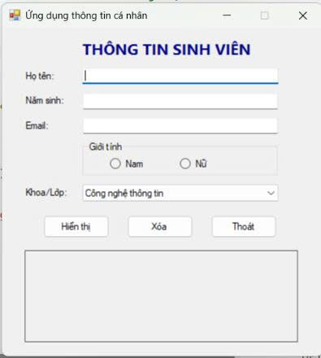
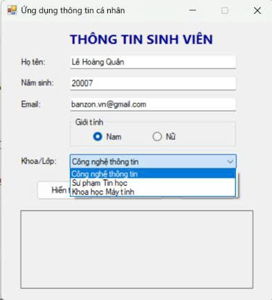
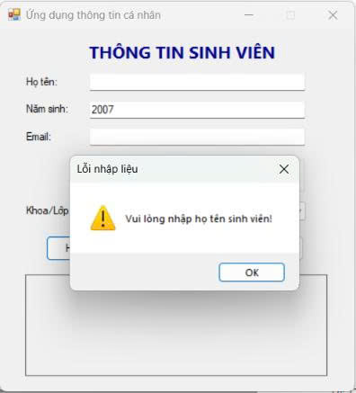
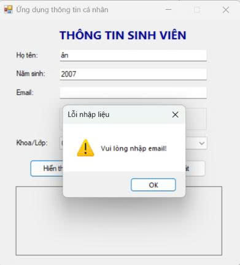
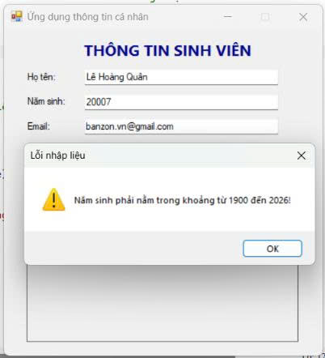
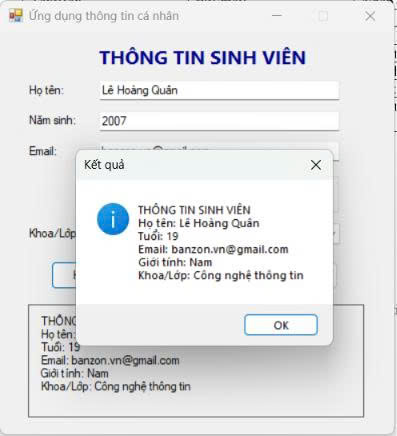
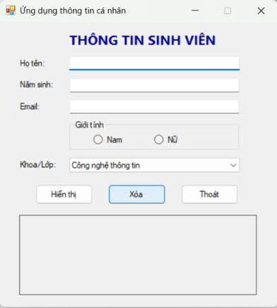
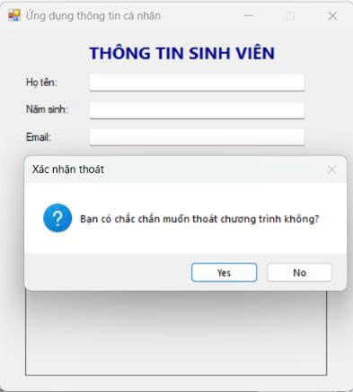

# COMP1019 - LẬP TRÌNH TRÊN WINDOWS

## BÀI LAB 01: ỨNG DỤNG THÔNG TIN CÁ NHÂN

- **Giảng viên hướng dẫn:** ThS. Lê Thanh Thoại
- **Sinh viên thực hiện:** Lê Hoàng Quân
- **Mã số sinh viên:** 51.01.104.082
- **Lớp:** 51.CNTT.A

---

## CHỨC NĂNG

### 1. Giao diện khi khởi chạy chương trình

Giao diện ứng dụng ban đầu với các trường nhập liệu trống, danh sách khoa được khởi tạo và con trỏ chuột tự động focus vào ô nhập họ tên.

_Mô tả: Form khởi động thành công với đầy đủ các control._

---

### 2. Danh sách lựa chọn Khoa/Lớp

Danh mục khoa được nạp sẵn ít nhất 3 lựa chọn để sinh viên chọn.

_Mô tả: ComboBox hiển thị các chuyên ngành gồm Công nghệ thông tin, Sư phạm Tin học và Khoa học Máy tính._

---

### 3. Kiểm tra tính hợp lệ dữ liệu (Validation)

- **Trường hợp 1: Họ tên để trống**

  

  _Mô tả: Xuất cảnh báo `Vui lòng nhập họ tên sinh viên!` khi chưa điền họ tên._

- **Trường hợp 2: Email để trống**

  

  _Mô tả: Xuất cảnh báo `Vui lòng nhập email!` khi bỏ sót thông tin email._

- **Trường hợp 3: Năm sinh không hợp lệ**

  

  _Mô tả: Khi nhập năm sinh `20007`, hệ thống phát hiện lỗi ngoài khoảng cho phép và báo `Năm sinh phải nằm trong khoảng từ 1900 đến 2026!`._

---

### 4. Kết quả hiển thị khi nhập đúng thông tin

Khi dữ liệu hợp lệ (Họ tên: `Lê Hoàng Quân`, Năm sinh: `2007`, Email: `banzon.vn@gmail.com`, Giới tính: `Nam`, Khoa: `Công nghệ thông tin`), chương trình tính tuổi (`19`) và hiển thị kết quả lên cả `MessageBox` lẫn vùng kết quả trên Form.

_Mô tả: Hiển thị đầy đủ thông tin sinh viên và tuổi được tính chính xác._

---

### 5.5. Chức năng Xóa dữ liệu (Clear Form)

Sau khi nhấn nút **Xóa**, toàn bộ ô nhập liệu, giới tính và kết quả được đưa về trạng thái rỗng ban đầu.

_Mô tả: Dữ liệu được làm sạch, sẵn sàng cho lần nhập tiếp theo._

---

### 5.6. Xác nhận khi đóng chương trình

Nhấn nút **Thoát**, một hộp thoại xác nhận xuất hiện giúp tránh việc vô tình tắt ứng dụng.

_Mô tả: Hộp thoại xác nhận với hai nút lựa chọn Yes / No._

---
