# COMP1019 - LẬP TRÌNH TRÊN WINDOWS

## BUỔI 2 - LAB 02: C# CƠ BẢN - QUẢN LÝ MẢNG SỐ NGUYÊN BẰNG CONSOLE

- **Sinh viên thực hiện:** Lê Hoàng Quân
- **Mã số sinh viên:** 51.01.104.082
- **Lớp:** 51.CNTT.A
- **Môi trường:** .NET / C# Console App, Microsoft Visual Studio

---

## 3. Kết quả thực nghiệm và minh chứng chức năng

### 3.1. Giao diện Menu chính

Menu hiển thị đầy đủ 7 chức năng nghiệp vụ kèm tùy chọn thoát (0).

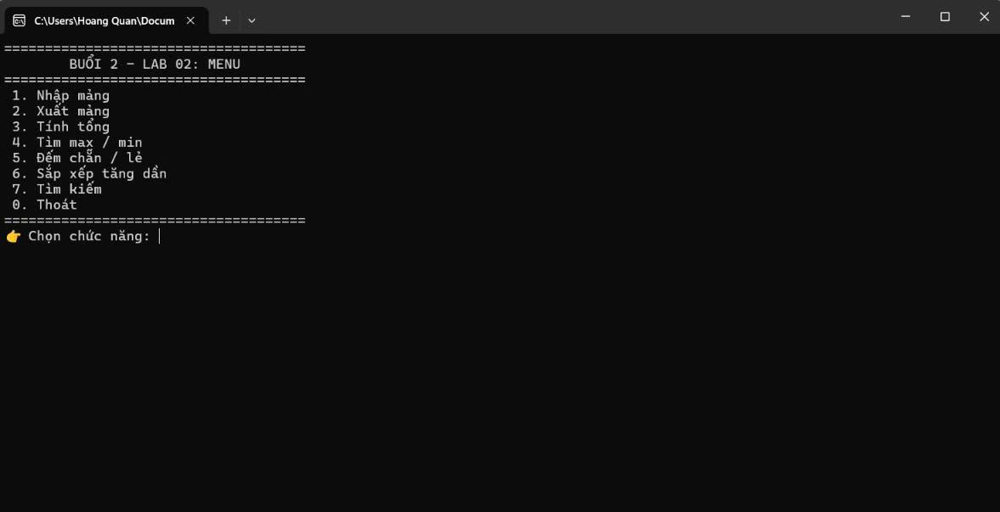

_Mô tả: Giao diện Menu khởi đầu của chương trình._

---

### 3.2. Chức năng 1: Nhập mảng

Nhập số lượng phần tử $n = 5$ và lần lượt các giá trị: `1, 2, 3, 4, 5`.

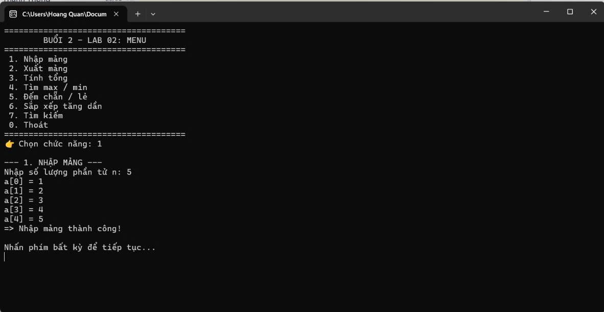

_Mô tả: Nhập thành công mảng 5 phần tử._

---

### 3.3. Chức năng 2: Xuất mảng

Hiển thị tất cả các phần tử hiện có trong mảng ra màn hình console.

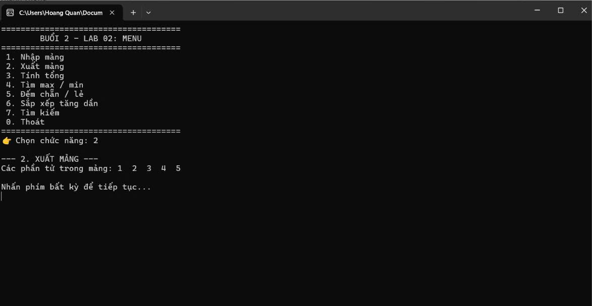

_Mô tả: Xuất các phần tử `1  2  3  4  5`._

---

### 3.4. Chức năng 3: Tính tổng

Tính tổng các giá trị trong mảng: $1 + 2 + 3 + 4 + 5 = 15$.

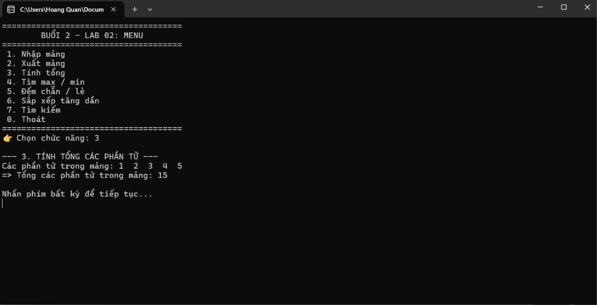

_Mô tả: Kết quả tính tổng hiển thị chính xác là 15._

---

### 3.5. Chức năng 4: Tìm lớn nhất (Max) và nhỏ nhất (Min)

Quét mảng và trả về giá trị lớn nhất ($Max = 5$) cùng giá trị nhỏ nhất ($Min = 1$).

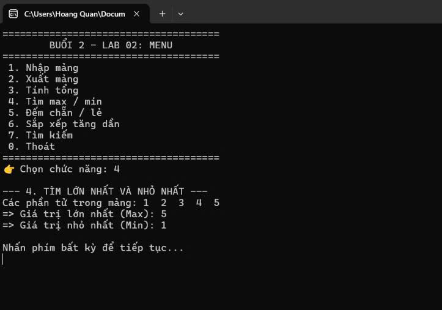

_Mô tả: Giá trị lớn nhất là 5, giá trị nhỏ nhất là 1._

---

### 3.6. Chức năng 5: Đếm số lượng chẵn / lẻ

Phân loại và đếm số lượng:

- Số chẵn: $2, 4 \rightarrow 2$ phần tử
- Số lẻ: $1, 3, 5 \rightarrow 3$ phần tử

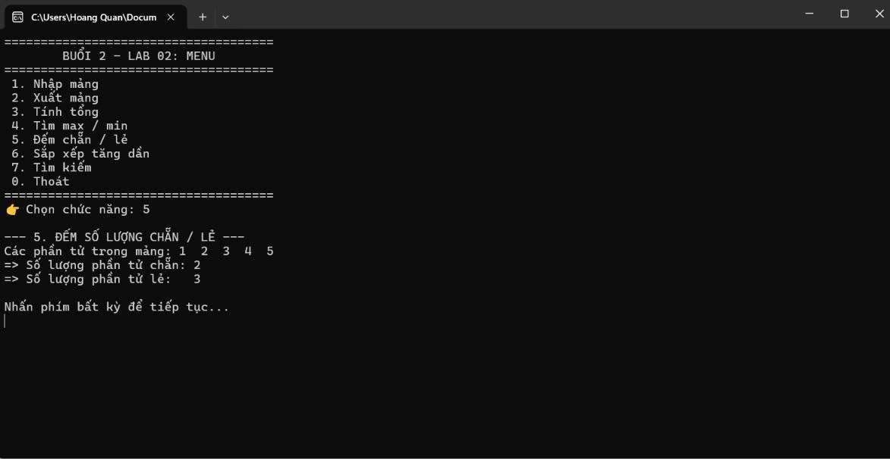

_Mô tả: Đếm chính xác 2 phần tử chẵn và 3 phần tử lẻ._

---

### 3.7. Chức năng 6: Sắp xếp tăng dần

Hiển thị trạng thái mảng trước và sau khi thực hiện sắp xếp nổi bọt (Bubble Sort).

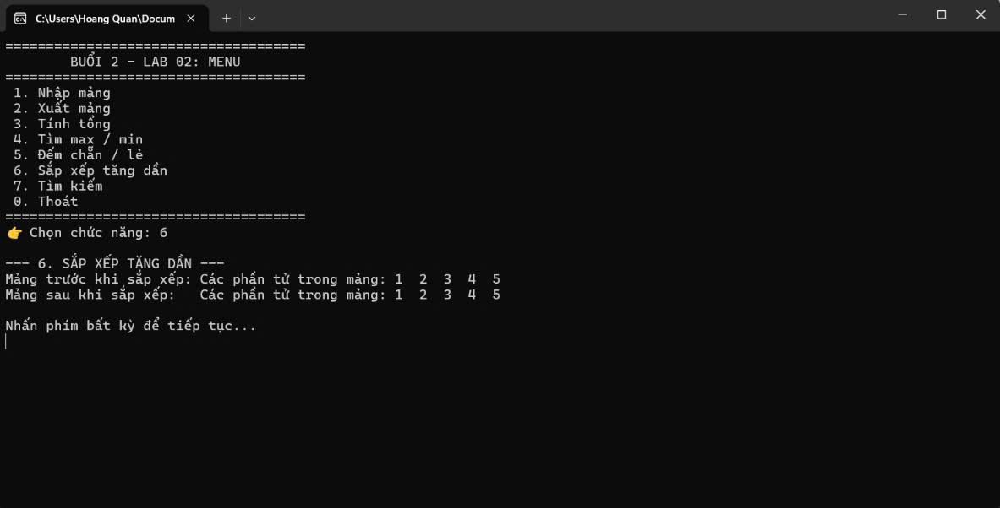

_Mô tả: Mảng sau khi sắp xếp đúng thứ tự tăng dần `1  2  3  4  5`._

---

### 3.8. Chức năng 7: Tìm kiếm phần tử (Trường hợp tìm thấy)

Nhập giá trị cần tìm $x = 5$. Chương trình quét mảng và trả về vị trí index đầu tiên tìm thấy.

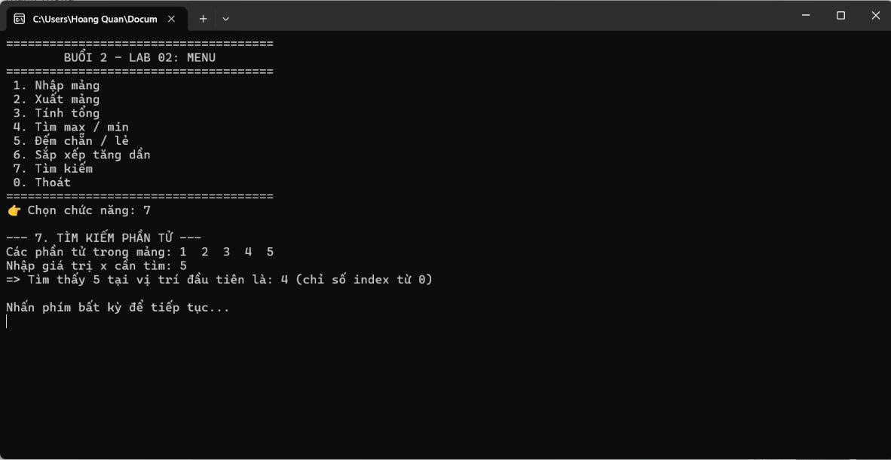

_Mô tả: Tìm thấy giá trị 5 tại vị trí index thứ 4 trong mảng._

---

### 3.9. Kiểm tra lỗi chọn Menu không hợp lệ

Khi người dùng nhập chức năng nằm ngoài phạm vi $0 - 7$ (ví dụ chọn `8`), hệ thống xuất cảnh báo đỏ và cho phép nhập lại mà không bị dừng chương trình đột ngột.

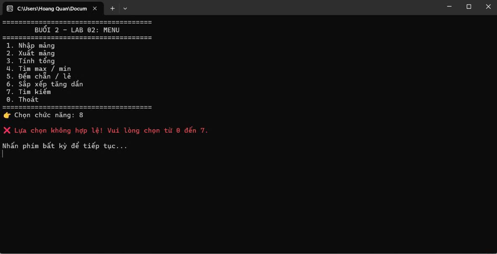

_Mô tả: Báo lỗi "Lựa chọn không hợp lệ! Vui lòng chọn từ 0 đến 7." khi nhập chức năng 8._

---

### 3.10. Kiểm tra ràng buộc dữ liệu đầu vào (Validation)

- Nhập $n = 0$: Báo lỗi yêu cầu $n$ phải là số nguyên dương ($> 0$).
- Nhập chuỗi sai định dạng số nguyên cho phần tử: Báo lỗi và yêu cầu nhập lại đúng giá trị cho phần tử đó.

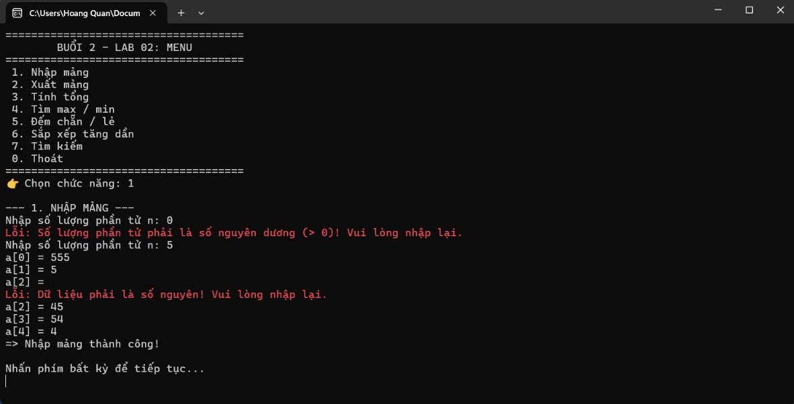

_Mô tả: Xử lý ngoại lệ chống crash khi nhập sai $n$ và nhập sai kiểu dữ liệu phần tử._

---

### 3.11. Chức năng 7: Tìm kiếm phần tử (Trường hợp không tìm thấy)

Nhập giá trị $x = 0$ cần tìm trong mảng `555  5  45  54  4`. Chương trình duyệt hết mảng và thông báo không tìm thấy giá trị.

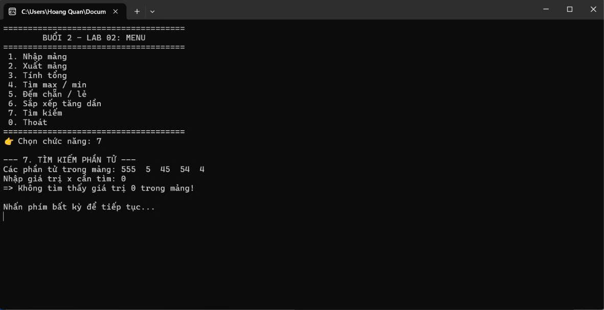

_Mô tả: Thông báo rõ ràng "Không tìm thấy giá trị 0 trong mảng!"._

---
