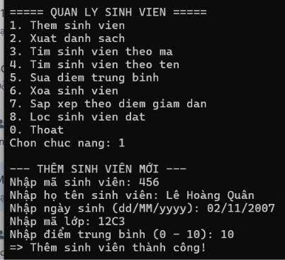
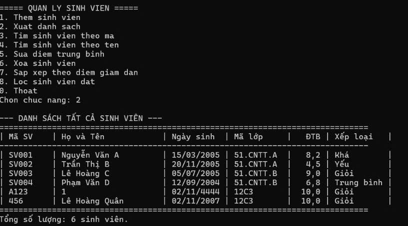
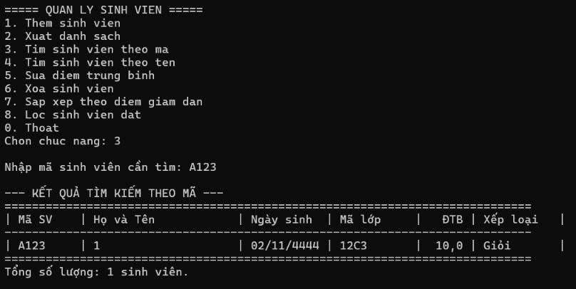
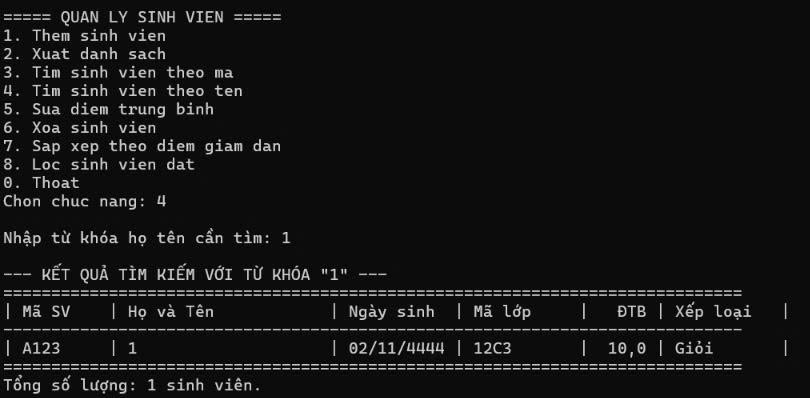
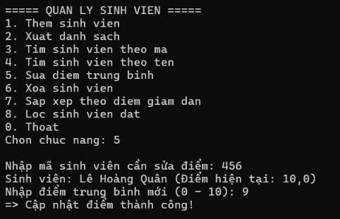
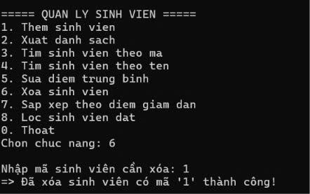
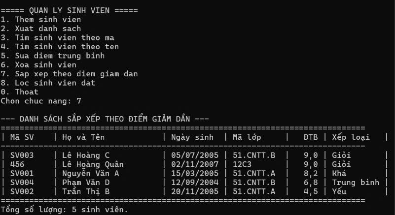
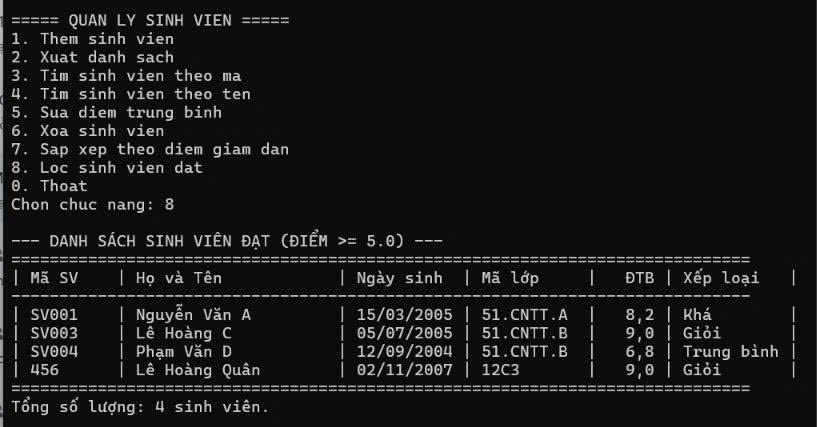

# COMP1019 - LẬP TRÌNH TRÊN WINDOWS

## BÀI LAB 03: C# VÀ LẬP TRÌNH HƯỚNG ĐỐI TƯỢNG – QUẢN LÝ SINH VIÊN BẰNG CONSOLE

- **Giảng viên hướng dẫn:** ThS. Lê Thanh Thoại
- **Sinh viên thực hiện:** Lê Hoàng Quân
- **Mã số sinh viên:** 51.01.104.082
- **Lớp:** 51.CNTT.A

---

## 5. Kết quả thực nghiệm & Minh họa chức năng

### 5.1. Thêm sinh viên mới từ bàn phím (Chức năng 1)

Nhập đầy đủ thông tin sinh viên hợp lệ: Mã SV `456`, Họ tên `Lê Hoàng Quân`, Ngày sinh `02/11/2007`, Lớp `12C3`, Điểm `10`.

_Mô tả: Hệ thống tiếp nhận dữ liệu và thông báo `=> Thêm sinh viên thành công!`._

---

### 5.2. Xuất toàn bộ danh sách sinh viên (Chức năng 2)

Danh sách được hiển thị dưới dạng bảng ngay ngắn, tự động tính cột xếp loại theo thang điểm.

_Mô tả: Bảng hiển thị đầy đủ thông tin 6 sinh viên đã có trong hệ thống._

---

### 5.3. Tìm kiếm sinh viên theo mã (Chức năng 3)

Nhập mã sinh viên `A123` để tra cứu thông tin chính xác.

_Mô tả: Trích xuất và hiển thị thông tin sinh viên có mã tương ứng dạng bảng._

---

### 5.4. Tìm kiếm sinh viên theo tên (Chức năng 4)

Nhập từ khóa tìm kiếm `"1"`, chương trình lọc ra tất cả sinh viên có họ tên chứa ký tự này.

_Mô tả: Kết quả tìm kiếm hiển thị các sinh viên thỏa mãn từ khóa tìm kiếm._

---

### 5.5. Cập nhật sửa điểm trung bình (Chức năng 5)

Nhập mã sinh viên `456`, chương trình hiển thị tên cùng điểm hiện tại (`10,0`), sau đó cho phép cập nhật điểm mới thành `9`.

_Mô tả: Điểm số được cập nhật thành công vào bộ nhớ (`=> Cập nhật điểm thành công!`)._

---

### 5.6. Xóa sinh viên khỏi danh sách (Chức năng 6)

Nhập mã sinh viên cần xóa `1`. Hệ thống tìm kiếm theo mã và thực hiện xóa sinh viên ra khỏi bộ nhớ danh sách.

_Mô tả: Thông báo xác nhận xóa thành công `=> Đã xóa sinh viên có mã '1' thành công!`._

---

### 5.7. Sắp xếp danh sách theo điểm giảm dần bằng LINQ (Chức năng 7)

Áp dụng LINQ để sắp xếp lại thứ tự sinh viên theo điểm từ cao nhất xuống thấp nhất.

_Mô tả: Sinh viên có điểm số cao nhất hiển thị ở đầu bảng, thứ tự giảm dần chính xác._

---

### 5.8. Lọc danh sách sinh viên đạt (Điểm >= 5.0) bằng LINQ (Chức năng 8)

Lọc và xuất các sinh viên có điểm trung bình từ `5.0` trở lên thông qua phương thức `Where()` của LINQ.

_Mô tả: Kết quả lọc hiển thị 4 sinh viên đạt chuẩn (SV001, SV003, SV004 và 456 - Lê Hoàng Quân), sinh viên SV002 có ĐTB 4,5 đã được lọc bỏ chính xác._

---
