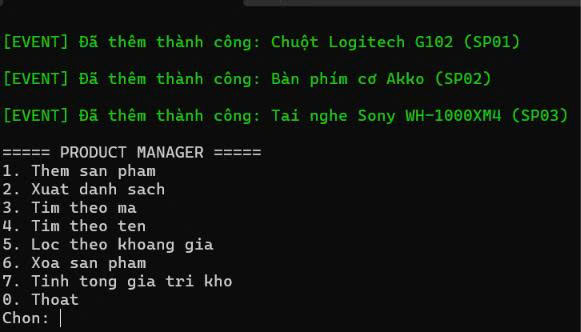
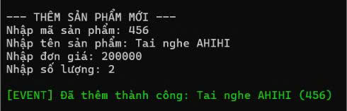
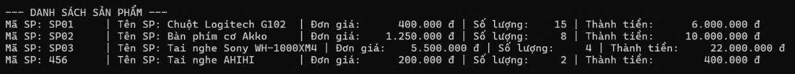
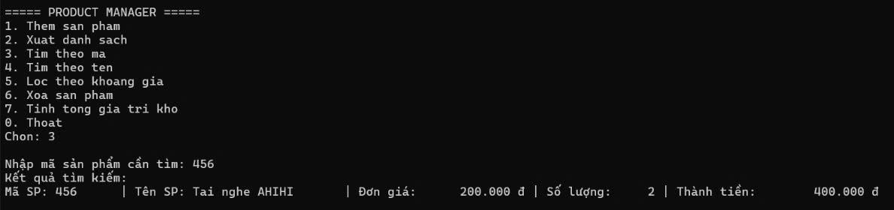
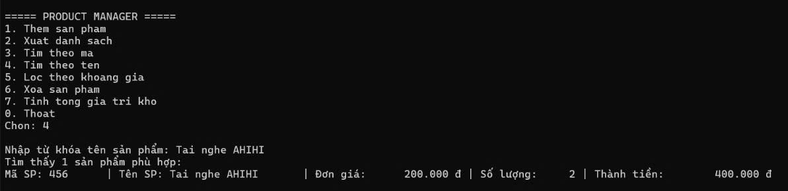
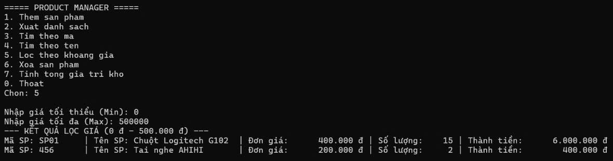
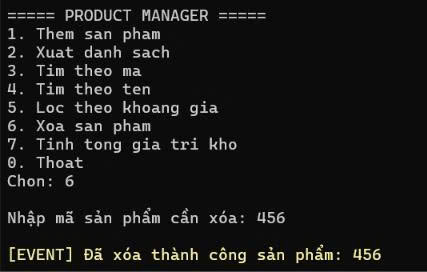
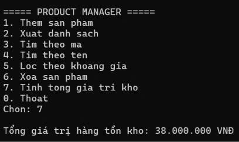
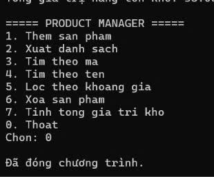

# COMP1019 - LẬP TRÌNH TRÊN WINDOWS

## BUỔI 4 - LAB 04: EXCEPTION, DELEGATE/EVENT, FUNC/ACTION VÀ GENERIC TRONG C#

- **Sinh viên thực hiện:** Lê Hoàng Quân
- **Mã số sinh viên:** 51.01.104.082
- **Lớp:** 51.CNTT.A
- **Môi trường phát triển:** .NET / C# Console App, Microsoft Visual Studio

---

## 4. Kết quả thực nghiệm & Minh chứng chức năng

### 4.1. Khởi động chương trình & Tải dữ liệu mẫu

Khi khởi động, hệ thống nạp sẵn dữ liệu mẫu ban đầu và kích hoạt sự kiện `[EVENT]` thông báo thêm thành công lên màn hình Console, sau đó hiển thị Menu chính.

_Mô tả: Phát event nạp 3 sản phẩm mẫu ban đầu và hiển thị Menu Product Manager._

---

### 4.2. Chức năng 1: Thêm sản phẩm mới

Nhập thông tin sản phẩm mới:

- Mã SP: `456`
- Tên SP: `Tai nghe AHIHI`
- Đơn giá: `200.000 đ`
- Số lượng: `2`
- Kích hoạt sự kiện: `[EVENT] Đã thêm thành công: Tai nghe AHIHI (456)`

_Mô tả: Nhập sản phẩm và kích hoạt Event thông báo thêm thành công._

---

### 4.3. Chức năng 2: Xuất danh sách sản phẩm

Xuất toàn bộ 4 sản phẩm hiện có trong kho hàng kèm định dạng tiền tệ và tính toán thành tiền chi tiết.

_Mô tả: Danh sách sản phẩm đầy đủ thông tin mã, tên, đơn giá, số lượng, thành tiền._

---

### 4.4. Chức năng 3: Tìm kiếm sản phẩm theo mã

Nhập mã `456`, hệ thống sử dụng phương thức `FindById` trong Generic Repository để trả về kết quả sản phẩm `Tai nghe AHIHI`.

_Mô tả: Tìm thấy chính xác sản phẩm theo mã 456._

---

### 4.5. Chức năng 4: Tìm kiếm theo tên sản phẩm

Nhập từ khóa `Tai nghe AHIHI`, hệ thống tìm kiếm và hiển thị 1 sản phẩm phù hợp.

_Mô tả: Tìm thấy sản phẩm chứa từ khóa tên cần tìm._

---

### 4.6. Chức năng 5: Lọc theo khoảng giá (Sử dụng `Func<Product, bool>`)

Nhập khoảng giá tìm kiếm:

- Giá tối thiểu (Min): `0`
- Giá tối đa (Max): `500.000`
- Kết quả lọc ra 2 sản phẩm thỏa điều kiện `p => p.Price >= min && p.Price <= max`:
  - `SP01 - Chuột Logitech G102` (400.000 đ)
  - `456 - Tai nghe AHIHI` (200.000 đ)

_Mô tả: Lọc sản phẩm theo khoảng giá bằng biểu thức Func._

---

### 4.7. Chức năng 6: Xóa sản phẩm

Nhập mã sản phẩm cần xóa: `456`. Hệ thống xóa sản phẩm khỏi Repository và kích hoạt event:
`[EVENT] Đã xóa thành công sản phẩm: 456`.

_Mô tả: Xóa sản phẩm và phát Event thông báo xóa thành công._

---

### 4.8. Chức năng 7: Tính tổng giá trị kho hàng

Sau khi đã xóa sản phẩm mã `456` (400.000 đ), tổng giá trị hàng tồn kho còn lại là:
$$6.000.000 + 10.000.000 + 22.000.000 = 38.000.000\,\text{VNĐ}$$

_Mô tả: Tính tổng giá trị toàn bộ kho hàng chính xác là 38.000.000 VNĐ._

---

### 4.9. Chức năng 0: Thoát chương trình

Chọn `0`, ứng dụng hiển thị thông báo `Đã đóng chương trình.` và kết thúc an toàn.

_Mô tả: Đóng chương trình an toàn._

---
