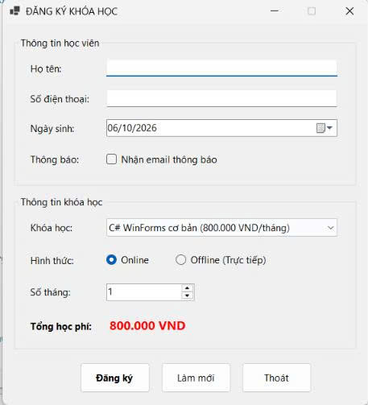
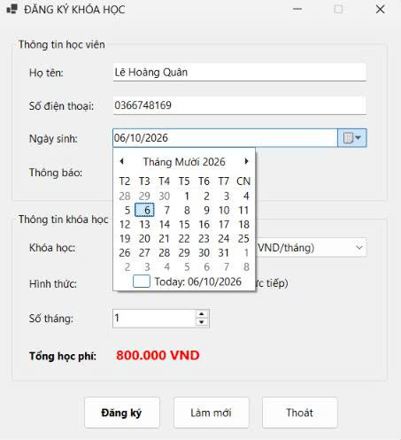
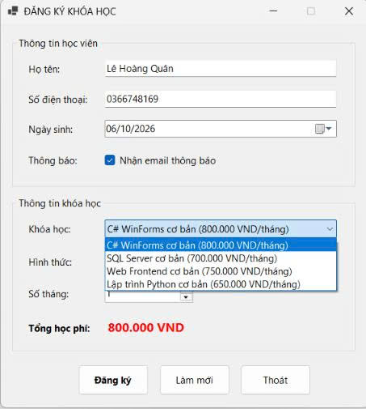
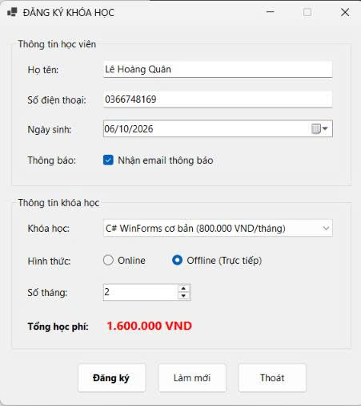
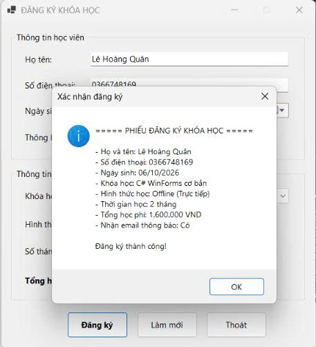
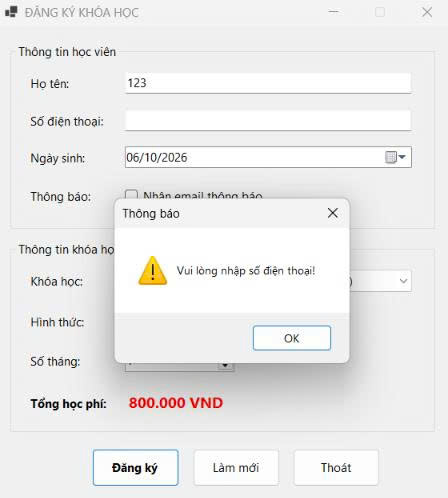
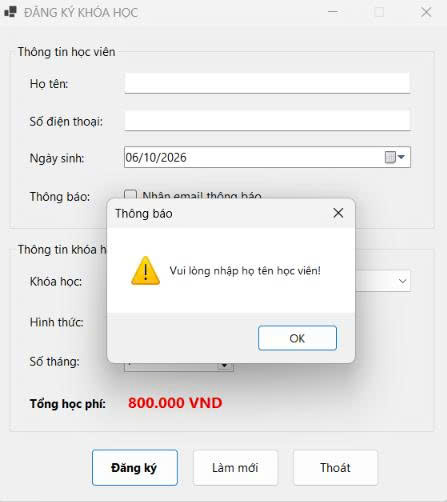
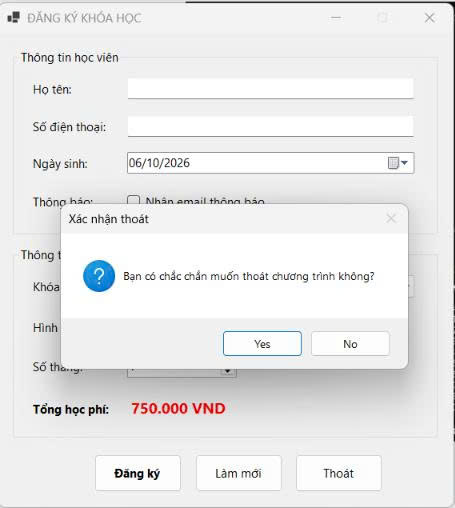

# COMP1019 - LẬP TRÌNH TRÊN WINDOWS

## BÀI LAB BUỔI 5: WINDOWS FORMS CƠ BẢN - ỨNG DỤNG ĐĂNG KÝ KHÓA HỌC (CourseRegistrationApp)

- **Giảng viên hướng dẫn:** ThS. Lê Thanh Thoại - Khoa Công nghệ Thông tin, HCMUE
- **Sinh viên thực hiện:** Lê Hoàng Quân
- **Mã số sinh viên:** 51.01.104.082
- **Lớp:** 51.CNTT.A
- **Môi trường phát triển:** .NET / C# Windows Forms App, Microsoft Visual Studio

---

## 4. Kết quả thực nghiệm & Minh chứng chức năng

### 4.1. Khởi tạo ứng dụng khi Form Load

Khi khởi động, ComboBox được nạp sẵn 4 khóa học, mặc định chọn khóa đầu tiên (_C# WinForms cơ bản_), hình thức mặc định là _Online_, số tháng mặc định là _1_ và tổng học phí ban đầu hiển thị là **800.000 VND**.

_Mô tả: Giao diện form khởi tạo chuẩn với các giá trị mặc định._

---

### 4.2. Chọn ngày sinh qua DateTimePicker

Hỗ trợ giao diện lịch trực quan để chọn chính xác ngày tháng năm sinh của học viên.

_Mô tả: Dropdown lịch hiển thị khi chọn ngày sinh._

---

### 4.3. Danh sách lựa chọn khóa học trong ComboBox

ComboBox hiển thị đầy đủ danh sách 4 khóa học kèm đơn giá từng tháng.

_Mô tả: Danh sách khóa học được nạp đầy đủ vào ComboBox._

---

### 4.4. Tự động tính học phí khi thay đổi thông tin

Khi thay đổi hình thức sang _Offline (Trực tiếp)_ và tăng số tháng đăng ký lên **2 tháng**, nhãn tổng học phí tự động cập nhật:
$$800.000 \times 2 = \mathbf{1.600.000\,\text{VND}}$$

_Mô tả: Tổng học phí tự động nhân theo số tháng đăng ký._

---

### 4.5. Đăng ký thành công & Xuất phiếu đăng ký

Khi nhập đầy đủ dữ liệu và nhấn nút **Đăng ký**, một hộp thoại `MessageBox` xuất hiện tổng hợp toàn bộ thông tin đăng ký khóa học của học viên.

_Mô tả: Hộp thoại xác nhận đăng ký thành công với đầy đủ các trường thông tin._

---

### 4.6. Kiểm tra hợp lệ: Bắt lỗi để trống số điện thoại

Nếu bỏ trống ô số điện thoại và bấm Đăng ký, hệ thống kích hoạt hộp thoại cảnh báo: `Vui lòng nhập số điện thoại!`.

_Mô tả: Cảnh báo khi người dùng không điền số điện thoại._

---

### 4.7. Kiểm tra hợp lệ: Bắt lỗi để trống họ tên học viên

Nếu bỏ trống ô họ tên học viên, hệ thống phát hiện lỗi và cảnh báo: `Vui lòng nhập họ tên học viên!`.

_Mô tả: Cảnh báo khi người dùng để trống họ tên._

---

### 4.8. Chức năng Thoát có xác nhận (Yes/No)

Nhấn nút **Thoát**, một hộp thoại hỏi `Bạn có chắc chắn muốn thoát chương trình không?` hiển thị giúp tránh việc vô tình tắt ứng dụng.

_Mô tả: Hộp thoại xác nhận trước khi đóng Form._

---
