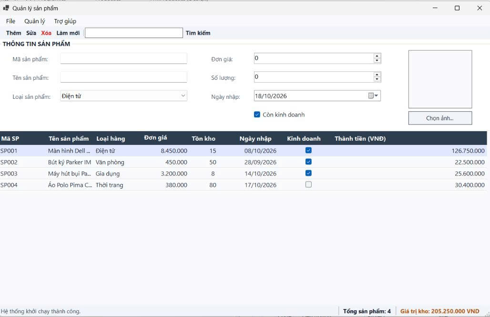
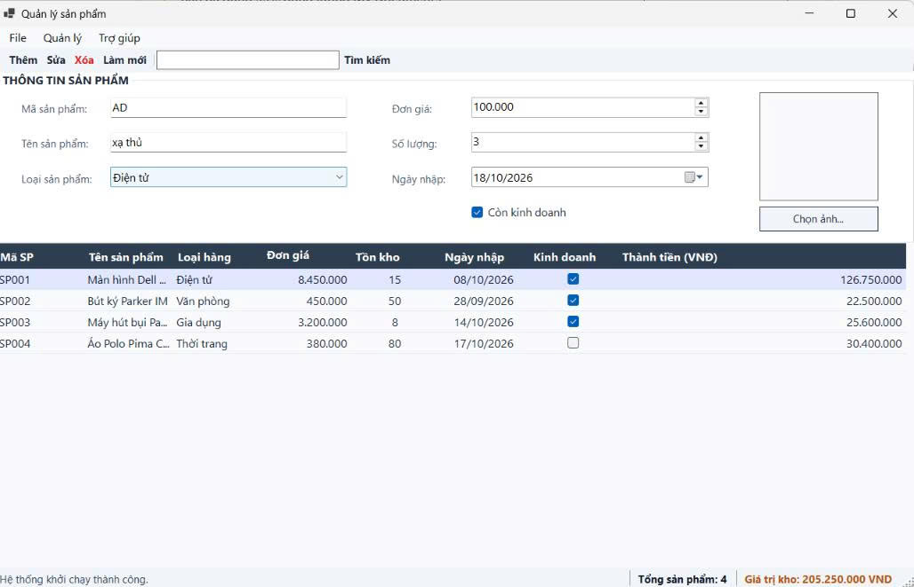
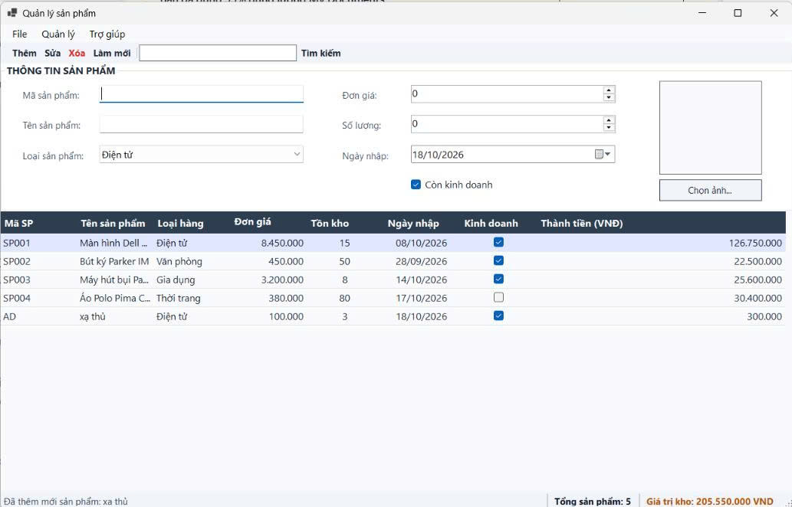
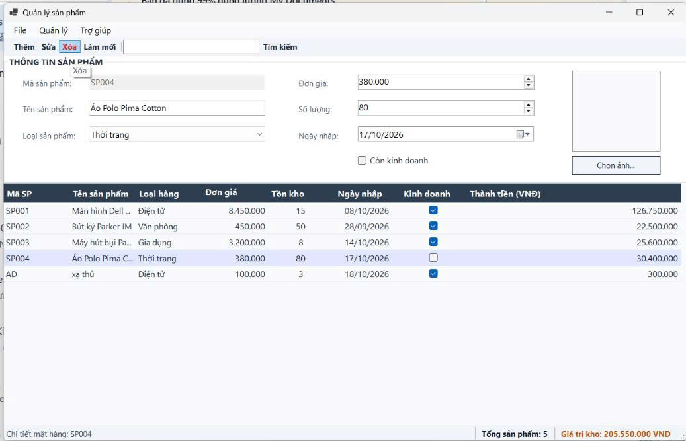
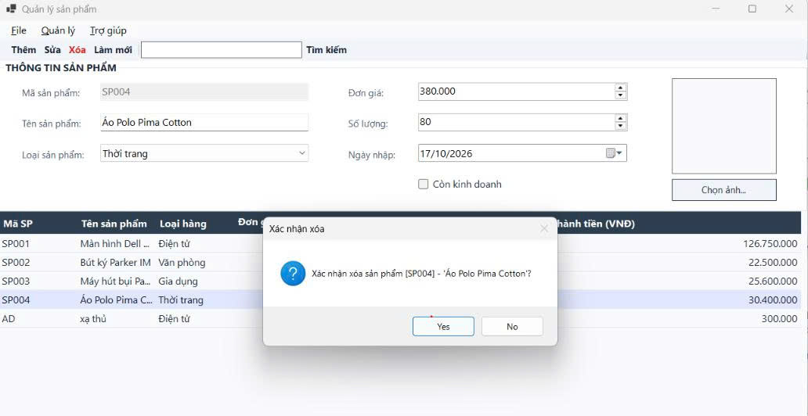
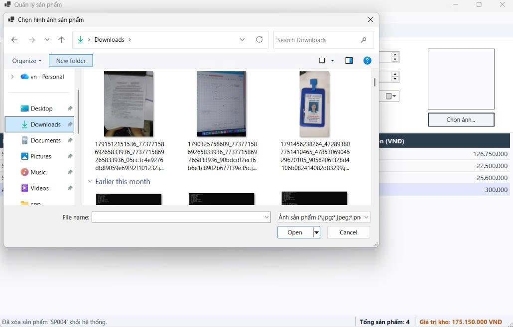
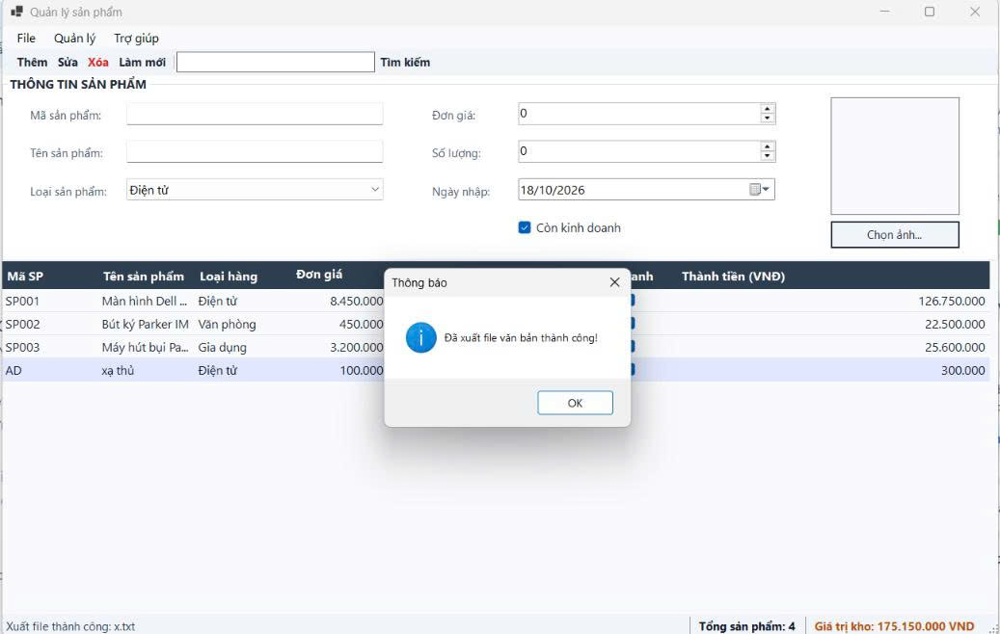

# COMP1019 - LẬP TRÌNH TRÊN WINDOWS

## BÀI LAB BUỔI 6: WINDOWS FORMS NÂNG CAO VÀ DATAGRIDVIEW - ỨNG DỤNG QUẢN LÝ SẢN PHẨM (ProductManager)

- **Giảng viên hướng dẫn:** ThS. Lê Thanh Thoại - Khoa Công nghệ Thông tin, HCMUE
- **Sinh viên thực hiện:** Lê Hoàng Quân
- **Mã số sinh viên:** 51.01.104.082
- **Lớp:** 51.CNTT.A
- **Môi trường phát triển:** .NET / C# Windows Forms App, Microsoft Visual Studio

---

## 1. Mục tiêu bài lab

- Thiết kế giao diện ứng dụng quản lý dữ liệu chuyên nghiệp bằng **Form Designer**, **Toolbox** và cửa sổ **Properties**.
- Xây dựng hệ thống điều hướng nâng cao chuẩn nghiệp vụ: `MenuStrip`, `ToolStrip`, `StatusStrip` và `ContextMenuStrip`.
- Hiển thị và quản lý danh sách đối tượng trực quan trên `DataGridView`.
- Thực hiện các thao tác CRUD dữ liệu trong bộ nhớ (`In-Memory`) thông qua kiến trúc liên kết hai chiều: `BindingList<T>` $\rightarrow$ `BindingSource` $\rightarrow$ `DataGridView`.
- Kiểm tra tính hợp lệ của dữ liệu nhập (Validation) bằng `ErrorProvider` kết hợp thông báo bằng `MessageBox`.
- Sử dụng các hộp thoại hệ thống: `OpenFileDialog` (chọn ảnh minh họa sản phẩm) và `SaveFileDialog` (xuất báo cáo danh sách ra file `.txt`).

---

## 2. Thiết kế giao diện & Danh sách Controls

Form chính có tên **`FrmProduct`**, tiêu đề: **`Quản lý sản phẩm`**, bố cục phân nhóm rõ ràng gồm các điều hướng, vùng nhập liệu và bảng dữ liệu:

| Nhóm                     |    Loại Control    | Tên Control (`Name`) | Chức năng / Mô tả                                       |
| :----------------------- | :----------------: | :------------------- | :------------------------------------------------------ |
| **Thanh Menu chính**     |    `MenuStrip`     | `mnuMain`            | Hệ thống menu gồm các nhóm: File, Quản lý, Trợ giúp     |
| **Thanh công cụ nhanh**  |    `ToolStrip`     | `tlsActions`         | Nút thao tác nhanh: Thêm, Sửa, Xóa, Làm mới và Tìm kiếm |
| **Thông tin sản phẩm**   |     `GroupBox`     | `grpProductInfo`     | Gom nhóm các control nhập liệu thông tin mặt hàng       |
|                          |     `TextBox`      | `txtMaSP`            | Nhập mã sản phẩm (Khóa khi sửa, bắt lỗi trống/trùng mã) |
|                          |     `TextBox`      | `txtTenSP`           | Nhập tên sản phẩm (Bắt lỗi không được để trống)         |
|                          |     `ComboBox`     | `cboLoaiSP`          | Chọn loại sản phẩm (Điện tử, Văn phòng, Gia dụng, ...)  |
|                          |  `NumericUpDown`   | `numDonGia`          | Nhập đơn giá sản phẩm (Bắt lỗi lớn hơn 0 VNĐ)           |
|                          |  `NumericUpDown`   | `numSoLuong`         | Nhập số lượng tồn kho (Bắt lỗi lớn hơn hoặc bằng 0)     |
|                          |  `DateTimePicker`  | `dtpNgayNhap`        | Chọn ngày nhập kho (Không lớn hơn ngày hiện tại)        |
|                          |     `CheckBox`     | `chkConKinhDoanh`    | Đánh dấu trạng thái còn kinh doanh hay ngừng kinh doanh |
|                          |    `PictureBox`    | `picProduct`         | Hiển thị hình ảnh xem trước của sản phẩm                |
|                          |      `Button`      | `btnSelectImage`     | Mở `OpenFileDialog` để chọn file ảnh sản phẩm           |
| **Hiển thị danh sách**   |   `DataGridView`   | `dgvProducts`        | Hiển thị danh sách sản phẩm dạng bảng                   |
|                          | `ContextMenuStrip` | `ctxGridMenu`        | Menu ngữ cảnh chuột phải trên grid (Sửa, Xóa, Chi tiết) |
| **Thanh trạng thái**     |   `StatusStrip`    | `stStrip`            | Hiển thị dòng trạng thái, tổng số lượng và tổng giá trị |
| **Kiểm tra & Hộp thoại** |  `ErrorProvider`   | `errValidator`       | Hiển thị biểu tượng báo lỗi ngay cạnh control nhập liệu |

---

## 3. Dữ liệu & Quy tắc xử lý nghiệp vụ

### 3.1. Cấu trúc đối tượng sản phẩm (`Product.cs`)

- **`MaSP`** (`string`): Mã sản phẩm (Khóa chính).
- **`TenSP`** (`string`): Tên sản phẩm.
- **`LoaiSP`** (`string`): Phân loại (Điện tử, Văn phòng, Gia dụng, Thời trang).
- **`DonGia`** (`decimal`): Đơn giá bán.
- **`SoLuong`** (`int`): Số lượng tồn kho.
- **`NgayNhap`** (`DateTime`): Ngày nhập hàng.
- **`ConKinhDoanh`** (`bool`): Trạng thái kinh doanh.
- **`DuongDanAnh`** (`string`): Đường dẫn lưu tập tin ảnh sản phẩm.
- **`ThanhTien`** (`decimal` - Thuộc tính tính toán): $$\text{Thành tiền} = \text{Đơn giá} \times \text{Số lượng}$$

### 3.2. Quy tắc nghiệp vụ & Bắt lỗi (Validation)

- **Load Form:** Tự động nạp danh sách loại sản phẩm vào ComboBox và nạp sẵn 4 sản phẩm mẫu vào bộ nhớ.
- **Ràng buộc dữ liệu:**
  - `MaSP`: Không rỗng, không trùng với sản phẩm đã có.
  - `TenSP`: Không để trống.
  - `DonGia`: Phải lớn hơn $0\,\text{VNĐ}$.
  - `SoLuong`: Phải lớn hơn hoặc bằng $0$.
  - `NgayNhap`: Không được lớn hơn ngày hiện tại.
- **Cập nhật StatusStrip tự động:** Cập nhật thông báo trạng thái thao tác, tổng số lượng sản phẩm và tự động cộng dồn **Tổng giá trị tồn kho** sau mỗi lần Thêm/Sửa/Xóa.

---

## 4. Kết quả thực nghiệm & Minh chứng chức năng

### 4.1. Khởi tạo ứng dụng khi Form Load

Khởi động ứng dụng, DataGridView nạp danh sách sản phẩm mẫu ban đầu, thanh StatusStrip hiển thị tổng số lượng sản phẩm và tổng giá trị kho hàng ($205.250.000\,\text{VNĐ}$).

_Mô tả: Giao diện chính khởi tạo danh sách sản phẩm và thông số thống kê._

---

### 4.2. Nhập thông tin và Thêm sản phẩm mới

Nhập thông tin sản phẩm mới vào GroupBox nhập liệu và bấm nút **Thêm**.

_Mô tả: Nhập dữ liệu sản phẩm mới trên form._

Sau khi thêm thành công, dữ liệu lập tức cập nhật lên DataGridView, thanh trạng thái báo thông báo thành công và cập nhật lại số lượng/tổng giá trị kho.

_Mô tả: Sản phẩm mới được cập nhật lên DataGridView và StatusStrip._

---

### 4.3. Chọn sản phẩm từ DataGridView để xem chi tiết

Click chọn một dòng bất kỳ trên DataGridView, dữ liệu tương ứng tự động đổ lên các control ở phần nhập liệu.

_Mô tả: Chọn dòng dữ liệu trên bảng để đưa thông tin lên form._

---

### 4.4. Xóa sản phẩm có hộp thoại xác nhận

Chọn sản phẩm cần xóa và nhấn nút **Xóa** (hoặc dùng ContextMenuStrip/phím Delete), hệ thống kích hoạt hộp thoại `MessageBox` yêu cầu người dùng xác nhận trước khi xóa hẳn khỏi bộ nhớ.

_Mô tả: Hộp thoại xác nhận trước khi thực hiện xóa sản phẩm._

---

### 4.5. Chọn hình ảnh minh họa qua OpenFileDialog

Nhấn nút **Chọn ảnh...**, cửa sổ `OpenFileDialog` mở ra cho phép người dùng duyệt file ảnh từ máy tính để gán cho sản phẩm.

_Mô tả: Hộp thoại OpenFileDialog nạp ảnh minh họa._

---

### 4.6. Xuất danh sách báo cáo ra File Text (.txt)

Sử dụng chức năng xuất file trên MenuStrip hoặc tổ hợp phím `Ctrl + E`, ứng dụng mở `SaveFileDialog` xuất toàn bộ danh sách báo cáo ra tập tin văn bản.

_Mô tả: Thông báo xuất dữ liệu ra file text thành công._

---
