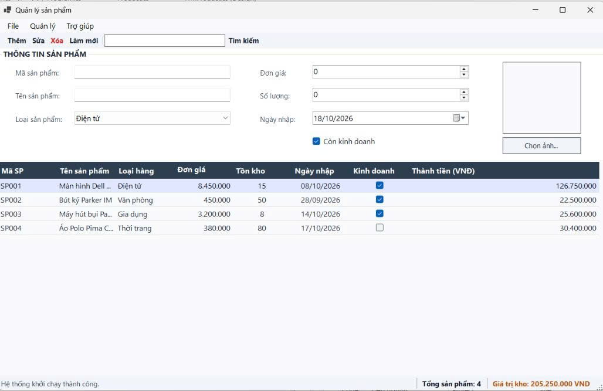
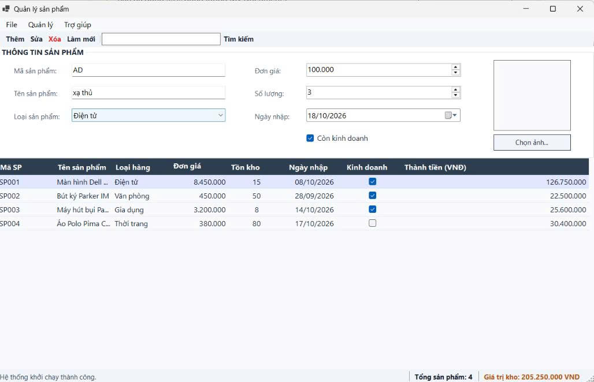
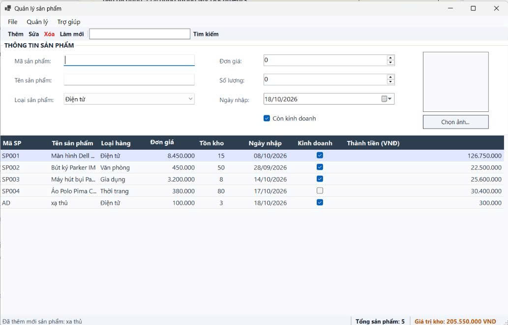
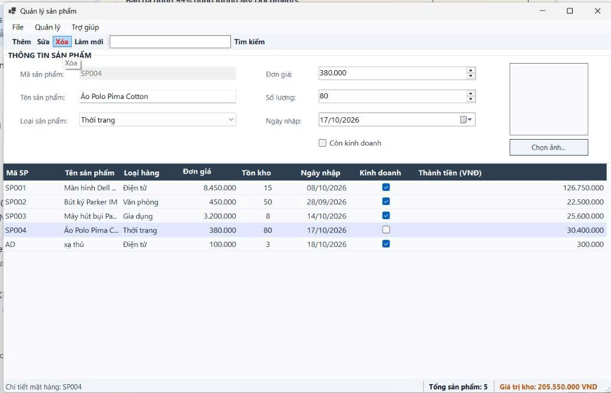
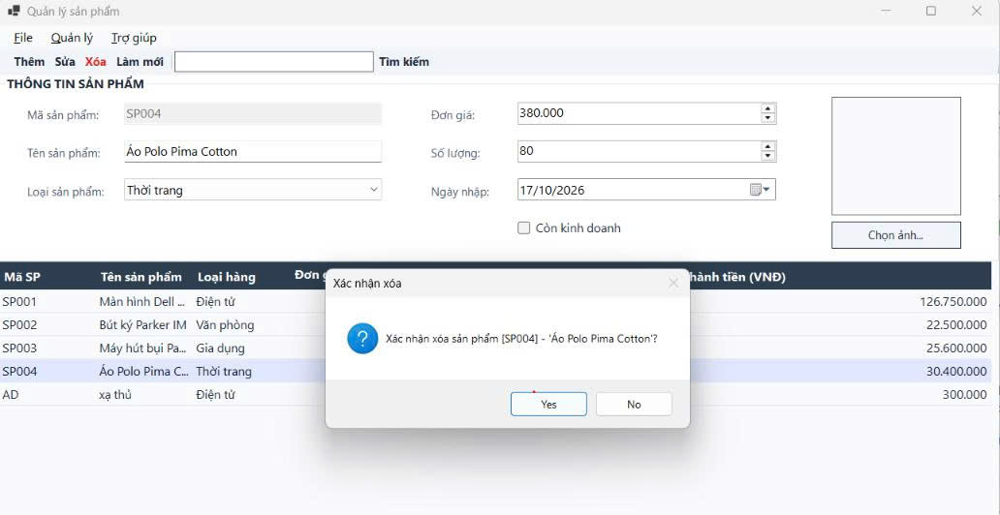
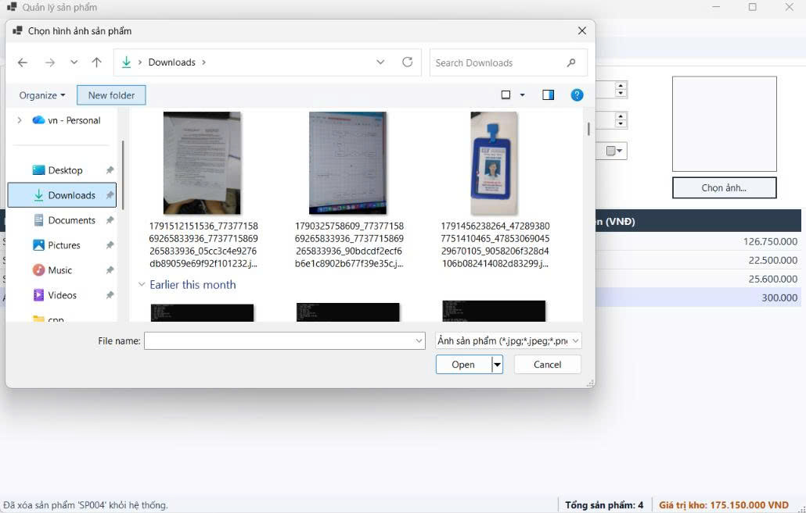
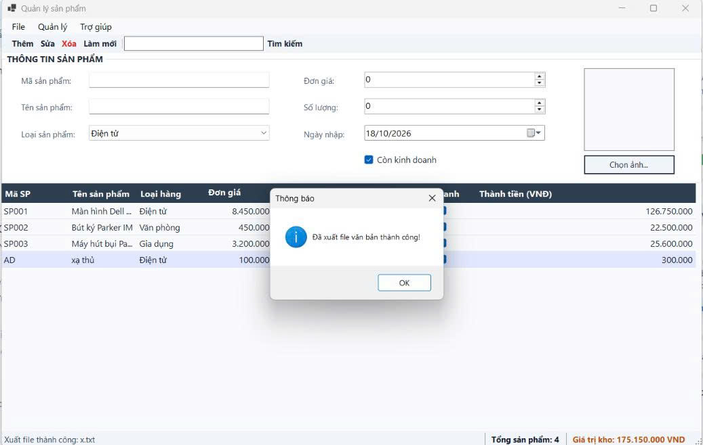

# COMP1019 - LẬP TRÌNH TRÊN WINDOWS

## BÀI LAB BUỔI 6: WINDOWS FORMS NÂNG CAO VÀ DATAGRIDVIEW - ỨNG DỤNG QUẢN LÝ SẢN PHẨM (ProductManager)

- **Giảng viên hướng dẫn:** ThS. Lê Thanh Thoại - Khoa Công nghệ Thông tin, HCMUE
- **Sinh viên thực hiện:** Lê Hoàng Quân
- **Mã số sinh viên:** 51.01.104.082
- **Lớp:** 51.CNTT.A
- **Môi trường phát triển:** .NET / C# Windows Forms App, Microsoft Visual Studio

---

## 4. Chức năng

### 4.1. Khởi tạo ứng dụng khi Form Load

Khởi động ứng dụng, DataGridView nạp danh sách sản phẩm mẫu ban đầu, thanh StatusStrip hiển thị tổng số lượng sản phẩm và tổng giá trị kho hàng ($205.250.000\,\text{VNĐ}$).

_Mô tả: Giao diện chính khởi tạo danh sách sản phẩm và thông số thống kê._

---

### 4.2. Nhập thông tin và Thêm sản phẩm mới

Nhập thông tin sản phẩm mới vào GroupBox nhập liệu và bấm nút **Thêm**.

_Mô tả: Nhập dữ liệu sản phẩm mới trên form._

Sau khi thêm thành công, dữ liệu lập tức cập nhật lên DataGridView, thanh trạng thái báo thông báo thành công và cập nhật lại số lượng/tổng giá trị kho.

_Mô tả: Sản phẩm mới được cập nhật lên DataGridView và StatusStrip._

---

### 4.3. Chọn sản phẩm từ DataGridView để xem chi tiết

Click chọn một dòng bất kỳ trên DataGridView, dữ liệu tương ứng tự động đổ lên các control ở phần nhập liệu.

_Mô tả: Chọn dòng dữ liệu trên bảng để đưa thông tin lên form._

---

### 4.4. Xóa sản phẩm có hộp thoại xác nhận

Chọn sản phẩm cần xóa và nhấn nút **Xóa** (hoặc dùng ContextMenuStrip/phím Delete), hệ thống kích hoạt hộp thoại `MessageBox` yêu cầu người dùng xác nhận trước khi xóa hẳn khỏi bộ nhớ.

_Mô tả: Hộp thoại xác nhận trước khi thực hiện xóa sản phẩm._

---

### 4.5. Chọn hình ảnh minh họa qua OpenFileDialog

Nhấn nút **Chọn ảnh...**, cửa sổ `OpenFileDialog` mở ra cho phép người dùng duyệt file ảnh từ máy tính để gán cho sản phẩm.

_Mô tả: Hộp thoại OpenFileDialog nạp ảnh minh họa._

---

### 4.6. Xuất danh sách báo cáo ra File Text (.txt)

Sử dụng chức năng xuất file trên MenuStrip hoặc tổ hợp phím `Ctrl + E`, ứng dụng mở `SaveFileDialog` xuất toàn bộ danh sách báo cáo ra tập tin văn bản.

_Mô tả: Thông báo xuất dữ liệu ra file text thành công._

---
