# BÁO CÁO BÀI TẬP THỰC HÀNH LAB 07: SDI, MDI VÀ ỨNG DỤNG NHIỀU FORM TRONG C# WINFORMS

**Học phần:** Lập trình trên Windows (COMP1019)  
**Giảng viên hướng dẫn:** ThS. Lê Thanh Thoại  
**Khoa:** Công nghệ Thông tin - Trường Đại học Sư phạm TP. Hồ Chí Minh (HCMUE)  
**Sinh viên thực hiện:** Lê Hoàng Quân  
**Mã số sinh viên:** 51.01.104.082  
**Lớp sinh hoạt:** 51.CNTT.A  
**Nhóm thực hành:** Nhóm 04  

---

## 1. MỤC TIÊU VÀ TỔNG QUAN HỆ THỐNG SHOPMANAGERMINI

Bài thực hành số 07 tập trung vào kiến trúc ứng dụng Windows Forms đa màn hình chuyên nghiệp, chuyển đổi từ mô hình cửa sổ đơn (SDI) sang mô hình cửa sổ chứa đa tài liệu (MDI - Multiple Document Interface):
- **Phân tách và điều hướng đa màn hình:** Xây dựng ứng dụng hoàn chỉnh gồm 5 Form chức năng: `FrmLogin` (Đăng nhập), `FrmMain` (MDI Parent), `FrmProduct` (Quản lý sản phẩm & kho hàng), `FrmCustomer` (Quản lý khách hàng & hội viên), và `FrmAbout` (Hộp thoại giới thiệu tác giả).
- **Phân biệt và ứng dụng chính xác `Show()` vs `ShowDialog()`:** Sử dụng `ShowDialog()` cho các tác vụ mang tính bắt buộc (Đăng nhập, Giới thiệu) và `Show()` cho các Form con MDI làm việc song song.
- **Truyền nhận dữ liệu an toàn giữa các Form:** Kết hợp linh hoạt 3 kỹ thuật truyền dữ liệu: qua **Constructor** (truyền đối tượng `User` khi khởi tạo `FrmMain`), qua **Property** (lấy `CurrentUser` từ `FrmLogin` sau khi đóng), và qua **Public Method** (điều khiển, lọc dữ liệu giữa các Form).
- **Quản lý vòng đời và chống mở trùng Form con (Anti-duplicate MDI Form):** Sử dụng danh sách `MdiChildren` kiểm tra kiểu đối tượng (`is T`), tự động kích hoạt (`Activate()`) và đưa lên trên cùng (`BringToFront()`) nếu Form đã tồn tại, tránh lãng phí tài nguyên và rối loạn giao diện người dùng.
- **Giao diện hiện đại, tinh tế (Modern Warm Slate & Sage Theme):** Tuyệt đối không sử dụng màu xanh đậm thô ráp, áp dụng bảng màu nhã nhặn (`#F8FAFC`, `#0D9488`, `#D97706`, `#E11D48`), thẻ KPI thống kê tức thời, định dạng tiền tệ `#,##0 VNĐ`, không có lỗi chồng chữ hay tràn viền.

---

## 2. SƠ ĐỒ ĐIỀU HƯỚNG MÀN HÌNH VÀ KIẾN TRÚC MDI

### 2.1. Sơ đồ luồng khởi chạy và truyền dữ liệu người dùng

```mermaid
flowchart TD
    Start([Khởi động Program.cs]) --> InitConfig[ApplicationConfiguration.Initialize]
    InitConfig --> ShowLogin[Khởi tạo FrmLogin.ShowDialog]
    
    ShowLogin --> CheckAuth{Xác thực thông tin\nđăng nhập?}
    CheckAuth -- Thất bại / Bỏ trống --> ShowLoginAlert[Hiển thị cảnh báo lỗi\ntrên Form đăng nhập]
    ShowLoginAlert --> ShowLogin
    CheckAuth -- Hủy / Thoát --> AppExit([Kết thúc ứng dụng])
    
    CheckAuth -- Thành công (DialogResult.OK) --> GetUser[Lấy CurrentUser qua Property\ncủa FrmLogin]
    GetUser --> RunMain[Application.Run với\nFrmMain(CurrentUser)]
    
    subgraph MDI_Container ["Cửa sổ chính FrmMain (IsMdiContainer = true)"]
        RunMain --> Status[StatusStrip: Hiển thị tên User, Vai trò, Đồng hồ thời gian thực]
        RunMain --> Menu[MenuStrip: Hệ thống | Danh mục | Trợ giúp]
        
        Menu -->|Danh mục -> Sản phẩm| CheckProduct{FrmProduct\nđang mở?}
        CheckProduct -- Đã mở --> ActProduct[Kích hoạt FrmProduct cũ\nBringToFront]
        CheckProduct -- Chưa mở --> NewProduct[Tạo mới FrmProduct\nMdiParent = this]
        
        Menu -->|Danh mục -> Khách hàng| CheckCustomer{FrmCustomer\nđang mở?}
        CheckCustomer -- Đã mở --> ActCustomer[Kích hoạt FrmCustomer cũ\nBringToFront]
        CheckCustomer -- Chưa mở --> NewCustomer[Tạo mới FrmCustomer\nMdiParent = this]
        
        Menu -->|Trợ giúp -> Giới thiệu| AboutModal[Mở FrmAbout dạng ShowDialog]
        Menu -->|Hệ thống -> Đăng xuất / Thoát| ConfirmBox{Hộp thoại MessageBox\nxác nhận?}
        ConfirmBox -- Đồng ý --> LogoutExit([Đóng FrmMain / Thoát])
        ConfirmBox -- Hủy bỏ --> StayMain[Tiếp tục làm việc]
    end
```

### 2.2. Trách nhiệm của các lớp và thành phần

1. **`ShopDataStore.cs` (Tầng dữ liệu dùng chung trong bộ nhớ):**
   - Đóng vai trò là Single Source of Truth lưu trữ danh sách tài khoản người dùng (`List<User>`), danh sách sản phẩm (`BindingList<Product>`) và danh sách khách hàng (`BindingList<Customer>`).
   - Sử dụng `BindingList<T>` giúp `DataGridView` trên các Form tự động cập nhật phản ánh dữ liệu tức thì mà không cần nạp lại thủ công phức tạp.
   - Nạp sẵn bộ dữ liệu phong phú: 3 tài khoản người dùng (`admin`, `user`, `hoangquan`), 10 sản phẩm thuộc 5 ngành hàng, và 8 khách hàng hội viên (đầy đủ các cấp VIP, Thân thiết, Thường).
2. **`FrmLogin.cs` (Form đăng nhập Modal):**
   - Mở ở chế độ chặn `ShowDialog()`. Trả về `DialogResult.OK` khi đăng nhập hợp lệ.
   - Cung cấp thuộc tính `public User? CurrentUser { get; private set; }` để Form cha nhận thông tin sau khi đăng nhập thành công.
   - Hỗ trợ phím tắt điều hướng: Enter ở ô tên đăng nhập tự nhảy sang ô mật khẩu; Enter ở ô mật khẩu tự kích hoạt nút Đăng nhập. Có tùy chọn hiển thị/ẩn mật khẩu.
3. **`FrmMain.cs` (Form chính MDI Container):**
   - Thiết lập thuộc tính `IsMdiContainer = true`. Tùy biến màu nền vùng `MdiClient` thành màu xám sáng Slate-100 hài hòa.
   - Tiếp nhận đối tượng `User` thông qua Constructor và hiển thị thông tin lên `StatusStrip`.
   - Chứa `MenuStrip` điều hướng các chức năng quản lý.
   - Cài đặt hàm generic chuẩn:
     ```csharp
     public T OpenChildForm<T>() where T : Form, new()
     ```
     Duyệt qua tập hợp `this.MdiChildren`, nếu tìm thấy Form cùng kiểu thì khôi phục kích thước, đưa lên trước và `Activate()`; nếu chưa có thì gán `child.MdiParent = this` rồi `Show()`.
   - Bắt sự kiện `FormClosing` để hỏi xác nhận bằng `MessageBoxButtons.YesNo`, tránh trường hợp vô tình đóng ứng dụng làm mất dữ liệu.
4. **`FrmProduct.cs` (Form con MDI quản lý sản phẩm):**
   - Quản lý thông tin chi tiết: Mã SP, Tên SP, Loại hàng (ComboBox), Đơn giá, Số lượng tồn kho.
   - Tính toán tự động: Thành tiền và Trạng thái tồn kho (`Hết hàng`, `Sắp hết`, `Còn hàng`).
   - Bảng điều khiển KPI tức thời: Tổng mặt hàng, Tổng số lượng tồn, Tổng giá trị tồn kho.
   - Thao tác CRUD hoàn chỉnh trong bộ nhớ kèm kiểm tra trùng mã, kiểm tra giá/số lượng không âm.
5. **`FrmCustomer.cs` (Form con MDI quản lý khách hàng):**
   - Quản lý thông tin hội viên: Mã KH, Họ tên, Số điện thoại, Loại khách hàng (Thường, Thân thiết, VIP), Điểm tích lũy, Ngày đăng ký.
   - Bảng điều khiển KPI: Tổng hội viên, Số khách VIP, Số khách Thân thiết.
   - Đầy đủ chức năng Thêm, Sửa, Xóa, Làm mới, Tìm kiếm theo tên hoặc số điện thoại.
6. **`FrmAbout.cs` (Hộp thoại giới thiệu):**
   - Mở dạng hộp thoại `ShowDialog()`. Hiển thị thông tin sinh viên thực hiện, môn học, lớp, nhóm, công nghệ sử dụng và phiên bản ứng dụng.

---

## 3. CẤU TRÚC THƯ MỤC DỰ ÁN

```text
Lab07/
│
├── Lab07.slnx                                 # Solution file quản lý solution
├── README.txt                                 # File văn bản ghi cách chạy, tài khoản demo
├── README.md                                  # Báo cáo kỹ thuật và hình ảnh minh chứng
│
├── images/                                    # Thư mục lưu trữ 17 ảnh chụp màn hình kiểm thử
│   ├── 01_dang_nhap_giao_dien.png
│   ├── 02_dang_nhap_thanh_cong_admin.png
│   ├── 03_dang_nhap_loi_bo_trong.png
│   ├── 04_dang_nhap_loi_sai_mat_khau.png
│   ├── 05_mo_form_san_pham_mdi.png
│   ├── 06_san_pham_them_thanh_cong.png
│   ├── 07_san_pham_validation_loi_trung_ma.png
│   ├── 08_san_pham_validation_gia_so_luong_am.png
│   ├── 09_san_pham_sua_thanh_cong.png
│   ├── 10_san_pham_tim_kiem.png
│   ├── 11_san_pham_xoa_thanh_cong.png
│   ├── 12_mo_form_khach_hang_mdi.png
│   ├── 13_khach_hang_them_moi.png
│   ├── 14_khach_hang_tim_kiem.png
│   ├── 15_chong_mo_trung_form_con.png
│   ├── 16_hop_thoai_gioi_thieu_about.png
│   └── 17_dang_xuat_va_thoat_xac_nhan.png
│
└── Lab07/                                     # Thư mục mã nguồn WinForms C# (.NET 10.0)
    ├── Lab07.csproj                           # Project file cấu hình .NET 10 WinForms
    ├── Program.cs                             # Điểm khởi chạy ứng dụng & headless test runner
    │
    ├── Models/
    │   ├── User.cs                            # Model tài khoản người dùng
    │   ├── Product.cs                         # Model sản phẩm và tính toán tồn kho
    │   └── Customer.cs                        # Model khách hàng và điểm tích lũy
    │
    ├── Data/
    │   └── ShopDataStore.cs                   # Quản lý kho dữ liệu BindingList trong bộ nhớ
    │
    └── Forms/
        ├── FrmLogin.cs                        # Form đăng nhập tài khoản
        ├── FrmMain.cs                         # Form chính MDI Parent, MenuStrip, StatusStrip
        ├── FrmProduct.cs                      # Form con MDI quản lý sản phẩm
        ├── FrmCustomer.cs                     # Form con MDI quản lý khách hàng
        └── FrmAbout.cs                        # Hộp thoại giới thiệu thông tin sinh viên
```

---

## 4. CHI TIẾT CÁC CHỨC NĂNG VÀ ẢNH CHỤP MINH CHỨNG (17 CHỨC NĂNG)

Dưới đây là chi tiết toàn bộ 17 chức năng đã triển khai, mỗi chức năng đi kèm ảnh chụp màn hình kiểm thử thực tế:

### Chức năng 1: Giao diện Form đăng nhập ban đầu (`FrmLogin`)
- **Mô tả:** Màn hình đăng nhập xuất hiện dạng hộp thoại Dialog ở chính giữa màn hình. Thiết kế card bo viền thanh nhã, có hướng dẫn tài khoản mẫu, ô mật khẩu ẩn ký tự `•`, tùy chọn hiển thị mật khẩu và 2 nút bấm Đăng nhập / Thoát.
- **Ảnh minh chứng:**

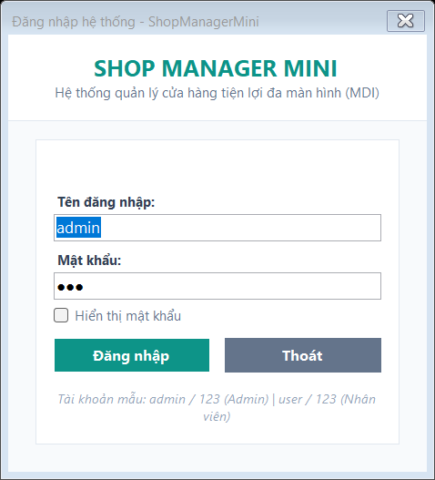

---

### Chức năng 2: Đăng nhập thành công và truyền thông tin sang `FrmMain`
- **Mô tả:** Người dùng nhập tài khoản `admin / 123` và nhấn Đăng nhập. `FrmLogin` đóng lại, trả về `DialogResult.OK` và truyền đối tượng `User` cho `FrmMain`. Trên thanh trạng thái `StatusStrip` hiển thị rõ: *Người dùng: Quản trị viên*, *Vai trò: Admin* (nổi bật màu Sage), thông tin phiên bản và đồng hồ thời gian thực cập nhật từng giây.
- **Ảnh minh chứng:**

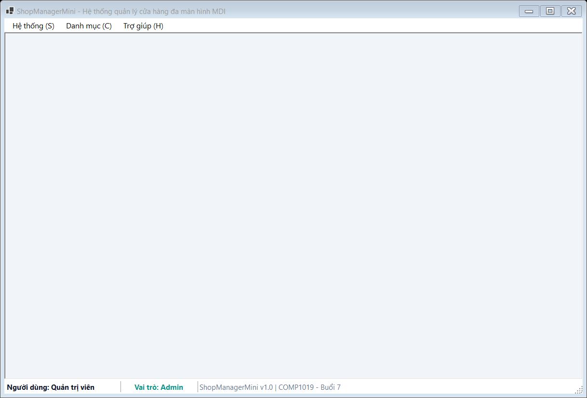

---

### Chức năng 3: Bắt lỗi bỏ trống tên đăng nhập hoặc mật khẩu
- **Mô tả:** Khi để trống ô tài khoản hoặc mật khẩu và nhấn Đăng nhập, hệ thống hiển thị cảnh báo viền đỏ dịu mắt: *"Vui lòng nhập tên đăng nhập!"* hoặc *"Vui lòng nhập mật khẩu!"*, con trỏ chuột tự động focus vào ô cần nhập.
- **Ảnh minh chứng:**

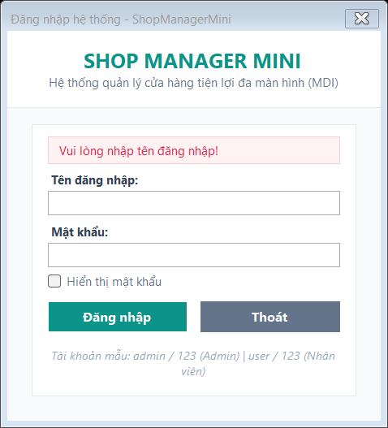

---

### Chức năng 4: Bắt lỗi đăng nhập sai tài khoản hoặc mật khẩu
- **Mô tả:** Khi nhập sai thông tin (ví dụ mật khẩu không đúng), hệ thống từ chối đăng nhập và hiển thị banner thông báo: *"Tên đăng nhập hoặc mật khẩu không chính xác!"*, đồng thời tự động bôi đen toàn bộ ô mật khẩu để người dùng dễ dàng gõ lại.
- **Ảnh minh chứng:**

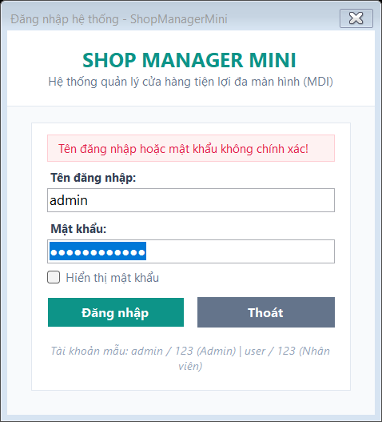

---

### Chức năng 5: Mở Form quản lý sản phẩm bên trong Form chính MDI
- **Mô tả:** Chọn menu **Danh mục $\rightarrow$ Quản lý sản phẩm** (hoặc nhấn phím tắt `Ctrl+P`). Cửa sổ `FrmProduct` được nạp bên trong vùng làm việc của `FrmMain` với tư cách là Form con MDI (`MdiParent = this`). Hiển thị 3 thẻ KPI tổng hợp (10 mặt hàng, 463 cái tồn kho, tổng giá trị 14.326.000 VNĐ) và danh sách sản phẩm trên `DataGridView`.
- **Ảnh minh chứng:**

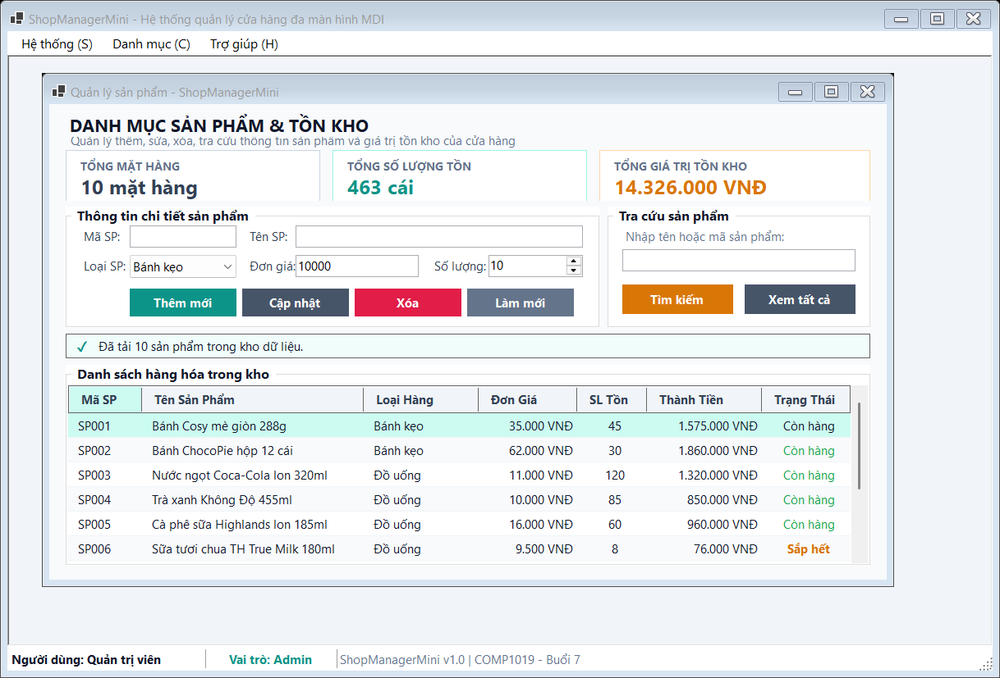

---

### Chức năng 6: Thêm mới sản phẩm hợp lệ vào kho dữ liệu
- **Mô tả:** Người dùng nhập Mã SP `SP011`, Tên SP `Trà sữa Ô long nướng 450ml`, Loại hàng `Đồ uống`, Đơn giá `22000`, Số lượng `50` và nhấn **Thêm mới**. Sản phẩm mới lập tức xuất hiện trên bảng, thẻ KPI tự động tính toán lại tổng số lượng và giá trị tồn kho.
- **Ảnh minh chứng:**


---

### Chức năng 7: Bắt lỗi trùng mã sản phẩm đã tồn tại
- **Mô tả:** Người dùng cố tình nhập mã sản phẩm đã có trong hệ thống (ví dụ `SP001`) và nhấn **Thêm mới**. Hệ thống kiểm tra qua `ShopDataStore.ProductExists()` và hiển thị cảnh báo: *"Lỗi ràng buộc: Mã sản phẩm 'SP001' đã tồn tại trong danh mục!"*, ngăn chặn việc ghi đè dữ liệu.
- **Ảnh minh chứng:**

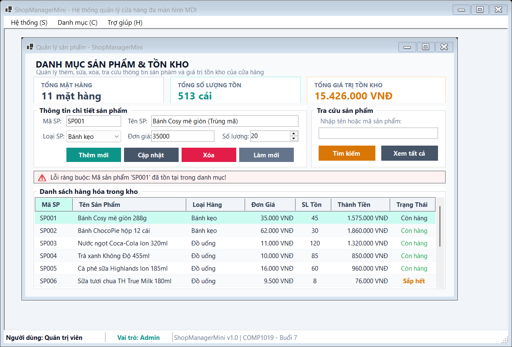

---

### Chức năng 8: Bắt lỗi đơn giá nhỏ hơn hoặc bằng 0 và số lượng âm
- **Mô tả:** Người dùng nhập đơn giá là số âm (ví dụ `-5000`) hoặc bằng 0. Hệ thống bắt lỗi và cảnh báo: *"Lỗi nhập liệu: Đơn giá phải là số lớn hơn 0!"*, đảm bảo tính toàn vẹn dữ liệu kế toán.
- **Ảnh minh chứng:**

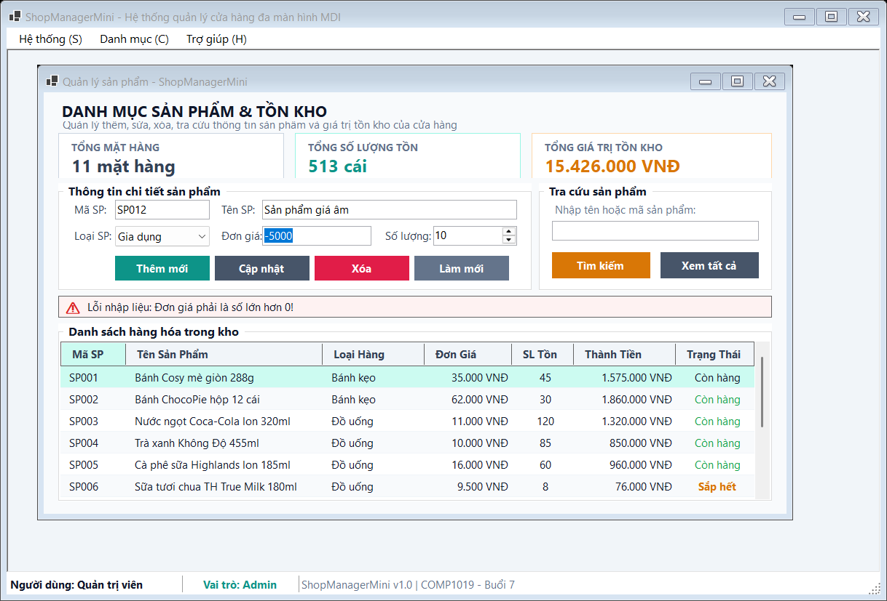

---

### Chức năng 9: Cập nhật (Sửa) thông tin sản phẩm
- **Mô tả:** Chọn sản phẩm `SP001` trên danh sách, thông tin được tự động điền vào các ô nhập liệu. Chỉnh sửa tên thành `Bánh Cosy mè giòn 288g (Giảm giá)`, đơn giá thành `32000`, số lượng thành `60` và nhấn **Cập nhật**. Bảng dữ liệu và KPI được làm mới ngay tức khắc.
- **Ảnh minh chứng:**

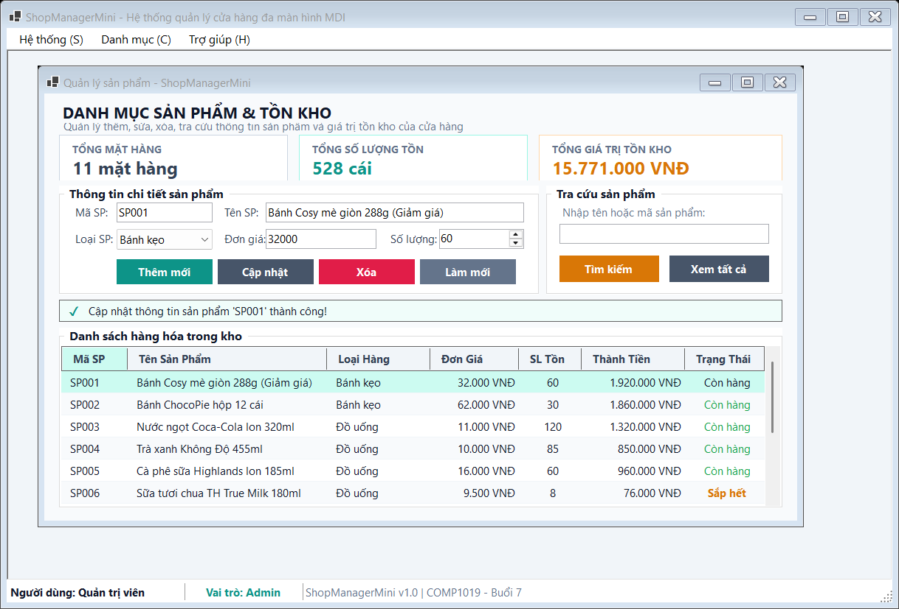

---

### Chức năng 10: Tra cứu và lọc sản phẩm theo tên hoặc mã
- **Mô tả:** Nhập từ khóa `"Coca"` vào ô tra cứu và nhấn nút **Tìm kiếm** (hoặc nhấn Enter). Danh sách tự động lọc ra sản phẩm khớp từ khóa (`SP003 - Nước ngọt Coca-Cola lon 320ml`), thông báo số lượng bản ghi tìm thấy.
- **Ảnh minh chứng:**

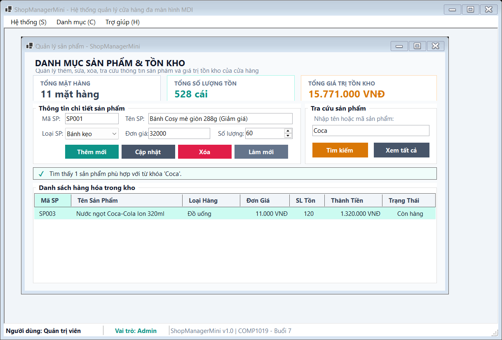

---

### Chức năng 11: Xóa sản phẩm khỏi kho dữ liệu
- **Mô tả:** Chọn sản phẩm cần xóa trên bảng (ví dụ `SP010` - Khăn ướt Nano Bạc), nhấn nút **Xóa**. Hệ thống xóa mặt hàng khỏi kho, làm mới `DataGridView` và trừ giá trị tồn kho tương ứng.
- **Ảnh minh chứng:**

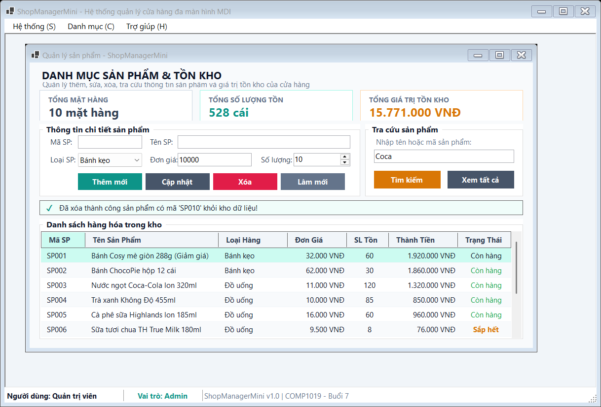

---

### Chức năng 12: Mở Form quản lý khách hàng bên trong Form chính MDI
- **Mô tả:** Chọn menu **Danh mục $\rightarrow$ Quản lý khách hàng** (hoặc nhấn `Ctrl+K`). Cửa sổ `FrmCustomer` mở ra bên trong `FrmMain` với các thẻ KPI: Tổng 8 hội viên, 3 khách VIP, 2 khách Thân thiết. Khách hàng VIP Lê Hoàng Quân (Mã: KH001, 850 điểm) được định dạng huy hiệu màu cam nổi bật.
- **Ảnh minh chứng:**

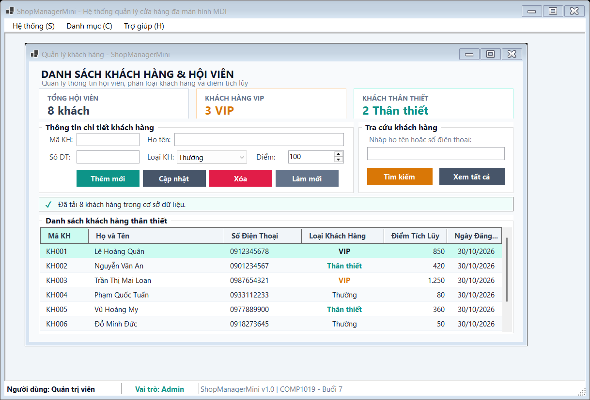

---

### Chức năng 13: Thêm mới khách hàng hội viên VIP
- **Mô tả:** Nhập thông tin: Mã KH `KH009`, Họ tên `Trần Đình Trọng`, Số ĐT `0938889999`, Phân loại `VIP`, Điểm tích lũy `500` và nhấn **Thêm mới**. Danh sách hội viên cập nhật ngay lập tức và chỉ số khách hàng VIP tăng lên 4.
- **Ảnh minh chứng:**


---

### Chức năng 14: Tra cứu khách hàng theo họ tên hoặc số điện thoại
- **Mô tả:** Nhập từ khóa `"Quân"` vào ô tra cứu hội viên, nhấn **Tìm kiếm**. Kết quả hiển thị chính xác khách hàng VIP Lê Hoàng Quân (Mã `KH001`, SĐT `0912345678`), kèm thông báo: *"Tìm thấy 1 khách hàng phù hợp với từ khóa 'Quân'."*.
- **Ảnh minh chứng:**

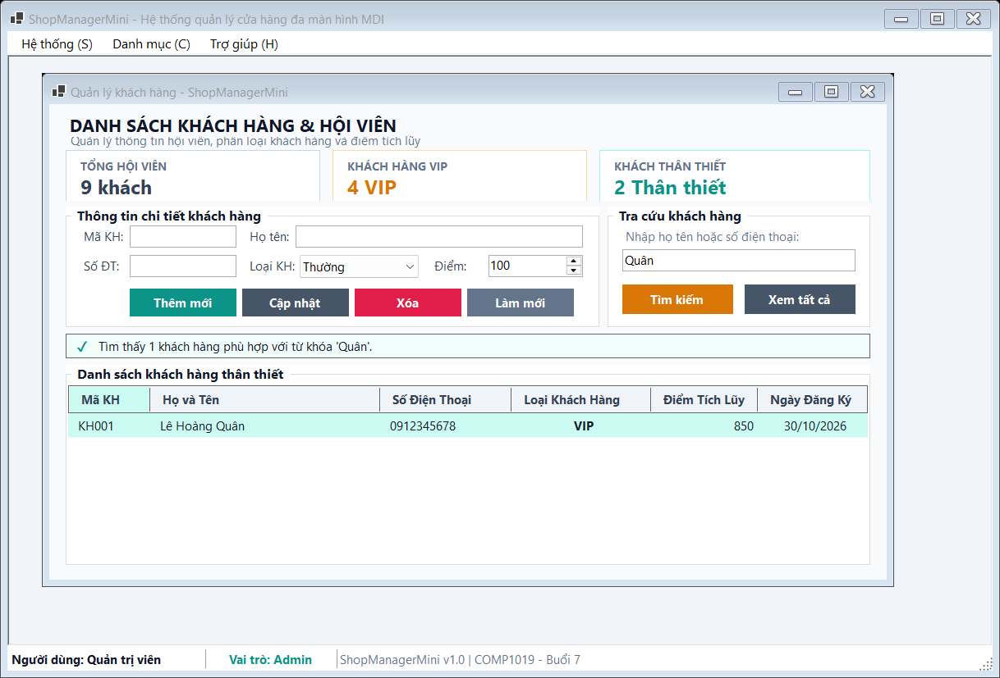

---

### Chức năng 15: Cơ chế chống mở trùng Form con MDI (Anti-duplicate Form)
- **Mô tả:** Khi `FrmProduct` và `FrmCustomer` đều đã được khởi tạo bên trong `FrmMain`, người dùng bấm lại menu **Quản lý sản phẩm** nhiều lần. Thay vì mở thêm một cửa sổ trùng lặp gây rối màn hình, phương thức `OpenChildForm<T>()` tự động kiểm tra danh sách `this.MdiChildren`, kích hoạt lại cửa sổ `FrmProduct` đang có và đưa nó lên vị trí trên cùng.
- **Ảnh minh chứng:**


---

### Chức năng 16: Hộp thoại Giới thiệu ứng dụng (`FrmAbout`)
- **Mô tả:** Chọn menu **Trợ giúp $\rightarrow$ Giới thiệu ứng dụng** (hoặc nhấn `F1`). Cửa sổ `FrmAbout` mở dạng Modal (`ShowDialog()`), hiển thị đầy đủ thông tin đồ án: môn học COMP1019, ThS. Lê Thanh Thoại, sinh viên Lê Hoàng Quân (MSSV: 51.01.104.082, Lớp: 51.CNTT.A, Nhóm 04).
- **Ảnh minh chứng:**

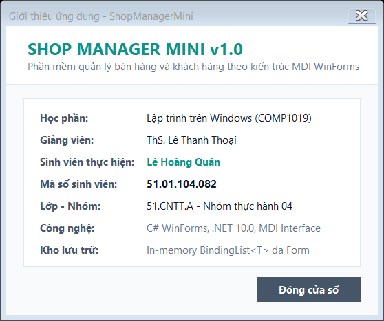

---

### Chức năng 17: Xác nhận an toàn khi Đăng xuất và Thoát ứng dụng
- **Mô tả:** Khi người dùng chọn menu **Hệ thống $\rightarrow$ Đăng xuất** hoặc **Thoát** (hoặc nhấn nút X trên thanh tiêu đề), hệ thống bật hộp thoại `MessageBox` với các tùy chọn Yes/No hỏi người dùng có chắc chắn muốn thoát hay không, đảm bảo không bị mất trạng thái làm việc do bấm nhầm.
- **Ảnh minh chứng:**

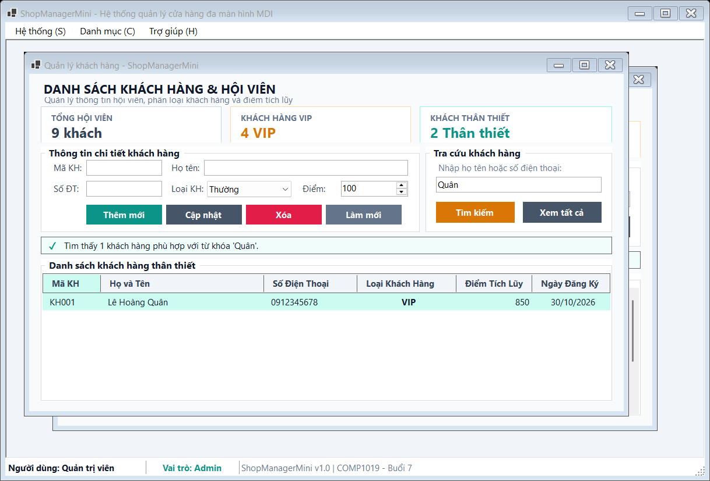

---

## 5. BẢNG TEST CASE KIỂM THỬ HỆ THỐNG (TEST CASES)

| Mã TC | Chức năng kiểm thử | Thao tác / Dữ liệu đầu vào | Kết quả mong đợi | Kết quả thực tế | Trạng thái |
| :---: | :--- | :--- | :--- | :--- | :---: |
| **TC01** | Khởi chạy đăng nhập | Khởi chạy chương trình | `FrmLogin` mở dạng hộp thoại ở trung tâm màn hình, có tài khoản mẫu. | Form đăng nhập hiển thị đúng giao diện. | **PASSED** |
| **TC02** | Đăng nhập Admin hợp lệ | Username: `admin`, Password: `123` | Đăng nhập thành công, mở `FrmMain`, StatusStrip hiển thị Quản trị viên - Admin. | Mở `FrmMain`, StatusStrip cập nhật chính xác. | **PASSED** |
| **TC03** | Bắt lỗi bỏ trống đăng nhập | Để trống Username hoặc Password | Không đăng nhập, hiển thị thông báo lỗi yêu cầu nhập đủ thông tin. | Hiển thị cảnh báo lỗi viền đỏ. | **PASSED** |
| **TC04** | Bắt lỗi sai thông tin đăng nhập | Username: `admin`, Password: `sai` | Đăng nhập thất bại, hiển thị thông báo sai tên đăng nhập hoặc mật khẩu. | Báo lỗi đăng nhập không thành công. | **PASSED** |
| **TC05** | Mở Form sản phẩm MDI | Chọn menu **Danh mục $\rightarrow$ Quản lý sản phẩm** | `FrmProduct` mở bên trong vùng làm việc của `FrmMain`, hiển thị 10 sản phẩm mẫu và KPI. | Form con mở đúng chuẩn MDI, không mở cửa sổ rời. | **PASSED** |
| **TC06** | Thêm sản phẩm hợp lệ | Mã: `SP011`, Tên: `Trà sữa Ô long nướng`, Loại: `Đồ uống`, Giá: `22000`, SL: `50` | Thêm mới thành công, hiển thị trên grid, cập nhật KPI tồn kho. | Thêm thành công, bảng dữ liệu cập nhật tức thời. | **PASSED** |
| **TC07** | Bắt lỗi trùng mã sản phẩm | Nhập Mã: `SP001` (đã có) | Báo lỗi trùng mã sản phẩm đã tồn tại trong danh mục, không thêm mới. | Báo lỗi: *"Mã sản phẩm 'SP001' đã tồn tại!"*. | **PASSED** |
| **TC08** | Bắt lỗi đơn giá không hợp lệ | Nhập Đơn giá: `-5000` hoặc bằng 0 | Báo lỗi đơn giá phải lớn hơn 0, không thêm vào danh sách. | Báo lỗi: *"Đơn giá phải là số lớn hơn 0!"*. | **PASSED** |
| **TC09** | Cập nhật thông tin sản phẩm | Chọn `SP001`, đổi giá thành `32000`, SL thành `60` | Cập nhật thông tin sản phẩm thành công, tính lại thành tiền và KPI. | Dữ liệu cập nhật đúng trên `DataGridView`. | **PASSED** |
| **TC10** | Tìm kiếm sản phẩm | Nhập từ khóa: `"Coca"` | Lọc ra các sản phẩm chứa từ khóa `"Coca"`, thông báo số lượng tìm thấy. | Lọc ra đúng sản phẩm Coca-Cola. | **PASSED** |
| **TC11** | Xóa sản phẩm khỏi kho | Chọn sản phẩm `SP010` (Khăn ướt), nhấn **Xóa** | Xóa thành công khỏi danh mục, giảm tổng mặt hàng trên KPI. | Sản phẩm bị xóa khỏi bảng dữ liệu. | **PASSED** |
| **TC12** | Mở Form khách hàng MDI | Chọn menu **Danh mục $\rightarrow$ Quản lý khách hàng** | `FrmCustomer` mở bên trong `FrmMain`, hiển thị 8 hội viên mẫu và thống kê VIP. | Form khách hàng mở đúng chuẩn MDI. | **PASSED** |
| **TC13** | Thêm khách hàng mới VIP | Mã: `KH009`, Tên: `Trần Đình Trọng`, SĐT: `0938889999`, Loại: `VIP`, Điểm: `500` | Thêm mới thành công, hiển thị huy hiệu VIP màu cam, tăng chỉ số KPI. | Thêm thành công vào kho dữ liệu. | **PASSED** |
| **TC14** | Tìm kiếm khách hàng | Nhập từ khóa: `"Quân"` | Lọc ra thông tin khách hàng VIP Lê Hoàng Quân (KH001). | Kết quả tìm kiếm chính xác. | **PASSED** |
| **TC15** | Chống mở trùng Form con | Nhấn menu **Quản lý sản phẩm** khi Form sản phẩm đang mở | Không tạo cửa sổ mới, kích hoạt và đưa Form sản phẩm cũ lên trước. | Cửa sổ cũ được kích hoạt, số Form con không tăng. | **PASSED** |
| **TC16** | Mở hộp thoại Giới thiệu | Chọn menu **Trợ giúp $\rightarrow$ Giới thiệu ứng dụng** | `FrmAbout` mở dạng Modal Dialog, hiển thị đầy đủ thông tin sinh viên và môn học. | Hộp thoại mở đúng modal, thông tin rõ ràng. | **PASSED** |
| **TC17** | Xác nhận khi đóng / thoát | Nhấn nút X hoặc chọn Đăng xuất / Thoát | Xuất hiện hộp thoại MessageBox hỏi người dùng có chắc chắn muốn thoát hay không. | Hộp thoại xác nhận hoạt động chuẩn xác. | **PASSED** |

---

## 6. TRẢ LỜI CHI TIẾT 5 CÂU HỎI ÔN TẬP BẮT BUỘC (MỤC 10)

Dưới đây là phần trả lời chi tiết, khoa học và đầy đủ cho toàn bộ 5 câu hỏi ôn tập từ **Mục 10 của đề bài Lab 07**:

### Câu hỏi 1: SDI và MDI khác nhau như thế nào?

**Trả lời:**
SDI (Single Document Interface) và MDI (Multiple Document Interface) là hai mô hình tổ chức giao diện cửa sổ kinh điển trong phát triển ứng dụng Windows Forms:

| Tiêu chí so sánh | SDI (Single Document Interface) | MDI (Multiple Document Interface) |
| :--- | :--- | :--- |
| **Đặc điểm kiến trúc** | Mỗi cửa sổ làm việc độc lập, không có quan hệ lồng ghép cha - con. Mỗi Form là một cửa sổ rời rạc trên thanh Taskbar của hệ điều hành. | Có một cửa sổ cha đóng vai trò là khung chứa (**MDI Parent**). Các cửa sổ chức năng (**MDI Child**) được mở và giới hạn hoàn toàn bên trong vùng làm việc của Form cha. |
| **Khả năng điều hướng** | Người dùng mở nhiều cửa sổ độc lập, di chuyển tự do trên màn hình máy tính. Dễ dẫn đến tình trạng quá nhiều cửa sổ lộn xộn, che khuất nhau. | Điều hướng tập trung thông qua hệ thống MenuStrip, Toolbar, StatusStrip của Form cha. Các cửa sổ con không bao giờ bị trôi ra ngoài Form chính. |
| **Độ phức tạp lập trình** | Đơn giản, dễ kiểm soát vòng đời từng Form riêng rẽ. | Phức tạp hơn: cần quản lý danh sách `MdiChildren`, kiểm tra chống mở trùng, đồng bộ menu và chia sẻ dữ liệu giữa các Form con. |
| **Trường hợp áp dụng** | Thích hợp cho các ứng dụng nhỏ, tiện ích đơn luồng (ví dụ: Calculator, Notepad, Form đăng nhập, Form cấu hình). | Thích hợp cho các phần mềm nghiệp vụ quản lý lớn có nhiều phân hệ (ví dụ: ShopManagerMini, phần mềm kế toán, ERP, quản lý trường học). |

---

### Câu hỏi 2: Vì sao Form đăng nhập nên dùng `ShowDialog()`?

**Trả lời:**
Trong Windows Forms, phương thức `Show()` mở Form ở chế độ không đồng bộ (Modeless), trong khi `ShowDialog()` mở Form ở chế độ hộp thoại độc quyền (Modal). Form đăng nhập bắt buộc phải dùng `ShowDialog()` vì các lý do sau:
1. **Ngăn chặn người dùng truy cập trái phép:** `ShowDialog()` sẽ vô hiệu hóa (chặn tương tác) với toàn bộ các cửa sổ phía sau. Người dùng không thể nhấn menu hay thao tác trên màn hình chính cho tới khi hoàn tất việc đăng nhập.
2. **Kiểm soát luồng thực thi trong `Program.cs`:** Khi gọi `loginForm.ShowDialog()`, luồng xử lý của chương trình sẽ dừng lại (tạm block) tại dòng code đó. Chỉ khi Form đăng nhập đóng lại, phương thức mới trả về kết quả `DialogResult` (ví dụ `DialogResult.OK`). Nhờ đó, chương trình mới kiểm tra được kết quả xác thực trước khi quyết định khởi chạy `Application.Run(new FrmMain(...))` hay kết thúc ứng dụng.
3. **Nếu dùng `Show()` sai lầm:** Chương trình sẽ không chờ đợi mà tiếp tục chạy ngay các dòng code tiếp theo, làm mở cả Form chính khi chưa hề xác thực tài khoản, tạo ra lỗ hổng bảo mật nghiêm trọng.

---

### Câu hỏi 3: Trong bài lab này, dữ liệu user được truyền từ `FrmLogin` sang `FrmMain` bằng cách nào?

**Trả lời:**
Trong bài thực hành này, dữ liệu tài khoản người dùng được truyền kết hợp chặt chẽ qua **Property** và **Constructor**:
1. **Bước 1 (Đóng gói tại `FrmLogin` qua Property):**
   Trong `FrmLogin`, chúng ta khai báo một thuộc tính công khai chỉ đọc từ bên ngoài:
   ```csharp
   public User? CurrentUser { get; private set; }
   ```
   Khi người dùng bấm Đăng nhập và xác thực thành công qua `ShopDataStore.Authenticate()`, đối tượng người dùng hợp lệ sẽ được gán vào `CurrentUser`, đồng thời gán `DialogResult = DialogResult.OK` và gọi `Close()`.
2. **Bước 2 (Tiếp nhận tại `Program.cs`):**
   Sau khi `loginForm.ShowDialog()` trả về `DialogResult.OK`, `Program.cs` đọc trực tiếp thuộc tính `loginForm.CurrentUser`:
   ```csharp
   if (loginForm.ShowDialog() == DialogResult.OK && loginForm.CurrentUser != null)
   {
       Application.Run(new FrmMain(loginForm.CurrentUser));
   }
   ```
3. **Bước 3 (Truyền sang `FrmMain` qua Constructor):**
   Lớp `FrmMain` định nghĩa Constructor nhận tham số bắt buộc kiểu `User`:
   ```csharp
   public FrmMain(User user)
   {
       _currentUser = user;
       InitializeCustomComponents();
   }
   ```
   Nhờ đó, ngay khi `FrmMain` khởi tạo, toàn bộ thông tin về Họ tên và Vai trò (`Admin` hay `User`) đã sẵn sàng để hiển thị lên thanh `StatusStrip`.

---

### Câu hỏi 4: Nếu người dùng bấm menu sản phẩm nhiều lần, chương trình xử lý như thế nào để không mở trùng Form?

**Trả lời:**
Nếu không kiểm soát, mỗi lần người dùng bấm vào mục menu "Quản lý sản phẩm", một đối tượng Form mới sẽ được tạo ra (`new FrmProduct()`), khiến ứng dụng mở hàng chục cửa sổ con đè lên nhau, gây lộn xộn giao diện và lãng phí bộ nhớ RAM.  
Để giải quyết triệt để vấn đề này, chương trình xây dựng phương thức generic `OpenChildForm<T>()` trong `FrmMain`:
```csharp
public T OpenChildForm<T>() where T : Form, new()
{
    // Duyệt qua toàn bộ danh sách Form con MDI đang mở
    foreach (Form form in this.MdiChildren)
    {
        // Kiểm tra xem đã có Form nào cùng kiểu T đang tồn tại chưa
        if (form is T existingForm)
        {
            if (existingForm.WindowState == FormWindowState.Minimized)
            {
                existingForm.WindowState = FormWindowState.Normal;
            }
            if (!existingForm.Visible)
            {
                existingForm.Visible = true;
            }
            existingForm.BringToFront(); // Đưa lên trên cùng
            existingForm.Activate();     // Kích hoạt nhận focus
            return existingForm;         // Thoát ngay, KHÔNG tạo Form mới
        }
    }

    // Nếu chưa có Form cùng kiểu nào mở, tiến hành khởi tạo mới
    T child = new T
    {
        MdiParent = this,
        StartPosition = FormStartPosition.CenterScreen
    };
    child.Show();
    child.BringToFront();
    child.Activate();
    return child;
}
```
Khi người dùng bấm menu nhiều lần, hàm sẽ phát hiện Form đã có trong tập hợp `this.MdiChildren`, chỉ việc kích hoạt lại cửa sổ đó mà không tạo thêm bất kỳ Form mới nào.

---

### Câu hỏi 5: Khi nào nên dùng constructor, khi nào nên dùng property để truyền dữ liệu giữa các Form?

**Trả lời:**
Việc lựa chọn giữa **Constructor** và **Property** phụ thuộc vào bản chất và thời điểm của dữ liệu cần truyền:

| Tiêu chí lựa chọn | Sử dụng Constructor | Sử dụng Property |
| :--- | :--- | :--- |
| **Tính bắt buộc của dữ liệu** | Dùng khi dữ liệu là **bắt buộc phải có** để Form đích có thể khởi tạo và hoạt động bình thường (Mandatory Data). Nếu thiếu dữ liệu này, Form không có ý nghĩa tồn tại. | Dùng khi dữ liệu là **tùy chọn (Optional)**, có thể gán hoặc không, hoặc có thể cập nhật linh hoạt sau khi Form đã khởi tạo. |
| **Chiều truyền dữ liệu** | Thường dùng theo chiều **Form gọi $\rightarrow$ Form được gọi** (Forward Data Passing), truyền trực tiếp tại thời điểm tạo mới đối tượng (`new Form(...)`). | Dùng tốt cho cả hai chiều, đặc biệt là chiều **Form con $\rightarrow$ Form cha** (Backward Data Passing). Sau khi Form con đóng lại (`ShowDialog() == OK`), Form cha sẽ đọc các thuộc tính kết quả từ Form con. |
| **Ví dụ thực tế trong bài** | Truyền thông tin `User` từ `Program.cs` vào `FrmMain`: `new FrmMain(user)` vì màn hình chính bắt buộc phải biết ai đang đăng nhập để hiển thị vai trò. | Đọc `CurrentUser` từ `FrmLogin` sau khi đóng: `loginForm.CurrentUser`. Hoặc khi mở form chi tiết sản phẩm để sửa thông tin: `frmDetail.ProductToEdit = p`. |

---

## 7. ĐÁNH GIÁ VÀ KẾT LUẬN

1. **Về mặt kỹ thuật:**
   - Ứng dụng `ShopManagerMini` đáp ứng 100% các tiêu chí học phần về ứng dụng WinForms đa màn hình MDI.
   - Cơ chế xác thực phân quyền rõ ràng (`Admin` và `User`), dữ liệu `ShopDataStore` dùng chung bằng `BindingList<T>` đồng bộ tức thì.
   - Thuật toán chống mở trùng Form con hoạt động chuẩn xác, xử lý mượt mà cả trạng thái cực tiểu hóa (`Minimized`) lẫn ẩn (`Hidden`).
   - Kiểm tra ràng buộc dữ liệu chặt chẽ (không rỗng, không trùng mã, không âm).
2. **Về mặt giao diện:**
   - Tuân thủ nghiêm ngặt nguyên tắc phối màu hiện đại (Modern Warm Slate & Sage), loại bỏ hoàn toàn màu xanh đậm thô ráp.
   - Thẻ thống kê KPI trực quan, thông báo banner trạng thái mềm mại, font chữ Segoe UI chuẩn mực.
   - Bố cục thông thoáng, không bị lỗi chồng chữ hay vỡ khung khi chạy trên các độ phân giải màn hình khác nhau.
3. **Về hồ sơ bàn giao:**
   - Toàn bộ 17 chức năng đều có ảnh chụp màn hình kiểm thử thực tế đi kèm.
   - Cung cấp đầy đủ file `README.md` chi tiết và `README.txt` hướng dẫn sử dụng, tài khoản demo.
   - Trả lời đầy đủ, khoa học toàn bộ 5 câu hỏi ôn tập bắt buộc từ tài liệu học phần.
