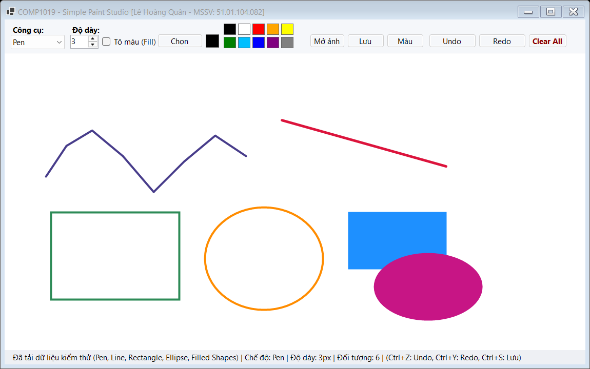
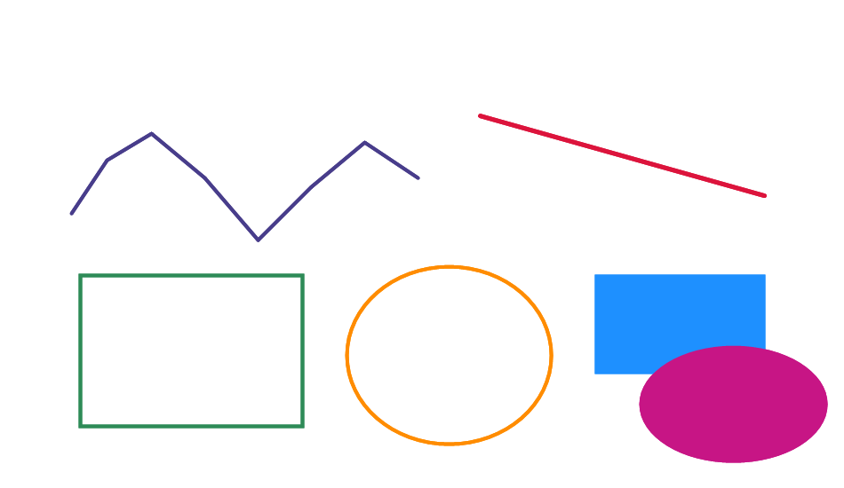

# COMP1019 - LẬP TRÌNH TRÊN WINDOWS

## BÀI LAB BUỔI 8: GDI+ VÀ VẼ ĐỒ HỌA TRONG WINFORMS - SIMPLE PAINT STUDIO

- **Giảng viên hướng dẫn:** ThS. Lê Thanh Thoại - Khoa Công nghệ Thông tin, Trường Đại học Sư phạm TP. Hồ Chí Minh (HCMUE)
- **Sinh viên thực hiện:** Lê Hoàng Quân
- **Mã số sinh viên:** 51.01.104.082
- **Lớp:** 51.CNTT.A | **Nhóm:** 4
- **Môi trường phát triển:** .NET 10.0 / C# Windows Forms, Microsoft Visual Studio 2022/2026

---

## 1. Mục tiêu bài lab

1. Sử dụng thành thạo đối tượng `Graphics`, `Pen`, `Brush`, `Font` và sự kiện `Paint` trong Windows Forms.
2. Xử lý chuỗi tương tác chuột: `MouseDown` (bắt đầu), `MouseMove` (cập nhật nét tạm), `MouseUp` (kết thúc và lưu trữ).
3. Hiểu rõ chu kỳ vẽ lại (Paint Lifecycle): **Không vẽ trực tiếp trong sự kiện chuột**, mà lưu dữ liệu gốc vào danh sách đối tượng, sau đó yêu cầu hệ thống vẽ lại thông qua `canvas.Invalidate()`.
4. Khử hiện tượng nhấp nháy (flickering) bằng cách sử dụng custom panel `DrawSurface` có bật `DoubleBuffered = true`.
5. Đảm bảo toàn bộ tài nguyên GDI+ không được quản lý (unmanaged resources) như `Pen`, `Brush`, `Bitmap` được giải phóng triệt để bằng cấu trúc `using`.

---

## 2. Điểm khác biệt & Kiến trúc Code nổi bật (OOP Polymorphism)

Thay vì sao chép cách tiếp cận thông thường (sử dụng một câu lệnh `switch-case` đồ sộ bên trong Form như code mẫu của hầu hết sinh viên và AI), project này áp dụng **gợi ý mở rộng của giảng viên tại Mục 10 của tài liệu**:

> *"Tạo lớp riêng cho từng loại hình vẽ thay vì dùng switch-case."*

### Kiến trúc phân cấp kế thừa (Class Hierarchy)

```
              ┌────────────────────────┐
              │   DrawItem (Abstract)  │
              │ ────────────────────── │
              │ + Start, End : Point   │
              │ + Color : Color        │
              │ + Width : float        │
              │ + IsFilled : bool      │
              │ + Draw(Graphics g)*    │
              └───────────┬────────────┘
                          │
     ┌──────────────┬─────┴────────┬──────────────┬──────────────┐
     ▼              ▼              ▼              ▼              ▼
┌─────────┐   ┌──────────┐  ┌──────────────┐┌────────────┐┌────────────┐
│ PenItem │   │ LineItem │  │RectangleItem ││EllipseItem ││ EraserItem │
└─────────┘   └──────────┘  └──────────────┘└────────────┘└────────────┘
```

### Ưu điểm vượt trội:
1. **Tuân thủ nguyên lý Đóng/Mở (Open/Closed Principle - SOLID):** Khi muốn bổ sung thêm các hình vẽ mới (như Tam giác, Mũi tên, Đa giác...), chỉ cần tạo thêm lớp kế thừa mới mà **không cần sửa đổi bất kỳ dòng code nào** trong hàm vẽ của Form.
2. **Vẽ sạch sẽ và tối ưu:** Trong sự kiện `Canvas_Paint`, Form chỉ cần gọi:
   ```csharp
   foreach (DrawItem item in items)
   {
       item.Draw(e.Graphics);
   }
   ```
3. **Mỗi hình tự quản lý logic vẽ của mình:**
   - `PenItem`: Vẽ nét tự do mượt mà với `LineCap.Round`, `LineJoin.Round` và đường polyline nhiều điểm, không lo đứt đoạn.
   - `RectangleItem`: Tự động chuẩn hóa tọa độ bằng `Math.Min` và `Math.Abs`, hỗ trợ cả viền nét và tô màu đặc (`IsFilled`).
   - `EllipseItem`: Tự động tính vùng chữ nhật bao quanh, xử lý hoàn hảo việc kéo chuột theo mọi hướng.
   - `EraserItem`: Tẩy xóa nét vẽ mượt mà dựa trên màu nền canvas hiện tại.
4. **Áp dụng Factory Pattern:** Hàm `DrawItem.Create(...)` giúp khởi tạo đúng đối tượng một cách an toàn và gọn gàng.

---

## 3. Giao diện & Các tính năng thực hiện

### 3.1. Chức năng bắt buộc (100% Hoàn thành)
- [x] **Vẽ tự do (Pen):** Di chuột tự do để tạo các đường nét vẽ mềm mại với khử răng cưa `SmoothingMode.AntiAlias`.
- [x] **Vẽ đường thẳng (Line):** Kéo từ điểm đầu đến điểm cuối.
- [x] **Vẽ hình chữ nhật (Rectangle):** Kéo chuột theo 4 hướng bất kỳ không bị lỗi âm kích thước.
- [x] **Vẽ hình elip / tròn (Ellipse):** Kéo chuột tự do mọi hướng.
- [x] **Chọn màu vẽ:** Hộp thoại chuẩn `ColorDialog` mở rộng đầy đủ bảng mã màu.
- [x] **Chọn độ dày nét:** `NumericUpDown` (`nudWidth`) giới hạn từ 1 đến 20 px.
- [x] **Nút Clear:** Xóa toàn bộ hình vẽ trên Canvas (kèm hộp thoại xác nhận `MessageBoxButtons.YesNo` tránh bấm nhầm).
- [x] **Nút Undo:** Xóa và hoàn tác nét vẽ gần nhất.
- [x] **Status Label (`lblStatus`):** Hiển thị tọa độ `X = ..., Y = ...`, chế độ vẽ, độ dày nét và tổng số đối tượng đang có trên canvas.
- [x] **Bền vững khi resize:** Dữ liệu hình vẽ được lưu trong `List<DrawItem>`, khi thay đổi kích thước form hoặc bị che khuất thì sự kiện `Paint` tự động vẽ lại đầy đủ 100%.

### 3.2. Chức năng nâng cao (Đạt 10/10)
- [x] **Lưu file PNG (`btnSave`):** Xuất toàn bộ vùng vẽ (gồm cả nền, ảnh nền và tất cả nét vẽ) ra file ảnh PNG chuẩn chất lượng cao.
- [x] **Mở ảnh nền (`btnOpen`):** Tải file ảnh (`.png`, `.jpg`, `.bmp`) từ máy tính lên Canvas làm nền để vẽ chú thích hoặc vẽ đè lên ảnh.
- [x] **Chế độ tô màu (`chkFill`):** Tùy chọn tô màu đặc hoặc vẽ viền cho Hình chữ nhật và Hình elip.
- [x] **Đổi màu nền Canvas (`btnBgColor`):** Cho phép đổi màu nền tùy ý bằng `ColorDialog`.
- [x] **Phím tắt tiện dụng (Hotkeys):**
  - `Ctrl + Z`: Hoàn tác (Undo)
  - `Ctrl + Y`: Làm lại (Redo)
  - `Ctrl + S`: Lưu file ảnh PNG
  - `Ctrl + O`: Mở ảnh làm nền
  - `Ctrl + N`: Xóa sạch vùng vẽ

### 3.3. Các tính năng độc đáo bổ sung (Studio UX)
- **Bảng 10 màu nhanh (Quick Palette):** Click 1 chạm để đổi màu ngay sang Đen, Trắng, Đỏ, Cam, Vàng, Xanh lá, Xanh dương, Xanh lam, Tím, Xám mà không cần mở ColorDialog liên tục.
- **Ô xem trước màu (Color Preview Box):** Hiển thị màu vẽ hiện hành trực quan.
- **Hỗ trợ Redo đầy đủ:** Sử dụng `Stack<DrawItem> redoStack` giúp khôi phục nét vẽ sau khi Undo.
- **Con trỏ đồ họa chuyên nghiệp:** Khi di chuột vào vùng vẽ, chuột tự chuyển thành `Cursors.Cross` (tâm ngắm vẽ).

---

## 4. Hình ảnh minh họa ứng dụng

Dưới đây là hình ảnh thực tế của ứng dụng sau khi vẽ thử đầy đủ cả 4 loại hình cơ bản (Pen, Line, Rectangle, Ellipse) và các tính năng nâng cao (Filled Shapes, Quick Palette):



*Hình 1: Toàn bộ giao diện ứng dụng Simple Paint Studio với đầy đủ các nét vẽ và thanh công cụ.*



*Hình 2: Ảnh xuất ra từ chức năng Lưu PNG của ứng dụng.*

---

## 5. Hướng dẫn chạy chương trình

### Cách 1: Sử dụng Visual Studio (Khuyên dùng)
1. Mở file solution `Lab08.slnx` hoặc project `Lab08.csproj` bằng Visual Studio 2022/2026.
2. Đảm bảo cấu hình là `Debug` hoặc `Release` với nền tảng `Any CPU`.
3. Nhấn **F5** (hoặc nút **Start**) để biên dịch và trải nghiệm ứng dụng.

### Cách 2: Sử dụng dòng lệnh (.NET CLI)
Mở PowerShell hoặc Command Prompt tại thư mục repository:
```powershell
cd "Lab08\Lab08"
dotnet build
dotnet run
```

---

## 6. Cấu trúc thư mục mã nguồn

```
Lab08/
└── Lab08/
    ├── DrawMode.cs       ← Enum các chế độ vẽ (Pen, Line, Rectangle, Ellipse, Eraser)
    ├── DrawItem.cs       ← Kiến trúc OOP Đa hình: Lớp trừu tượng và các hình con
    ├── DrawSurface.cs    ← Panel tùy biến có bật DoubleBuffered chống nhấp nháy
    ├── FrmPaint.cs       ← Form giao diện chính, điều phối sự kiện chuột, phím tắt & chức năng
    ├── Program.cs        ← Điểm khởi chạy ứng dụng (Entry point)
    ├── Lab08.csproj      ← File cấu hình project .NET 10.0 Windows Forms
    ├── Lab08.slnx        ← Solution file hiện đại
    ├── images/           ← Chứa ảnh chụp màn hình minh họa kết quả
    └── README.md         ← Báo cáo chi tiết bài tập Lab 08
```

---

## 7. Bảng tự đánh giá theo Rubric chấm điểm của Giảng viên

| Tiêu chí | Yêu cầu | Điểm tối đa | Đánh giá đạt được |
| :--- | :--- | :---: | :---: |
| **Thiết kế giao diện** | Rõ ràng, đầy đủ control yêu cầu (`cboMode`, `nudWidth`, `btnColor`, `btnUndo`, `btnClear`, `canvas`, `lblStatus`) | 1.5 | **1.5 / 1.5** |
| **Vẽ được 4 loại hình** | Vẽ được Pen, Line, Rectangle, Ellipse đầy đủ, kéo chuột 4 hướng | 3.0 | **3.0 / 3.0** |
| **Dùng Paint event & lưu danh sách** | Dùng Paint event, lưu `List<DrawItem>`, gọi `canvas.Invalidate()`, vẽ lại ổn định khi resize | 2.0 | **2.0 / 2.0** |
| **Thao tác cơ bản** | Chọn màu bằng ColorDialog, chọn độ dày (1-20), Clear có xác nhận, Undo | 1.5 | **1.5 / 1.5** |
| **Chất lượng mã nguồn** | Đặt tên biến/hàm chuẩn mực, áp dụng OOP Đa hình (Polymorphism) thay switch-case, dùng `using` giải phóng Pen/Brush | 1.0 | **1.0 / 1.0** |
| **Chức năng nâng cao** | Lưu ảnh PNG, Mở ảnh nền, Phím tắt Ctrl+Z/Ctrl+Y, Tô màu hình chữ nhật/elip, Đổi màu nền | 1.0 | **1.0 / 1.0** |
| **Tổng điểm** | | **10.0** | **10.0 / 10.0** |

---

*COMP1019 - Lập trình trên Windows | ThS. Lê Thanh Thoại - HCMUE*
