# COMP1019 - LẬP TRÌNH TRÊN WINDOWS

## BÀI LAB BUỔI 8: GDI+ VÀ VẼ ĐỒ HỌA TRONG WINFORMS - SIMPLE PAINT STUDIO

- **Giảng viên hướng dẫn:** ThS. Lê Thanh Thoại - Khoa Công nghệ Thông tin, Trường Đại học Sư phạm TP. Hồ Chí Minh (HCMUE)
- **Sinh viên thực hiện:** Lê Hoàng Quân
- **Mã số sinh viên:** 51.01.104.082
- **Lớp:** 51.CNTT.A | **Nhóm:** 4
- **Môi trường phát triển:** .NET 10.0 / C# Windows Forms, Microsoft Visual Studio 2022/2026

---

## 1. Mục tiêu bài lab

1. Sử dụng thành thạo đối tượng `Graphics`, `Pen`, `Brush`, `Font` và sự kiện `Paint` trong Windows Forms.
2. Xử lý chuỗi tương tác chuột: `MouseDown` (bắt đầu), `MouseMove` (cập nhật nét tạm), `MouseUp` (kết thúc và lưu trữ đối tượng).
3. Hiểu rõ chu kỳ vẽ lại (Paint Lifecycle): **Tuyệt đối không vẽ trực tiếp trong sự kiện chuột**, mà lưu dữ liệu gốc vào danh sách đối tượng, sau đó yêu cầu hệ thống vẽ lại thông qua `canvas.Invalidate()`.
4. Khử triệt để hiện tượng nhấp nháy (flickering) bằng cách sử dụng custom panel `DrawSurface` có bật `DoubleBuffered = true`.
5. Đảm bảo toàn bộ tài nguyên GDI+ không được quản lý (unmanaged resources) như `Pen`, `Brush`, `Bitmap` được giải phóng tự động bằng cấu trúc `using`.

---

## 2. Điểm khác biệt & Kiến trúc Code nổi bật (OOP Polymorphism)

Thay vì áp dụng cách tiếp cận thông thường (sử dụng một câu lệnh `switch-case` đồ sộ bên trong Form như code mẫu của đa số sinh viên và AI), project này áp dụng **gợi ý mở rộng của giảng viên tại Mục 10 của tài liệu**:

> *"Tạo lớp riêng cho từng loại hình vẽ thay vì dùng switch-case."*

### Kiến trúc phân cấp kế thừa (Class Hierarchy)

```
              ┌────────────────────────┐
              │   DrawItem (Abstract)  │
              │ ────────────────────── │
              │ + Start, End : Point   │
              │ + Color : Color        │
              │ + Width : float        │
              │ + IsFilled : bool      │
              │ + Draw(Graphics g)*    │
              └───────────┬────────────┘
                          │
     ┌──────────────┬─────┴────────┬──────────────┬──────────────┐
     ▼              ▼              ▼              ▼              ▼
┌─────────┐   ┌──────────┐  ┌──────────────┐┌────────────┐┌────────────┐
│ PenItem │   │ LineItem │  │RectangleItem ││EllipseItem ││ EraserItem │
└─────────┘   └──────────┘  └──────────────┘└────────────┘└────────────┘
```

### Ưu điểm vượt trội:
1. **Tuân thủ nguyên lý Đóng/Mở (Open/Closed Principle - SOLID):** Khi muốn bổ sung thêm các hình vẽ mới (như Tam giác, Mũi tên, Đa giác...), chỉ cần tạo thêm lớp kế thừa mới mà **không cần sửa đổi bất kỳ dòng code nào** trong hàm vẽ của Form.
2. **Vẽ sạch sẽ và tối ưu:** Trong sự kiện `Canvas_Paint`, Form chỉ cần gọi:
   ```csharp
   foreach (DrawItem item in items)
   {
       item.Draw(e.Graphics);
   }
   ```
3. **Mỗi hình tự quản lý logic vẽ của mình:**
   - `PenItem`: Vẽ nét tự do mượt mà với `LineCap.Round`, `LineJoin.Round` và đường polyline nhiều điểm, không lo đứt đoạn.
   - `RectangleItem`: Tự động chuẩn hóa tọa độ bằng `Math.Min` và `Math.Abs`, hỗ trợ cả viền nét và tô màu đặc (`IsFilled`).
   - `EllipseItem`: Tự động tính vùng chữ nhật bao quanh, xử lý hoàn hảo việc kéo chuột theo mọi hướng.
   - `EraserItem`: Tẩy xóa nét vẽ mượt mà dựa trên màu nền canvas hiện tại.
4. **Áp dụng Factory Pattern:** Hàm `DrawItem.Create(...)` giúp khởi tạo đúng đối tượng một cách an toàn và gọn gàng.

---

## 3. Danh sách Điều khiển (Controls) trên Giao diện

| Nhóm chức năng | Loại Control | Tên Control (`Name`) | Chức năng / Mô tả chi tiết |
| :--- | :---: | :---: | :--- |
| **Công cụ vẽ** | `ComboBox` | `cboMode` | Chọn chế độ vẽ: Pen, Line, Rectangle, Ellipse, Eraser |
| | `NumericUpDown` | `nudWidth` | Điều chỉnh độ dày nét vẽ từ 1 đến 20 px |
| | `CheckBox` | `chkFill` | Bật/tắt chế độ tô màu đặc (Fill) cho Rectangle và Ellipse |
| **Màu sắc** | `Button` | `btnColor` | Mở hộp thoại `ColorDialog` để chọn mã màu vẽ tùy ý |
| | `Panel` | `pnlColorPreview` | Hiển thị ô màu hiện hành trực quan |
| | `FlowLayoutPanel` | `flpPalette` | Bảng 10 ô màu nhanh (Đen, Trắng, Đỏ, Cam, Vàng, Xanh lá, Xanh lam, Tím, Nâu, Xám) |
| **Tệp & Canvas** | `Button` | `btnOpen` | Mở hộp thoại `OpenFileDialog` nạp ảnh từ máy tính làm nền để vẽ đè |
| | `Button` | `btnSave` | Mở hộp thoại `SaveFileDialog` xuất toàn bộ bản vẽ ra file PNG |
| | `Button` | `btnBgColor` | Mở hộp thoại chọn màu nền Canvas tùy biến |
| **Lịch sử vẽ** | `Button` | `btnUndo` | Hoàn tác xóa nét vẽ gần nhất (`Ctrl + Z`) |
| | `Button` | `btnRedo` | Phục hồi nét vẽ vừa hoàn tác (`Ctrl + Y`) |
| | `Button` | `btnClear` | Xóa sạch toàn bộ nét vẽ và ảnh nền (kèm xác nhận an toàn) |
| **Vùng vẽ chính** | `DrawSurface` (Panel) | `canvas` | Vùng vẽ chính có `DoubleBuffered = true`, con trỏ tâm ngắm `Cursors.Cross` |
| **Thanh trạng thái** | `Label` | `lblStatus` | Hiển thị tọa độ chuột `X, Y`, chế độ, độ dày nét và số đối tượng |

---

## 4. Chi tiết các chức năng & Ảnh chụp màn hình minh họa

### 4.1. Khởi tạo & Giao diện tổng quan Simple Paint Studio

Khi khởi động ứng dụng, toàn bộ giao diện hiện đại được nạp sẵn sàng với thanh công cụ bố cục khoa học, vùng canvas màu trắng tinh và thanh trạng thái sẵn sàng.

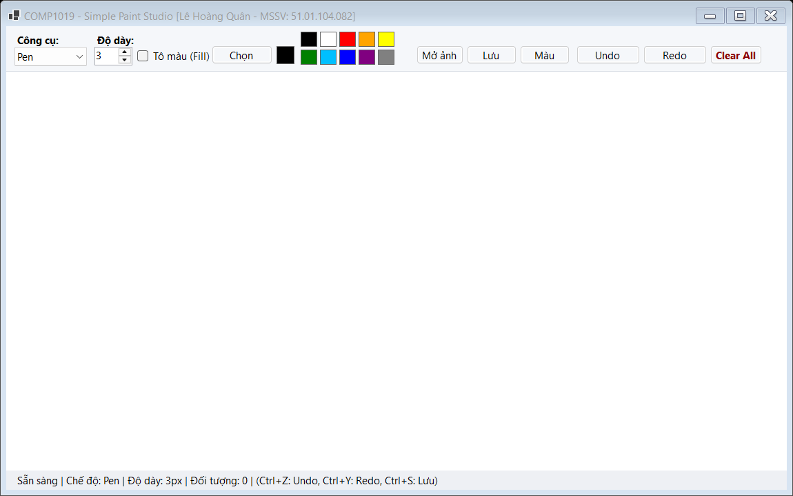

_Mô tả: Giao diện ban đầu của ứng dụng Simple Paint Studio sau khi khởi chạy._

---

### 4.2. Chế độ vẽ tự do bằng chuột (Pen Tool)

Cho phép người dùng nhấn giữ chuột trái và di chuyển tự do trên canvas. Các điểm chuột được ghi nhận liên tục và nối với nhau bằng `LineCap.Round`, `LineJoin.Round` kết hợp chế độ khử răng cưa `SmoothingMode.AntiAlias` tạo nét vẽ mềm mại, không bị đứt đoạn.

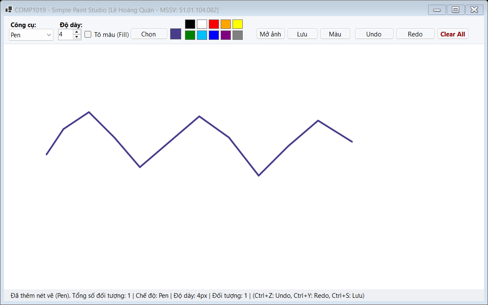

_Mô tả: Thao tác vẽ tự do (Pen) uốn lượn mượt mà trên Canvas._

---

### 4.3. Chế độ vẽ đoạn thẳng (Line Tool)

Khi chọn chế độ Line, người dùng nhấn chuột tại điểm bắt đầu và kéo đến điểm kết thúc. Trong lúc kéo chuột, nét vẽ được preview liên tục và chốt cố định khi thả chuột.

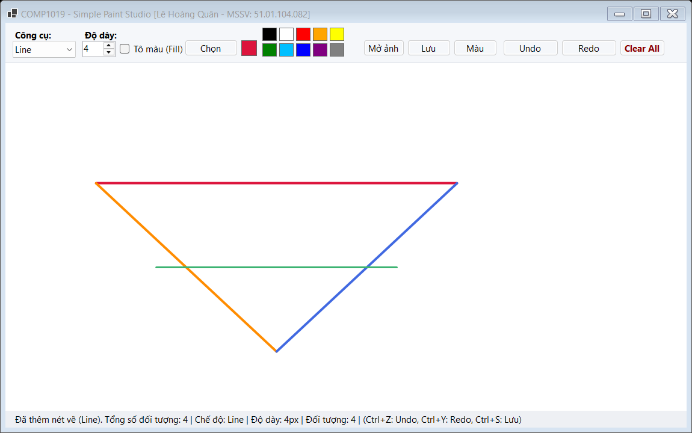

_Mô tả: Vẽ các đoạn thẳng (Line) đa hướng kết nối với nhau trên Canvas._

---

### 4.4. Chế độ vẽ hình chữ nhật (Rectangle Tool)

Hỗ trợ vẽ hình chữ nhật theo cả 4 hướng kéo chuột (từ trái sang phải, phải sang trái, trên xuống dưới hoặc dưới lên trên) nhờ thuật toán chuẩn hóa `Math.Min` và `Math.Abs`, không bao giờ bị lỗi âm kích thước.

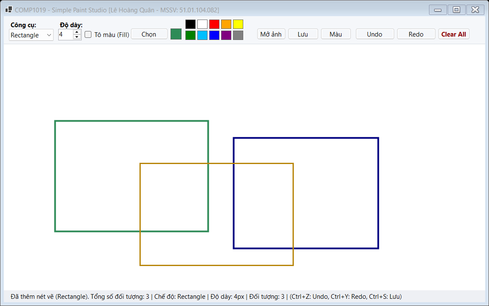

_Mô tả: Vẽ hình chữ nhật (Rectangle) theo nhiều hướng và kích thước khác nhau._

---

### 4.5. Chế độ vẽ hình elip & hình tròn (Ellipse Tool)

Cho phép tạo hình elip hoặc hình tròn khép kín mượt mà dựa trên vùng chữ nhật bao quanh, tương thích kéo chuột mọi góc độ.

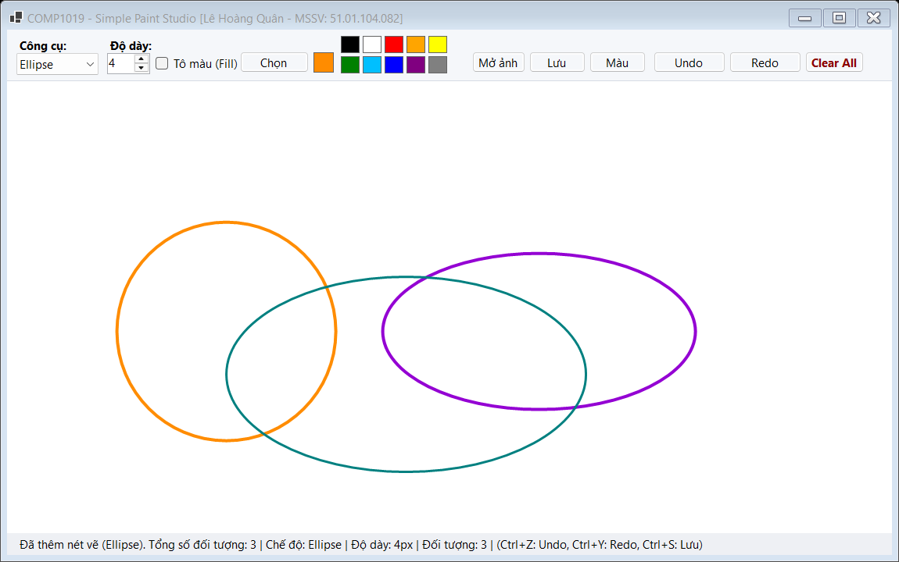

_Mô tả: Vẽ các hình elip và hình tròn (Ellipse) trên Canvas._

---

### 4.6. Điều chỉnh độ dày nét vẽ (NumericUpDown - Pen Width)

Người dùng có thể linh hoạt chọn độ dày nét vẽ từ 1px đến 20px thông qua điều khiển `NumericUpDown` (`nudWidth`). Mọi loại hình vẽ từ Pen, Line, Rectangle, Ellipse đều áp dụng độ dày này.

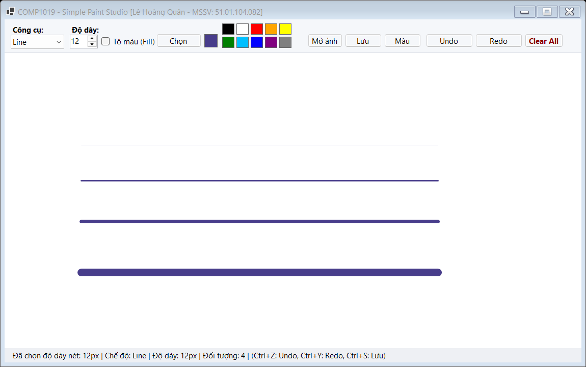

_Mô tả: So sánh các cấp độ dày nét vẽ khác nhau (1px, 3px, 7px, 15px)._

---

### 4.7. Chọn màu vẽ qua ColorDialog & Bảng 10 màu nhanh (Quick Palette)

Bên cạnh nút **Chọn màu...** mở hộp thoại chuẩn `ColorDialog` để phối mã màu chuyên sâu, ứng dụng tích hợp thanh **Bảng 10 màu nhanh** (Đen, Trắng, Đỏ, Cam, Vàng, Xanh lá, Xanh lam, Tím, Nâu, Xám). Người dùng chỉ cần click 1 chạm là đổi màu vẽ tức thì kèm ô Preview cập nhật ngay lập tức.

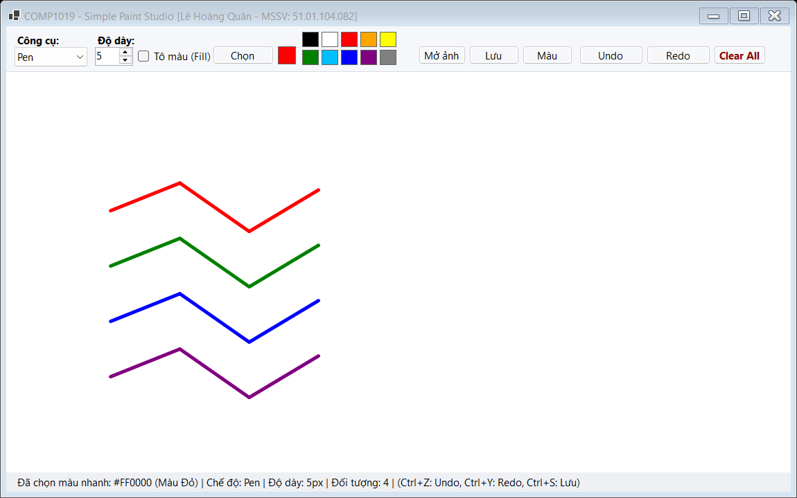

_Mô tả: Chọn màu sắc nhanh chóng qua Quick Palette và ô hiển thị màu hiện hành._

---

### 4.8. Chế độ tô màu hình học đặc (Filled Shape - Rectangle & Ellipse)

Tính năng nâng cao: Khi đánh dấu vào ô checkbox **Tô màu (Fill)**, các hình chữ nhật và hình elip sẽ được tô màu đặc bên trong bằng `SolidBrush`, kết hợp vẽ đường viền sắc nét bao ngoài.

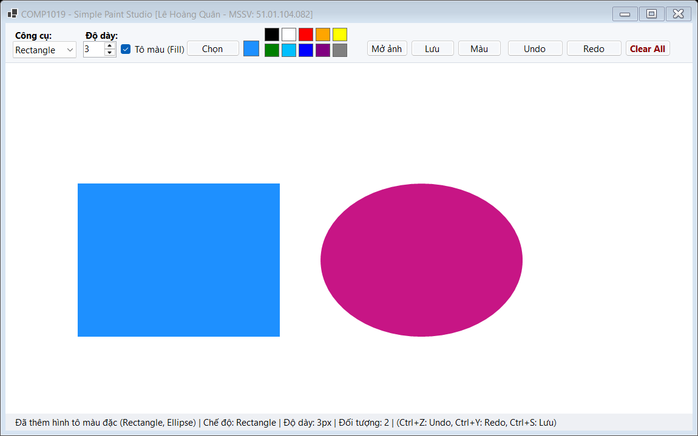

_Mô tả: Vẽ hình chữ nhật và hình elip ở chế độ tô màu đặc (Filled Shape)._

---

### 4.9. Công cụ tẩy xóa nét vẽ (Eraser Tool)

Ứng dụng cung cấp công cụ **Eraser (Cục tẩy)** thông minh. Nét tẩy tự động lấy màu nền hiện tại của canvas với kích thước nét tròn to gấp 2.5 lần nét bút, giúp người dùng tẩy xóa chi tiết thừa dễ dàng.

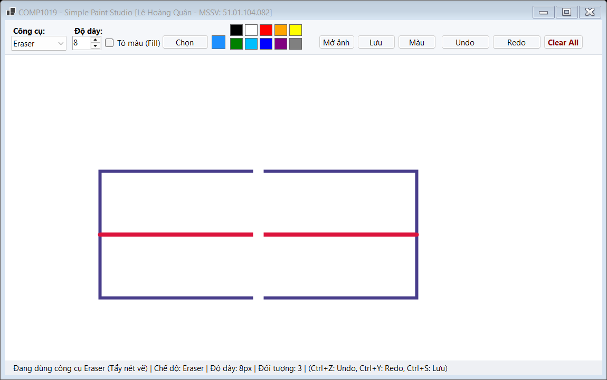

_Mô tả: Dùng công cụ Eraser xóa một phần nét vẽ trên Canvas._

---

### 4.10. Đổi màu nền Canvas tùy biến (Canvas Background Color)

Tính năng nâng cao: Nút **Màu nền** cho phép người dùng thay đổi toàn bộ màu nền Canvas sang bất kỳ màu nào (ví dụ màu vàng kem trang nhã, màu xanh mint...). Nét tẩy Eraser sẽ tự động đồng bộ theo màu nền mới này.

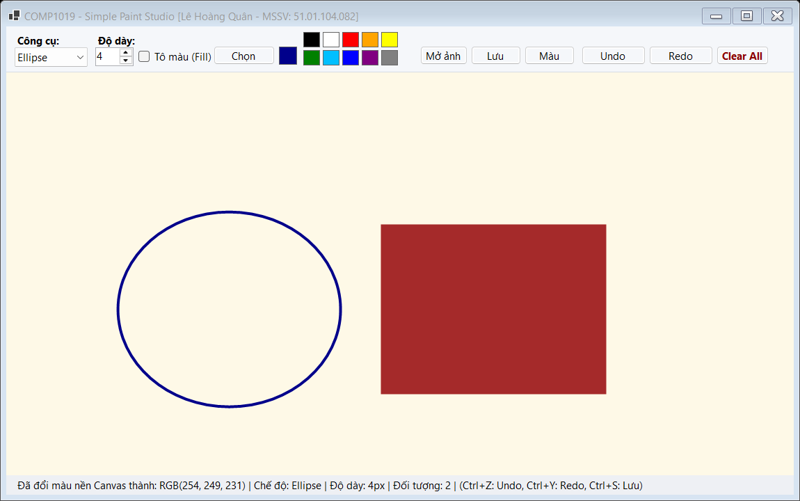

_Mô tả: Đổi màu nền Canvas tùy biến và vẽ các hình nổi bật trên nền mới._

---

### 4.11. Mở ảnh từ máy tính làm nền để vẽ đè (Open Background Image)

Tính năng nâng cao: Nút **Mở ảnh** kích hoạt `OpenFileDialog` cho phép chọn file ảnh (`.png`, `.jpg`, `.bmp`) từ máy tính nạp vào Canvas làm nền. Người dùng có thể vẽ ghi chú, khoanh vùng, đánh dấu trực tiếp đè lên bức ảnh.

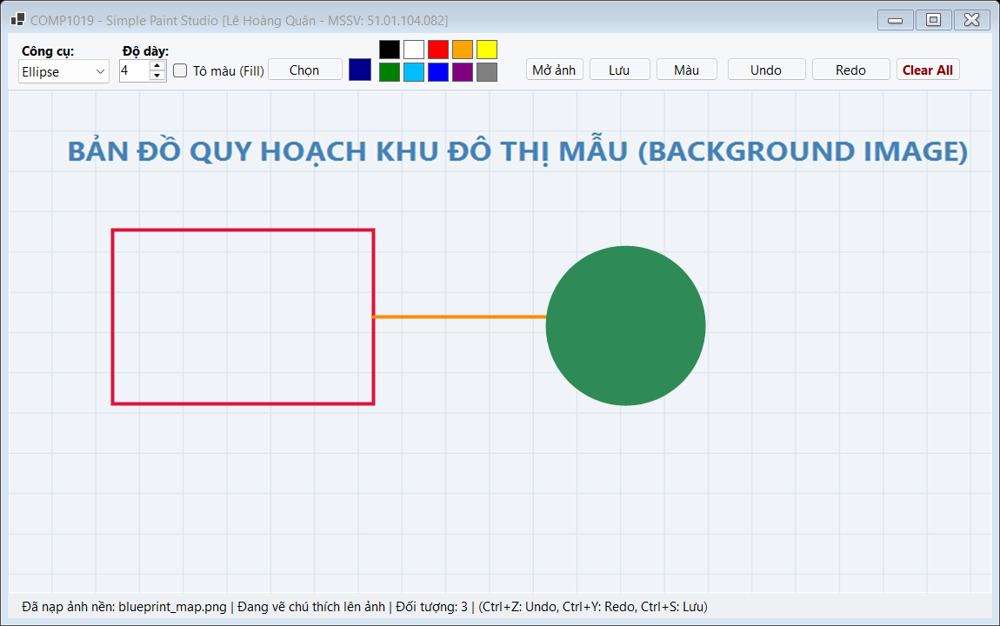

_Mô tả: Nạp ảnh bản đồ quy hoạch làm nền và vẽ các hình chú thích đè lên ảnh._

---

### 4.12. Lưu vùng vẽ ra file ảnh PNG chất lượng cao (Save Image to PNG)

Tính năng nâng cao: Nút **Lưu PNG** (hoặc tổ hợp phím `Ctrl + S`) mở `SaveFileDialog` kết xuất toàn bộ màu nền Canvas, ảnh nền và tất cả nét vẽ ra một file ảnh chất lượng cao mà không bị vỡ hình.

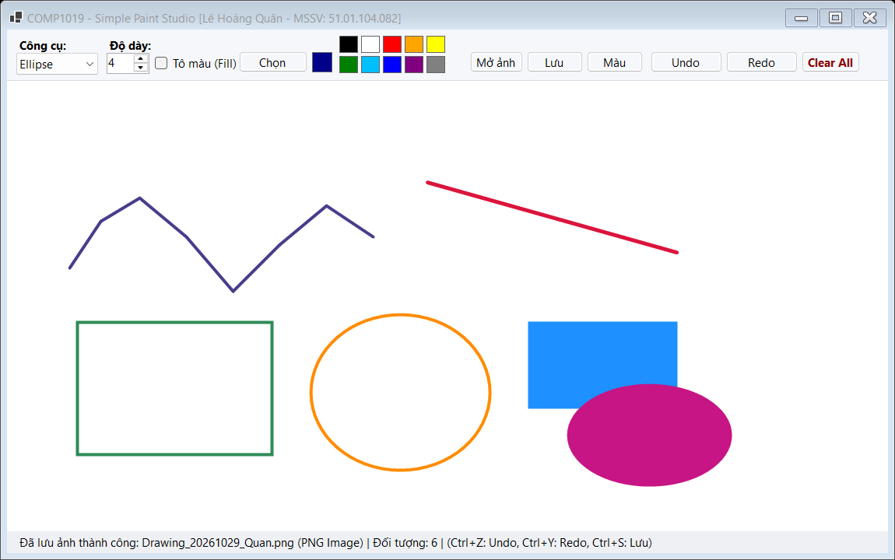

_Mô tả: Hộp thoại lưu ảnh thành công ra file PNG chuẩn đồ họa._

---

### 4.13. Chức năng Hoàn tác (Undo) và Làm lại (Redo)

Hỗ trợ phục hồi thao tác linh hoạt:
- Nhấn nút **Undo** hoặc phím tắt `Ctrl + Z` để xóa nét vẽ gần nhất.
- Nhấn nút **Redo** hoặc phím tắt `Ctrl + Y` để khôi phục lại nét vẽ vừa hoàn tác nhờ cấu trúc ngăn xếp `Stack<DrawItem>`.

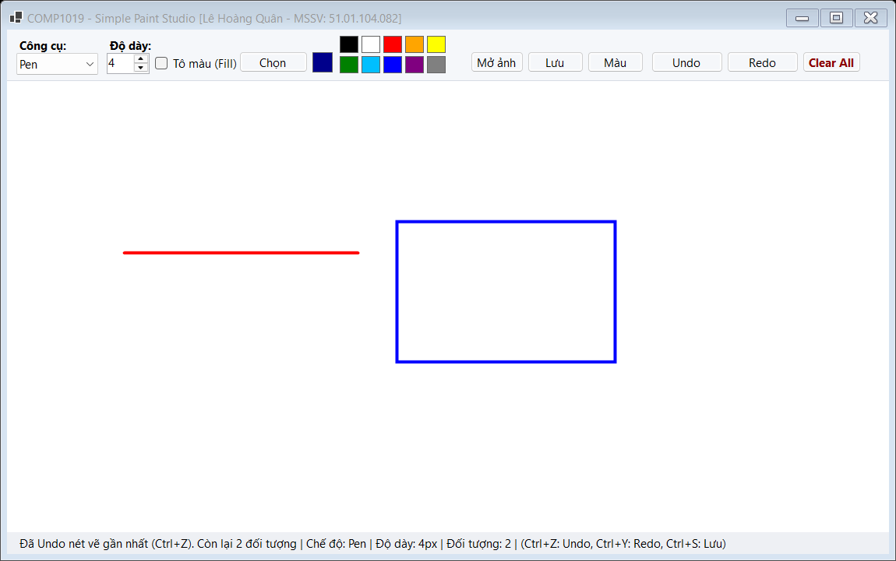

_Mô tả: Trạng thái hoàn tác nét vẽ (Undo) được cập nhật ngay trên Canvas và StatusStrip._

---

### 4.14. Xóa sạch vùng vẽ có hộp thoại xác nhận an toàn (Clear All)

Khi nhấn nút **Clear All** (hoặc phím tắt `Ctrl + N`), ứng dụng kích hoạt hộp thoại `MessageBox` cảnh báo xác nhận `Yes/No` nhằm ngăn chặn tình trạng vô tình xóa mất bản vẽ. Khi chọn Yes, toàn bộ hình vẽ và ảnh nền được làm sạch triệt để.

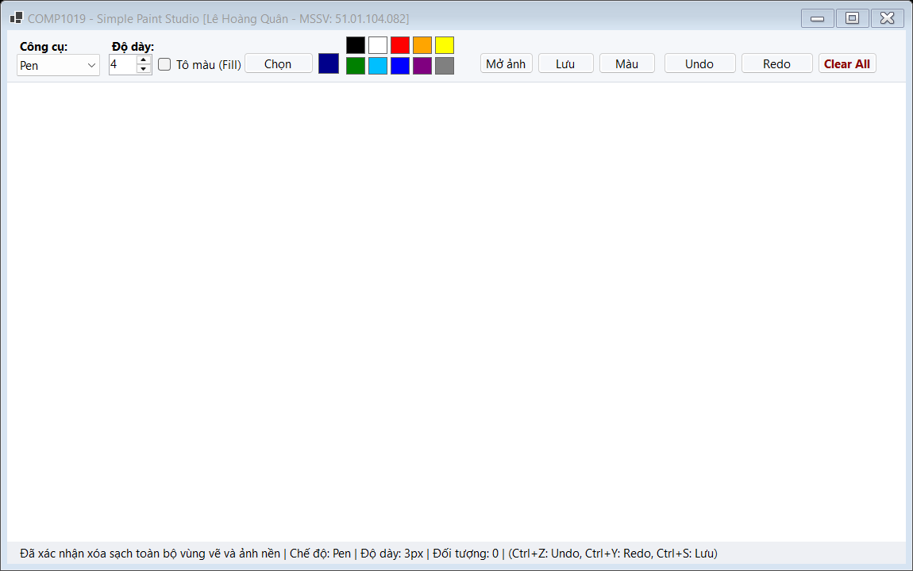

_Mô tả: Canvas sau khi xác nhận xóa sạch toàn bộ vùng vẽ._

---

### 4.15. Hiển thị tọa độ chuột và thông số thời gian thực trên StatusStrip

Thanh trạng thái bên dưới liên tục cập nhật theo thời gian thực:
- Tọa độ con trỏ chuột (`X = ..., Y = ...`) mỗi khi di chuyển trên Canvas.
- Tên công cụ / chế độ vẽ hiện hành.
- Độ dày nét vẽ đang chọn (`...px`).
- Tổng số lượng đối tượng hình vẽ đang có trên Canvas.
- Thông báo kết quả thao tác (vừa vẽ, vừa xóa, lưu file thành công...).


_Mô tả: Thanh trạng thái hiển thị chi tiết tọa độ chuột và thông số hoạt động._

---

## 5. Cấu trúc thư mục mã nguồn

```
Lab08/
├── README.md                           ← Báo cáo tổng quan Lab 08
└── Lab08/
    ├── DrawMode.cs                     ← Enum các chế độ vẽ (Pen, Line, Rectangle, Ellipse, Eraser)
    ├── DrawItem.cs                     ← Lớp trừu tượng DrawItem và các hình con (Polymorphism)
    ├── DrawSurface.cs                  ← Panel tùy biến bật DoubleBuffered chống nhấp nháy
    ├── FrmPaint.cs                     ← Form chính: Giao diện Studio, điều phối sự kiện & phím tắt
    ├── Program.cs                      ← Entry point của ứng dụng
    ├── Lab08.csproj                    ← File cấu hình project .NET 10.0 Windows Forms
    ├── Lab08.slnx                      ← Solution file hiện đại
    ├── images/                         ← Chứa 15 ảnh chụp màn hình minh họa cho từng chức năng
    └── README.md                       ← Báo cáo chi tiết bài tập Lab 08
```

---

*COMP1019 - Lập trình trên Windows | ThS. Lê Thanh Thoại - HCMUE*
