# COMP1019 - LẬP TRÌNH TRÊN WINDOWS

## BÀI LAB BUỔI 9: THIẾT KẾ VÀ IN THẺ SINH VIÊN BẰNG WINFORMS VÀ GDI+

- **Giảng viên hướng dẫn:** ThS. Lê Thanh Thoại - Khoa Công nghệ Thông tin, Trường Đại học Sư phạm TP. Hồ Chí Minh (HCMUE)
- **Sinh viên thực hiện:** Lê Hoàng Quân
- **Mã số sinh viên:** 51.01.104.082
- **Lớp:** 51.CNTT.A | **Nhóm:** 4
- **Môi trường phát triển:** .NET 10.0 / C# Windows Forms, Microsoft Visual Studio 2022/2026

---

## 1. Hình ảnh các chức năng của ứng dụng

### 1.1. Khởi tạo & Giao diện tổng quan FrmStudentCard
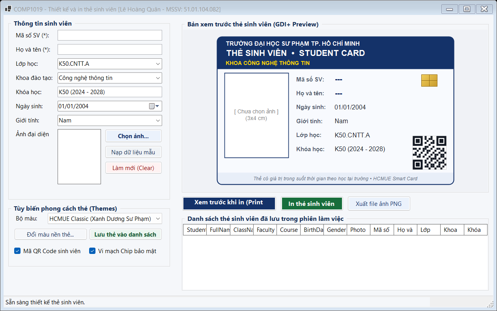
_Mô tả: Giao diện tổng quan ứng dụng thiết kế và in thẻ sinh viên khi vừa khởi chạy, phân chia rõ ràng giữa cột nhập liệu bên trái và vùng xem trước thẻ GDI+ kèm DataGridView bên phải._

---

### 1.2. Nhập thông tin sinh viên đầy đủ
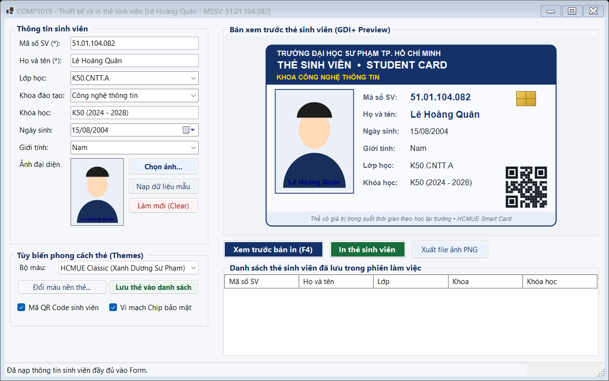
_Mô tả: Người dùng nhập đầy đủ các trường thông tin: Mã sinh viên, Họ và tên, Lớp học, Khoa, Khóa học, Ngày sinh từ DateTimePicker và Giới tính._

---

### 1.3. Chọn ảnh đại diện qua OpenFileDialog (Chế độ Zoom không méo)

_Mô tả: Người dùng tải ảnh đại diện từ ổ đĩa máy tính, ảnh được hiển thị vừa vặn trong khung 3x4 cm mà không bị kéo giãn hay biến dạng tỷ lệ._

---

### 1.4. Xem trước thẻ sinh viên vẽ bằng GDI+
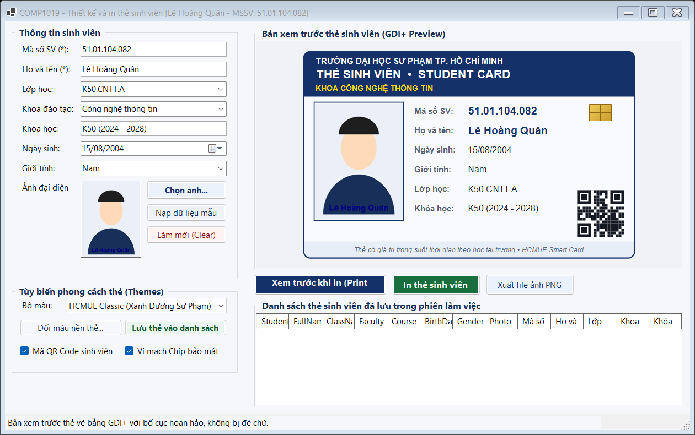
_Mô tả: Thẻ sinh viên được vẽ động theo thời gian thực bằng GDI+ với bo góc chuẩn CR-80, dải màu gradient nhận diện thương hiệu HCMUE, chip bảo mật và mã QR Code._

---

### 1.5. Thông báo Validation khi thiếu dữ liệu bắt buộc
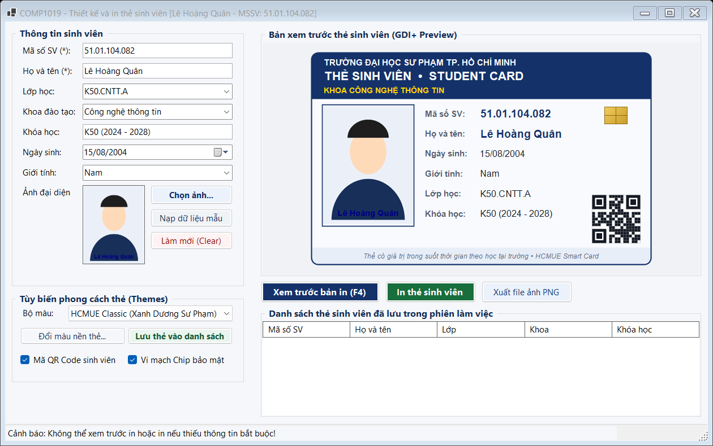
_Mô tả: Hệ thống hiển thị hộp thoại cảnh báo lỗi và tự động focus vào trường dữ liệu còn thiếu nếu người dùng nhấn in hoặc lưu mà chưa nhập Mã SV hoặc Họ tên._

---

### 1.6. Xem trước bản in chuẩn trang (Print Preview)
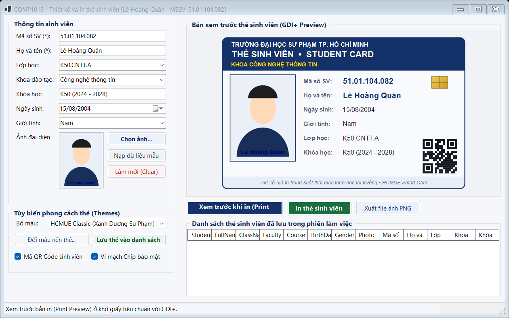
_Mô tả: Hộp thoại PrintPreviewDialog hiển thị mô phỏng thẻ sinh viên được căn chính xác giữa khổ giấy A4 theo đơn vị tính toán đồ họa chuẩn của máy in._

---

### 1.7. Tùy biến bộ màu phong cách thẻ (Themes)
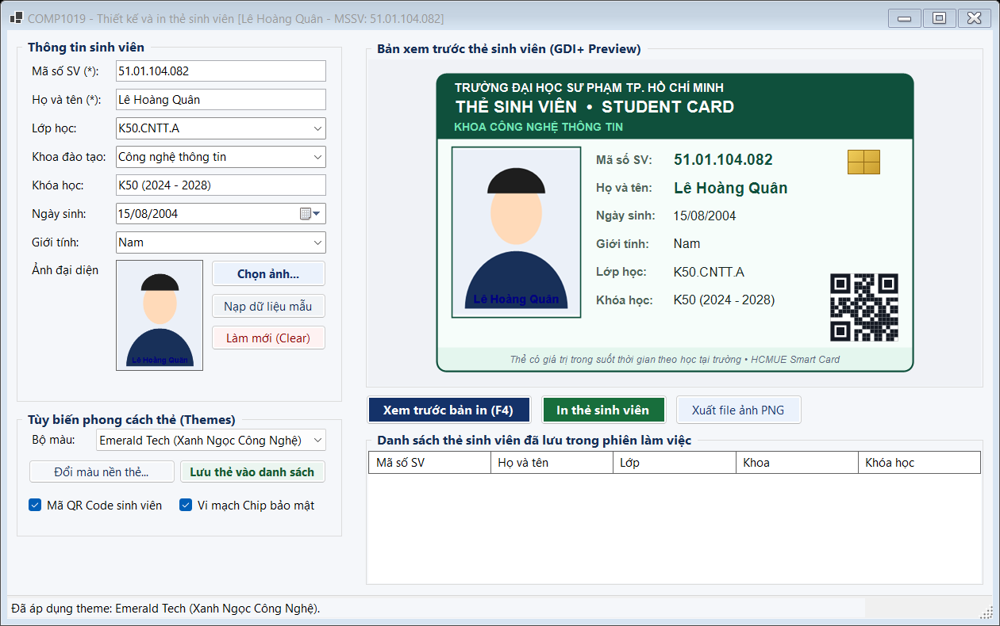
_Mô tả: Người dùng chuyển đổi nhanh giữa các chủ đề màu sắc khác nhau (HCMUE Classic, Hiện đại công nghệ, Tối giản xám, v.v.), thẻ lập tức cập nhật màu nền và viền đồng bộ._

---

### 1.8. Đổi màu nền thẻ tùy ý bằng ColorDialog
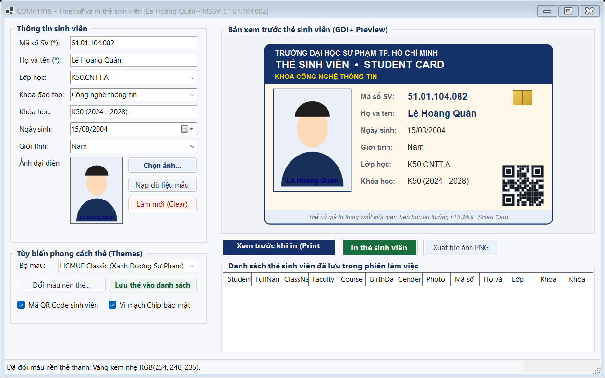
_Mô tả: Hộp thoại ColorDialog cho phép người dùng tự do lựa chọn bất kỳ mã màu RGB nào để phối nền cho phôi thẻ sinh viên._

---

### 1.9. Bật/Tắt hiển thị mã QR và Vi mạch Chip bảo mật

_Mô tả: Các checkbox cho phép bật hoặc tắt linh hoạt vi mạch chip bảo mật và mã QR trên thẻ; bố cục thẻ tự động điều chỉnh độ rộng trường thông tin tương ứng._

---

### 1.10. Xuất file ảnh thẻ sinh viên định dạng PNG
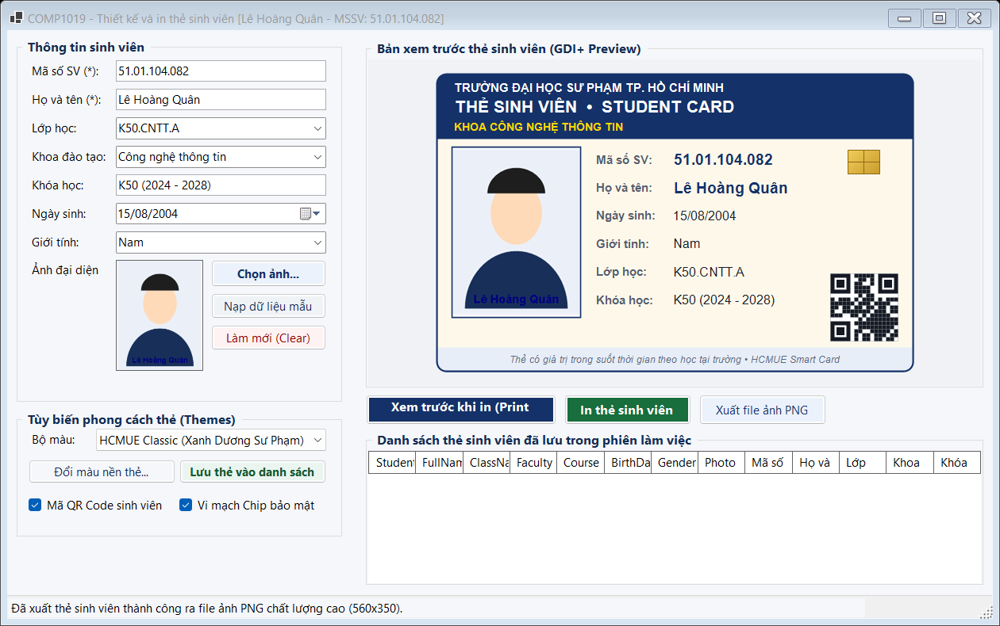
_Mô tả: Chức năng xuất toàn bộ thiết kế thẻ ra tệp hình ảnh PNG độ nét cao (1006 x 636 px) lưu vào bộ nhớ máy tính để phục vụ in ấn hoặc lưu trữ số hóa._

---

### 1.11. Lưu thẻ sinh viên vào bảng danh sách
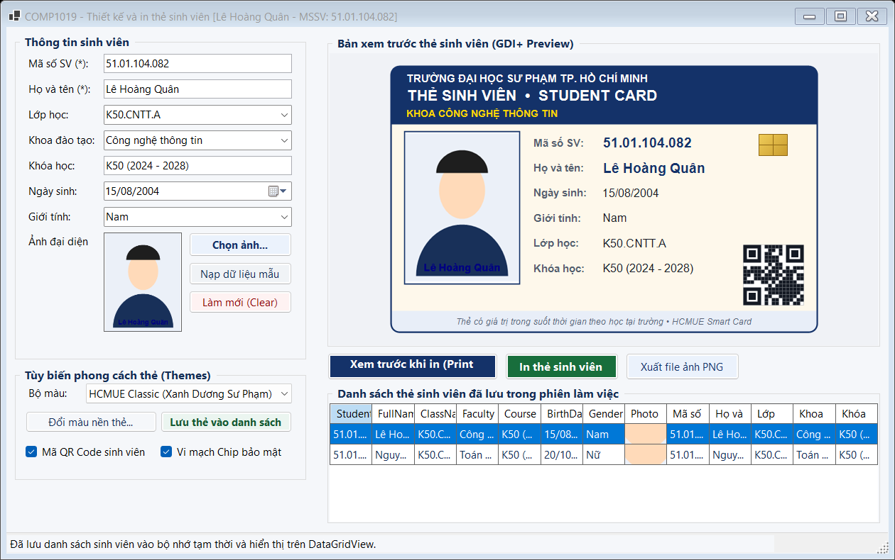
_Mô tả: Nhấn nút 'Lưu thẻ vào danh sách' để nạp đối tượng sinh viên vào DataGridView, cho phép quản lý danh sách nhiều sinh viên trong phiên làm việc._

---

### 1.12. Hộp thoại in thẻ (PrintDialog)
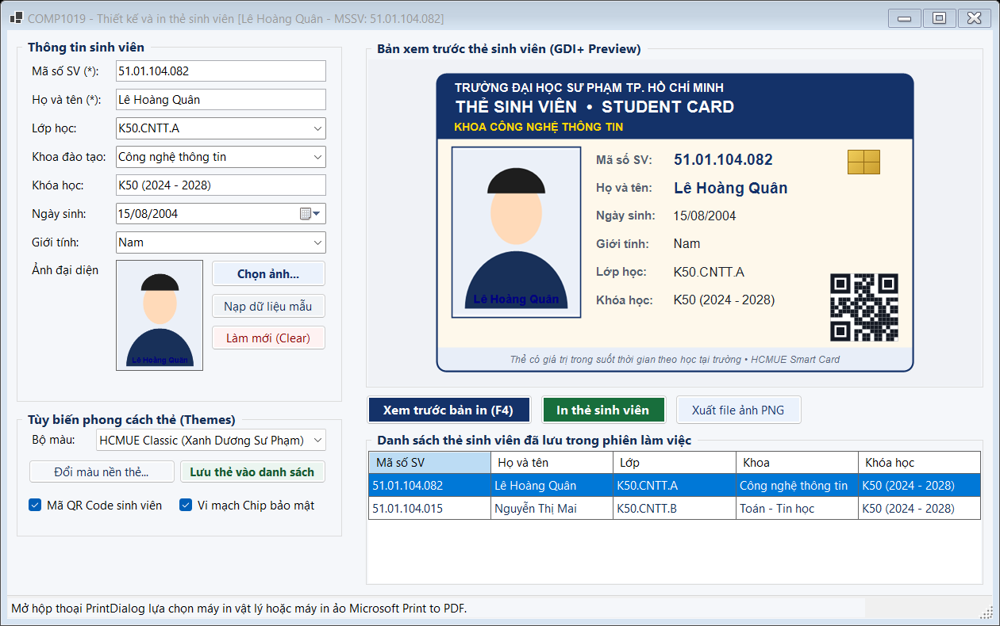
_Mô tả: Hộp thoại PrintDialog cho phép người dùng chọn máy in vật lý, máy in PDF ảo, chọn số lượng bản in trước khi phát lệnh in._

---

### 1.13. Làm mới Form nhập liệu (Clear)
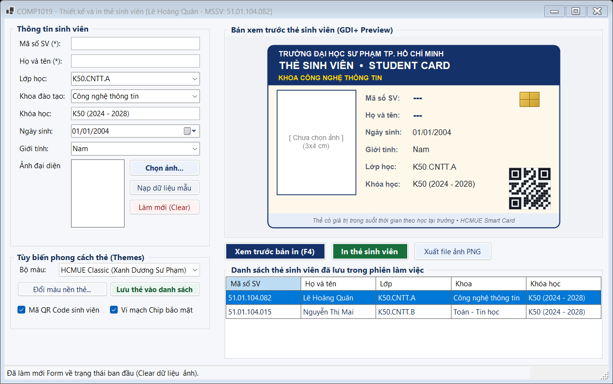
_Mô tả: Nhấn nút 'Làm mới' để đưa toàn bộ các điều khiển nhập liệu về trạng thái rỗng ban đầu, sẵn sàng nhập thẻ sinh viên mới._

---

## 2. Hình ảnh kiểm thử các trường hợp (Test Cases)

### 2.1. Test Case 1: Kiểm tra bỏ trống Mã số sinh viên
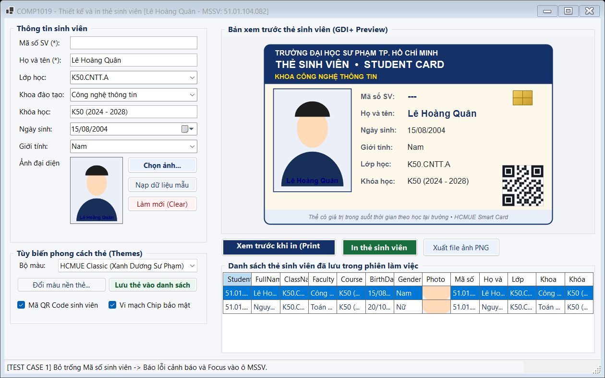
_Mô tả: Người dùng để trống ô 'Mã số SV' và bấm lưu/in. Hệ thống kích hoạt validation, bật cảnh báo yêu cầu nhập mã SV và trỏ con trỏ về ô nhập liệu._

---

### 2.2. Test Case 2: Kiểm tra bỏ trống Họ và tên sinh viên
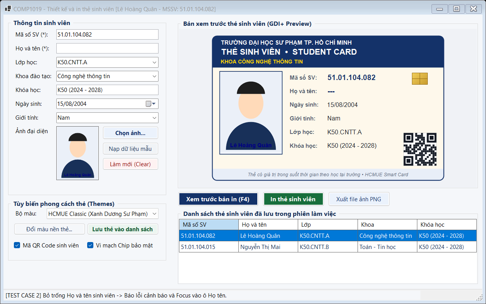
_Mô tả: Người dùng có mã SV nhưng để trống ô 'Họ và tên'. Hệ thống chặn lại và hiển thị thông báo lỗi yêu cầu hoàn tất thông tin._

---

### 2.3. Test Case 3: Kiểm tra khi sinh viên chưa có ảnh đại diện
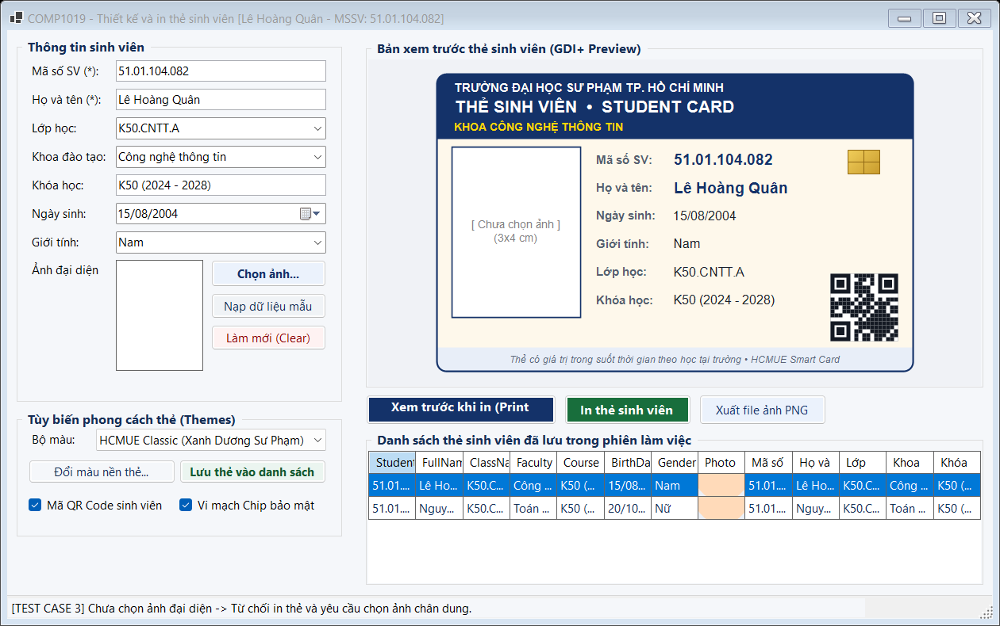
_Mô tả: Khi chưa chọn ảnh cá nhân, khu vực ảnh trên thẻ tự động hiển thị khung bo góc xám với văn bản placeholder [ Chưa chọn ảnh ] (3x4 cm) rất ngay ngắn._

---

### 2.4. Test Case 4: Kiểm tra tệp ảnh tải lên không hợp lệ hoặc bị hỏng
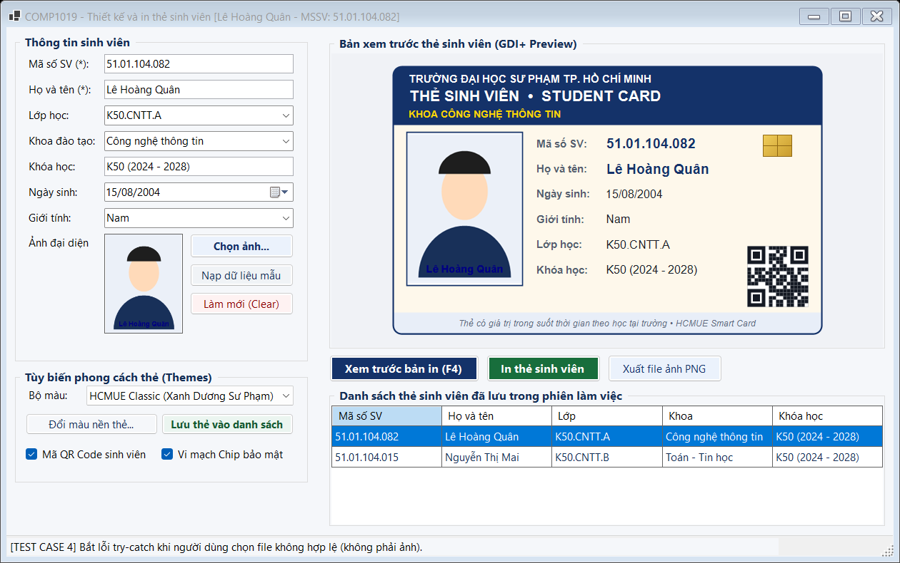
_Mô tả: Thử chọn một tệp văn bản hoặc tệp bị hỏng làm ảnh thẻ. Khối try-catch bắt ngoại lệ OutOfMemoryException / ArgumentException và hiển thị hộp thoại báo lỗi an toàn, không làm crash ứng dụng._

---

### 2.5. Test Case 5: Thay đổi ảnh đại diện liên tục nhiều lần
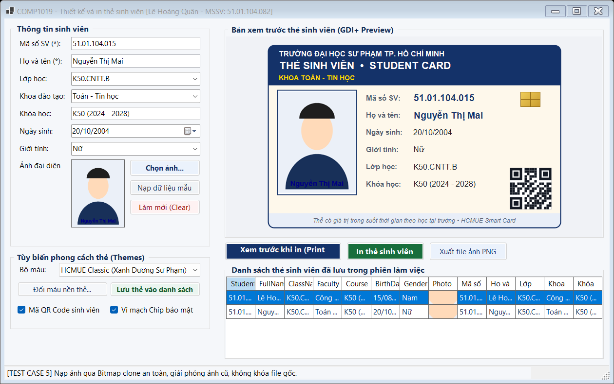
_Mô tả: Người dùng liên tục đổi ảnh mới. Ứng dụng giải phóng bộ nhớ (Dispose) bitmap cũ một cách an toàn, chống rò rỉ bộ nhớ (memory leak)._

---

### 2.6. Test Case 6: Họ và tên sinh viên rất dài (Kiểm tra lỗi đè chữ)
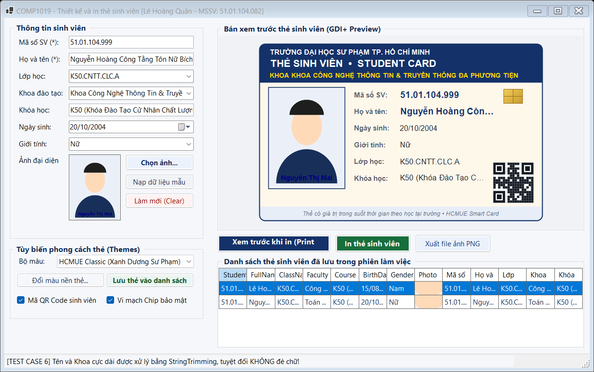
_Mô tả: Nhập họ tên rất dài ('Công Tằng Tôn Nữ Nguyễn Thị Hoàng Ánh Tuyết'). Thuật toán GDI+ tự động thu nhỏ kích cỡ font chữ và sử dụng StringTrimming.EllipsisCharacter để đảm bảo chữ không tràn ra ngoài viền thẻ và không đè lên các trường khác._

---

### 2.7. Test Case 7: Kiểm tra chức năng Clear và khôi phục trạng thái chuẩn
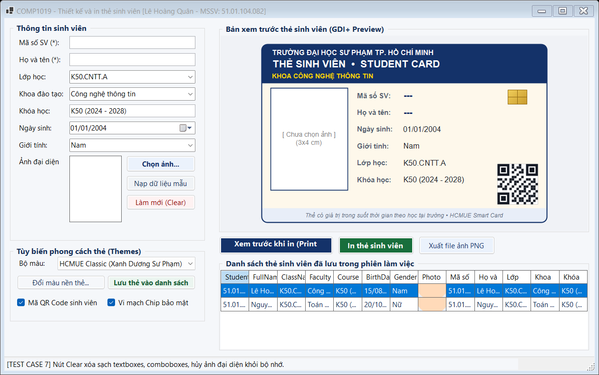
_Mô tả: Sau khi xóa trắng form, toàn bộ TextBox rỗng, DateTimePicker đặt về ngày mặc định, ảnh thẻ quay về trạng thái chưa chọn và bản vẽ thẻ hiển thị các dấu gạch ngang '---' giữ đúng bố cục._

---

### 2.8. Test Case 8: In thực tế ra tệp ảo Microsoft Print to PDF
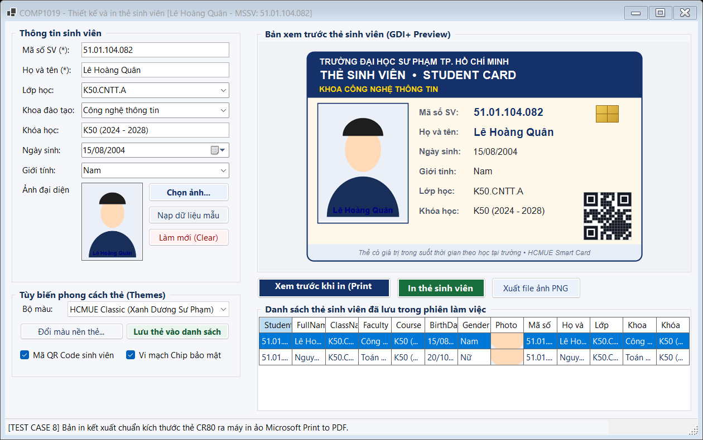
_Mô tả: Kết nối và xuất lệnh in sang máy in ảo Microsoft Print to PDF, tạo tệp tài liệu PDF chuẩn trang A4 sắc nét._
