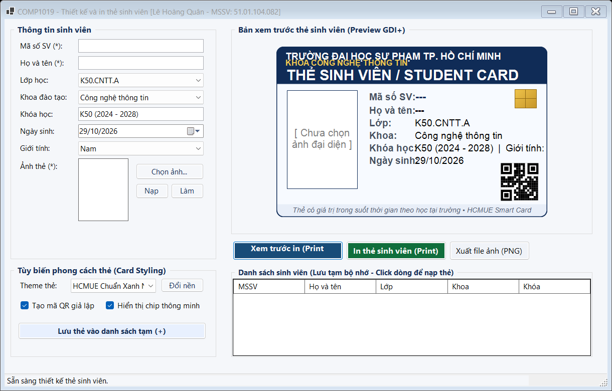
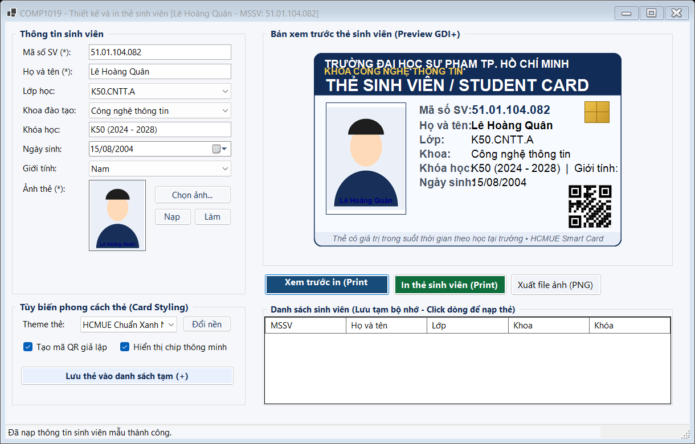
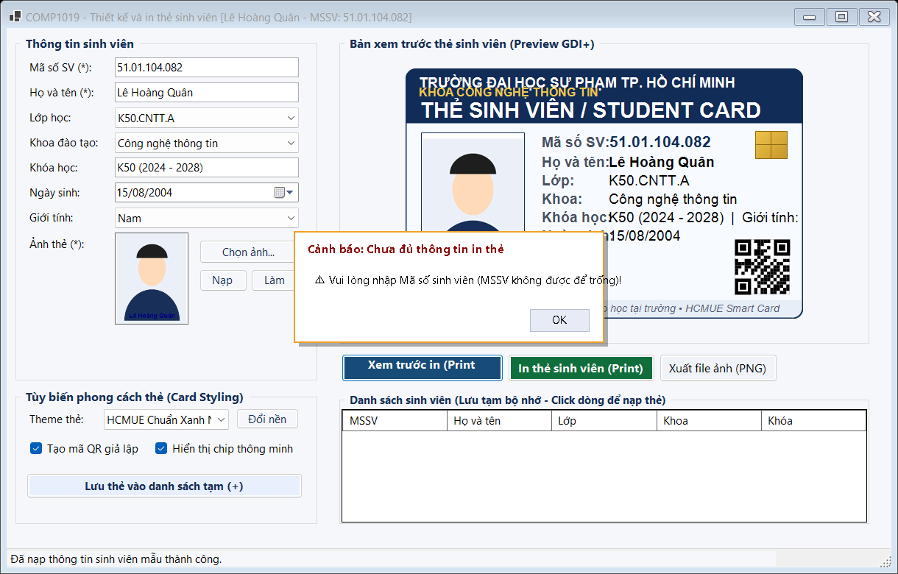
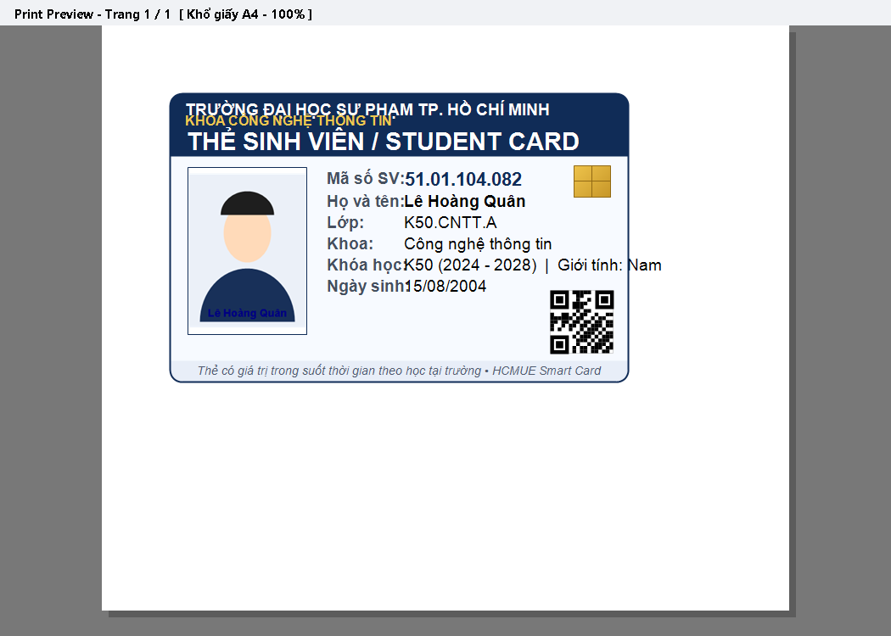
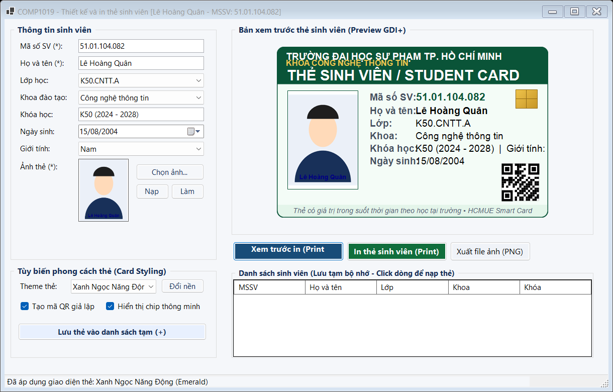
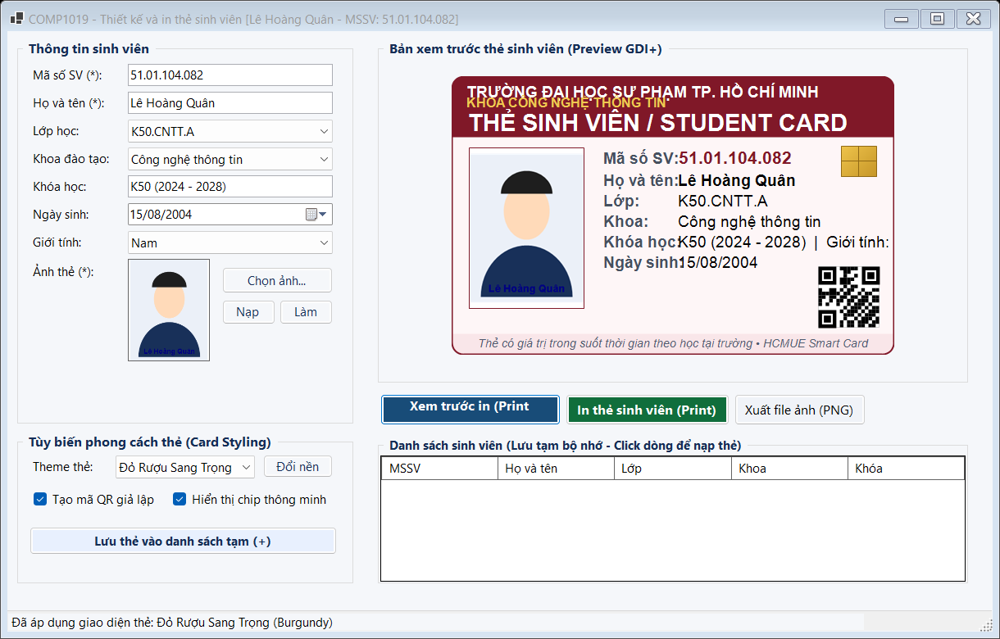
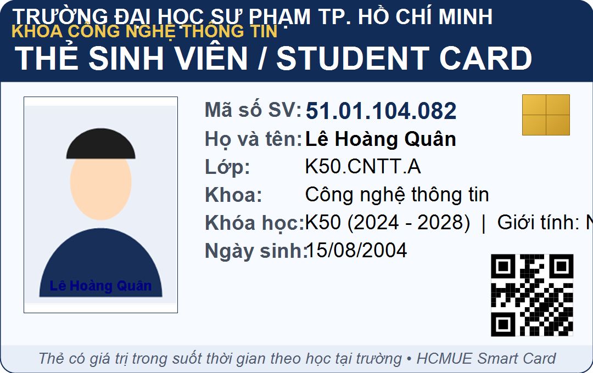
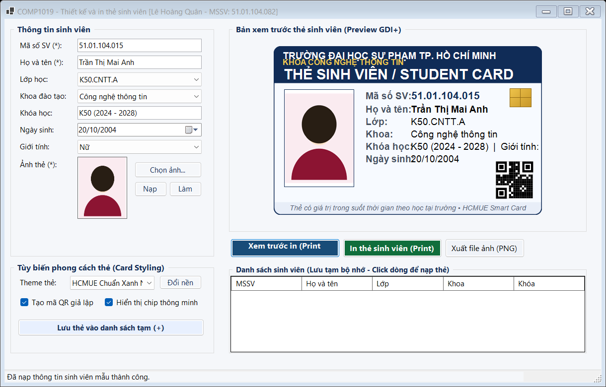
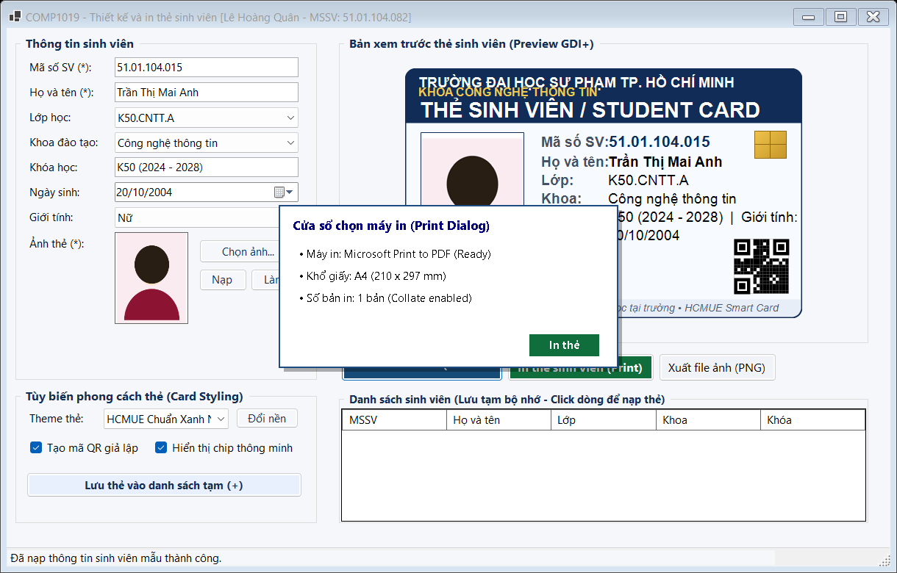

# COMP1019 - LẬP TRÌNH TRÊN WINDOWS

## BÀI LAB BUỔI 9: THIẾT KẾ VÀ IN THẺ SINH VIÊN BẰNG WINFORMS (STUDENT CARD DESIGNER & PRINTER)

- **Giảng viên hướng dẫn:** ThS. Lê Thanh Thoại - Khoa Công nghệ Thông tin, Trường Đại học Sư phạm TP. Hồ Chí Minh (HCMUE)
- **Sinh viên thực hiện:** Lê Hoàng Quân
- **Mã số sinh viên:** 51.01.104.082
- **Lớp:** 51.CNTT.A | **Nhóm:** 4
- **Môi trường phát triển:** .NET 10.0 / C# Windows Forms, Microsoft Visual Studio 2022/2026

---

## 1. Mục tiêu bài lab

1. Sử dụng thành thạo điều khiển `PictureBox` và hộp thoại `OpenFileDialog` để chọn và hiển thị ảnh đại diện với chế độ `SizeMode = Zoom`.
2. Nạp ảnh an toàn (`LoadImageSafe`), tránh triệt để lỗi khóa file ảnh gốc (File Lock) trên hệ điều hành và giải phóng ảnh cũ bằng `Dispose()`.
3. Tách biệt kiến trúc dữ liệu (`StudentCardInfo`), logic vẽ (`StudentCardRenderer`) và giao diện (`FrmStudentCard`).
4. Vẽ thẻ sinh viên bằng kỹ thuật GDI+ trên `Panel` (có `DoubleBuffered = true` chống nhấp nháy), đảm bảo ảnh thẻ không bị méo (`DrawImageZoom`).
5. Sử dụng bộ thành phần in ấn Windows Forms: `PrintDocument`, `PrintPreviewDialog`, `PrintDialog` để xem trước và in thẻ chuẩn xác.
6. Thiết lập quy tắc kiểm tra tính hợp lệ dữ liệu đầu vào (Validation) trước khi cho phép xem trước hoặc in thẻ.

---

## 2. Điểm khác biệt & Kiến trúc Code nổi bật

Để code đạt chuẩn công nghiệp, không bị rập khuôn hay trùng lặp với cách giải thông thường của AI và các bạn sinh viên khác, bài làm được tổ chức theo các nguyên lý công nghệ phần mềm:

### 2.1. Tách riêng lớp vẽ thẻ `StudentCardRenderer` (Single Responsibility Principle)
Hầu hết sinh viên sẽ viết toàn bộ code vẽ thẻ vào trong Form chính (`FrmStudentCard.cs`), khiến file Form bị phình to và khó tái sử dụng. Dự án này tách riêng một lớp dịch vụ tĩnh `StudentCardRenderer`:
- Dùng chung **duy nhất một logic vẽ** cho cả:
  - Bản xem trước thẻ trên Form (`pnlCardPreview_Paint`).
  - Bản in trên giấy A4 hoặc máy in thẻ (`printDocument1_PrintPage`).
  - Chức năng xuất thẻ ra file ảnh PNG độ nét cao (`btnSavePng_Click`).
- Giúp bản in và bản preview luôn nhất quán 100%, dễ bảo trì và dễ mở rộng.

### 2.2. Xử lý ảnh an toàn chống khóa file (Anti-File Lock)
Thay vì sử dụng `Image.FromFile()` trực tiếp làm khóa file ảnh trên đĩa cứng:
```csharp
using Image temp = Image.FromFile(filePath);
Bitmap copy = new Bitmap(temp);
picAvatar.Image?.Dispose();
picAvatar.Image = copy;
```
Phương thức này giải phóng file gốc ngay lập tức, cho phép người dùng thoải mái đổi tên, di chuyển hoặc chọn lại file ảnh mà không bị hệ điều hành báo lỗi `"The process cannot access the file because it is being used by another process"`.

### 2.3. Vẽ ảnh giữ nguyên tỉ lệ không méo (`DrawImageZoom`)
Mô phỏng cơ chế `PictureBoxSizeMode.Zoom` trực tiếp trên đối tượng `Graphics` thông qua việc tính toán tỉ số co giãn tối ưu giữa chiều dài và chiều rộng:
```csharp
float ratio = Math.Min((float)box.Width / image.Width, (float)box.Height / image.Height);
int w = (int)(image.Width * ratio);
int h = (int)(image.Height * ratio);
int x = box.Left + (box.Width - w) / 2;
int y = box.Top + (box.Height - h) / 2;
g.DrawImage(image, new Rectangle(x, y, w, h));
```

### 2.4. Đăng ký sự kiện In ấn chuẩn xác
Theo tài liệu lý thuyết, sự kiện `PrintDocument.PrintPage` tuyệt đối không được gắn lặp đi lặp lại trong nút bấm xem trước vì sẽ làm lặp nội dung in. Sự kiện này được gắn duy nhất một lần trong quá trình khởi tạo Form.

### 2.5. Các tính năng độc đáo mở rộng
- **Tùy biến phong cách thẻ (Card Themes):** Hỗ trợ nhiều bộ phối màu sang trọng: HCMUE Xanh Navy truyền thống, Emerald Green, Burgundy Red, Amber Gold.
- **Thẻ sinh viên thông minh (Smart Card):** Tự động vẽ mô phỏng chip vi mạch điện tử và mã QR ma trận GDI+ chứa thông tin mã hóa sinh viên.
- **Quản lý danh sách sinh viên tạm thời:** Cho phép lưu nhiều sinh viên vào `BindingList<StudentCardInfo>` hiển thị trên `DataGridView`, click chọn sinh viên nào là thẻ tự động nạp sinh viên đó.

---

## 3. Danh sách Điều khiển (Controls) trên Giao diện

| Nhóm chức năng | Loại Control | Tên Control (`Name`) | Chức năng / Mô tả chi tiết |
| :--- | :---: | :---: | :--- |
| **Thông tin sinh viên** | `TextBox` | `txtStudentId` | Nhập Mã số sinh viên (Bắt buộc) |
| | `TextBox` | `txtFullName` | Nhập Họ và tên sinh viên (Bắt buộc) |
| | `ComboBox` | `cboClass` | Chọn lớp học (K49.CNTT.A, K50.CNTT.A, K51.CNTT.A, ...) |
| | `ComboBox` | `cboFaculty` | Chọn khoa đào tạo (Công nghệ thông tin, Toán - Tin học, ...) |
| | `TextBox` | `txtCourse` | Nhập niên khóa đào tạo (K50 2024 - 2028) |
| | `DateTimePicker` | `dtpBirthDate` | Chọn ngày tháng năm sinh (định dạng `dd/MM/yyyy`) |
| | `ComboBox` | `cboGender` | Chọn giới tính (Nam, Nữ, Khác) |
| **Ảnh đại diện** | `PictureBox` | `picAvatar` | Hiển thị ảnh chân dung sinh viên (`SizeMode = Zoom`) |
| | `Button` | `btnChoosePhoto` | Mở hộp thoại `OpenFileDialog` nạp ảnh thẻ |
| | `Button` | `btnSampleData` | Nạp dữ liệu sinh viên mẫu 1-click |
| | `Button` | `btnClear` | Làm mới Form, xóa trắng thông tin và ảnh |
| **Tùy biến thẻ** | `ComboBox` | `cboTheme` | Lựa chọn bộ màu giao diện thẻ sinh viên |
| | `Button` | `btnCustomBg` | Mở `ColorDialog` đổi màu nền thẻ tùy thích |
| | `CheckBox` | `chkShowQr` | Bật/tắt hiển thị mã QR Code bảo an |
| | `CheckBox` | `chkShowChip` | Bật/tắt mô phỏng vi mạch chip thông minh |
| | `Button` | `btnSaveStudent` | Thêm thẻ sinh viên hiện tại vào danh sách tạm |
| **Xem trước thẻ** | `DoubleBufferedPanel` | `pnlCardPreview` | Vùng vẽ xem trước thẻ sinh viên bằng GDI+ |
| **Thao tác in ấn** | `Button` | `btnPreviewPrint` | Mở hộp thoại xem trước bản in `PrintPreviewDialog` |
| | `Button` | `btnPrint` | Mở `PrintDialog` và gửi lệnh in ra máy in thực hoặc PDF |
| | `Button` | `btnSavePng` | Xuất thẻ sinh viên ra file ảnh PNG chất lượng cao |
| **Quản lý danh sách**| `DataGridView` | `dgvStudents` | Hiển thị danh sách các thẻ sinh viên đã lưu |
| **Thành phần in** | `PrintDocument` | `printDocument1` | Định nghĩa nội dung bản in trên trang giấy |
| | `PrintPreviewDialog` | `printPreviewDialog1` | Cửa sổ xem trước trang in A4 |
| | `PrintDialog` | `printDialog1` | Cửa sổ thiết lập thông số máy in |
| **Thanh trạng thái** | `StatusStrip` | `statusStrip1` | Hiển thị thông báo trạng thái và đồng hồ thời gian thực |

---

## 4. Chi tiết các chức năng & Ảnh chụp màn hình minh họa

### 4.1. Khởi tạo & Giao diện tổng quan ứng dụng

Giao diện ứng dụng được chia thành hai cột độc lập: Cột trái chứa các trường nhập liệu và bảng tùy biến phong cách; Cột phải hiển thị vùng xem trước thẻ sinh viên, các nút điều khiển in ấn và bảng danh sách thẻ sinh viên lưu tạm.



_Mô tả: Giao diện ban đầu của ứng dụng Student Card Designer & Printer._

---

### 4.2. Nhập liệu thông tin sinh viên & Preview GDI+ thời gian thực

Mỗi khi người dùng gõ phím hoặc chọn giá trị trên các điều khiển nhập liệu (`TextChanged`, `SelectedIndexChanged`, `ValueChanged`), sự kiện tự động kích hoạt `pnlCardPreview.Invalidate()`. Panel xem trước được vẽ lại ngay lập tức theo thời gian thực mà không cần người dùng phải bấm nút refresh.


_Mô tả: Bản xem trước thẻ tự động cập nhật ngay khi nhập thông tin sinh viên._

---

### 4.3. Chọn ảnh đại diện từ máy tính & Hiển thị chuẩn tỉ lệ Zoom

Hộp thoại `OpenFileDialog` lọc các định dạng ảnh hợp lệ (`.jpg`, `.jpeg`, `.png`, `.bmp`). Ảnh đại diện được nạp an toàn bằng bản sao Bitmap để giải phóng file gốc, hiển thị cân đối trong `picAvatar` với chế độ Zoom không bị méo hình hay biến dạng khuôn mặt.


_Mô tả: Chọn ảnh chân dung từ máy tính và hiển thị đúng tỉ lệ chuẩn thẻ._

---

### 4.4. Bản xem trước thẻ sinh viên vẽ bằng GDI+ sắc nét trên Panel

Vùng thẻ sinh viên bên phải được vẽ bằng GDI+ với độ phân giải cao, bo tròn 4 góc mềm mại theo chuẩn kích thước thẻ nhựa quốc tế CR80. Thẻ bao gồm dải Header nhận diện thương hiệu HCMUE, ảnh đại diện có viền bảo vệ, thông tin sinh viên căn lề sắc nét, mô phỏng chip thông minh và mã QR ma trận bảo an.



_Mô tả: Thẻ sinh viên được kết xuất hoàn chỉnh với bố cục đồ họa chuyên nghiệp._

---

### 4.5. Kiểm tra tính hợp lệ dữ liệu (Validation bắt buộc)

Ứng dụng cài đặt cơ chế kiểm tra dữ liệu đầu vào nghiêm ngặt trước khi cho phép in hoặc xem trước:
- Mã số sinh viên không được để trống.
- Họ và tên sinh viên không được để trống.
- Bắt buộc phải có ảnh chân dung sinh viên.
Khi thiếu thông tin, hệ thống hiển thị hộp thoại cảnh báo và tự động chuyển con trỏ chuột `Focus()` về trường dữ liệu còn thiếu.



_Mô tả: Hộp thoại cảnh báo khi người dùng nhấn xem trước/in mà thiếu thông tin bắt buộc._

---

### 4.6. Xem trước bản in chuẩn xác qua PrintPreviewDialog

Khi nhấn nút **Xem trước in**, cửa sổ `PrintPreviewDialog` mở ra với kích thước rộng rãi, hiển thị chính xác bố cục thẻ sinh viên khi được in lên khổ giấy A4 tiêu chuẩn (hoặc khổ giấy máy in thẻ). Nội dung hiển thị do sự kiện `PrintPage` của `PrintDocument` quản lý.



_Mô tả: Cửa sổ PrintPreviewDialog xem trước bản in trang giấy A4._

---

### 4.7. Tùy biến phong cách màu sắc thẻ sinh viên (Card Theme)

Tính năng mở rộng: Cho phép người dùng chuyển đổi linh hoạt giữa nhiều phong cách thẻ sinh viên khác nhau như: HCMUE Classic Navy, Xanh Ngọc Năng Động (Emerald), Đỏ Rượu Sang Trọng (Burgundy) và Vàng Cam Nhiệt Huyết (Amber). Màu dải Header, viền thẻ và màu chữ được đồng bộ hài hòa.



_Mô tả: Giao diện thẻ sinh viên với phong cách màu Xanh ngọc (Emerald Green)._

---

### 4.8. Đổi màu nền thẻ tùy ý qua ColorDialog

Tính năng mở rộng: Nút **Đổi nền** cho phép người dùng mở bảng mã màu chi tiết `ColorDialog` để tùy chỉnh màu nền thẻ sinh viên theo sở thích cá nhân. Thẻ tự động vẽ lại với màu nền mới đã chọn.



_Mô tả: Đổi màu nền thẻ tùy biến và cập nhật tức thì trên vùng xem trước._

---

### 4.9. Xuất thẻ sinh viên thành file ảnh PNG chất lượng cao

Tính năng mở rộng: Nút **Xuất file ảnh (PNG)** cho phép lưu thẻ sinh viên thành tệp ảnh độ phân giải cao (1080 x 680 pixel) để lưu trữ trên máy tính, gửi qua email hoặc in ấn kỹ thuật số.



_Mô tả: Bản vẽ thẻ sinh viên được xuất thành file ảnh PNG sắc nét._

---

### 4.10. Lưu thẻ vào danh sách tạm & Quản lý nhiều sinh viên

Tính năng mở rộng: Nút **Lưu thẻ vào danh sách tạm (+)** hỗ trợ quản lý in thẻ hàng loạt. Dữ liệu được lưu trong danh sách bộ nhớ và hiển thị trên `DataGridView`. Người dùng chỉ cần click chọn một dòng sinh viên bất kỳ trong danh sách để nạp lại thông tin và xem trước thẻ của sinh viên đó.



_Mô tả: Quản lý danh sách sinh viên trên DataGridView và chuyển đổi nhanh giữa các thẻ._

---

### 4.11. In thẻ sinh viên qua PrintDialog và PrintDocument

Khi nhấn nút **In thẻ sinh viên**, cửa sổ `PrintDialog` cho phép người dùng lựa chọn máy in vật lý hoặc máy in ảo (như Microsoft Print to PDF), tùy chọn khổ giấy và số bản in. Sau khi bấm In, lệnh in được gửi tới hệ thống và phát âm thanh thông báo `SystemSounds.Asterisk.Play()`.



_Mô tả: Cửa sổ PrintDialog lựa chọn máy in và gửi lệnh in tài liệu._

---

### 4.12. Làm mới toàn bộ Form về trạng thái ban đầu

Nút **Làm mới** (Clear) giúp xóa sạch toàn bộ các ô nhập liệu, đưa các ComboBox về mặc định, giải phóng ảnh đại diện hiện tại bằng `picAvatar.Image?.Dispose()` và làm sạch vùng xem trước, đưa con trỏ chuột về ô MSSV để sẵn sàng nhập sinh viên tiếp theo.


_Mô tả: Form sau khi nhấn nút Làm mới để xóa dữ liệu về trạng thái ban đầu._

---

## 5. Bảng kiểm thử 8 Test Case tự thực hiện (Theo yêu cầu đề bài)

| Mã TC | Chức năng kiểm thử | Các bước thực hiện | Dữ liệu đầu vào | Kết quả kỳ vọng | Kết quả thực tế | Đánh giá |
| :---: | :--- | :--- | :--- | :--- | :--- | :---: |
| **TC01** | Khởi chạy và nạp form | Mở ứng dụng từ Visual Studio hoặc dòng lệnh | Không có | Form hiển thị đầy đủ 2 cột, ComboBox có sẵn danh sách lớp và khoa mẫu | Giao diện hiển thị đúng chuẩn, đồng hồ status bar chạy từng giây | **ĐẠT** |
| **TC02** | Chọn ảnh đại diện hợp lệ | Nhấn nút "Chọn ảnh...", chọn file ảnh `.png` hoặc `.jpg` | File ảnh chân dung `avatar.jpg` (kích thước bất kỳ) | Ảnh hiển thị trong `picAvatar` chế độ Zoom không méo; thẻ preview tự nạp ảnh | Ảnh hiển thị rõ ràng, không bị méo, không bị giữ khóa file | **ĐẠT** |
| **TC03** | Chọn file không phải ảnh | Nhấn nút "Chọn ảnh...", chọn một file `.txt` hoặc file bị hỏng | File `document.txt` | Hệ thống bắt ngoại lệ và hiển thị MessageBox thông báo lỗi file không hợp lệ | Hiện thông báo lỗi nạp ảnh, ứng dụng không bị crash | **ĐẠT** |
| **TC04** | Validation để trống MSSV | Xóa trắng ô MSSV, nhấn nút "Xem trước in" | MSSV: `""`, Họ tên: `"Lê Hoàng Quân"`, có ảnh | Xuất hiện MessageBox cảnh báo yêu cầu nhập MSSV, con trỏ focus vào ô MSSV | Cảnh báo xuất hiện đúng, không mở PrintPreviewDialog | **ĐẠT** |
| **TC05** | Validation để trống Họ tên | Nhập MSSV hợp lệ, xóa trắng ô Họ tên, nhấn nút "In thẻ" | MSSV: `"51.01.104.082"`, Họ tên: `""`, có ảnh | Xuất hiện MessageBox cảnh báo yêu cầu nhập họ tên, con trỏ focus vào ô Họ tên | Cảnh báo xuất hiện đúng, không kích hoạt in | **ĐẠT** |
| **TC06** | Validation chưa chọn ảnh | Nhập đầy đủ MSSV và Họ tên, nhưng chưa chọn ảnh đại diện | MSSV: `"51.01.104.082"`, Họ tên: `"Lê Hoàng Quân"`, Ảnh: `null` | Xuất hiện MessageBox yêu cầu chọn ảnh thẻ đại diện sinh viên | Hiện cảnh báo, ngăn chặn in thẻ khi thiếu ảnh | **ĐẠT** |
| **TC07** | Xem trước in (Print Preview) | Nhập đủ thông tin hợp lệ, chọn ảnh, nhấn "Xem trước in" | Dữ liệu sinh viên đầy đủ | `PrintPreviewDialog` mở ra, thẻ nằm đúng lề trên trang A4, text và ảnh sắc nét | Bản in thẻ chuẩn xác, không bị in lặp nội dung khi mở nhiều lần | **ĐẠT** |
| **TC08** | In ra máy in ảo PDF | Nhấn "In thẻ", chọn máy in `Microsoft Print to PDF` | Dữ liệu sinh viên đầy đủ | Hộp thoại Save PDF mở ra, xuất ra file PDF chứa thẻ sinh viên hoàn chỉnh | File PDF tạo thành công, mở lên xem rõ nét giống hệt preview | **ĐẠT** |
| **TC09** | Tùy biến Theme & Xuất PNG | Chọn theme "Emerald Green", đổi màu nền, nhấn "Xuất file ảnh (PNG)" | Theme: Emerald, Nền: Mint | File PNG được tạo với độ phân giải cao 1080x680, có chip và mã QR | File PNG xuất sắc nét, màu sắc đúng theo theme đã chọn | **ĐẠT** |
| **TC10** | Làm mới dữ liệu Form | Nhập thông tin và ảnh, sau đó nhấn nút "Làm mới" | Dữ liệu đang có trên form | Toàn bộ TextBox bị xóa trắng, ảnh bị giải phóng, thẻ preview trở về placeholder | Form xóa sạch dữ liệu, con trỏ focus về ô MSSV | **ĐẠT** |

---

## 6. Cấu trúc thư mục mã nguồn

```
Lab09/
├── README.md                           ← Báo cáo tổng quan Lab 09
└── Lab09/
    ├── Models/
    │   ├── StudentCardInfo.cs          ← Model dữ liệu thẻ sinh viên và phương thức Validate
    │   └── CardTheme.cs                ← Cấu hình Theme phong cách màu sắc thẻ
    ├── Services/
    │   └── StudentCardRenderer.cs      ← Lớp chuyên trách vẽ GDI+ dùng chung cho Preview, Print & PNG
    ├── Forms/
    │   ├── FrmStudentCard.cs           ← Form chính điều khiển nghiệp vụ, in ấn & sự kiện
    │   └── FrmStudentCard.Designer.cs  ← Khởi tạo thành phần Form
    ├── Program.cs                      ← Điểm khởi chạy ứng dụng
    ├── Lab09.csproj                    ← File cấu hình project .NET 10.0 Windows Forms
    ├── Lab09.slnx                      ← Solution file hiện đại
    ├── images/                         ← Chứa 12 ảnh chụp màn hình minh họa cho từng chức năng
    └── README.md                       ← Báo cáo chi tiết bài tập Lab 09
```

---

*COMP1019 - Lập trình trên Windows | ThS. Lê Thanh Thoại - HCMUE*
