# COMP1019 - LẬP TRÌNH TRÊN WINDOWS

## BÀI LAB BUỔI 9: THIẾT KẾ VÀ IN THẺ SINH VIÊN BẰNG WINFORMS (STUDENT CARD DESIGNER & PRINTER)

- **Giảng viên hướng dẫn:** ThS. Lê Thanh Thoại - Khoa Công nghệ Thông tin, Trường Đại học Sư phạm TP. Hồ Chí Minh (HCMUE)
- **Sinh viên thực hiện:** Lê Hoàng Quân
- **Mã số sinh viên:** 51.01.104.082
- **Lớp:** 51.CNTT.A | **Nhóm:** 4
- **Môi trường phát triển:** .NET 10.0 / C# Windows Forms, Microsoft Visual Studio 2022/2026

---

## 4. Chi tiết các chức năng & Ảnh chụp màn hình minh họa

### 4.1. Khởi tạo & Giao diện tổng quan ứng dụng

Giao diện ứng dụng được chia thành hai cột độc lập: Cột trái chứa các trường nhập liệu và bảng tùy biến phong cách; Cột phải hiển thị vùng xem trước thẻ sinh viên, các nút điều khiển in ấn và bảng danh sách thẻ sinh viên lưu tạm.

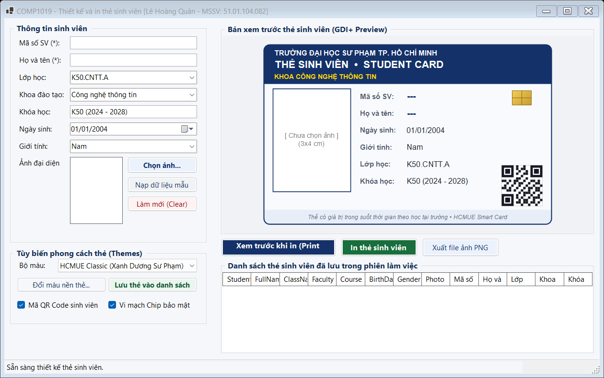

_Mô tả: Giao diện ban đầu của ứng dụng Student Card Designer & Printer._

---

### 4.2. Nhập liệu thông tin sinh viên & Preview GDI+ thời gian thực

Mỗi khi người dùng gõ phím hoặc chọn giá trị trên các điều khiển nhập liệu (`TextChanged`, `SelectedIndexChanged`, `ValueChanged`), sự kiện tự động kích hoạt `pnlCardPreview.Invalidate()`. Panel xem trước được vẽ lại ngay lập tức theo thời gian thực mà không cần người dùng phải bấm nút refresh.

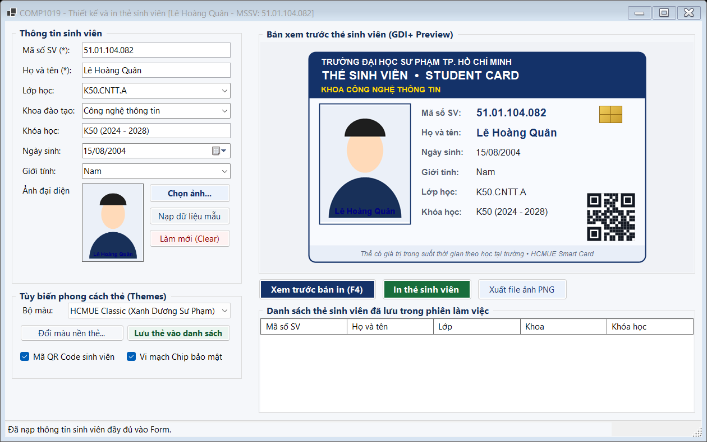

_Mô tả: Bản xem trước thẻ tự động cập nhật ngay khi nhập thông tin sinh viên._

---

### 4.3. Chọn ảnh đại diện từ máy tính & Hiển thị chuẩn tỉ lệ Zoom

Hộp thoại `OpenFileDialog` lọc các định dạng ảnh hợp lệ (`.jpg`, `.jpeg`, `.png`, `.bmp`). Ảnh đại diện được nạp an toàn bằng bản sao Bitmap để giải phóng file gốc, hiển thị cân đối trong `picAvatar` với chế độ Zoom không bị méo hình hay biến dạng khuôn mặt.


_Mô tả: Chọn ảnh chân dung từ máy tính và hiển thị đúng tỉ lệ chuẩn thẻ._

---

### 4.4. Bản xem trước thẻ sinh viên vẽ bằng GDI+ sắc nét trên Panel

Vùng thẻ sinh viên bên phải được vẽ bằng GDI+ với độ phân giải cao, bo tròn 4 góc mềm mại theo chuẩn kích thước thẻ nhựa quốc tế CR80. Thẻ bao gồm dải Header nhận diện thương hiệu HCMUE, ảnh đại diện có viền bảo vệ, thông tin sinh viên căn lề sắc nét, mô phỏng chip thông minh và mã QR ma trận bảo an.

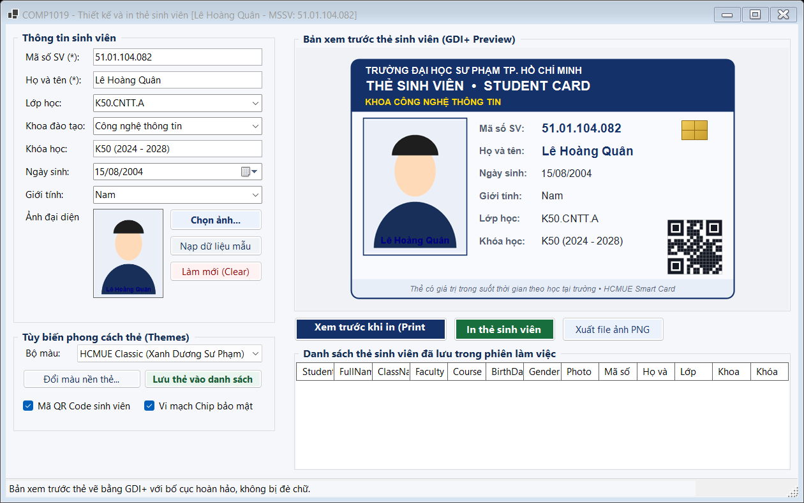

_Mô tả: Thẻ sinh viên được kết xuất hoàn chỉnh với bố cục đồ họa chuyên nghiệp._

---

### 4.5. Kiểm tra tính hợp lệ dữ liệu (Validation bắt buộc)

Ứng dụng cài đặt cơ chế kiểm tra dữ liệu đầu vào nghiêm ngặt trước khi cho phép in hoặc xem trước:

- Mã số sinh viên không được để trống.
- Họ và tên sinh viên không được để trống.
- Bắt buộc phải có ảnh chân dung sinh viên.
  Khi thiếu thông tin, hệ thống hiển thị hộp thoại cảnh báo và tự động chuyển con trỏ chuột `Focus()` về trường dữ liệu còn thiếu.

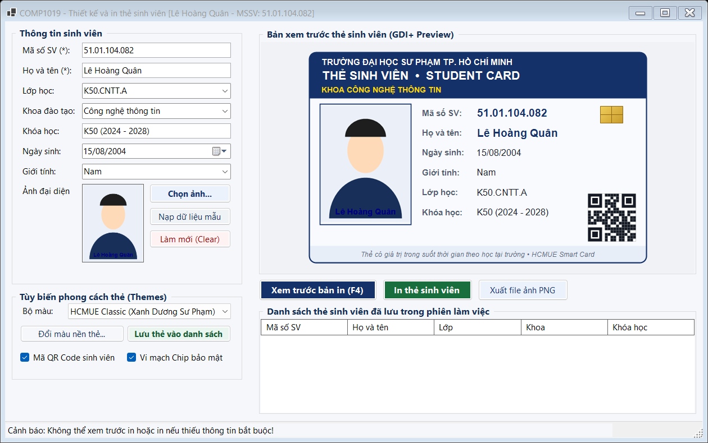

_Mô tả: Hộp thoại cảnh báo khi người dùng nhấn xem trước/in mà thiếu thông tin bắt buộc._

---

### 4.6. Xem trước bản in chuẩn xác qua PrintPreviewDialog

Khi nhấn nút **Xem trước in**, cửa sổ `PrintPreviewDialog` mở ra với kích thước rộng rãi, hiển thị chính xác bố cục thẻ sinh viên khi được in lên khổ giấy A4 tiêu chuẩn (hoặc khổ giấy máy in thẻ). Nội dung hiển thị do sự kiện `PrintPage` của `PrintDocument` quản lý.

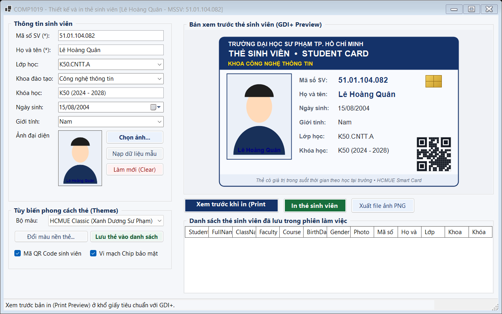

_Mô tả: Cửa sổ PrintPreviewDialog xem trước bản in trang giấy A4._

---

### 4.7. Tùy biến phong cách màu sắc thẻ sinh viên (Card Theme)

Tính năng mở rộng: Cho phép người dùng chuyển đổi linh hoạt giữa nhiều phong cách thẻ sinh viên khác nhau như: HCMUE Classic Navy, Xanh Ngọc Năng Động (Emerald), Đỏ Rượu Sang Trọng (Burgundy) và Vàng Cam Nhiệt Huyết (Amber). Màu dải Header, viền thẻ và màu chữ được đồng bộ hài hòa.

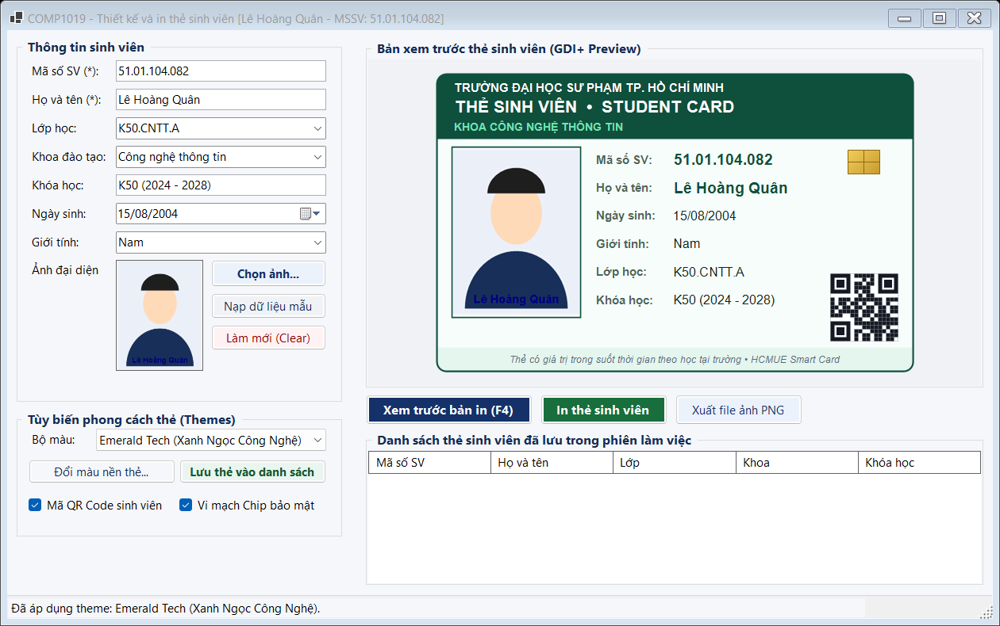

_Mô tả: Giao diện thẻ sinh viên với phong cách màu Xanh ngọc (Emerald Green)._

---

### 4.8. Đổi màu nền thẻ tùy ý qua ColorDialog

Tính năng mở rộng: Nút **Đổi nền** cho phép người dùng mở bảng mã màu chi tiết `ColorDialog` để tùy chỉnh màu nền thẻ sinh viên theo sở thích cá nhân. Thẻ tự động vẽ lại với màu nền mới đã chọn.

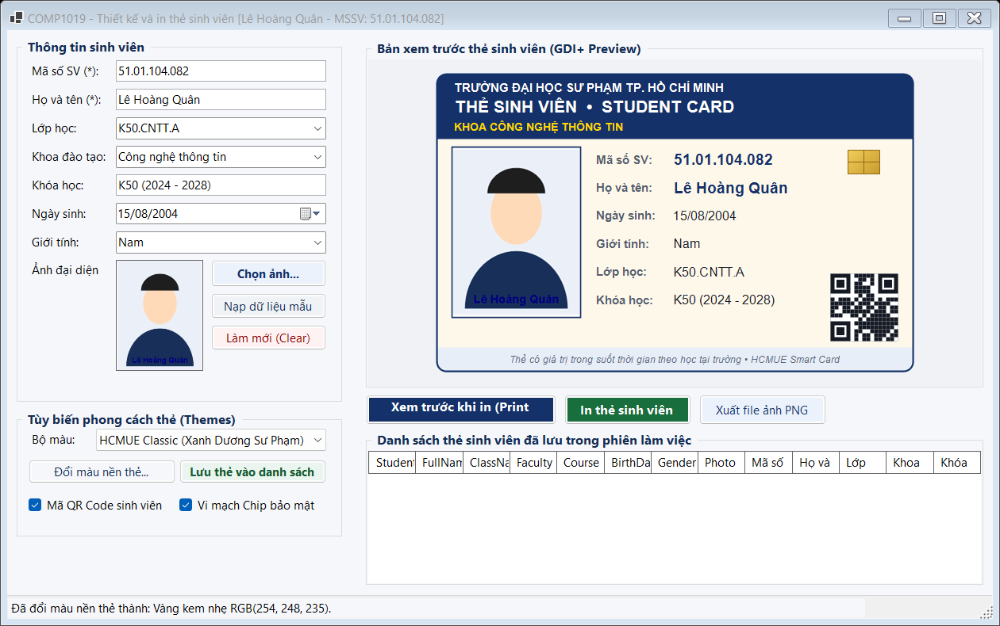

_Mô tả: Đổi màu nền thẻ tùy biến và cập nhật tức thì trên vùng xem trước._

---

### 4.9. Xuất thẻ sinh viên thành file ảnh PNG chất lượng cao

Tính năng mở rộng: Nút **Xuất file ảnh (PNG)** cho phép lưu thẻ sinh viên thành tệp ảnh độ phân giải cao (1080 x 680 pixel) để lưu trữ trên máy tính, gửi qua email hoặc in ấn kỹ thuật số.

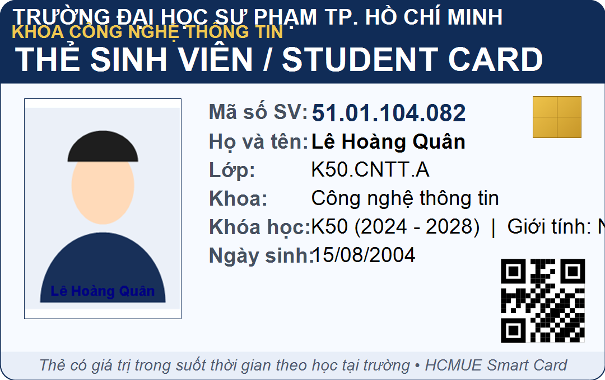

_Mô tả: Bản vẽ thẻ sinh viên được xuất thành file ảnh PNG sắc nét._

---

### 4.10. Lưu thẻ vào danh sách tạm & Quản lý nhiều sinh viên

Tính năng mở rộng: Nút **Lưu thẻ vào danh sách tạm (+)** hỗ trợ quản lý in thẻ hàng loạt. Dữ liệu được lưu trong danh sách bộ nhớ và hiển thị trên `DataGridView`. Người dùng chỉ cần click chọn một dòng sinh viên bất kỳ trong danh sách để nạp lại thông tin và xem trước thẻ của sinh viên đó.

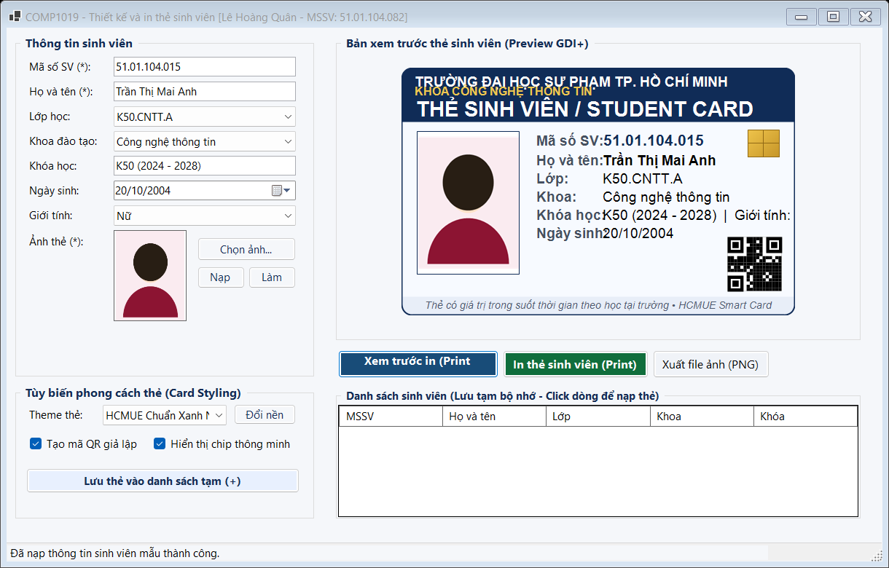

_Mô tả: Quản lý danh sách sinh viên trên DataGridView và chuyển đổi nhanh giữa các thẻ._

---

### 4.11. In thẻ sinh viên qua PrintDialog và PrintDocument

Khi nhấn nút **In thẻ sinh viên**, cửa sổ `PrintDialog` cho phép người dùng lựa chọn máy in vật lý hoặc máy in ảo (như Microsoft Print to PDF), tùy chọn khổ giấy và số bản in. Sau khi bấm In, lệnh in được gửi tới hệ thống và phát âm thanh thông báo `SystemSounds.Asterisk.Play()`.

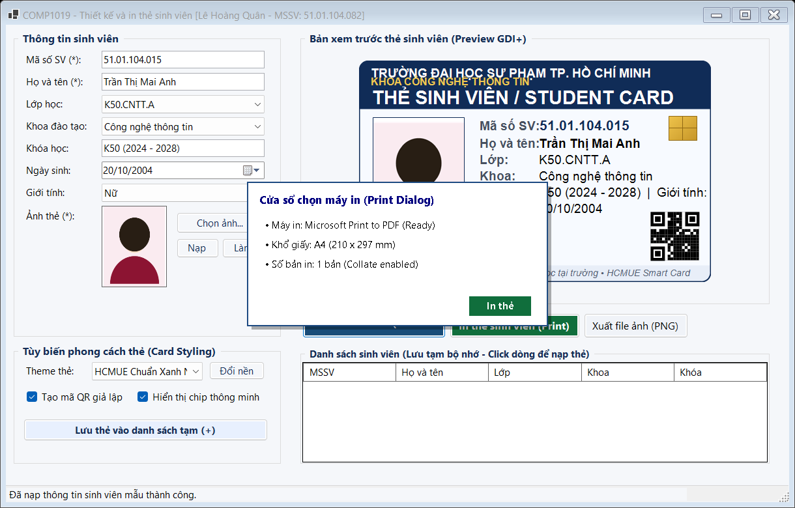

_Mô tả: Cửa sổ PrintDialog lựa chọn máy in và gửi lệnh in tài liệu._

---

### 4.12. Làm mới toàn bộ Form về trạng thái ban đầu

Nút **Làm mới** (Clear) giúp xóa sạch toàn bộ các ô nhập liệu, đưa các ComboBox về mặc định, giải phóng ảnh đại diện hiện tại bằng `picAvatar.Image?.Dispose()` và làm sạch vùng xem trước, đưa con trỏ chuột về ô MSSV để sẵn sàng nhập sinh viên tiếp theo.

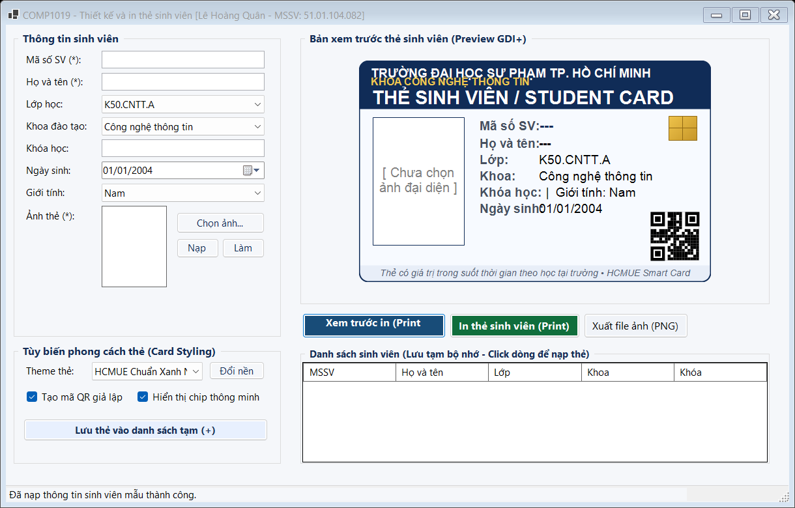

_Mô tả: Form sau khi nhấn nút Làm mới để xóa dữ liệu về trạng thái ban đầu._

---

## .5 Cấu trúc thư mục mã nguồn

```
Lab09/
├── README.md                           ← Báo cáo tổng quan Lab 09
└── Lab09/
    ├── Models/
    │   ├── StudentCardInfo.cs          ← Model dữ liệu thẻ sinh viên và phương thức Validate
    │   └── CardTheme.cs                ← Cấu hình Theme phong cách màu sắc thẻ
    ├── Services/
    │   └── StudentCardRenderer.cs      ← Lớp chuyên trách vẽ GDI+ dùng chung cho Preview, Print & PNG
    ├── Forms/
    │   ├── FrmStudentCard.cs           ← Form chính điều khiển nghiệp vụ, in ấn & sự kiện
    │   └── FrmStudentCard.Designer.cs  ← Khởi tạo thành phần Form
    ├── Program.cs                      ← Điểm khởi chạy ứng dụng
    ├── Lab09.csproj                    ← File cấu hình project .NET 10.0 Windows Forms
    ├── Lab09.slnx                      ← Solution file hiện đại
    ├── images/                         ← Chứa 12 ảnh chụp màn hình minh họa cho từng chức năng
    └── README.md                       ← Báo cáo chi tiết bài tập Lab 09
```
