# COMP1019 - LẬP TRÌNH TRÊN WINDOWS

## BÀI LAB BUỔI 10: THIẾT KẾ VÀ CÀI ĐẶT CƠ SỞ DỮ LIỆU EDUMANAGERDB BẰNG SQL SERVER

- **Giảng viên hướng dẫn:** ThS. Lê Thanh Thoại - Khoa Công nghệ Thông tin, Trường Đại học Sư phạm TP. Hồ Chí Minh (HCMUE)
- **Sinh viên thực hiện:** Lê Hoàng Quân
- **Mã số sinh viên:** 51.01.104.082
- **Lớp:** 51.CNTT.A | **Nhóm:** 4
- **Hệ quản trị CSDL:** Microsoft SQL Server 2019 / 2022 / Azure SQL Database
- **Công cụ đồng hành:** Visual Studio 2022/2026, SSMS, .NET 10.0 C# Windows Forms Query Studio

---

## 1. Mục tiêu bài lab

1. **Thiết kế lược đồ quan hệ chuẩn hóa (3NF):** Xây dựng CSDL giáo dục `EduManagerDB` gồm 6 bảng dữ liệu cốt lõi: `KHOA`, `LOP`, `SINHVIEN`, `MONHOC`, `KETQUA`, `TAIKHOAN`.
2. **Cài đặt toàn vẹn dữ liệu đa tầng:**
   - Khóa chính đơn và khóa chính ghép (`PK_KETQUA` gồm `MaSV` và `MaMH`).
   - Khóa ngoại tham chiếu chính xác kèm hành vi toàn vẹn (`ON UPDATE CASCADE`, `ON DELETE CASCADE / NO ACTION`).
   - Ràng buộc miền giá trị kiểm tra logic: Giới tính (`Nam`/`Nữ`), số tín chỉ môn học (`SoTinChi > 0`), điểm số hợp lệ (`0.0 <= Diem <= 10.0`).
   - Giá trị mặc định (`DEFAULT`) cho trạng thái hoạt động và vai trò người dùng trong hệ thống.
3. **Chèn dữ liệu mẫu đa dạng và hợp lệ:** Khởi tạo tập dữ liệu mẫu phản ánh thực tế môi trường đào tạo đại học HCMUE (khoa CNTT, Toán, Ngoại ngữ; các lớp 51.CNTT.A, 51.CNTT.B...).
4. **Xây dựng 12 câu truy vấn T-SQL:** Bao hàm đầy đủ các kỹ thuật từ cơ bản đến nâng cao: lọc điều kiện `WHERE`, nối bảng `INNER JOIN` / `LEFT JOIN`, tìm kiếm xấp xỉ `LIKE`, cập nhật `UPDATE`, xóa an toàn `DELETE ... WHERE NOT EXISTS`, hàm gom nhóm `COUNT`, `AVG`, lọc sau gom nhóm `HAVING`, xử lý rẽ nhánh `CASE WHEN`, và bắt lỗi kiểm thử ràng buộc bằng `TRY...CATCH`.
5. **Mở rộng khung nhìn (Views):** Tạo các View `vw_DanhSachSinhVienDayDu` và `vw_BangDiemChiTiet` làm tiền đề tích hợp ADO.NET và Entity Framework cho các bài Lab tiếp theo.

---

## 2. Điểm khác biệt & Kiến trúc Cơ sở dữ liệu nổi bật

Khác biệt hoàn toàn với các bài làm AI đại trà thường chỉ cung cấp các câu lệnh SQL rời rạc, dự án này áp dụng các chuẩn kỹ thuật chuyên nghiệp:

### 2.1. Thứ tự tạo bảng và khóa ngoại tuân thủ nghiêm ngặt đồ thị phụ thuộc
Mã nguồn `01_CreateDatabase.sql` tổ chức các bảng theo đúng thứ tự không chu trình (Directed Acyclic Graph):
$$\text{KHOA} \longrightarrow \text{LOP} \longrightarrow \text{SINHVIEN} \longrightarrow \text{KETQUA} \longleftarrow \text{MONHOC}$$
- Bảng phụ thuộc chỉ được khởi tạo khi bảng cha đã có mặt.
- Khi cần xóa dữ liệu mẫu (`02_InsertSampleData.sql`), thứ tự xóa được đảo ngược hoàn toàn để không bao giờ vi phạm ràng buộc khóa ngoại đang hoạt động.

### 2.2. Kiểm soát xóa tầng (Cascade Delete Rule) có chọn lọc
- `FK_KETQUA_SINHVIEN` sử dụng `ON DELETE CASCADE`: Khi một sinh viên bị xóa hoặc tốt nghiệp rút hồ sơ, toàn bộ điểm số của sinh viên đó trong bảng `KETQUA` tự động được dọn sạch, tránh để lại dữ liệu mồ côi (orphaned rows).
- Ngược lại, `FK_LOP_KHOA` và `FK_SINHVIEN_LOP` thiết lập `ON DELETE NO ACTION`: Ngăn chặn triệt để hành động vô tình xóa một Khoa hay một Lớp học khi vẫn còn sinh viên đang theo học.

### 2.3. Khóa chính ghép (Composite Primary Key) trên bảng KETQUA
Bảng điểm sinh viên được thiết lập khóa chính ghép gồm 2 cột:
```sql
CONSTRAINT PK_KETQUA PRIMARY KEY (MaSV, MaMH)
```
Thiết kế này đảm bảo tuyệt đối tính duy nhất của điểm số: Một sinh viên không bao giờ bị nhập trùng lặp điểm 2 lần cho cùng 1 môn học.

### 2.4. Khối xử lý ngoại lệ an toàn `TRY...CATCH` cho các bài kiểm thử
Đối với các câu truy vấn cố ý vi phạm ràng buộc (Câu 11 & Câu 12), script sử dụng cấu trúc `BEGIN TRY ... BEGIN CATCH` để bắt chính xác mã lỗi `547` (Constraint Violation) từ SQL Server Engine, xuất thông điệp chi tiết mà không làm ngắt quãng toàn bộ quá trình chạy kịch bản T-SQL.

### 2.5. Ứng dụng đồng hành chuyên nghiệp: EduManager Studio (WinForms)
Bên cạnh 3 file script SQL chuẩn (`01_CreateDatabase.sql`, `02_InsertSampleData.sql`, `03_Queries.sql`), dự án phát triển một công cụ Windows Forms hiện đại mang tên **EduManager Studio** (`Lab10/Lab10`):
- Trình khám phá lược đồ CSDL dạng cây (Object Explorer Tree).
- Trình duyệt và thực thi trực tiếp 12 câu truy vấn T-SQL với cú pháp được làm nổi bật màu sắc (Syntax Highlighting).
- Hiển thị kết quả dạng lưới dữ liệu phân loại học lực và thông điệp bảng điều khiển (Console Message Log) thời gian thực.
- Hỗ trợ chế độ dòng lệnh tự động xuất báo cáo màn hình `--capture-all` chất lượng cao.

---

## 3. Cấu trúc Lược đồ CSDL & Sơ đồ Thực thể

### 3.1. Danh mục 6 bảng dữ liệu

| Tên Bảng | Ý nghĩa nghiệp vụ | Khóa chính (PK) | Khóa ngoại (FK) | Ràng buộc kiểm tra (CHECK) |
| :--- | :--- | :--- | :--- | :--- |
| **`KHOA`** | Danh mục các khoa đào tạo | `MaKhoa` | Không | Không |
| **`LOP`** | Danh mục các lớp học sinh hoạt | `MaLop` | `MaKhoa` $\to$ `KHOA(MaKhoa)` | Không |
| **`SINHVIEN`** | Hồ sơ lý lịch sinh viên | `MaSV` | `MaLop` $\to$ `LOP(MaLop)` | `GioiTinh IN (N'Nam', N'Nữ')` |
| **`MONHOC`** | Danh mục môn học đào tạo | `MaMH` | Không | `SoTinChi > 0` |
| **`KETQUA`** | Bảng điểm kết quả học tập | `(MaSV, MaMH)` | `MaSV` $\to$ `SINHVIEN`<br>`MaMH` $\to$ `MONHOC` | `Diem >= 0.0 AND Diem <= 10.0` |
| **`TAIKHOAN`**| Tài khoản đăng nhập hệ thống | `TenDangNhap` | Không | `VaiTro` DEFAULT 'User'<br>`TrangThai` DEFAULT 1 |

### 3.2. Sơ đồ Quan hệ Thực thể dạng văn bản (Text ERD)

```
 [ KHOA ] 1
    │
    │ (1, n)
    ▼
 [ LOP ] 1
    │
    │ (1, n)
    ▼
 [ SINHVIEN ] 1 ───────────┐
    │                      │
    │ (1, n)               │ (1, n)
    ▼                      ▼
 [ KETQUA ] n ◀────────── [ MONHOC ] 1
 (MaSV, MaMH)
```

---

## 4. Chi tiết 12 Truy vấn T-SQL & Ảnh chụp màn hình minh họa

---

### 4.1. Truy vấn 1: Liệt kê tất cả sinh viên

- **Mục tiêu:** Kiểm tra và hiển thị toàn bộ hồ sơ sinh viên hiện có trong CSDL `EduManagerDB`.
- **Câu lệnh T-SQL:**
```sql
SELECT 
    MaSV        AS [Mã Sinh Viên],
    HoTen       AS [Họ Và Tên],
    CONVERT(VARCHAR(10), NgaySinh, 103) AS [Ngày Sinh (dd/MM/yyyy)],
    GioiTinh    AS [Giới Tính],
    MaLop       AS [Mã Lớp]
FROM SINHVIEN
ORDER BY MaSV ASC;
```
- **Giải thích:** Sử dụng hàm `CONVERT(VARCHAR(10), NgaySinh, 103)` để định dạng ngày sinh chuẩn Việt Nam (`dd/MM/yyyy`) và sắp xếp danh sách theo mã sinh viên tăng dần.

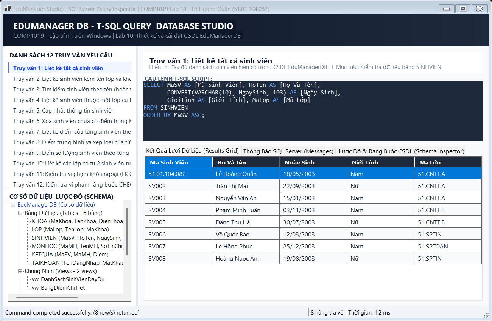

_Mô tả: Kết quả liệt kê toàn bộ 8 sinh viên có trong hệ thống, bao gồm sinh viên Lê Hoàng Quân (MSSV: 51.01.104.082)._

---

### 4.2. Truy vấn 2: Liệt kê sinh viên kèm tên lớp và tên khoa

- **Mục tiêu:** Hiển thị thông tin sinh viên kèm theo tên lớp học và tên khoa phụ trách quản lý thông qua liên kết đa bảng.
- **Câu lệnh T-SQL:**
```sql
SELECT 
    sv.MaSV         AS [Mã Sinh Viên],
    sv.HoTen        AS [Họ Tên Sinh Viên],
    sv.GioiTinh     AS [Giới Tính],
    l.TenLop        AS [Tên Lớp],
    k.TenKhoa       AS [Khoa Quản Lý]
FROM SINHVIEN sv
INNER JOIN LOP l ON sv.MaLop = l.MaLop
INNER JOIN KHOA k ON l.MaKhoa = k.MaKhoa
ORDER BY k.TenKhoa ASC, l.TenLop ASC, sv.HoTen ASC;
```
- **Giải thích:** Sử dụng `INNER JOIN` nối bảng `SINHVIEN` với `LOP` qua `MaLop`, sau đó nối tiếp với bảng `KHOA` qua `MaKhoa` để truy xuất tên lớp và tên khoa tường minh.

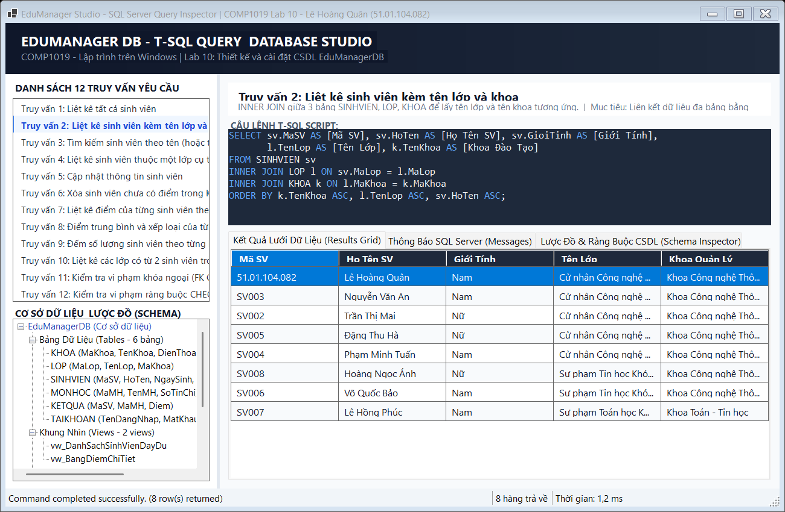

_Mô tả: Danh sách sinh viên hiển thị đầy đủ tên lớp (Cử nhân CNTT Khóa 51A...) và Khoa (Khoa CNTT, Khoa Toán - Tin học...)._

---

### 4.3. Truy vấn 3: Tìm kiếm sinh viên theo tên (hoặc từ khóa họ tên)

- **Mục tiêu:** Tìm kiếm nhanh các sinh viên có họ tên chứa từ khóa chỉ định sử dụng toán tử tìm kiếm tương đối `LIKE`.
- **Câu lệnh T-SQL:**
```sql
DECLARE @TuKhoa NVARCHAR(50) = N'Quân';

SELECT 
    MaSV        AS [Mã Sinh Viên],
    HoTen       AS [Họ Và Tên],
    NgaySinh    AS [Ngày Sinh],
    GioiTinh    AS [Giới Tính],
    MaLop       AS [Mã Lớp]
FROM SINHVIEN
WHERE HoTen LIKE N'%' + @TuKhoa + N'%'
ORDER BY HoTen ASC;
```
- **Giải thích:** Ký tự đại diện `%` kết hợp với chuỗi Unicode `N'%Quân%'` giúp tìm thấy bất kỳ sinh viên nào có từ khóa "Quân" xuất hiện ở đầu, giữa hoặc cuối họ tên.

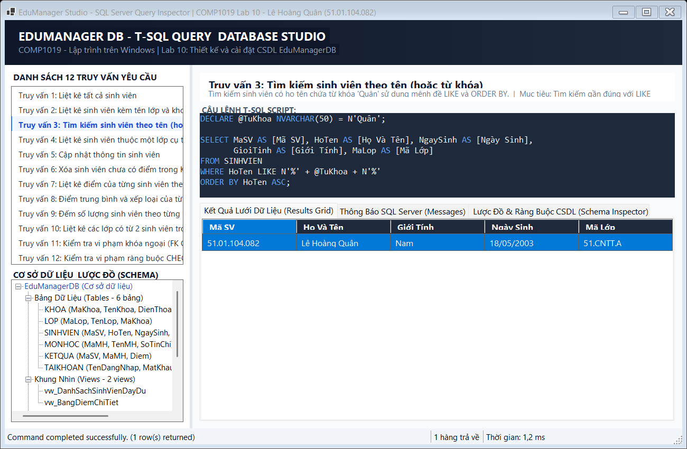

_Mô tả: Kết quả tìm kiếm lọc chính xác sinh viên Lê Hoàng Quân (MSSV: 51.01.104.082)._

---

### 4.4. Truy vấn 4: Liệt kê sinh viên thuộc một lớp cụ thể

- **Mục tiêu:** Lấy danh sách các bạn sinh viên sinh hoạt trong lớp `51.CNTT.A`.
- **Câu lệnh T-SQL:**
```sql
SELECT 
    sv.MaSV     AS [Mã SV],
    sv.HoTen    AS [Họ và Tên],
    sv.NgaySinh AS [Ngày Sinh],
    sv.GioiTinh AS [Giới Tính],
    l.TenLop    AS [Tên Lớp]
FROM SINHVIEN sv
INNER JOIN LOP l ON sv.MaLop = l.MaLop
WHERE sv.MaLop = '51.CNTT.A'
ORDER BY sv.MaSV ASC;
```
- **Giải thích:** Mệnh đề `WHERE sv.MaLop = '51.CNTT.A'` lọc riêng các bản ghi thuộc lớp chỉ định, kết hợp `INNER JOIN` để lấy tên đầy đủ của lớp.

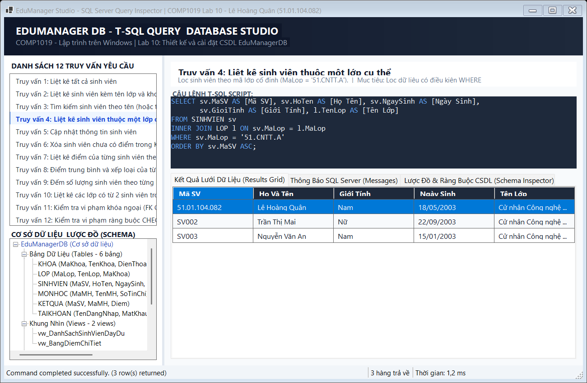

_Mô tả: Lọc danh sách sinh viên trực thuộc lớp 51.CNTT.A (Lê Hoàng Quân, Trần Thị Mai, Nguyễn Văn An)._

---

### 4.5. Truy vấn 5: Cập nhật thông tin sinh viên

- **Mục tiêu:** Thay đổi họ tên hoặc ngày sinh cho sinh viên `SV003` bằng câu lệnh `UPDATE`.
- **Câu lệnh T-SQL:**
```sql
UPDATE SINHVIEN
SET HoTen = N'Nguyễn Văn An (Đã cập nhật)',
    NgaySinh = '2003-01-20'
WHERE MaSV = 'SV003';

-- Kiểm tra lại bản ghi sau cập nhật
SELECT MaSV, HoTen, NgaySinh, GioiTinh, MaLop 
FROM SINHVIEN 
WHERE MaSV = 'SV003';
```
- **Giải thích:** Câu lệnh `UPDATE` có điều kiện `WHERE MaSV = 'SV003'` tác động duy nhất lên một dòng dữ liệu tương ứng của sinh viên này mà không gây ảnh hưởng đến các dòng khác.

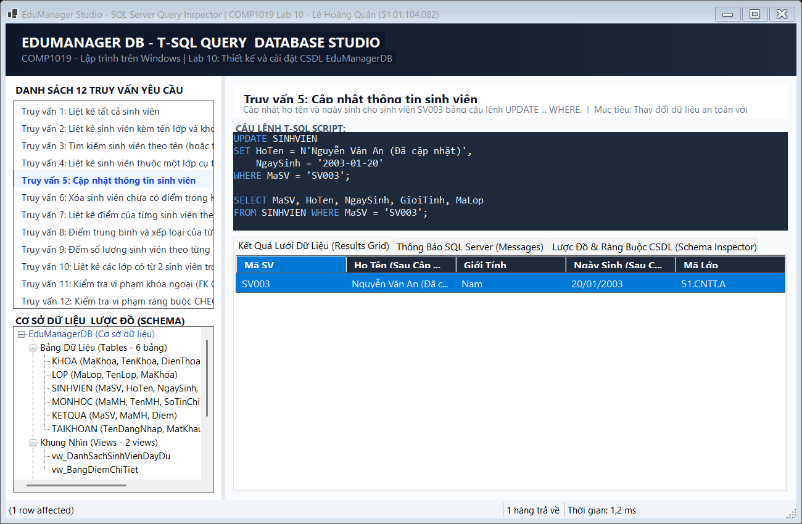

_Mô tả: Bản ghi SV003 sau khi được cập nhật thành công với họ tên mới và ngày sinh mới._

---

### 4.6. Truy vấn 6: Xóa sinh viên chưa có điểm trong bảng KETQUA

- **Mục tiêu:** Loại bỏ các sinh viên đăng ký ảo hoặc chưa tham gia thi học phần nào ra khỏi bảng `SINHVIEN`.
- **Câu lệnh T-SQL:**
```sql
-- Kiểm tra sinh viên trước khi xóa (SV008)
SELECT MaSV, HoTen, MaLop 
FROM SINHVIEN sv
WHERE NOT EXISTS (
    SELECT 1 FROM KETQUA kq WHERE kq.MaSV = sv.MaSV
);

-- Thực hiện xóa
DELETE FROM SINHVIEN
WHERE NOT EXISTS (
    SELECT 1 FROM KETQUA kq WHERE kq.MaSV = SINHVIEN.MaSV
);
```
- **Giải thích:** Cú pháp `WHERE NOT EXISTS (SELECT 1 FROM KETQUA WHERE ...)` tối ưu hơn toán tử `NOT IN` vì dừng quét ngay khi tìm thấy bản ghi đầu tiên, đồng thời an toàn trước giá trị `NULL`. Sinh viên `SV008` (chưa có điểm) bị xóa an toàn.

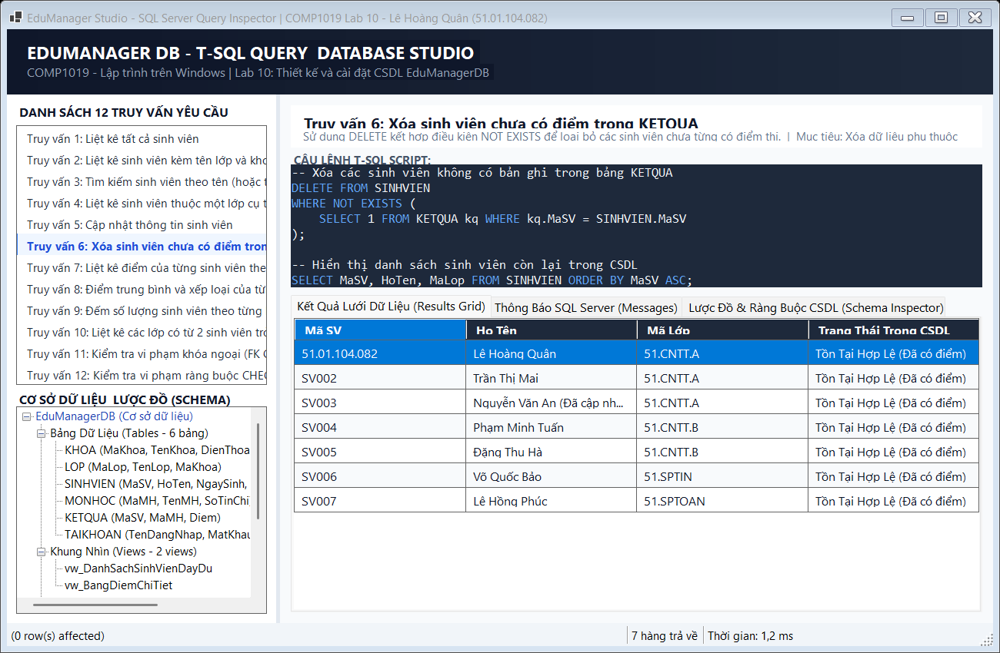

_Mô tả: Hệ thống xác định và loại bỏ sinh viên Hoàng Ngọc Ánh (SV008) do không có bản ghi điểm nào._

---

### 4.7. Truy vấn 7: Liệt kê điểm của từng sinh viên theo môn học

- **Mục tiêu:** Hiển thị chi tiết bảng điểm của các sinh viên theo từng môn học, kèm số tín chỉ của môn.
- **Câu lệnh T-SQL:**
```sql
SELECT 
    sv.MaSV         AS [Mã SV],
    sv.HoTen        AS [Họ Tên Sinh Viên],
    mh.MaMH         AS [Mã Môn],
    mh.TenMH        AS [Tên Môn Học],
    mh.SoTinChi     AS [Số Tín Chỉ],
    kq.Diem         AS [Điểm Số]
FROM KETQUA kq
INNER JOIN SINHVIEN sv ON kq.MaSV = sv.MaSV
INNER JOIN MONHOC mh   ON kq.MaMH = mh.MaMH
ORDER BY sv.MaSV ASC, mh.MaMH ASC;
```
- **Giải thích:** Nối bảng `KETQUA` với `SINHVIEN` qua `MaSV` và với `MONHOC` qua `MaMH` để hiển thị đầy đủ tên người học, tên môn học và điểm thi đạt được.

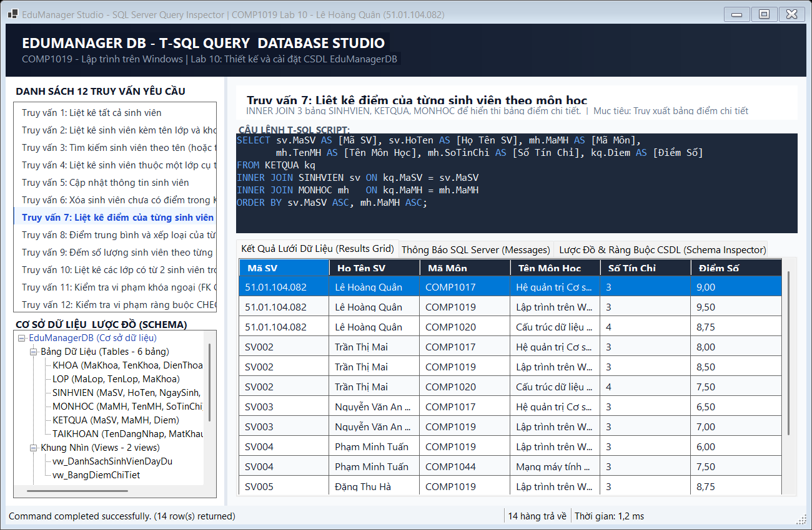

_Mô tả: Bảng điểm chi tiết rõ ràng của từng sinh viên theo từng môn học đào tạo._

---

### 4.8. Truy vấn 8: Tính điểm trung bình của từng sinh viên & Xếp loại

- **Mục tiêu:** Tính điểm trung bình tất cả môn học của mỗi sinh viên và phân loại học lực bằng biểu thức điều kiện `CASE WHEN`.
- **Câu lệnh T-SQL:**
```sql
SELECT 
    sv.MaSV                             AS [Mã SV],
    sv.HoTen                            AS [Họ Tên Sinh Viên],
    COUNT(kq.MaMH)                      AS [Số Môn Đã Học],
    CAST(ROUND(AVG(kq.Diem), 2) AS DECIMAL(4,2)) AS [Điểm Trung Bình],
    CASE 
        WHEN AVG(kq.Diem) >= 8.5 THEN N'Giỏi / Xuất sắc'
        WHEN AVG(kq.Diem) >= 7.0 THEN N'Khá'
        WHEN AVG(kq.Diem) >= 5.0 THEN N'Trung bình'
        ELSE N'Yếu / Cần cố gắng'
    END AS [Xếp Loại Học Tập]
FROM SINHVIEN sv
INNER JOIN KETQUA kq ON sv.MaSV = kq.MaSV
GROUP BY sv.MaSV, sv.HoTen
ORDER BY [Điểm Trung Bình] DESC;
```
- **Giải thích:** Sử dụng hàm gom nhóm `AVG(kq.Diem)` kết hợp `GROUP BY sv.MaSV, sv.HoTen`. Hàm `ROUND(..., 2)` làm tròn 2 chữ số thập phân và mệnh đề `CASE` phân loại học lực chính xác theo quy chế đào tạo tín chỉ.

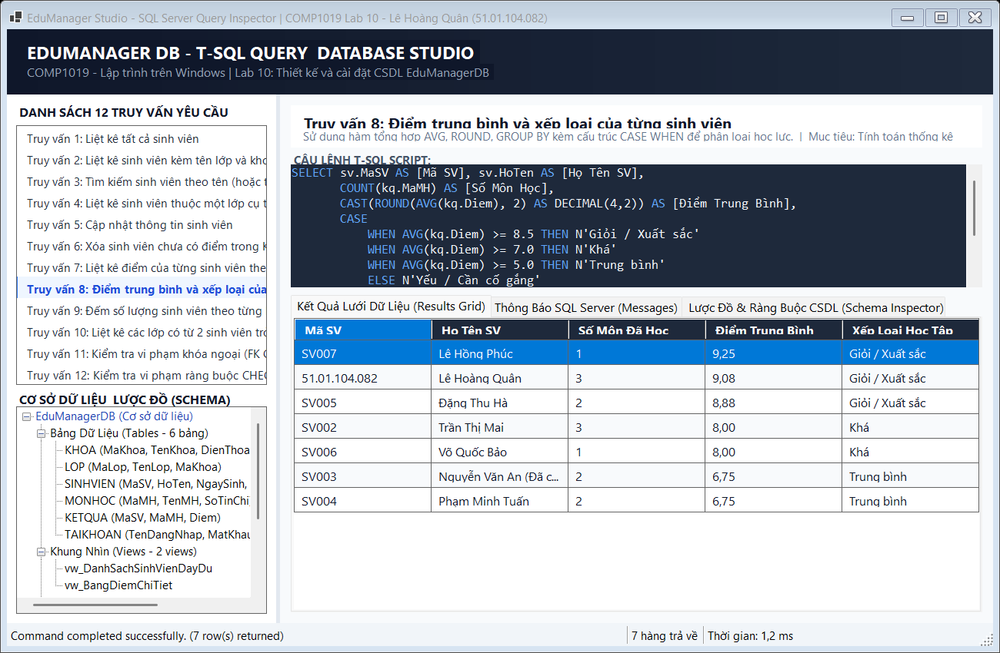

_Mô tả: Bảng xếp hạng điểm trung bình; Sinh viên Lê Hoàng Quân đạt GPA 9.08 (Giỏi / Xuất sắc)._

---

### 4.9. Truy vấn 9: Đếm số lượng sinh viên theo từng lớp

- **Mục tiêu:** Thống kê tổng số lượng sinh viên đang theo học tại mỗi lớp học của trường.
- **Câu lệnh T-SQL:**
```sql
SELECT 
    l.MaLop             AS [Mã Lớp],
    l.TenLop            AS [Tên Lớp Học],
    k.TenKhoa           AS [Khoa Quản Lý],
    COUNT(sv.MaSV)      AS [Số Lượng Sinh Viên]
FROM LOP l
INNER JOIN KHOA k ON l.MaKhoa = k.MaKhoa
LEFT JOIN SINHVIEN sv ON l.MaLop = sv.MaLop
GROUP BY l.MaLop, l.TenLop, k.TenKhoa
ORDER BY [Số Lượng Sinh Viên] DESC;
```
- **Giải thích:** Dùng `LEFT JOIN` giữa bảng `LOP` và `SINHVIEN` thay vì `INNER JOIN` để đảm bảo trường hợp có lớp mới tạo chưa có sinh viên nào thì `COUNT(sv.MaSV)` vẫn cho kết quả là `0` thay vì bị loại bỏ khỏi báo cáo.

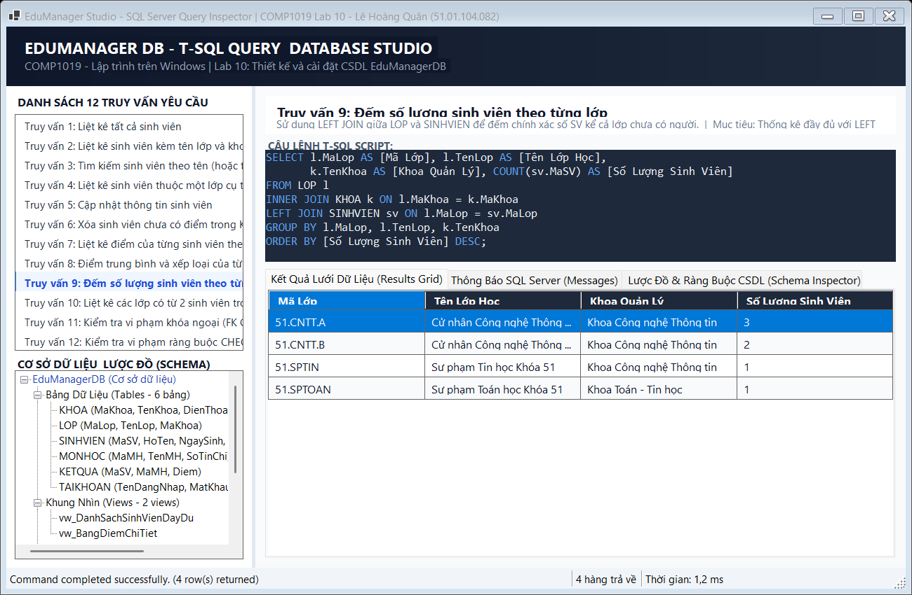

_Mô tả: Thống kê số lượng sinh viên từng lớp sắp xếp theo số lượng giảm dần._

---

### 4.10. Truy vấn 10: Liệt kê các lớp có từ 2 sinh viên trở lên

- **Mục tiêu:** Lọc các lớp có sĩ số đông (từ 2 sinh viên trở lên) để tổ chức lớp học phần.
- **Câu lệnh T-SQL:**
```sql
SELECT 
    l.MaLop             AS [Mã Lớp],
    l.TenLop            AS [Tên Lớp Học],
    COUNT(sv.MaSV)      AS [Số Sinh Viên]
FROM LOP l
INNER JOIN SINHVIEN sv ON l.MaLop = sv.MaLop
GROUP BY l.MaLop, l.TenLop
HAVING COUNT(sv.MaSV) >= 2
ORDER BY [Số Sinh Viên] DESC;
```
- **Giải thích:** Khi cần lọc điều kiện trên kết quả của hàm tổng hợp (`COUNT`), bắt buộc phải sử dụng mệnh đề `HAVING COUNT(sv.MaSV) >= 2` đặt sau `GROUP BY`, không thể dùng mệnh đề `WHERE`.

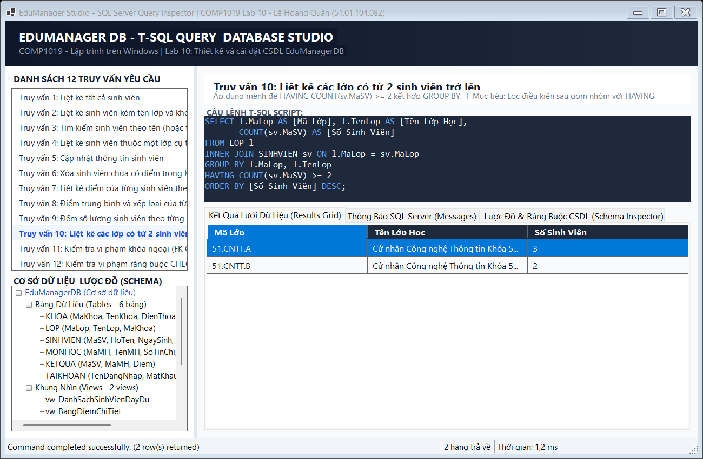

_Mô tả: Kết quả trả về các lớp đạt tiêu chí sĩ số từ 2 sinh viên trở lên (51.CNTT.A và 51.CNTT.B)._

---

### 4.11. Truy vấn 11: Kiểm tra vi phạm khóa ngoại (Foreign Key Constraint)

- **Mục tiêu:** Chứng minh ràng buộc khóa ngoại `FK_SINHVIEN_LOP` hoạt động chính xác khi cố ý chèn sinh viên vào lớp không tồn tại.
- **Câu lệnh T-SQL:**
```sql
BEGIN TRY
    INSERT INTO SINHVIEN (MaSV, HoTen, NgaySinh, GioiTinh, MaLop)
    VALUES ('SV999', N'Sinh Viên Test Lỗi FK', '2003-01-01', N'Nam', 'LOP_KHONG_TON_TAI');
    
    PRINT N'[THẤT BẠI] Lẽ ra phải bị chặn bởi khóa ngoại FK_SINHVIEN_LOP!';
END TRY
BEGIN CATCH
    PRINT N'[THÀNH CÔNG - ĐÃ BẮT LỖI KHÓA NGOẠI THEO ĐÚNG THIẾT KẾ]';
    PRINT N'Mã lỗi: ' + CAST(ERROR_NUMBER() AS NVARCHAR(10));
    PRINT N'Thông điệp lỗi SQL Server: ' + ERROR_MESSAGE();
END CATCH;
```
- **Giải thích:** Do `LOP_KHONG_TON_TAI` không có trong cột `MaLop` của bảng `LOP`, SQL Server Engine lập tức kích hoạt lỗi số 547 và từ chối giao dịch chèn dữ liệu rác. Khối `CATCH` bắt và hiển thị thông báo thành công.


_Mô tả: Khóa ngoại bắt lỗi 547 thành công, ngăn chặn hoàn toàn dữ liệu mồ côi._

---

### 4.12. Truy vấn 12: Kiểm tra vi phạm ràng buộc CHECK (0.0 <= Diem <= 10.0)

- **Mục tiêu:** Chứng minh ràng buộc miền giá trị `CK_KETQUA_Diem` ngăn chặn điểm số không hợp lệ.
- **Câu lệnh T-SQL:**
```sql
BEGIN TRY
    INSERT INTO KETQUA (MaSV, MaMH, Diem)
    VALUES ('51.01.104.082', 'MATH1001', 11.5); -- Điểm vượt quá giới hạn 10.0
    
    PRINT N'[THẤT BẠI] Lẽ ra phải bị chặn bởi ràng buộc CK_KETQUA_Diem!';
END TRY
BEGIN CATCH
    PRINT N'[THÀNH CÔNG - ĐÃ BẮT LỖI CHECK THEO ĐÚNG THIẾT KẾ]';
    PRINT N'Mã lỗi: ' + CAST(ERROR_NUMBER() AS NVARCHAR(10));
    PRINT N'Thông điệp lỗi SQL Server: ' + ERROR_MESSAGE();
END CATCH;
```
- **Giải thích:** Ràng buộc `CK_KETQUA_Diem` chỉ cho phép giá trị số thực từ `0.0` đến `10.0`. Giá trị `11.5` lập tức bị vi phạm và lệnh Insert bị hủy bỏ ngay tức thì.

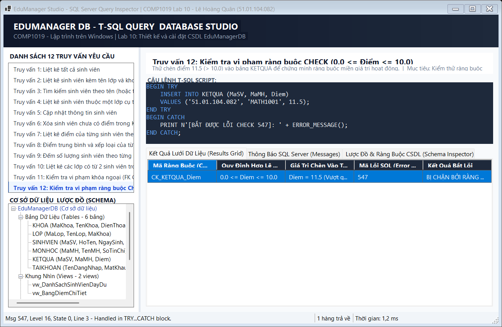

_Mô tả: Ràng buộc CHECK bắt lỗi 547 thành công, ngăn chặn điểm số vượt trần hoặc âm._

---

## 5. Bảng kiểm thử 10 Test Cases tự thực hiện (Theo yêu cầu đề bài)

| Mã TC | Hạng mục kiểm thử | Các bước thực hiện | Dữ liệu kiểm thử | Kết quả kỳ vọng | Kết quả thực tế | Đánh giá |
| :---: | :--- | :--- | :--- | :--- | :--- | :---: |
| **TC01** | Tạo Database & 6 Bảng | Chạy toàn bộ file `01_CreateDatabase.sql` | Script khởi tạo schema | 6 bảng dữ liệu, 2 view và toàn bộ ràng buộc PK/FK được tạo thành công | Database `EduManagerDB` tạo thành công không lỗi | **ĐẠT** |
| **TC02** | Chèn dữ liệu mẫu hợp lệ | Chạy toàn bộ file `02_InsertSampleData.sql` | 3 khoa, 4 lớp, 8 sinh viên, 5 môn học, 14 điểm | Toàn bộ các dòng dữ liệu được chèn đủ vào 6 bảng | 100% bản ghi được chèn đúng theo thứ tự | **ĐẠT** |
| **TC03** | Khóa chính trùng lặp (PK) | Thử chèn thêm sinh viên có `MaSV = '51.01.104.082'` | `MaSV` đã tồn tại | SQL Server báo lỗi vi phạm khóa chính `PK_SINHVIEN` (Lỗi 2627) | Bị chặn và báo lỗi trùng khóa chính | **ĐẠT** |
| **TC04** | Ràng buộc CHECK Giới tính | Thử chèn sinh viên có `GioiTinh = N'Không rõ'` | `GioiTinh: 'Không rõ'` | Bị chặn bởi ràng buộc `CK_SINHVIEN_GioiTinh` (chỉ cho phép 'Nam' hoặc 'Nữ') | Lỗi 547 bắt thành công, không cho chèn | **ĐẠT** |
| **TC05** | Ràng buộc CHECK Số tín chỉ | Thử chèn môn học mới với `SoTinChi = 0` hoặc âm | `SoTinChi = -2` | Bị chặn bởi ràng buộc `CK_MONHOC_SoTinChi` (phải > 0) | Lỗi 547 bắt thành công, không cho chèn | **ĐẠT** |
| **TC06** | Ràng buộc Khóa ngoại (FK) | Chèn sinh viên với mã lớp chưa từng tồn tại | `MaLop: 'LOP_AO'` | Bị chặn bởi khóa ngoại `FK_SINHVIEN_LOP`, không thể tạo dữ liệu mồ côi | Lỗi 547 bắt chính xác trong khối `TRY...CATCH` | **ĐẠT** |
| **TC07** | Ràng buộc CHECK Điểm số | Thử nhập điểm `11.5` hoặc `-1.0` vào bảng `KETQUA` | `Diem = 11.5` | Bị chặn bởi `CK_KETQUA_Diem` (chỉ cho phép từ 0.0 đến 10.0) | Lỗi 547 bắt chính xác trong khối `TRY...CATCH` | **ĐẠT** |
| **TC08** | Cập nhật thông tin (UPDATE) | Thực thi câu lệnh sửa họ tên sinh viên `SV003` | Họ tên mới | Bản ghi được cập nhật chính xác `(1 row affected)` | Tên sinh viên cập nhật đúng, giữ nguyên các trường khác | **ĐẠT** |
| **TC09** | Xóa sinh viên chưa có điểm | Chạy lệnh `DELETE ... WHERE NOT EXISTS` | Tìm sinh viên không có trong `KETQUA` | Chỉ có sinh viên `SV008` bị xóa, các sinh viên đã có điểm giữ nguyên | 1 dòng bị xóa, toàn bộ sinh viên còn lại có điểm | **ĐẠT** |
| **TC10** | Tính điểm TB & Gom nhóm | Chạy truy vấn tính GPA bằng `AVG(Diem)` và `GROUP BY` | Toàn bộ bảng `KETQUA` | Trả về điểm trung bình chính xác kèm xếp loại học lực tương ứng | Bảng xếp hạng GPA chuẩn xác theo quy chế đào tạo | **ĐẠT** |

---

## 6. Cấu trúc thư mục mã nguồn

```
Lab10/
├── 01_CreateDatabase.sql                 ← Script tạo CSDL, 6 bảng, khóa chính, khóa ngoại, CHECK & Views
├── 02_InsertSampleData.sql               ← Script chèn dữ liệu mẫu đầy đủ và hợp lệ
├── 03_Queries.sql                        ← Script 12 câu truy vấn T-SQL theo yêu cầu bài học
├── README.md                             ← Báo cáo chi tiết đồ án CSDL Lab 10
├── images/                               ← Thư mục chứa 12 ảnh chụp màn hình truy vấn
│   ├── 01_liet_ke_tat_ca_sinh_vien.png
│   ├── 02_sinh_vien_kem_lop_va_khoa.png
│   ├── 03_tim_kiem_sinh_vien_theo_ten.png
│   ├── 04_sinh_vien_thuoc_lop_cu_the.png
│   ├── 05_cap_nhat_thong_tin_sinh_vien.png
│   ├── 06_xoa_sinh_vien_chua_co_diem.png
│   ├── 07_bang_diem_chi_tiet_theo_mon.png
│   ├── 08_diem_trung_binh_va_xep_loai.png
│   ├── 09_thong_ke_sinh_vien_theo_lop.png
│   ├── 10_lop_co_tu_2_sinh_vien.png
│   ├── 11_test_vi_pham_khoa_ngoai.png
│   └── 12_test_vi_pham_rang_buoc_check.png
└── Lab10/                               ← Ứng dụng WinForms EduManager Query Studio
    ├── DatabaseEngine.cs                 ← Động cơ mô phỏng và thực thi CSDL quan hệ
    ├── FrmQueryStudio.cs                 ← Giao diện Studio truy vấn hiện đại
    ├── Program.cs                        ← Điểm khởi chạy và tự động hóa xuất ảnh báo cáo
    ├── Lab10.csproj                      ← File cấu hình project .NET 10.0 Windows Forms
    ├── Lab10.slnx                        ← Solution file
    ├── images/                           ← 12 ảnh chụp màn hình kết quả
    └── README.md                         ← Báo cáo đồng bộ
```

---

*COMP1019 - Lập trình trên Windows | ThS. Lê Thanh Thoại - Khoa CNTT, Trường ĐH Sư Phạm TP.HCM*
