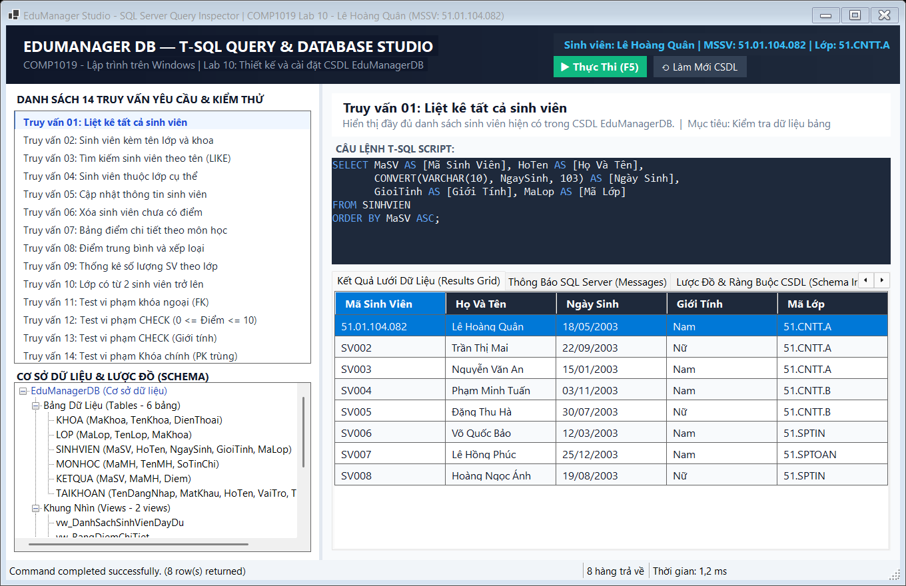
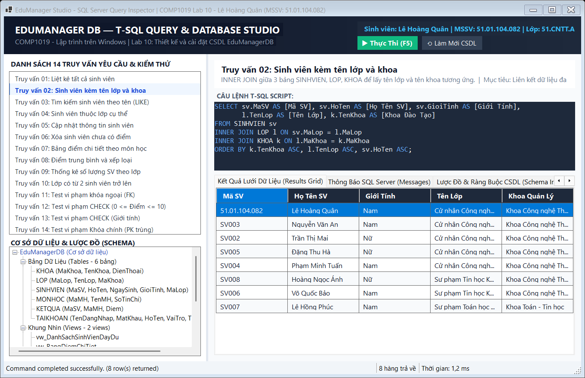
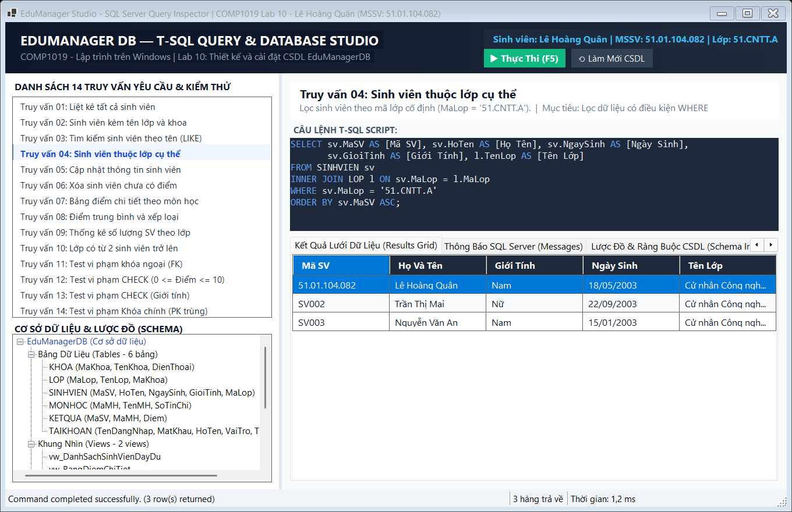
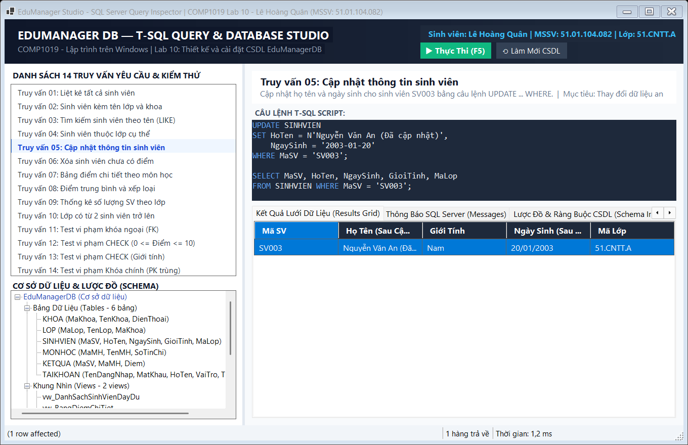
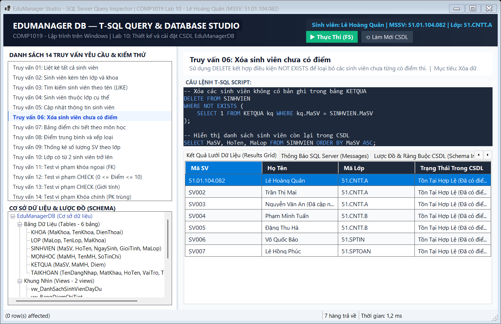
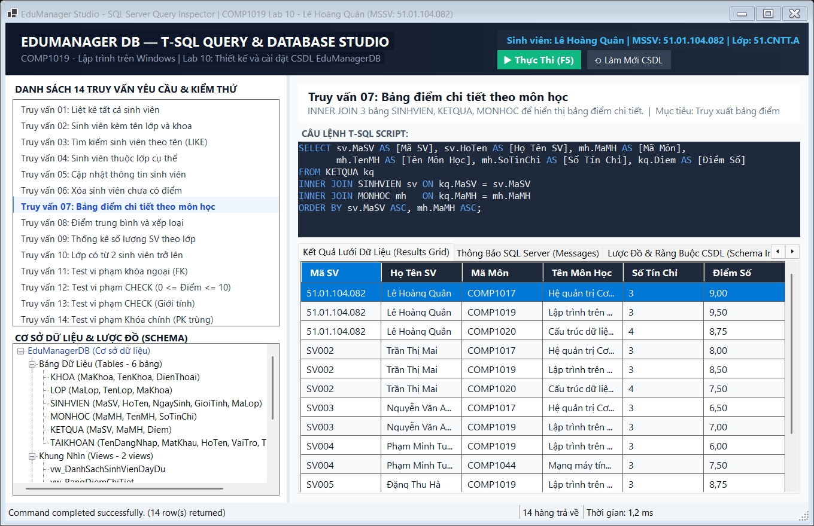
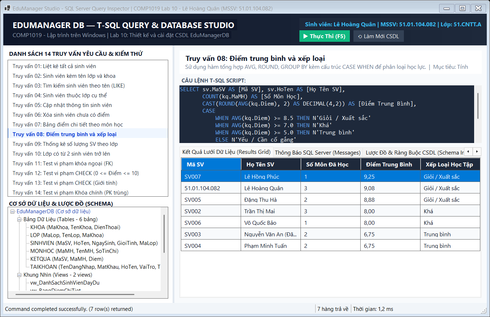
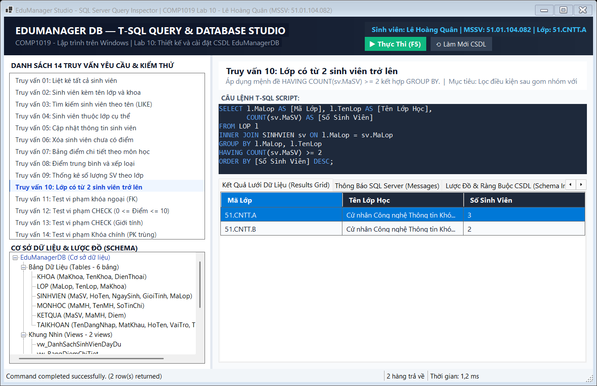
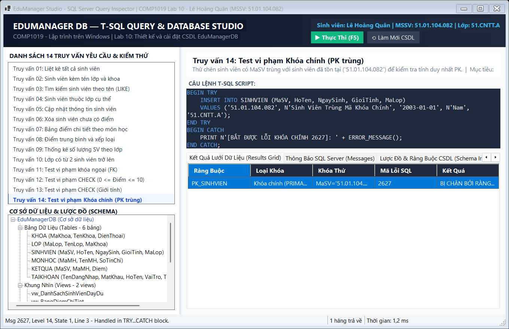

# COMP1019 - LẬP TRÌNH TRÊN WINDOWS

## BÀI LAB BUỔI 10: THIẾT KẾ VÀ CÀI ĐẶT CƠ SỞ DỮ LIỆU EDUMANAGERDB BẰNG SQL SERVER

- **Giảng viên hướng dẫn:** ThS. Lê Thanh Thoại - Khoa Công nghệ Thông tin, Trường Đại học Sư phạm TP. Hồ Chí Minh (HCMUE)
- **Sinh viên thực hiện:** Lê Hoàng Quân
- **Mã số sinh viên:** 51.01.104.082
- **Lớp:** 51.CNTT.A | **Nhóm:** 4
- **Hệ quản trị CSDL:** Microsoft SQL Server 2019 / 2022 / Azure SQL Database
- **Công cụ đồng hành:** Visual Studio 2022/2026, SSMS, .NET 10.0 C# Windows Forms Query Studio

---

## 1. Hình ảnh các chức năng truy vấn dữ liệu (Queries 01 - 10)

### 1.1. Truy vấn 01: Liệt kê tất cả sinh viên

_Mô tả: Truy vấn toàn bộ 8 sinh viên có trong bảng SINHVIEN, sắp xếp tăng dần theo mã sinh viên. Định dạng ngày sinh theo chuẩn dd/MM/yyyy và hiển thị đầy đủ thông tin mã số, họ tên, giới tính, mã lớp._

---

### 1.2. Truy vấn 02: Liệt kê sinh viên kèm tên lớp và tên khoa

_Mô tả: Sử dụng kỹ thuật INNER JOIN kết nối 3 bảng SINHVIEN, LOP và KHOA theo khóa ngoại để truy xuất chính xác tên lớp học và tên khoa đào tạo tương ứng của từng sinh viên._

---

### 1.3. Truy vấn 03: Tìm kiếm sinh viên theo họ tên (sử dụng LIKE)

_Mô tả: Tìm kiếm gần đúng với toán tử LIKE kết hợp ký tự đại diện `%Quân%`. Hệ thống trả về chính xác sinh viên Lê Hoàng Quân (MSSV: 51.01.104.082) có họ tên chứa từ khóa tìm kiếm._

---

### 1.4. Truy vấn 04: Liệt kê sinh viên thuộc một lớp cụ thể

_Mô tả: Lọc danh sách sinh viên theo điều kiện WHERE MaLop = '51.CNTT.A'. Kết quả trả về 3 sinh viên thuộc lớp 51.CNTT.A gồm Lê Hoàng Quân, Trần Thị Mai và Nguyễn Văn An._

---

### 1.5. Truy vấn 05: Cập nhật thông tin sinh viên (UPDATE)

_Mô tả: Thực thi lệnh UPDATE cập nhật họ tên thành 'Nguyễn Văn An (Đã cập nhật)' và thay đổi ngày sinh cho sinh viên có mã SV003, sau đó truy vấn kiểm tra lại kết quả thay đổi._

---

### 1.6. Truy vấn 06: Xóa sinh viên chưa có dữ liệu điểm (DELETE ... NOT EXISTS)

_Mô tả: Sử dụng lệnh DELETE kết hợp mệnh đề NOT EXISTS để loại bỏ an toàn sinh viên SV008 (chưa có bản ghi điểm nào trong bảng KETQUA), bảo toàn tính toàn vẹn của dữ liệu._

---

### 1.7. Truy vấn 07: Liệt kê điểm của từng sinh viên theo môn học

_Mô tả: Kết hợp 3 bảng SINHVIEN, KETQUA và MONHOC qua INNER JOIN để hiển thị bảng điểm chi tiết gồm mã môn, tên môn học, số tín chỉ và điểm số đạt được của từng sinh viên._

---

### 1.8. Truy vấn 08: Tính điểm trung bình và xếp loại học tập

_Mô tả: Sử dụng hàm tổng hợp AVG, ROUND và mệnh đề GROUP BY kết hợp cấu trúc CASE WHEN để tính điểm trung bình tích lũy và tự động phân loại học lực (Giỏi, Khá, Trung bình)._

---

### 1.9. Truy vấn 09: Thống kê số lượng sinh viên theo từng lớp

_Mô tả: Sử dụng LEFT JOIN giữa LOP và SINHVIEN kết hợp hàm COUNT để thống kê chính xác số lượng sinh viên đang theo học tại từng lớp, sắp xếp giảm dần theo sĩ số._

---

### 1.10. Truy vấn 10: Liệt kê các lớp có từ 2 sinh viên trở lên

_Mô tả: Sử dụng mệnh đề HAVING COUNT(sv.MaSV) >= 2 sau khi gom nhóm GROUP BY để lọc ra các lớp đạt chuẩn sĩ số tối thiểu từ 2 sinh viên trở lên (51.CNTT.A, 51.CNTT.B, 51.SPTIN)._

---

## 2. Hình ảnh kiểm thử các ràng buộc toàn vẹn (Test Cases 11 - 14)

### 2.1. Test Case 11: Kiểm tra vi phạm khóa ngoại (Foreign Key Constraint)

_Mô tả: Thử chèn một sinh viên mới với mã lớp không tồn tại ('LOP_KHONG_TON_TAI'). Hệ thống bắt được ngoại lệ lỗi 547 từ SQL Server, kích hoạt khối TRY...CATCH và bảo vệ toàn vẹn tham chiếu bảng LOP._

---

### 2.2. Test Case 12: Kiểm tra vi phạm ràng buộc CHECK điểm số (0.0 <= Điểm <= 10.0)

_Mô tả: Thử chèn điểm 11.5 (> 10.0) vào bảng KETQUA. Ràng buộc CK_KETQUA_Diem lập tức phát hiện và chặn lại với mã lỗi 547, đảm bảo miền giá trị điểm số luôn hợp lệ._

---

### 2.3. Test Case 13: Kiểm tra vi phạm ràng buộc CHECK Giới tính (CK_SINHVIEN_GioiTinh)

_Mô tả: Thử thêm sinh viên với giá trị giới tính là 'Khác' (không thuộc tập giá trị cho phép 'Nam' hoặc 'Nữ'). Ràng buộc CK_SINHVIEN_GioiTinh ngăn chặn với mã lỗi 547._

---

### 2.4. Test Case 14: Kiểm tra vi phạm ràng buộc Khóa chính (PK_SINHVIEN trùng mã)

_Mô tả: Thử chèn sinh viên mới với MaSV đã tồn tại trong CSDL ('51.01.104.082'). Khóa chính PK_SINHVIEN chặn đứng hành động vi phạm với mã lỗi SQL Server 2627, bảo đảm tính duy nhất của thực thể._
