# COMP1019 - LẬP TRÌNH TRÊN WINDOWS
## BÁO CÁO THỰC HÀNH LAB 11: ADO.NET VÀ CRUD VỚI SQL SERVER

- **Sinh viên thực hiện:** Lê Hoàng Quân
- **Mã số sinh viên:** 51.01.104.082
- **Lớp:** 51.CNTT.A | **Nhóm:** 4
- **Giảng viên hướng dẫn:** ThS. Lê Thanh Thoại - Khoa CNTT, Trường Đại học Sư phạm TP.HCM (HCMUE)
- **Cơ sở dữ liệu:** Microsoft SQL Server (`EduManagerDB`)

---

### 1. Khởi chạy ứng dụng & Tải danh sách lớp học từ SQL Server (F1)

_Mô tả: Khi mở ứng dụng, hệ thống tự động thiết lập kết nối đến Microsoft SQL Server thông qua SqlConnection và chuỗi kết nối an toàn. Bảng dữ liệu DataGridView (dgvLop) hiển thị toàn bộ 4 lớp học hiện có trong bảng LOP kèm số lượng sinh viên của từng lớp được tính toán thông qua hàm COUNT(sv.MaSV) kết hợp LEFT JOIN với bảng SINHVIEN. Thanh trạng thái hiển thị rõ trạng thái kết nối Online của CSDL EduManagerDB và tổng số lớp._

---

### 2. Chọn một dòng trên DataGridView & Đổ dữ liệu lên Form (F2)
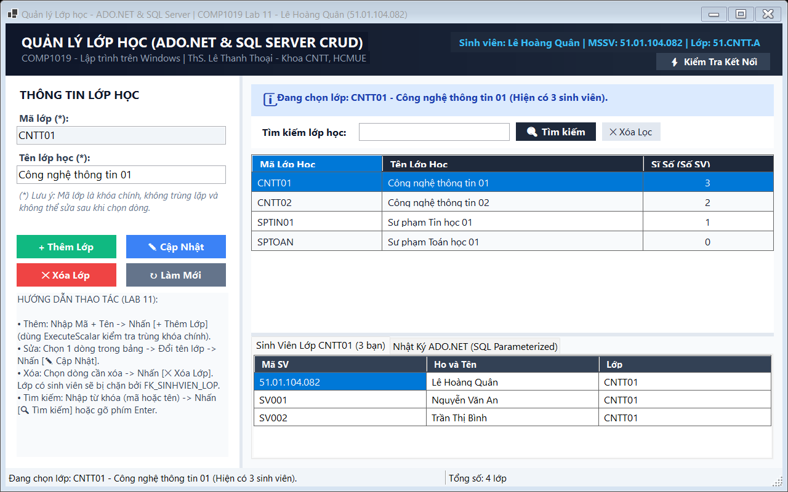
_Mô tả: Khi người dùng nhấp chuột vào dòng 'CNTT01' (Công nghệ thông tin 01), dữ liệu mã lớp và tên lớp được tự động điền vào các ô txtMaLop và txtTenLop. Ô txtMaLop được tự động khóa (ReadOnly = true) với nền màu xám nhạt để bảo vệ tính toàn vẹn của Khóa chính. Phía dưới tab 'Sinh viên thuộc lớp' lập tức nạp danh sách chi tiết 3 sinh viên đang theo học (bao gồm sinh viên Lê Hoàng Quân - 51.01.104.082), minh chứng trực quan cho mối quan hệ khóa ngoại giữa hai bảng._

---

### 3. Thêm mới lớp học hợp lệ vào SQL Server (F3)
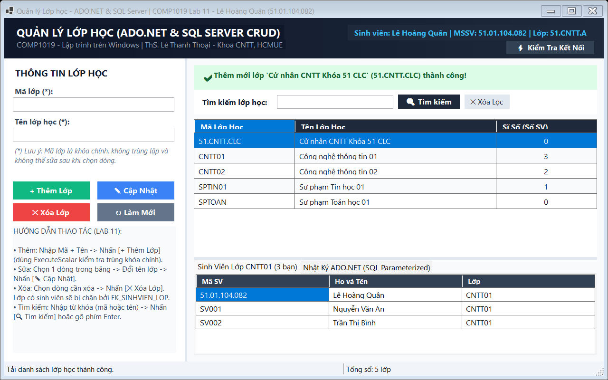
_Mô tả: Người dùng nhập Mã lớp '51.CNTT.CLC' và Tên lớp 'Cử nhân CNTT Khóa 51 CLC', sau đó nhấn nút [+ Thêm Lớp]. Hệ thống thực thi câu lệnh INSERT INTO LOP với các tham số @ma và @ten an toàn thông qua SqlParameter. Sau khi thêm thành công, banner màu xanh thông báo kết quả, bảng dgvLop tự động nạp lại cập nhật tổng số thành 5 lớp học và các ô nhập liệu được làm mới sẵn sàng cho thao tác tiếp theo._

---

### 4. Kiểm thử Validation: Bỏ trống trường bắt buộc khi Thêm (F3 - Validation Empty)
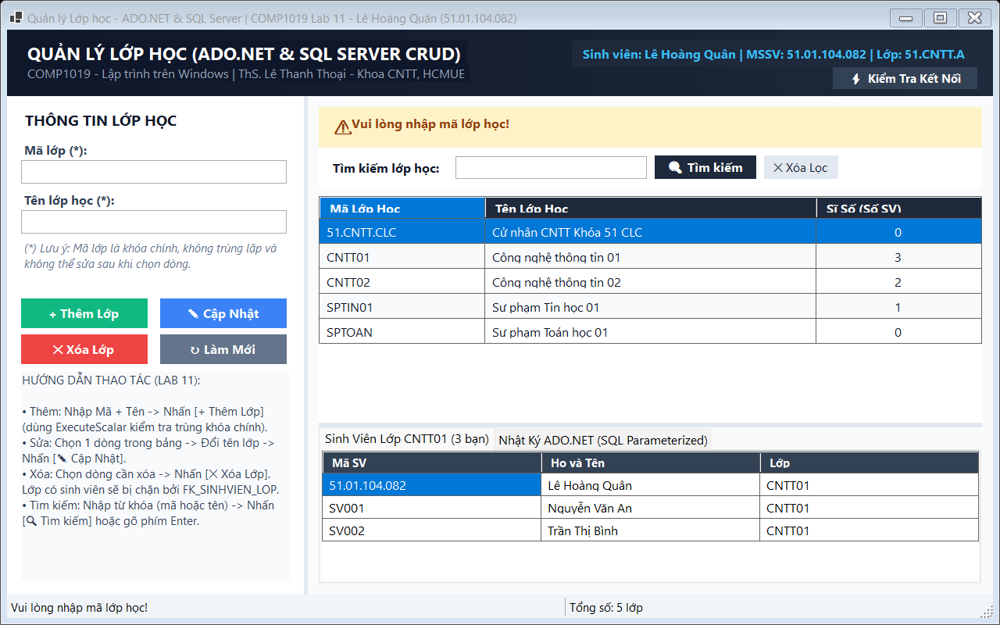
_Mô tả: Người dùng để trống ô Mã lớp hoặc Tên lớp rồi nhấn nút [+ Thêm Lớp]. Hệ thống lập tức kích hoạt bộ kiểm tra hợp lệ, hiển thị banner cảnh báo 'Vui lòng nhập mã lớp học!' và tự động đặt con trỏ chuột (Focus) vào ô nhập liệu lỗi để người dùng dễ dàng bổ sung, ngăn chặn việc gửi dữ liệu rỗng xuống cơ sở dữ liệu._

---

### 5. Kiểm thử Validation: Trùng mã lớp học - Khóa chính (F3 - Duplicate Key Check)
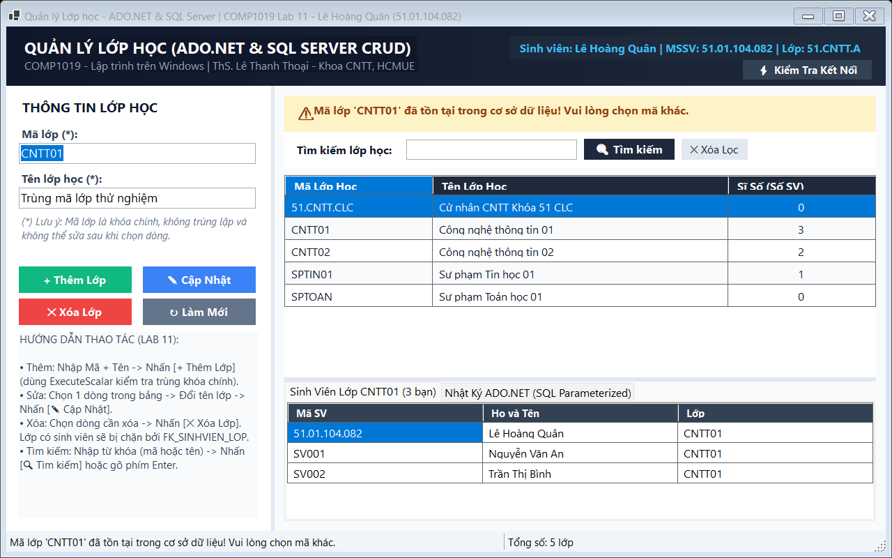
_Mô tả: Người dùng cố tình nhập mã lớp 'CNTT01' (đã tồn tại sẵn trong CSDL) rồi bấm nút [+ Thêm Lớp]. Hệ thống gọi hàm IsMaLopExists sử dụng ExecuteScalar với câu truy vấn 'SELECT COUNT(1) FROM LOP WHERE MaLop = @ma' để phát hiện trùng lặp. Banner cảnh báo 'Mã lớp CNTT01 đã tồn tại trong cơ sở dữ liệu! Vui lòng chọn mã khác' được hiển thị, đồng thời bôi đen toàn bộ văn bản trong ô txtMaLop để người dùng sửa lại._

---

### 6. Cập nhật tên lớp học đang chọn (F4 - Update)
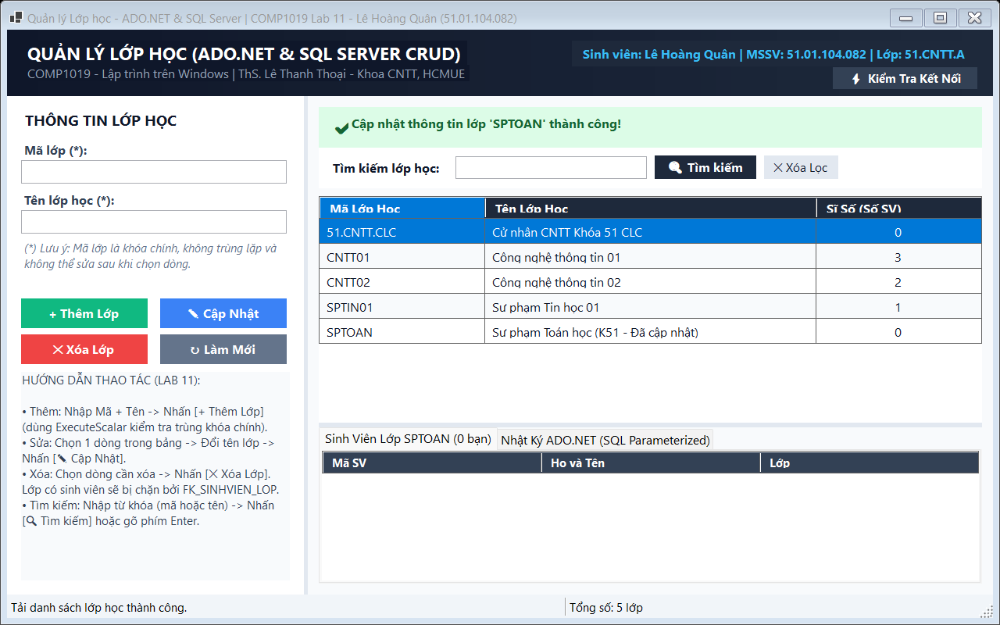
_Mô tả: Người dùng chọn lớp 'SPTOAN' trên bảng, thay đổi nội dung ô Tên lớp thành 'Sư phạm Toán học (K51 - Đã cập nhật)' rồi nhấn nút [✎ Cập Nhật]. Hệ thống thực thi lệnh UPDATE LOP SET TenLop = @ten WHERE MaLop = @ma bằng SqlCommand parameterized. Banner màu xanh thông báo 'Cập nhật thông tin lớp SPTOAN thành công!' xuất hiện và bảng DataGridView hiển thị ngay tên mới được đồng bộ từ SQL Server._

---

### 7. Kiểm thử Validation: Cập nhật khi chưa chọn dòng dữ liệu (F4 - Validation)
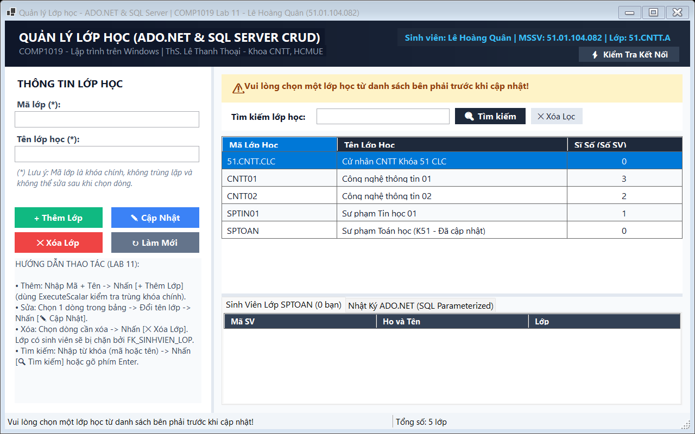
_Mô tả: Khi form ở trạng thái chưa chọn dòng nào (ô txtMaLop còn trống), người dùng bấm nút [✎ Cập Nhật]. Hệ thống chặn thao tác và cảnh báo 'Vui lòng chọn một lớp học từ danh sách bên phải trước khi cập nhật!', hướng dẫn người dùng chọn đúng đối tượng cần sửa đổi._

---

### 8. Xóa lớp học chưa có sinh viên theo học (F5 - Delete Thành công)
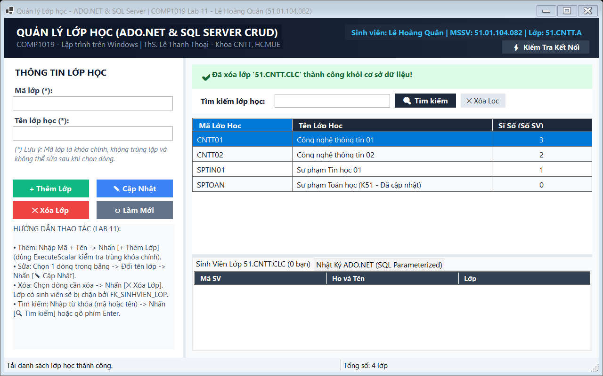
_Mô tả: Người dùng chọn lớp '51.CNTT.CLC' (lớp mới tạo có sĩ số 0 sinh viên) và nhấn nút [✕ Xóa Lớp]. Sau khi xác nhận hộp thoại Yes/No, hệ thống thực thi câu lệnh DELETE FROM LOP WHERE MaLop = @ma bằng ExecuteNonQuery. Lớp được xóa dứt điểm khỏi CSDL, banner thông báo 'Đã xóa lớp 51.CNTT.CLC thành công khỏi cơ sở dữ liệu!' và danh sách lớp tự động làm mới về 4 lớp._

---

### 9. Kiểm thử ràng buộc toàn vẹn: Chặn xóa lớp đang có sinh viên (F5 - Foreign Key Protection)
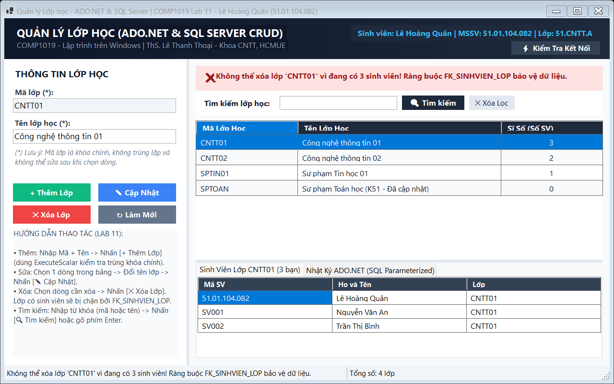
_Mô tả: Người dùng chọn lớp 'CNTT01' (lớp đang có 3 sinh viên trực thuộc) và nhấn nút [✕ Xóa Lớp]. Trước khi xóa, hàm CountSinhVienByLop thực thi câu lệnh 'SELECT COUNT(1) FROM SINHVIEN WHERE MaLop = @ma'. Phát hiện lớp đang có 3 sinh viên, hệ thống từ chối xóa và hiển thị banner cảnh báo đỏ: 'Không thể xóa lớp CNTT01 vì đang có 3 sinh viên! Ràng buộc FK_SINHVIEN_LOP bảo vệ dữ liệu'. Thao tác này ngăn ngừa lỗi vi phạm khóa ngoại ở tầng ứng dụng một cách chuyên nghiệp._

---

### 10. Tìm kiếm lớp học theo từ khóa tương đối (F6 - Search with LIKE)
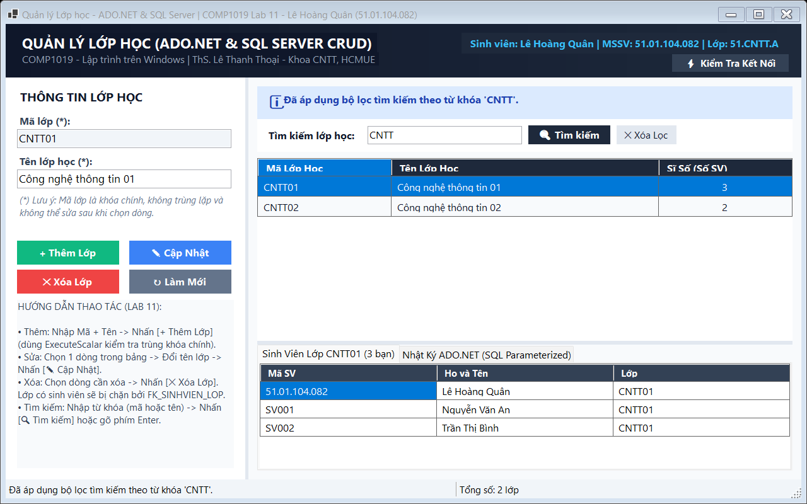
_Mô tả: Người dùng nhập từ khóa 'CNTT' vào ô tìm kiếm và bấm nút [🔍 Tìm kiếm] (hoặc gõ phím Enter). Hệ thống thực thi truy vấn parameterized an toàn: WHERE l.MaLop LIKE '%' + @kw + '%' OR l.TenLop LIKE '%' + @kw + '%'. Kết quả lọc chính xác 2 lớp CNTT01 và CNTT02, banner hiển thị số lượng kết quả tìm thấy và thanh trạng thái cập nhật 'Tổng số: 2 lớp'._

---

### 11. Làm mới form và nạp lại toàn bộ dữ liệu (F7 - Reset Form)
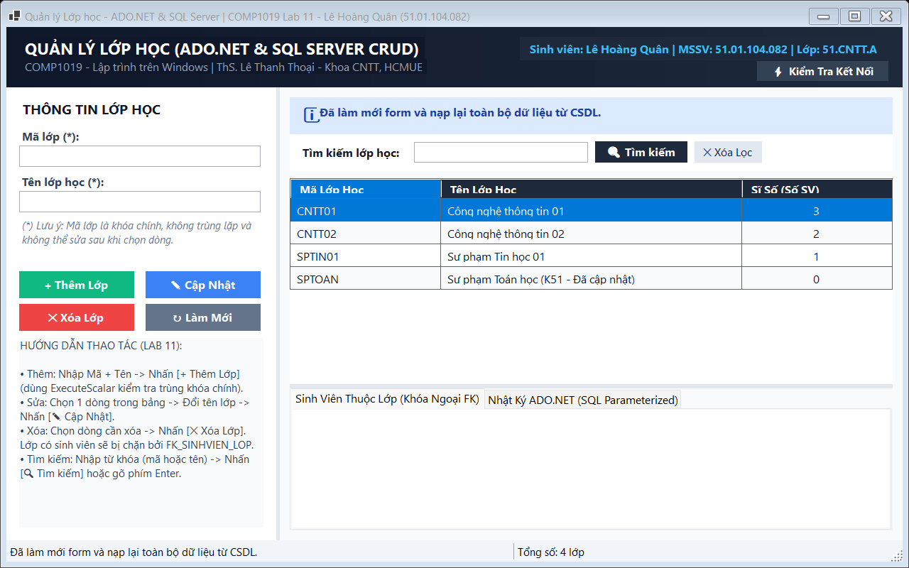
_Mô tả: Người dùng nhấn nút [↻ Làm Mới] (hoặc nút [✕ Xóa Lọc]). Toàn bộ các ô nhập liệu được xóa sạch, ô txtMaLop được mở khóa (ReadOnly = false, nền trắng) và nhận focus; thanh tìm kiếm được xóa; toàn bộ danh sách lớp học gốc từ SQL Server được nạp lại đầy đủ lên DataGridView._

---

### 12. Nhật ký câu lệnh ADO.NET Parameterized thời gian thực (F8 & Advanced SQL Monitor)
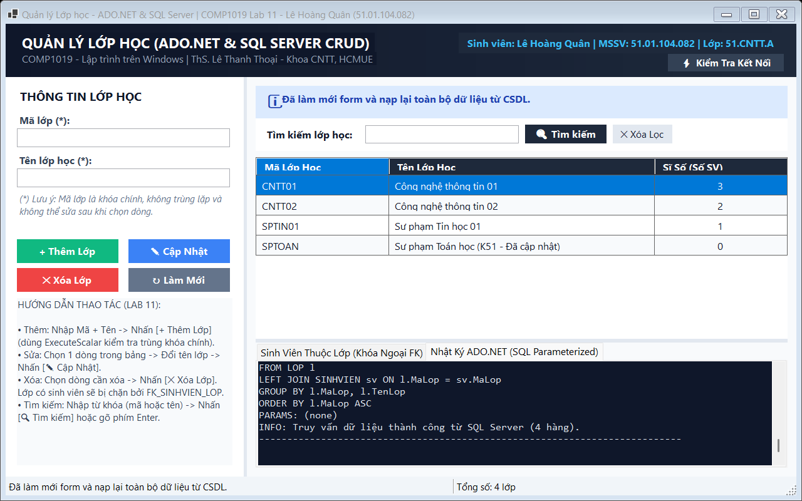
_Mô tả: Chuyển sang tab 'Nhật Ký ADO.NET (SQL Parameterized)' để kiểm chứng toàn bộ các câu lệnh T-SQL vừa được ứng dụng thực thi. Mỗi thao tác đều ghi nhận đầy đủ: Dấu thời gian (Timestamp), Trạng thái thành công [SUCCESS], Thời gian phản hồi CSDL (Execution Latency tính bằng ms), Số dòng bị tác động (Rows Affected), Nội dung câu lệnh SQL nguyên bản và Danh sách các SqlParameter truyền vào (@ma, @ten, @kw). 100% câu lệnh đều dùng tham số, tuyệt đối không ghép chuỗi, phòng chống triệt để tấn công SQL Injection._
