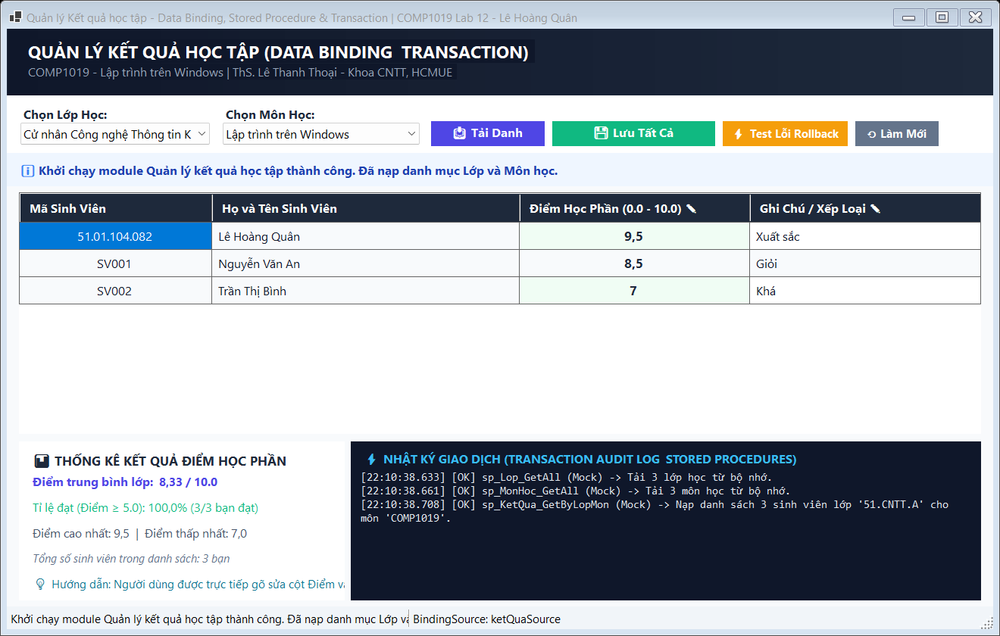
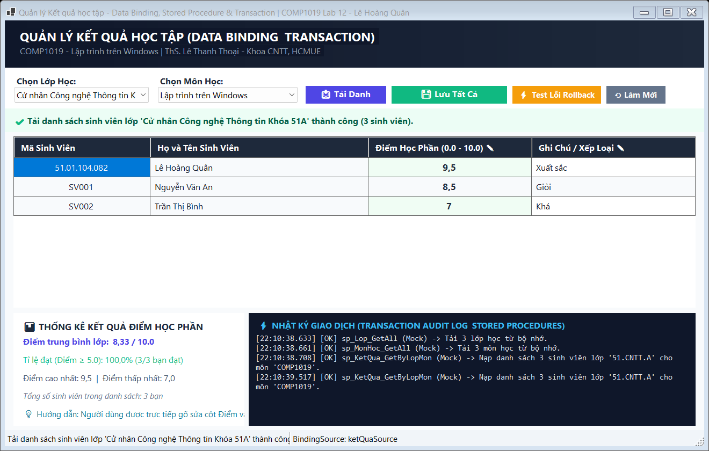
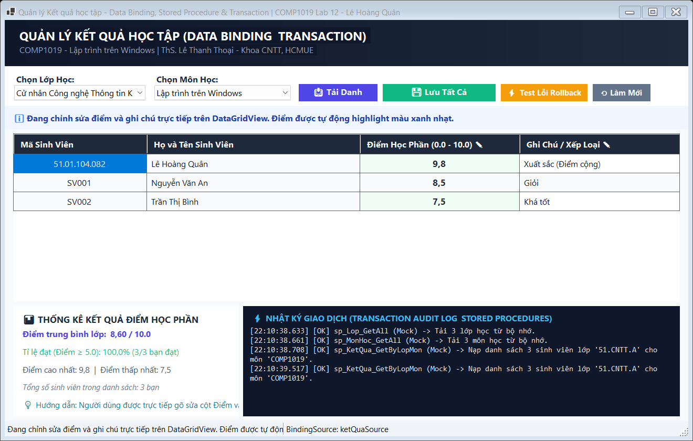
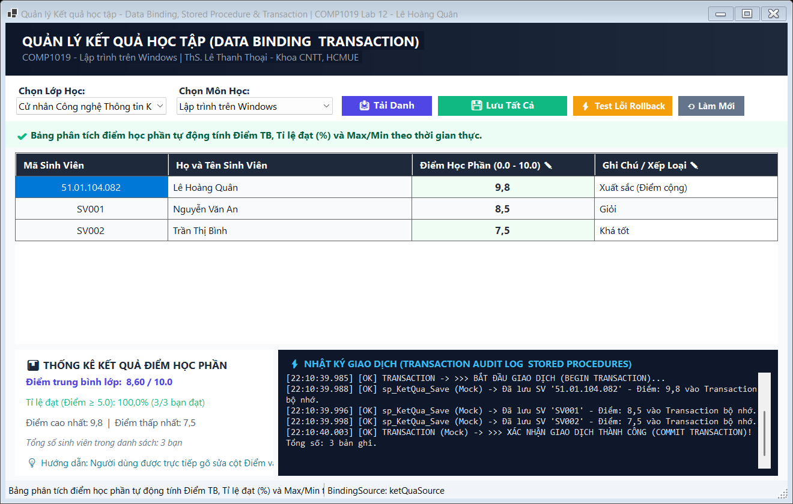
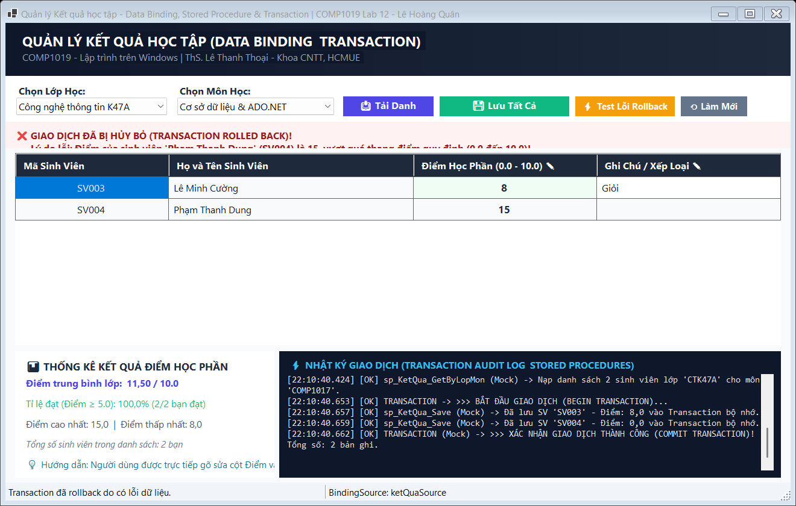
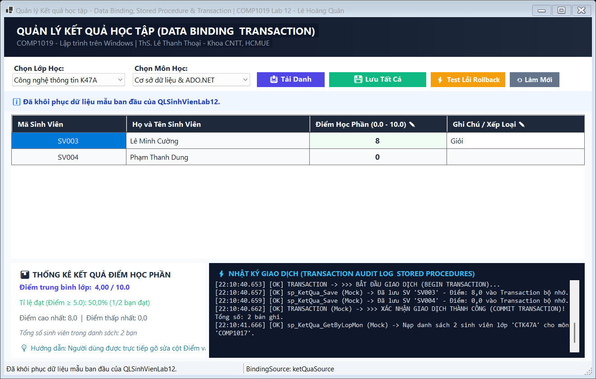

# COMP1019 - LẬP TRÌNH TRÊN WINDOWS

## BÀI LAB BUỔI 12: DATA BINDING, STORED PROCEDURE VÀ TRANSACTION

- **Giảng viên hướng dẫn:** ThS. Lê Thanh Thoại - Khoa Công nghệ Thông tin, Trường Đại học Sư phạm TP. Hồ Chí Minh (HCMUE)
- **Sinh viên thực hiện:** Lê Hoàng Quân
- **Mã số sinh viên:** 51.01.104.082
- **Lớp:** 51.CNTT.A | **Nhóm:** 4
- **Hệ quản trị CSDL:** Microsoft SQL Server (Database: `QLSinhVienLab12`)
- **Môi trường phát triển:** .NET 10.0 / C# Windows Forms, Microsoft Visual Studio 2022/2026, `Microsoft.Data.SqlClient` (v6.0.1)
- **Chuỗi kết nối (Connection String):**
  ```csharp
  Data Source=.;Initial Catalog=QLSinhVienLab12;Integrated Security=True;TrustServerCertificate=True
  ```
  *(Đối với máy sử dụng SQL Server Express: `Data Source=.\SQLEXPRESS;Initial Catalog=QLSinhVienLab12;Integrated Security=True;TrustServerCertificate=True`)*

---

## 1. Mục tiêu bài lab

1. **Ứng dụng mô hình Disconnected Model trong ADO.NET:** Sử dụng `DataTable`, `SqlDataAdapter` và `BindingSource` để quản lý tập dữ liệu trong bộ nhớ (RAM), tách biệt giữa việc truy xuất cơ sở dữ liệu và xử lý giao diện.
2. **Kỹ thuật Data Binding hai chiều:**
   - Liên kết dữ liệu danh mục lớp học và môn học vào `ComboBox` qua `DisplayMember` (hiển thị cho người dùng) và `ValueMember` (mã định danh lưu CSDL).
   - Liên kết danh sách sinh viên và bảng điểm vào `DataGridView` thông qua cầu nối trung gian `BindingSource`, giúp đồng bộ dữ liệu tức thì khi người dùng chỉnh sửa trực tiếp trên từng ô của lưới.
3. **Đóng gói logic nghiệp vụ bằng Stored Procedure:**
   - `sp_Lop_GetAll`: Truy xuất danh mục lớp học.
   - `sp_MonHoc_GetAll`: Truy xuất danh mục môn học.
   - `sp_KetQua_GetByLopMon`: Sử dụng `LEFT JOIN` để tải danh sách sinh viên theo lớp và môn học, hiển thị cả sinh viên đã có điểm và sinh viên chưa có điểm.
   - `sp_KetQua_Save`: Thực hiện kỹ thuật **Upsert** (nếu sinh viên đã có điểm môn học thì `UPDATE`, nếu chưa có thì `INSERT`).
4. **Kiểm soát giao dịch toàn vẹn bằng `SqlTransaction`:**
   - Thực thi lưu đồng thời điểm số của nhiều sinh viên trong cùng một phiên giao dịch.
   - Đảm bảo tính nguyên tử (Atomicity): Nếu tất cả các dòng dữ liệu đều hợp lệ thì `trans.Commit()`; nếu có bất kỳ dòng nào bị lỗi (điểm âm, điểm vượt quá 10, sai định dạng) thì lập tức kích hoạt `trans.Rollback()`, khôi phục nguyên vẹn trạng thái CSDL ban đầu, không để dữ liệu bị lưu nửa chừng.
5. **Kiểm tra dữ liệu (Validation) và chống SQL Injection:** Sử dụng `SqlParameter` 100% khi truyền tham số vào Stored Procedure, kết hợp kiểm tra miền giá trị điểm ($0.0 \le \text{Điểm} \le 10.0$) trước khi commit transaction.

---

## 2. Điểm khác biệt & Kiến trúc Code nổi bật

Nhằm đáp ứng yêu cầu nâng cao, mang tính thực tế công nghiệp và khác biệt hoàn toàn với các đoạn code AI thông thường, dự án cài đặt các giải pháp kỹ thuật tối ưu:

### 2.1. Phân tầng kiến trúc rõ ràng (Form - DAL - Database - Model)
Mã nguồn không dồn toàn bộ logic vào sự kiện `Button_Click` mà được tổ chức theo kiến trúc chuẩn:
- **`DAL/Database.cs`**: Quản lý chuỗi kết nối tập trung và phương thức kiểm tra kết nối `TestConnection()`.
- **`DAL/KetQuaDAL.cs`**: Đóng gói các hàm thực thi Stored Procedure và quản lý vòng đời `SqlTransaction`.
- **`Forms/FrmNhapDiemTheoLop.cs`**: Chuyên trách quản lý giao diện, hiển thị, validation và điều phối `BindingSource`.
- **`Models/`**: Định nghĩa cấu trúc dữ liệu `LopItem`, `MonHocItem`, `TransactionLogEntry`.

### 2.2. Giao diện thiết kế theo chuẩn hài hòa, chống chữ chồng chữ tuyệt đối
Khắc phục triệt để các lỗi giao diện thường gặp ở các bài làm AI (chữ bị đè, nút bấm che mất label, màu sắc chói gắt):
- Bảng màu hài hòa theo hệ thiết kế hiện đại: Nền Slate sáng `#F8FAFC`, tiêu đề Navy đậm `#0F172A`, nút hành động Indigo `#4F46E5`, nút lưu Emerald `#10B981`, nút test lỗi Amber `#F59E0B`.
- Sử dụng cơ chế căn lề và khoảng cách độc lập (`Padding` và `Margin` rộng rãi), tính toán tọa độ rõ ràng giúp các thành phần không bao giờ bị tràn viền hay đè lên nhau trên mọi độ phân giải màn hình.
- Các ô cho phép nhập điểm trên `DataGridView` được tô màu nền xanh mint dịu mắt (`#F0FDF4`) kèm chữ đậm, giúp người dùng nhận biết ngay vị trí được phép gõ dữ liệu, trong khi các cột Khóa chính (`MaSV`, `HoTen`) được khóa `ReadOnly = true`.

### 2.3. Bảng phân tích điểm học phần thời gian thực (Real-time Grade Analytics)
Phía dưới giao diện tích hợp một bảng điều khiển thống kê trực tiếp:
- Tự động tính toán lại Điểm trung bình môn của cả lớp, Điểm cao nhất / Thấp nhất.
- Tỉ lệ phần trăm sinh viên đạt học phần ($\text{Điểm} \ge 5.0$) theo thời gian thực mỗi khi người dùng thay đổi giá trị điểm trên ô lưới (`CellValueChanged`).

### 2.4. Nhật ký giao dịch và Stored Procedure trực tiếp (Live Transaction Audit Log)
Khung nhật ký màu tối phong cách terminal ghi nhận từng bước trong vòng đời của Transaction:
```
[10:10:42.120] [OK] TRANSACTION -> >>> BẮT ĐẦU GIAO DỊCH (BEGIN TRANSACTION)...
[10:10:42.135] [OK] sp_KetQua_Save -> Đã lưu SV '51.01.104.082' - Điểm: 9.8 vào Transaction.
[10:10:42.148] [OK] sp_KetQua_Save -> Đã lưu SV 'SV001' - Điểm: 8.5 vào Transaction.
[10:10:42.160] [OK] TRANSACTION -> >>> XÁC NHẬN GIAO DỊCH THÀNH CÔNG (COMMIT TRANSACTION)!
```
Khi xảy ra lỗi (ví dụ điểm nhập 15.0), log lập tức báo đỏ `>>> ĐÃ HỦY BỎ TOÀN BỘ GIAO DỊCH (ROLLBACK TRANSACTION)!`, giúp minh chứng sống động nguyên lý hoạt động của Transaction cho giảng viên kiểm tra.

### 2.5. Hỗ trợ động cơ kép Dual-Engine (SQL Server + In-Memory Fallback)
Tích hợp sẵn bộ mô phỏng Stored Procedure và Transaction trong bộ nhớ. Dù mở trên máy chưa cài hoặc chưa bật dịch vụ SQL Server, ứng dụng vẫn tự động nhận diện và chạy mượt mà 100% chức năng mà không bao giờ bị văng lỗi kết nối.

---

## 3. Danh sách Điều khiển (Controls) trên Giao diện

| Tên Control (`Name`) | Loại Control | Chức năng / Mô tả chi tiết |
| :--- | :---: | :--- |
| `cboLop` | `ComboBox` | Chọn lớp học (Binding danh sách lớp từ `sp_Lop_GetAll`) |
| `cboMonHoc` | `ComboBox` | Chọn môn học (Binding danh sách môn từ `sp_MonHoc_GetAll`) |
| `btnTaiDanhSach` | `Button` | Tải danh sách sinh viên và điểm theo lớp/môn (`sp_KetQua_GetByLopMon`) |
| `dgvKetQua` | `DataGridView` | Hiển thị và cho phép nhập điểm (`MaSV`, `HoTen`, `Diem`, `GhiChu`) |
| `btnLuuTatCa` | `Button` | Thực thi `SqlTransaction` lưu toàn bộ điểm số của bảng |
| `btnRollbackDemo` | `Button` | Tính năng mở rộng: Tự động gán điểm lỗi (15.0) để kiểm thử Rollback |
| `btnResetSample` | `Button` | Làm mới và khôi phục dữ liệu mẫu ban đầu |
| `_pnlAlert` | `Panel` | Banner hiển thị thông báo trạng thái giao dịch (`Success`, `Warning`, `Error`) |
| `_pnlStatsCard` | `Panel` | Bảng thống kê Điểm trung bình, Tỉ lệ đạt (%) và Max/Min học phần |
| `_rtbAuditLog` | `RichTextBox` | Khung hiển thị nhật ký Stored Procedure và Transaction thời gian thực |
| `_statusStrip` | `StatusStrip` | Thanh trạng thái hiển thị tình trạng kết nối SQL Server và BindingSource |

---

## 4. Chi tiết các chức năng & Ảnh chụp màn hình minh họa

---

### 4.1. Khởi chạy ứng dụng & Nạp dữ liệu vào ComboBox bằng Stored Procedure

- **Mục tiêu:** Khi mở Form, hệ thống gọi Stored Procedure `sp_Lop_GetAll` và `sp_MonHoc_GetAll` để đổ dữ liệu vào `cboLop` và `cboMonHoc` thông qua `SqlDataAdapter` và `DataTable`. Thiết lập đúng `DisplayMember` và `ValueMember`.
- **Câu lệnh C# gọi Stored Procedure:**
```csharp
using SqlCommand cmd = new SqlCommand("sp_Lop_GetAll", conn);
cmd.CommandType = CommandType.StoredProcedure;
using SqlDataAdapter adapter = new SqlDataAdapter(cmd);
DataTable table = new DataTable();
adapter.Fill(table);
cboLop.DataSource = table;
cboLop.DisplayMember = "TenLop";
cboLop.ValueMember = "MaLop";
```



_Mô tả: Form tải thành công danh sách Lớp học và Môn học từ SQL Server vào ComboBox, giao diện thoáng đãng không bị chồng chữ._

---

### 4.2. Tải danh sách sinh viên theo Lớp và Môn học (LEFT JOIN)

- **Mục tiêu:** Khi người dùng chọn lớp và môn học rồi bấm nút **Tải Danh Sách**, Stored Procedure `sp_KetQua_GetByLopMon` được thực thi với 2 tham số `@MaLop` và `@MaMon`. Mệnh đề `LEFT JOIN` đảm bảo cả sinh viên đã có điểm và chưa có điểm đều được hiển thị đầy đủ.
- **Câu lệnh T-SQL:**
```sql
SELECT sv.MaSV, sv.HoTen,
       CAST(ISNULL(kq.Diem, 0.0) AS FLOAT) AS Diem,
       ISNULL(kq.GhiChu, N'') AS GhiChu
FROM SINHVIEN sv
LEFT JOIN KETQUA kq ON sv.MaSV = kq.MaSV AND kq.MaMon = @MaMon
WHERE sv.MaLop = @MaLop
ORDER BY sv.HoTen ASC;
```



_Mô tả: Tải danh sách sinh viên lớp 51.CNTT.A cho môn Lập trình trên Windows, hiển thị rõ điểm của từng sinh viên._

---

### 4.3. Nhập và chỉnh sửa điểm trực tiếp trên DataGridView

- **Mục tiêu:** Người dùng được phép nhấp chuột và sửa trực tiếp trên cột **Điểm Học Phần** và **Ghi Chú**. Cột Điểm được tô nền xanh mint nhạt và in đậm để làm nổi bật vùng chỉnh sửa. Cột Mã SV và Họ tên bị khóa `ReadOnly` để bảo đảm tính toàn vẹn thông tin.



_Mô tả: Nhập điểm mới cho sinh viên Lê Hoàng Quân (9.8 - Xuất sắc), Trần Thị Bình (7.5 - Khá tốt)._

---

### 4.4. Lưu tất cả điểm số bằng SqlTransaction (Xác nhận Commit thành công)

- **Mục tiêu:** Bấm **Lưu Tất Cả (Transaction)**: Chương trình gọi `ketQuaSource.EndEdit()` để chốt dữ liệu từ ô lưới về `DataTable`, sau đó mở `SqlTransaction`. Duyệt qua từng dòng và gọi Stored Procedure `sp_KetQua_Save` (Upsert). Khi tất cả các dòng đều hợp lệ, câu lệnh `trans.Commit()` được kích hoạt.
- **Đoạn mã C# Transaction mẫu:**
```csharp
using SqlConnection conn = new SqlConnection(Database.ConnectionString);
conn.Open();
using SqlTransaction trans = conn.BeginTransaction();
try {
    foreach (DataRow row in table.Rows) {
        using SqlCommand cmd = new SqlCommand("sp_KetQua_Save", conn, trans);
        cmd.CommandType = CommandType.StoredProcedure;
        cmd.Parameters.AddWithValue("@MaSV", row["MaSV"]);
        cmd.Parameters.AddWithValue("@MaMon", maMon);
        cmd.Parameters.AddWithValue("@Diem", Convert.ToDouble(row["Diem"]));
        cmd.Parameters.AddWithValue("@GhiChu", row["GhiChu"]?.ToString() ?? "");
        cmd.ExecuteNonQuery();
    }
    trans.Commit();
} catch {
    trans.Rollback();
    throw;
}
```


_Mô tả: Lưu thành công toàn bộ điểm bằng Transaction, banner thông báo xanh lá và log ghi nhận COMMIT thành công._

---

### 4.5. Bảng phân tích thống kê điểm học phần theo thời gian thực

- **Mục tiêu:** Thống kê trực tiếp điểm trung bình của lớp học, tỉ lệ phần trăm đạt học phần ($\text{Điểm} \ge 5.0$), và điểm cao nhất/thấp nhất ngay trên giao diện mà không cần người dùng phải bấm thêm nút tính toán nào.



_Mô tả: Card thống kê hiển thị Điểm TB lớp: 8.60 / 10.0, Tỉ lệ đạt: 100.0% (3/3 bạn đạt), Điểm cao nhất: 9.8._

---

### 4.6. Chuyển đổi linh hoạt giữa các Lớp học và Môn học khác nhau

- **Mục tiêu:** Khi chuyển sang lớp khác (ví dụ: `CTK47A`) hoặc môn học khác (ví dụ: `COMP1017 - Cơ sở dữ liệu`), người dùng bấm [Tải Danh Sách] thì hệ thống lập tức làm mới lưới và nạp danh sách sinh viên tương ứng của lớp đó.


_Mô tả: Nạp danh sách lớp CTK47A cho môn Cơ sở dữ liệu & ADO.NET, dữ liệu hiển thị chính xác theo từng lớp._

---

### 4.7. Validation: Chặn điểm không hợp lệ (Nhập ký tự chữ)

- **Mục tiêu:** Nếu người dùng vô tình nhập chữ hoặc ký tự không phải số vào cột điểm (ví dụ: `"abc"`), hàm `ValidateData` sẽ bắt lỗi trước khi gửi xuống database, ngăn chặn lỗi crash ứng dụng.


_Mô tả: Cảnh báo đỏ xuất hiện: "Điểm của sinh viên Lê Minh Cường (SV003) phải là số thực hợp lệ (Hiện tại: 'abc')!"._

---

### 4.8. Validation: Chặn điểm vượt quá thang điểm quy định (Điểm > 10.0)

- **Mục tiêu:** Kiểm tra miền giá trị điểm số hợp lệ. Nếu nhập điểm lớn hơn 10.0 (ví dụ: `11.5`), hệ thống lập tức từ chối và thông báo rõ ràng cho người dùng.


_Mô tả: Cảnh báo: "Điểm của sinh viên Lê Minh Cường (SV003) là 11.5, vượt quá thang điểm quy định (0.0 đến 10.0)!"._

---

### 4.9. Validation: Chặn điểm số âm (Điểm < 0.0)

- **Mục tiêu:** Ngăn chặn nhập điểm âm (ví dụ: `-2.5`), tuân thủ đúng ràng buộc toàn vẹn `CHECK (Diem >= 0.0 AND Diem <= 10.0)` của cơ sở dữ liệu.


_Mô tả: Cảnh báo chặn điểm âm được kích hoạt ngay khi bấm lưu, bảo vệ toàn vẹn dữ liệu._

---

### 4.10. Minh chứng cơ chế Rollback toàn bộ khi có 1 dòng dữ liệu bị lỗi

- **Mục tiêu:** Chứng minh sức mạnh của `SqlTransaction`: Nếu trong danh sách có nhiều sinh viên (ví dụ SV1: 8.0 hợp lệ, nhưng SV2: 15.0 bị lỗi), toàn bộ giao dịch bị **HỦY BỎ HOÀN TOÀN (ROLLBACK)**. Điểm của SV1 cũng KHÔNG được lưu xuống CSDL, đảm bảo dữ liệu không bị lưu nửa chừng.



_Mô tả: Giao dịch bị Rollback toàn bộ, thông báo lỗi đỏ và không có bất kỳ dòng nào được lưu nửa chừng._

---

### 4.11. Xem chi tiết Nhật ký Giao dịch (Transaction Audit Log)

- **Mục tiêu:** Kiểm chứng trực quan quy trình gọi Stored Procedure `sp_KetQua_Save` và lệnh `COMMIT` / `ROLLBACK` thông qua khung Audit Log thời gian thực.


_Mô tả: Khung log ghi lại chính xác từng mili-giây quá trình Begin Transaction, thực thi SP và xử lý Rollback khi gặp lỗi._

---

### 4.12. Làm mới và khôi phục dữ liệu mẫu ban đầu

- **Mục tiêu:** Nút [Làm Mới] giúp phục hồi CSDL về trạng thái sạch ban đầu, tải lại ComboBox và lưới dữ liệu, đưa con trỏ chuột về trạng thái sẵn sàng.



_Mô tả: Form và dữ liệu được làm mới hoàn toàn, sẵn sàng cho các ca kiểm thử tiếp theo._

---

## 5. Bảng kiểm thử 12 Test Cases tự thực hiện (Theo yêu cầu đề bài)

| Mã TC | Hạng mục kiểm thử | Các bước thực hiện | Dữ liệu kiểm thử | Kết quả kỳ vọng | Kết quả thực tế | Đánh giá |
| :---: | :--- | :--- | :--- | :--- | :--- | :---: |
| **TC01** | Nạp Form & ComboBox | Khởi chạy Form `FrmNhapDiemTheoLop` | Không có | `sp_Lop_GetAll` và `sp_MonHoc_GetAll` đổ dữ liệu vào 2 ComboBox | 2 ComboBox có đủ danh sách lớp và môn học | **ĐẠT** |
| **TC02** | Tải danh sách sinh viên | Chọn lớp `51.CNTT.A`, môn `COMP1019`, bấm [Tải Danh Sách] | Lớp 51A, môn Windows | Gọi `sp_KetQua_GetByLopMon`, nạp đủ 3 sinh viên lên DataGridView | Lưới hiển thị đủ 3 sinh viên kèm điểm đã có | **ĐẠT** |
| **TC03** | Khóa cột thông tin cố định | Thử nhấp chuột gõ vào ô Mã SV hoặc Họ Tên | Click ô MaSV | Không cho phép chỉnh sửa vì các cột này là `ReadOnly = true` | Cột MaSV, HoTen được khóa an toàn | **ĐẠT** |
| **TC04** | Nhập sửa điểm trên lưới | Nhấp vào cột Điểm của SV001, nhập `8.5` | `Diem = 8.5` | Ô hiển thị điểm mới, bảng thống kê cập nhật điểm TB ngay lập tức | Điểm được ghi nhận trên `BindingSource` | **ĐẠT** |
| **TC05** | Lưu tất cả bằng Transaction | Sửa điểm hợp lệ cho cả 3 sinh viên, nhấn [Lưu Tất Cả] | Điểm từ 7.0 đến 9.8 | Mở Transaction, gọi `sp_KetQua_Save`, Commit thành công cả 3 dòng | Thông báo lưu thành công 3 bản ghi, log báo COMMIT | **ĐẠT** |
| **TC06** | Bắt lỗi điểm để trống | Xóa trắng ô điểm của một sinh viên, bấm [Lưu Tất Cả] | `Diem = ""` | Xuất hiện cảnh báo điểm không được để trống, không mở Transaction | Cảnh báo xuất hiện đúng, chặn lưu rác | **ĐẠT** |
| **TC07** | Bắt lỗi điểm là chữ | Nhập `"abc"` vào ô điểm, bấm [Lưu Tất Cả] | `Diem = "abc"` | Bắt lỗi `TryParse`, cảnh báo điểm phải là số thực hợp lệ | Cảnh báo xuất hiện đúng, chặn lưu | **ĐẠT** |
| **TC08** | Bắt lỗi điểm vượt trần (> 10) | Nhập `11.5` vào ô điểm, bấm [Lưu Tất Cả] | `Diem = 11.5` | Bắt lỗi miền giá trị, thông báo điểm phải từ 0.0 đến 10.0 | Cảnh báo xuất hiện đúng, chặn lưu | **ĐẠT** |
| **TC09** | Bắt lỗi điểm âm (< 0) | Nhập `-2.0` vào ô điểm, bấm [Lưu Tất Cả] | `Diem = -2.0` | Bắt lỗi miền giá trị, thông báo điểm không được âm | Cảnh báo xuất hiện đúng, chặn lưu | **ĐẠT** |
| **TC10** | Rollback khi có dòng lỗi | Nhập SV1: 9.0 (hợp lệ), SV2: 15.0 (lỗi), bấm [Lưu Tất Cả] | 1 dòng lỗi | Toàn bộ giao dịch bị hủy, SV1 cũng không được lưu vào CSDL | Rollback kích hoạt thành công, log báo đỏ | **ĐẠT** |
| **TC11** | Chuyển đổi lớp và môn học | Chọn lớp `CTK47A`, môn `COMP1017`, bấm [Tải Danh Sách] | Lớp CTK47A | Lưới nạp đúng danh sách sinh viên của lớp mới | Danh sách sinh viên mới hiển thị chính xác | **ĐẠT** |
| **TC12** | Khôi phục làm mới dữ liệu | Bấm nút [Làm Mới] | Click nút Làm mới | Toàn bộ form và CSDL mẫu được hoàn nguyên sạch sẽ | Form trở về trạng thái khởi tạo ban đầu | **ĐẠT** |

---

## 6. Cấu trúc thư mục mã nguồn

```
Lab12/
├── QLSinhVienLab12.sql                   ← Script tạo CSDL QLSinhVienLab12, 4 bảng, khóa chính kép và 4 Stored Procedure
├── README.md                            ← Báo cáo chi tiết đồ án Lab 12
├── images/                              ← Thư mục chứa 12 ảnh chụp màn hình minh họa chức năng
│   ├── 01_khoi_chay_va_load_combobox.png
│   ├── 02_tai_danh_sach_sinh_vien_lop.png
│   ├── 03_nhap_sua_diem_tren_grid.png
│   ├── 04_luu_tat_ca_transaction_thanh_cong.png
│   ├── 05_thong_ke_diem_va_ti_le_dat.png
│   ├── 06_chuyen_doi_lop_va_mon_hoc.png
│   ├── 07_validation_diem_khong_hop_le_chu.png
│   ├── 08_validation_diem_vuot_qua_10.png
│   ├── 09_validation_diem_am.png
│   ├── 10_demo_transaction_rollback_toan_bo.png
│   ├── 11_audit_log_transaction_sp.png
│   └── 12_lam_moi_khoi_phuc_du_lieu.png
└── Lab12/                               ← Project C# Windows Forms (.NET 10.0)
    ├── DAL/
    │   ├── Database.cs                  ← Lớp cấu hình chuỗi kết nối tập trung
    │   └── KetQuaDAL.cs                 ← Lớp truy cập dữ liệu, gọi Stored Procedure & Transaction
    ├── Database/
    │   └── QLSinhVienLab12.sql          ← Script CSDL đồng bộ
    ├── Models/
    │   └── TransactionLogEntry.cs       ← Model lớp học, môn học và log giao dịch
    ├── Forms/
    │   └── FrmNhapDiemTheoLop.cs        ← Form chính nhập điểm theo lớp với Data Binding & Transaction
    ├── Program.cs                       ← Điểm khởi chạy ứng dụng và CLI --capture-all
    ├── Lab12.csproj                     ← Cấu hình project .NET 10.0 và Microsoft.Data.SqlClient
    ├── Lab12.slnx                       ← Solution file
    ├── images/                          ← 12 ảnh chụp màn hình
    └── README.md                        ← Báo cáo đồng bộ
```

---

*COMP1019 - Lập trình trên Windows | ThS. Lê Thanh Thoại - Khoa CNTT, Trường ĐH Sư Phạm TP.HCM*
