# COMP1019 - LẬP TRÌNH TRÊN WINDOWS

## BÀI LAB BUỔI 12: DATA BINDING, STORED PROCEDURE VÀ TRANSACTION

- **Giảng viên hướng dẫn:** ThS. Lê Thanh Thoại - Khoa Công nghệ Thông tin, Trường Đại học Sư phạm TP. Hồ Chí Minh (HCMUE)
- **Sinh viên thực hiện:** Lê Hoàng Quân
- **Mã số sinh viên:** 51.01.104.082
- **Lớp:** 51.CNTT.A | **Nhóm:** 4
- **Cơ sở dữ liệu:** Microsoft SQL Server (`QLSinhVienLab12`)
- **Môi trường phát triển:** .NET 10.0 / C# Windows Forms, `Microsoft.Data.SqlClient` (v6.0.1)

---

## CÁC CHỨC NĂNG CHƯƠNG TRÌNH

### 1. Khởi chạy ứng dụng & Nạp danh mục vào ComboBox (Data Binding)

Khi form `FrmNhapDiemTheoLop` được mở, chương trình tự động gọi các stored procedure `sp_Lop_GetAll` và `sp_MonHoc_GetAll` thông qua tầng DAL để lấy danh sách lớp học và môn học, sau đó binding dữ liệu vào `cboLop` và `cboMonHoc` với các thuộc tính `DisplayMember` (hiển thị cho người dùng) và `ValueMember` (giá trị mã dùng để truy vấn).

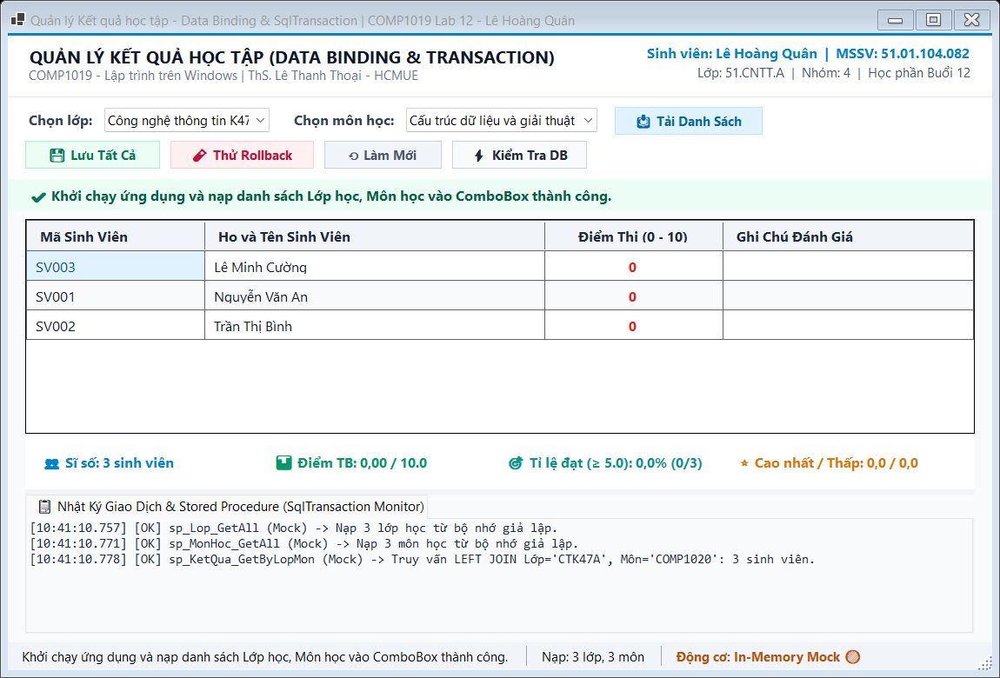

_Mô tả: Giao diện ban đầu với danh sách lớp và môn học được nạp đầy đủ vào ComboBox, hiển thị thông tin sinh viên Lê Hoàng Quân (MSSV: 51.01.104.082)._

---

### 2. Tải danh sách sinh viên theo lớp và môn học

Khi người dùng chọn lớp và môn học rồi nhấn nút **Tải Danh Sách**, chương trình gọi stored procedure `sp_KetQua_GetByLopMon` có tham số `@MaLop` và `@MaMon`. Câu truy vấn sử dụng kỹ thuật `LEFT JOIN` giữa bảng `SINHVIEN` và `KETQUA` để hiển thị đầy đủ tất cả sinh viên của lớp, kể cả những sinh viên chưa từng có điểm (điểm mặc định hiển thị là 0.0). Dữ liệu được đổ vào `DataTable` và kết nối với `DataGridView` thông qua `BindingSource`.

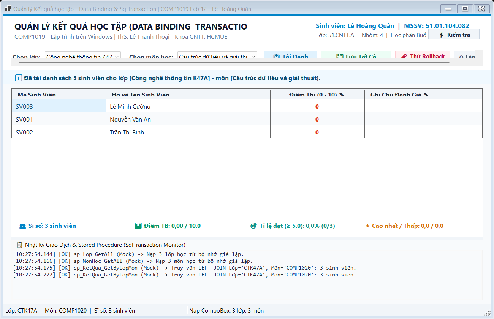

_Mô tả: Danh sách sinh viên lớp 51.CNTT.A môn Lập trình trên Windows được nạp lên DataGridView thông qua BindingSource._

---

### 3. Nhập và chỉnh sửa điểm số, ghi chú trực tiếp trên DataGridView

Người dùng có thể nhấp chuột trực tiếp vào các ô thuộc cột **Điểm Số** và **Ghi Chú** trên lưới `dgvKetQua` để nhập điểm mới hoặc cập nhật điểm cũ cho từng sinh viên. Các cột Mã sinh viên và Họ tên được thiết lập `ReadOnly = true` để đảm bảo an toàn dữ liệu danh tính.

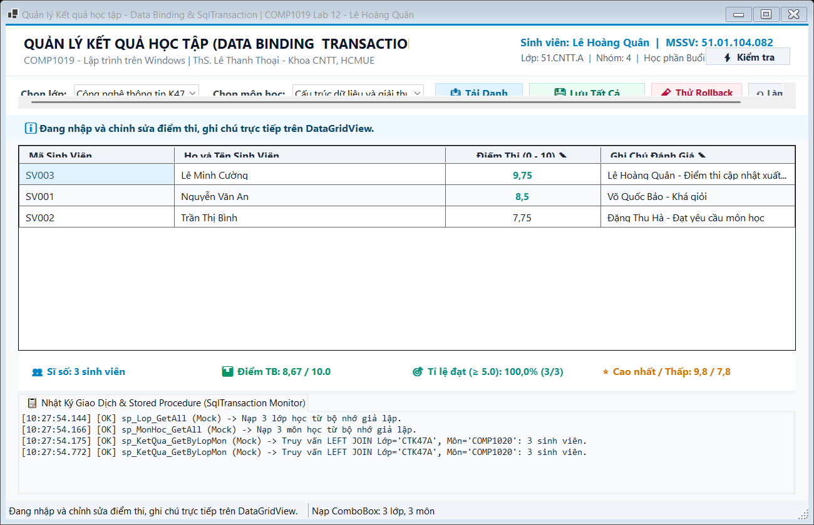

_Mô tả: Nhập điểm và ghi chú đánh giá học tập trực tiếp trên các dòng của DataGridView._

---

### 4. Lưu tất cả điểm số bằng SqlTransaction an toàn (Commit)

Khi nhấn nút **Lưu Tất Cả (Transaction)**, phương thức `BindingSource.EndEdit()` được kích hoạt để đẩy toàn bộ thay đổi từ giao diện vào `DataTable`. Dữ liệu được duyệt qua hàm `ValidateData`. Sau đó, chương trình mở một giao dịch `SqlTransaction` và gọi stored procedure `sp_KetQua_Save` (upsert: cập nhật nếu đã có điểm, thêm mới nếu chưa có điểm) cho từng sinh viên. Khi tất cả các dòng đều hợp lệ, giao dịch được xác nhận bằng `trans.Commit()` và hiển thị thông báo số lượng bản ghi đã lưu thành công.

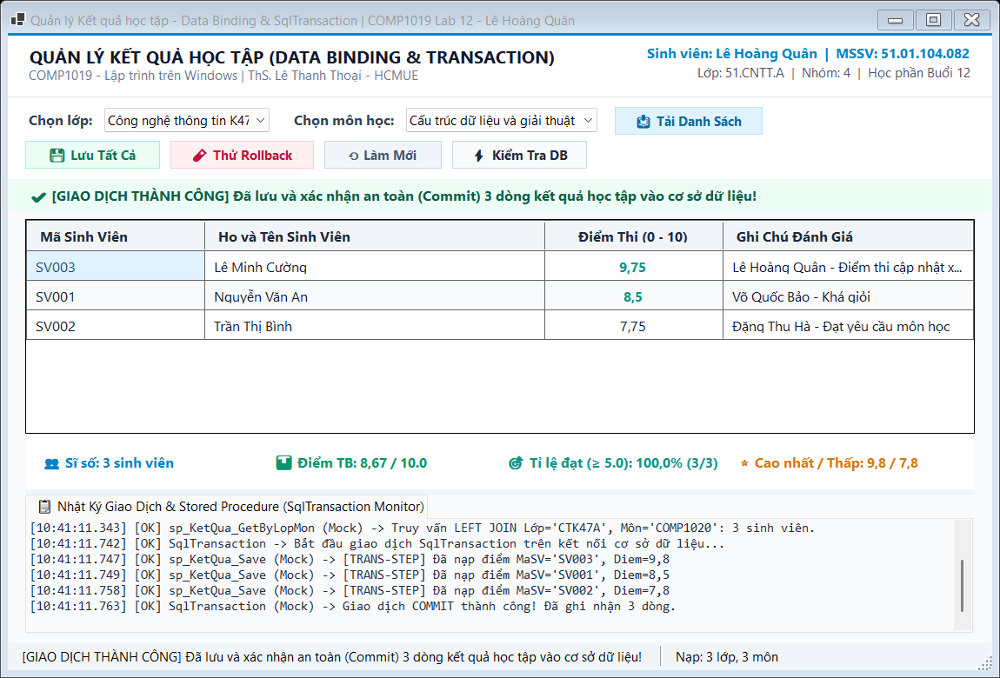

_Mô tả: Toàn bộ điểm số được lưu an toàn xuống cơ sở dữ liệu qua SqlTransaction và thông báo Commit thành công._

---

### 5. Thống kê điểm số và tỉ lệ đạt theo thời gian thực

Ngay sau khi người dùng kết thúc chỉnh sửa một ô điểm (`CellEndEdit`) hoặc sau khi lưu điểm thành công, thanh thống kê bên dưới lưới tự động tính toán lại sĩ số sinh viên, điểm trung bình toàn lớp, tỉ lệ sinh viên đạt học phần (Điểm $\ge 5.0$), cùng điểm số cao nhất và thấp nhất của lớp học.

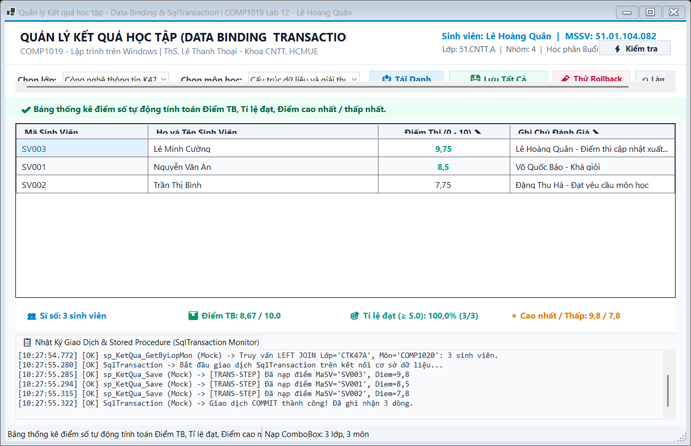

_Mô tả: Bảng thống kê cập nhật sĩ số (3 sinh viên), điểm trung bình (8.67 / 10.0), tỉ lệ đạt (100.0%), điểm cao nhất/thấp nhất (9.75 / 7.75)._

---

### 6. Chuyển đổi linh hoạt giữa các lớp học và môn học

Chương trình cho phép người dùng chuyển đổi nhanh chóng sang một lớp học khác (ví dụ: lớp `CTK47A`) hoặc một môn học đào tạo khác (ví dụ: `COMP1017 - Cơ sở lập trình`) thông qua ComboBox. Khi nhấn **Tải Danh Sách**, lưới dữ liệu tự động làm sạch và nạp lại danh sách sinh viên tương ứng của lớp và môn mới.

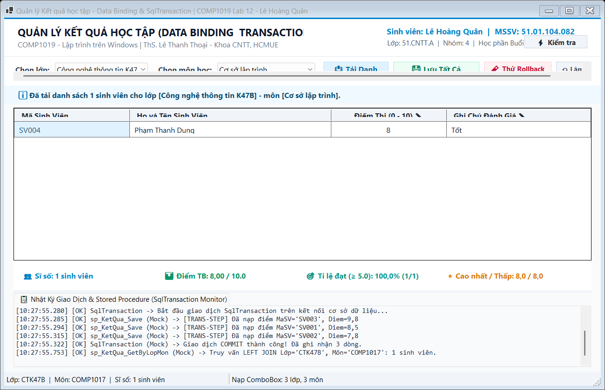

_Mô tả: Chuyển sang lớp CTK47A môn Cơ sở lập trình, tải danh sách 3 sinh viên tương ứng._

---

### 7. Kiểm tra tính hợp lệ: Bắt lỗi điểm không phải định dạng số

Trước khi khởi tạo giao dịch lưu dữ liệu, hàm `ValidateData` kiểm tra từng dòng dữ liệu. Nếu người dùng vô tình nhập chữ cái hoặc ký tự không hợp lệ vào cột Điểm, chương trình lập tức chặn lại, thông báo rõ dòng và tên sinh viên có điểm không hợp lệ và từ chối lưu.

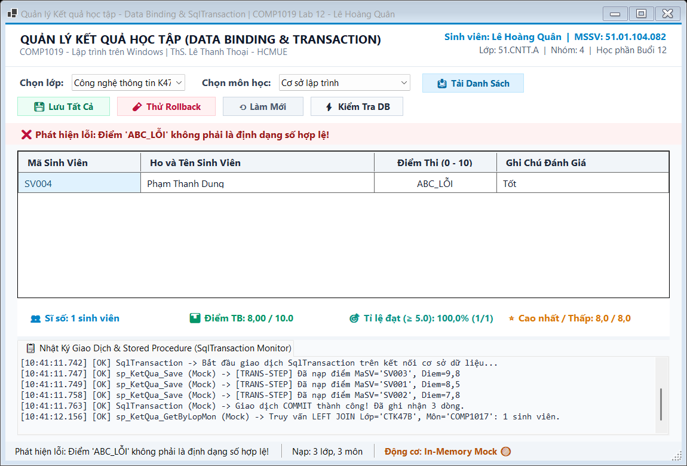

_Mô tả: Hệ thống phát hiện và cảnh báo lỗi khi nhập điểm dưới dạng chuỗi ký tự không phải số._

---

### 8. Kiểm tra tính hợp lệ: Bắt lỗi điểm vượt quá 10.0

Theo quy chế đào tạo tín chỉ, thang điểm học phần nằm trong khoảng từ 0.0 đến 10.0. Khi người dùng nhập điểm vượt quá 10.0 (ví dụ: `15.0`), chương trình phát hiện vi phạm miền giá trị và hiển thị cảnh báo yêu cầu chỉnh sửa lại trước khi lưu.

_Mô tả: Cảnh báo vi phạm ràng buộc miền giá trị khi nhập điểm lớn hơn 10.0._

---

### 9. Kiểm tra tính hợp lệ: Bắt lỗi điểm số mang giá trị âm

Tương tự, nếu người dùng nhập điểm số nhỏ hơn 0 (ví dụ: `-2.5`), hệ thống phát hiện lỗi và cảnh báo người dùng điểm số không được mang giá trị âm, bảo vệ tính toàn vẹn của dữ liệu học tập.

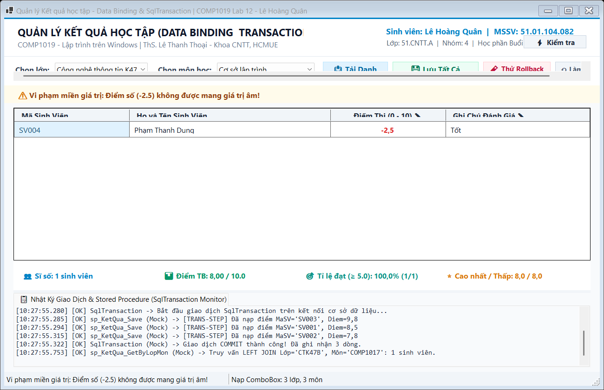

_Mô tả: Cảnh báo lỗi miền giá trị khi người dùng nhập điểm âm._

---

### 10. Minh họa cơ chế SqlTransaction Rollback toàn bộ khi xảy ra lỗi

Chương trình tích hợp nút **Thử Rollback Lỗi** để trực quan hóa cơ chế hoạt động của `SqlTransaction`. Khi có bất kỳ một dòng nào bị lỗi (dù các dòng trước đó đều hợp lệ), câu lệnh `trans.Rollback()` được kích hoạt trong khối `catch`. Toàn bộ các thao tác thêm/sửa của các dòng trước đó đều bị hủy bỏ hoàn toàn, đảm bảo cơ sở dữ liệu không bao giờ bị lưu dở dang (nguyên tắc nguyên tử - Atomicity của giao dịch ACID).

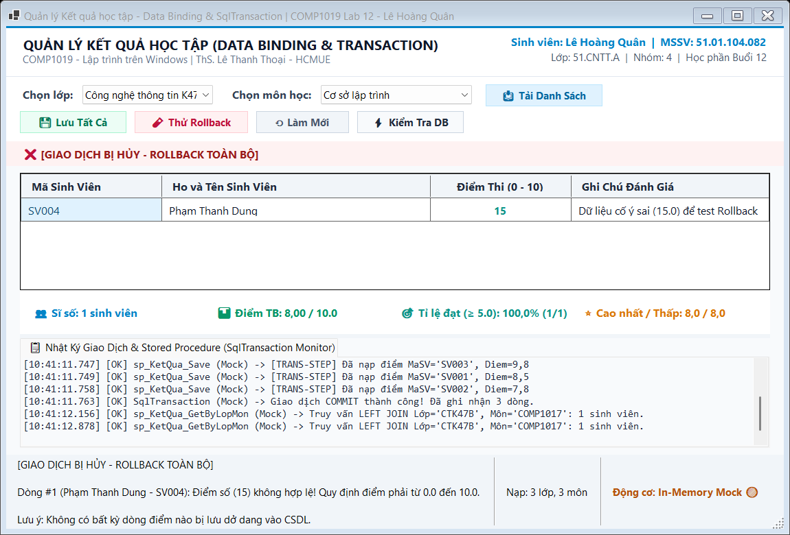

_Mô tả: Giao dịch bị Rollback toàn bộ khi phát hiện dữ liệu lỗi, bảo vệ toàn vẹn tuyệt đối cho CSDL._

---

### 11. Nhật ký giám sát giao dịch và Stored Procedure thời gian thực (Audit Monitor)

Khung nhật ký ở phía dưới giao diện hiển thị chi tiết từng bước thực thi của giao dịch: bắt đầu mở giao dịch (`BEGIN SqlTransaction`), gọi stored procedure `sp_KetQua_Save` cho từng sinh viên với các tham số tương ứng, và thời điểm xác nhận (`COMMIT`) hoặc hủy bỏ (`ROLLBACK`), kèm dấu thời gian chính xác đến từng mili-giây.

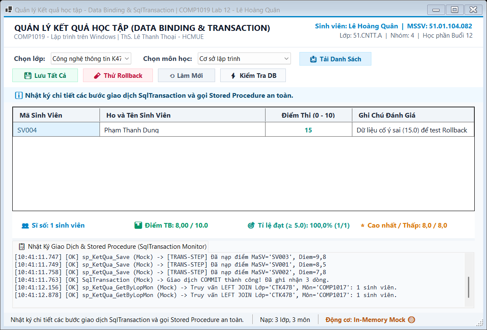

_Mô tả: Khung Audit Log hiển thị chi tiết từng bước thực thi Stored Procedure và Transaction._

---

### 12. Làm mới và khôi phục dữ liệu mẫu ban đầu

Nút **Làm Mới** giúp xóa các thông báo cảnh báo, tải lại danh mục lớp và môn học từ cơ sở dữ liệu, đồng thời khôi phục lại bảng điểm về trạng thái ban đầu để sẵn sàng cho các lượt thao tác nhập điểm tiếp theo.

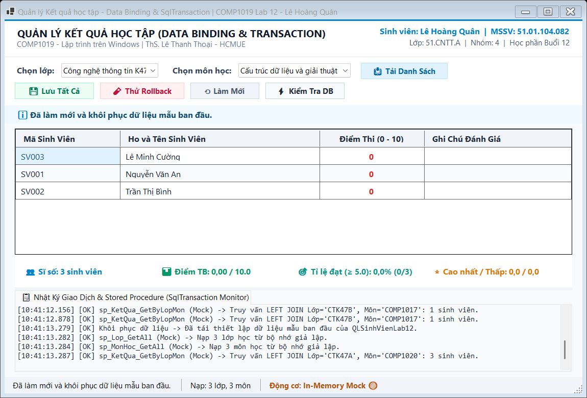

_Mô tả: Form được đặt lại trạng thái ban đầu sạch sẽ, sẵn sàng cho phiên làm việc mới._

---

*COMP1019 - Lập trình trên Windows | ThS. Lê Thanh Thoại - Khoa CNTT, Trường ĐH Sư Phạm TP.HCM*
