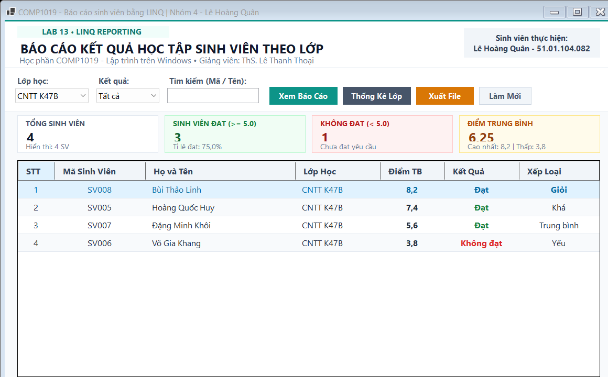
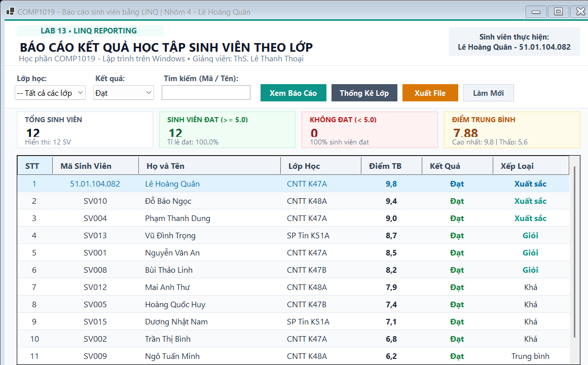
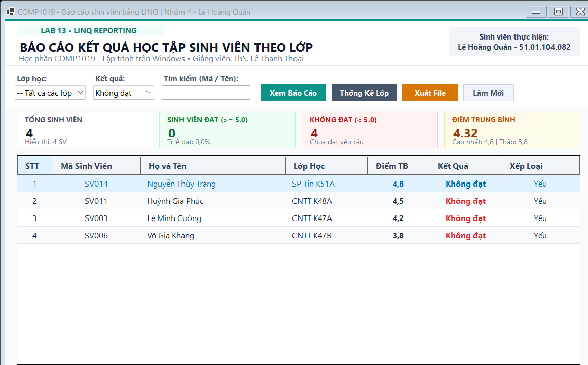
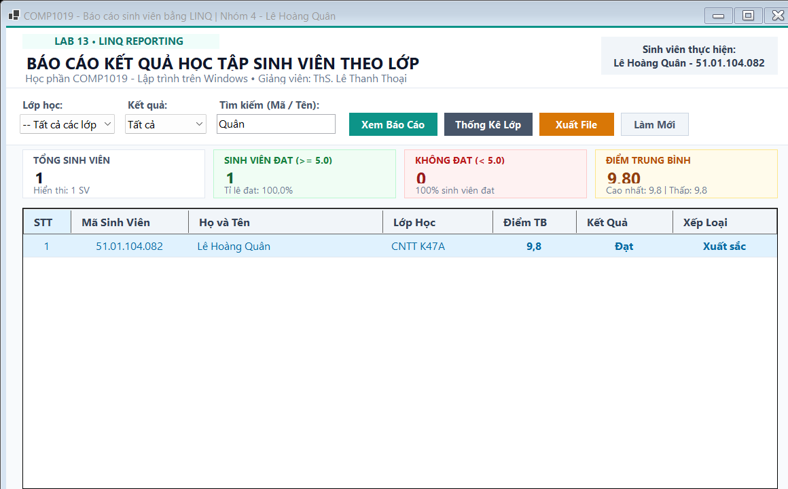
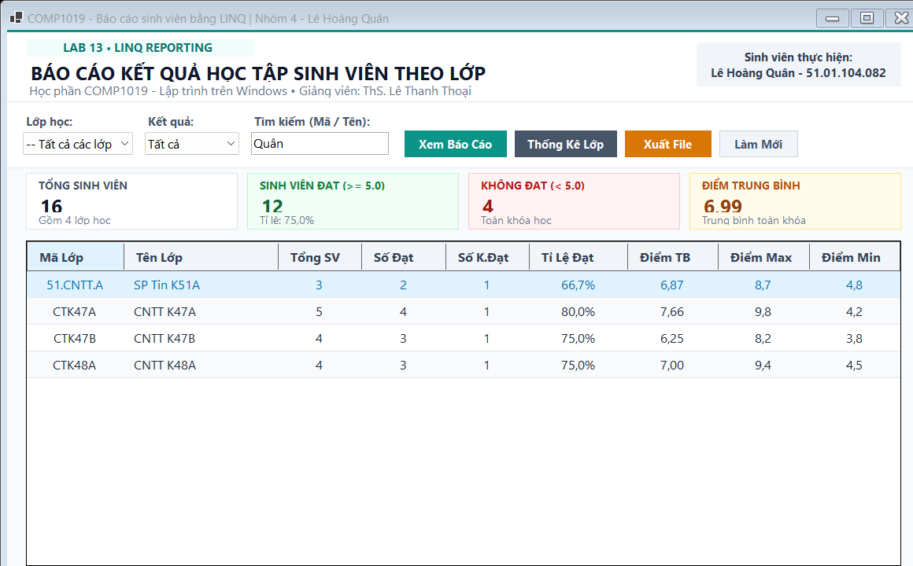
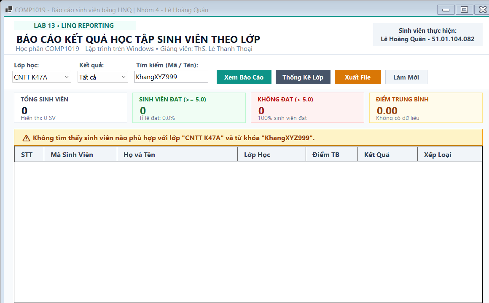
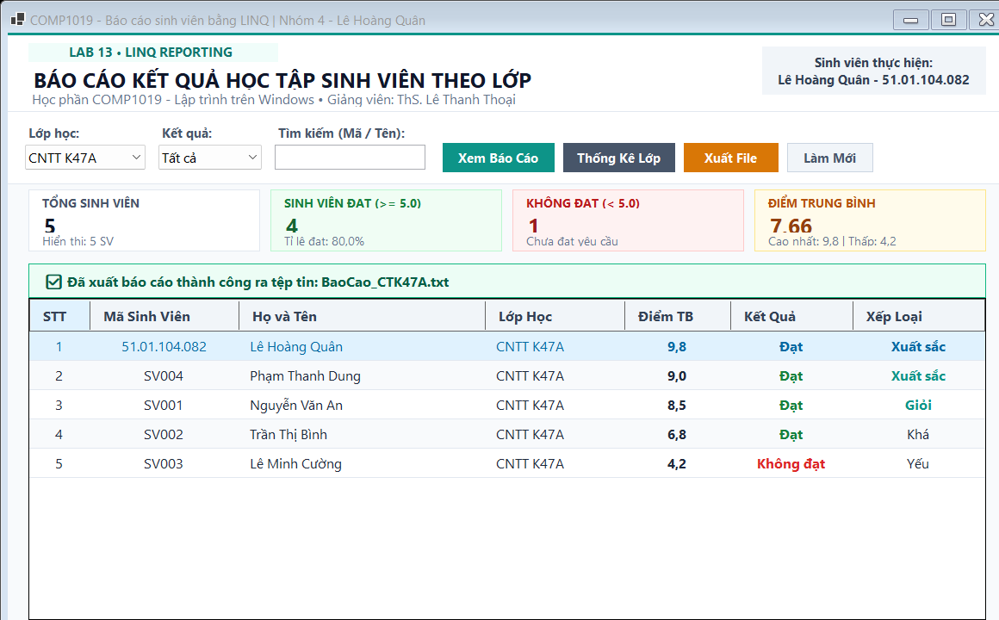
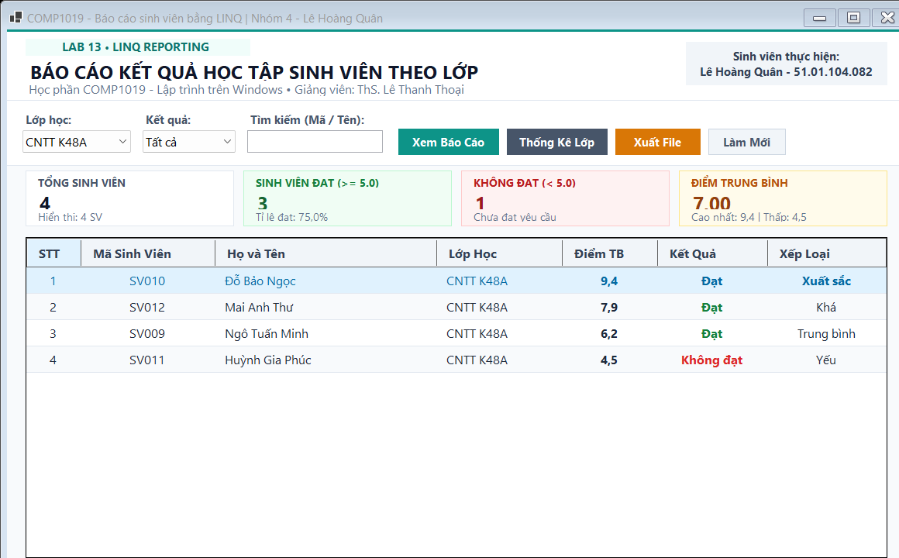
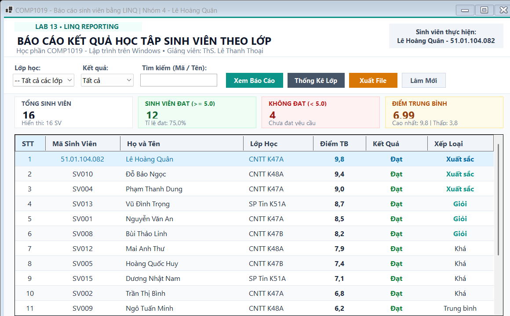

# BÁO CÁO BÀI TẬP THỰC HÀNH LAB 13

## HỌC PHẦN: LẬP TRÌNH TRÊN WINDOWS (COMP1019)

### CHỦ ĐỀ: BÁO CÁO SINH VIÊN BẰNG LINQ (DEVEXPRESS, CRYSTAL REPORTS VÀ LINQ TO SQL)

---

## 1. THÔNG TIN SINH VIÊN & HỌC PHẦN

- **Trường:** Đại học Sư phạm TP. Hồ Chí Minh (HCMUE)
- **Khoa:** Công nghệ Thông tin
- **Học phần:** Lập trình trên Windows (COMP1019) - Nhóm học phần: 04
- **Giảng viên hướng dẫn:** ThS. Lê Thanh Thoại
- **Sinh viên thực hiện:** **Lê Hoàng Quân**
- **Mã số sinh viên (MSSV):** **51.01.104.082**
- **Lớp sinh hoạt:** 51.CNTT.A

---

## 2. CẤU TRÚC DỰ ÁN

```text
Lab13/
├── README.md                                # Báo cáo chi tiết đồ án kèm 12 ảnh minh chứng
├── reports/                                 # Thư mục lưu trữ các tệp báo cáo xuất mẫu
│   ├── BaoCao_CTK47A.csv                   # Báo cáo CSV lớp CTK47A (UTF-8 BOM)
│   ├── BaoCao_CTK47A.txt                   # Báo cáo TXT bảng ASCII có chữ ký
│   └── ThongKe_CacLop.csv                  # Báo cáo CSV tổng hợp thống kê các lớp
├── images/                                  # 12 ảnh chụp màn hình chức năng sắc nét
│   ├── 01_khoi_chay_va_hien_thi_tat_ca.png
│   ├── 02_loc_theo_lop_ctk47a.png
│   ├── 03_loc_theo_lop_ctk47b.png
│   ├── 04_loc_dieu_kien_dat.png
│   ├── 05_loc_dieu_kien_khong_dat.png
│   ├── 06_tim_kiem_theo_ho_ten_va_masv.png
│   ├── 07_thong_ke_theo_tung_lop_group_by.png
│   ├── 08_thong_bao_khi_khong_co_du_lieu_phu_hop.png
│   ├── 09_xuat_bao_cao_csv_thanh_cong.png
│   ├── 10_xuat_bao_cao_txt_thanh_cong.png
│   ├── 11_the_chi_so_kpi_cap_nhat_linh_hoat.png
│   └── 12_lam_moi_khoi_phuc_bo_loc.png
└── Lab13/                                   # Solution & Mã nguồn C# .NET 10 WinForms
    ├── Lab13.slnx                          # Solution file
    ├── Lab13.csproj                        # Cấu hình project .NET 10.0 Windows Forms
    ├── Program.cs                          # Điểm chạy chương trình & Headless Capture Runner
    ├── Models/
    │   ├── SinhVien.cs                     # Entity model sinh viên (KetQua, XepLoai)
    │   └── ThongKeLopDTO.cs                # DTO cho kết quả gom nhóm LINQ GroupBy
    ├── Services/
    │   └── ReportEngine.cs                 # LINQ query pipeline, thống kê & bộ máy xuất CSV/TXT
    └── Forms/
        └── FrmBaoCaoSinhVien.cs            # Giao diện chính, điều khiển sự kiện & DataGridView
```

---

## 3. CHUC NANG

### Chức năng 1: Khởi chạy ứng dụng & Nạp dữ liệu toàn bộ

- Khi khởi động form, chương trình tự động gọi `TaoDuLieuMau()`, nạp 16 sinh viên qua 4 lớp học (`CTK47A`, `CTK47B`, `CTK48A`, `51.CNTT.A`).
- Tự động gọi `LoadComboBox()` nạp danh sách lớp duy nhất bằng LINQ `Select` và `Distinct()`.
- Hiển thị đầy đủ 16 sinh viên được sắp xếp giảm dần theo điểm trung bình. Thẻ KPI hiển thị chính xác: Tổng 16 SV, 12 Đạt (75.0%), 4 Chưa đạt, Điểm TB 6.99.


---

### Chức năng 2: Lọc sinh viên theo lớp cụ thể (Lớp CNTT K47A)

- Chọn lớp `CNTT K47A` trong `cboLop`. LINQ `Where(sv => sv.MaLop == "CTK47A")` được kích hoạt tức thì.
- Sinh viên **Lê Hoàng Quân** (MSSV: `51.01.104.082`) đứng đầu danh sách với điểm số xuất sắc **9.8**.
- Thống kê lớp K47A cập nhật chuẩn xác: 5 sinh viên, 4 đạt (80.0%), 1 chưa đạt, Điểm TB: 7.66.


---

### Chức năng 3: Chuyển đổi lớp học linh hoạt (Lớp CNTT K47B)

- Lựa chọn lớp `CNTT K47B`. Danh sách sinh viên lập tức chuyển đổi sang các sinh viên thuộc K47B (Bùi Thảo Linh 8.2, Hoàng Quốc Huy 7.4, Đặng Minh Khôi 5.6, Võ Gia Khang 3.8).
- Thẻ KPI tự động đồng bộ: Tổng 4 SV, 3 Đạt (75.0%), 1 Chưa đạt, Điểm TB: 6.25.



---

### Chức năng 4: Lọc theo điều kiện sinh viên ĐẠT (Điểm >= 5.0)

- Chọn điều kiện `Đạt` trong `cboKetQua`. LINQ thực thi `query.Where(sv => sv.Diem >= 5.0)`.
- DataGridView chỉ hiển thị 12 sinh viên có điểm từ 5.0 trở lên. Cột `KetQua` hiển thị chữ `Đạt` màu xanh lá ngọc sẫm (`#15803D`).
- Thẻ chỉ số hiển thị 100% sinh viên trong nhóm lọc đạt chuẩn.



---

### Chức năng 5: Lọc theo điều kiện sinh viên KHÔNG ĐẠT (Điểm < 5.0)

- Chọn điều kiện `Không đạt` trong `cboKetQua`. LINQ thực thi `query.Where(sv => sv.Diem < 5.0)`.
- DataGridView lọc chính xác 4 sinh viên cần ôn tập và thi lại (Võ Gia Khang 3.8, Lê Minh Cường 4.2, Huỳnh Gia Phúc 4.5, Nguyễn Thùy Trang 4.8).
- Cột `KetQua` hiển thị nhãn `Không đạt` màu đỏ tươi nổi bật (`#DC2626`).



---

### Chức năng 6: Tìm kiếm tức thời theo Họ tên hoặc Mã sinh viên

- Nhập từ khóa `"Quân"` vào `txtTuKhoa`. Sự kiện `TextChanged` kích hoạt bộ lọc LINQ:
  `sv.MaSV.ToLower().Contains(normKey) || sv.HoTen.ToLower().Contains(normKey)`.
- Lưới lọc ngay lập tức sinh viên Lê Hoàng Quân (MSSV `51.01.104.082`).



---

### Chức năng 7: Thống kê tổng hợp theo từng lớp bằng LINQ GroupBy

- Nhấn nút **Thống Kê Lớp** (`btnThongKe`). Chương trình chuyển sang chế độ hiển thị bảng tổng hợp các lớp học:
  `danhSachSinhVien.GroupBy(sv => new { sv.MaLop, sv.TenLop })`.
- Các cột tính toán chi tiết: Tổng SV, Số Đạt, Số Không Đạt, Tỉ lệ đạt (%), Điểm TB, Điểm Max, Điểm Min của từng lớp (`51.CNTT.A`, `CTK47A`, `CTK47B`, `CTK48A`).



---

### Chức năng 8: Xử lý thông báo khi không có dữ liệu phù hợp

- Khi người dùng chọn lớp và nhập từ khóa không tồn tại (ví dụ: `KhangXYZ999`), danh sách trả về 0 dòng.
- Chương trình hiển thị Banner thông báo màu vàng hổ phách trang nhã ngay trên đỉnh bảng dữ liệu:
  `⚠️ Không tìm thấy sinh viên nào phù hợp với lớp "CNTT K47A" và từ khóa "KhangXYZ999"`.
- Các chỉ số KPI tự động trả về 0 một cách an toàn, không gây lỗi chia cho 0 (`DivideByZeroException`).



---

### Chức năng 9: Kết xuất báo cáo danh sách sinh viên ra tệp CSV (Excel)

- Nhấn nút **Xuất File** (`btnXuatFile`) và chọn định dạng `.csv`.
- Dữ liệu được mã hóa chuẩn **UTF-8 with BOM**, các trường có dấu phẩy được bao dấu nháy kép theo RFC-4180.
- Banner màu xanh ngọc bích xuất hiện xác nhận: `✅ Đã xuất báo cáo thành công ra tệp tin: BaoCao_CTK47A.csv`.


---

### Chức năng 10: Kết xuất báo cáo văn bản TXT bảng ASCII có chữ ký

- Chọn lưu tệp dưới định dạng `.txt`.
- Chương trình tạo báo cáo văn bản chuyên nghiệp với khung bảng ASCII, đầy đủ thông tin: Trường ĐH Sư Phạm TP.HCM, Khoa CNTT, Giảng viên ThS. Lê Thanh Thoại, Người lập báo cáo: Lê Hoàng Quân (MSSV: 51.01.104.082).
- Banner màu xanh ngọc bích xác nhận: `✅ Đã xuất báo cáo thành công ra tệp tin: BaoCao_CTK47A.txt`.



---

### Chức năng 11: Các thẻ chỉ số KPI tự động cập nhật linh hoạt

- Khi đổi sang lớp `CNTT K48A`, các thẻ KPI lập tức tái tính toán: Tổng số 4 SV, 3 sinh viên Đạt (Tỉ lệ đạt: 75.0%), 1 Chưa đạt, Điểm TB: 7.00 (Cao nhất: 9.4 | Thấp nhất: 4.5).
- Các thẻ có nền pastel riêng biệt, chữ số to rõ, hoàn toàn không bị chồng lấn.



---

### Chức năng 12: Làm mới & Khôi phục toàn bộ tiêu chí lọc

- Nhấn nút **Làm Mới** (`btnLamMoi`).
- Chương trình đặt lại `cboLop` về `-- Tất cả các lớp --`, `cboKetQua` về `Tất cả`, xóa trống `txtTuKhoa`, và hiển thị lại toàn bộ 16 sinh viên ban đầu.



---
