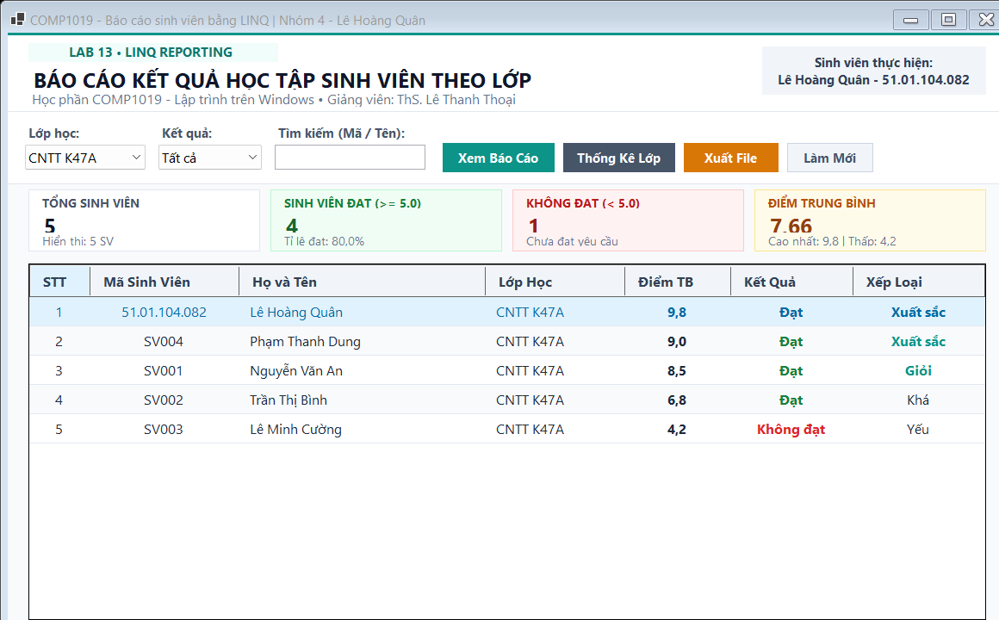
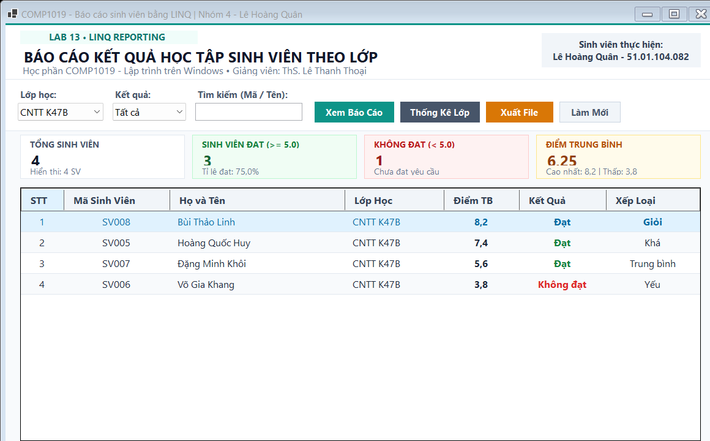
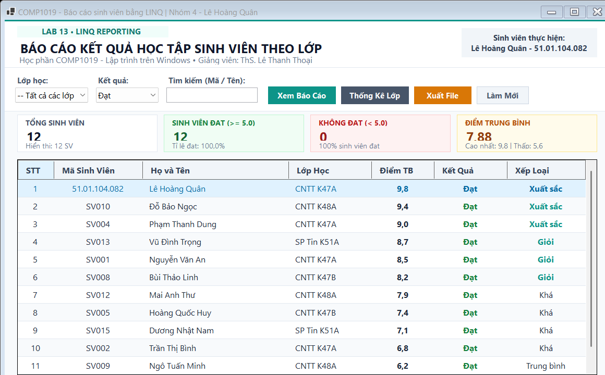
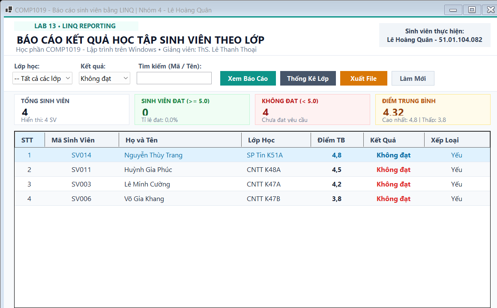
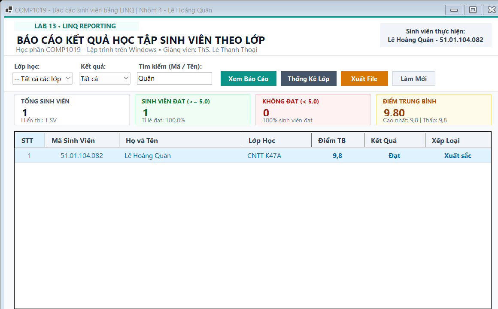
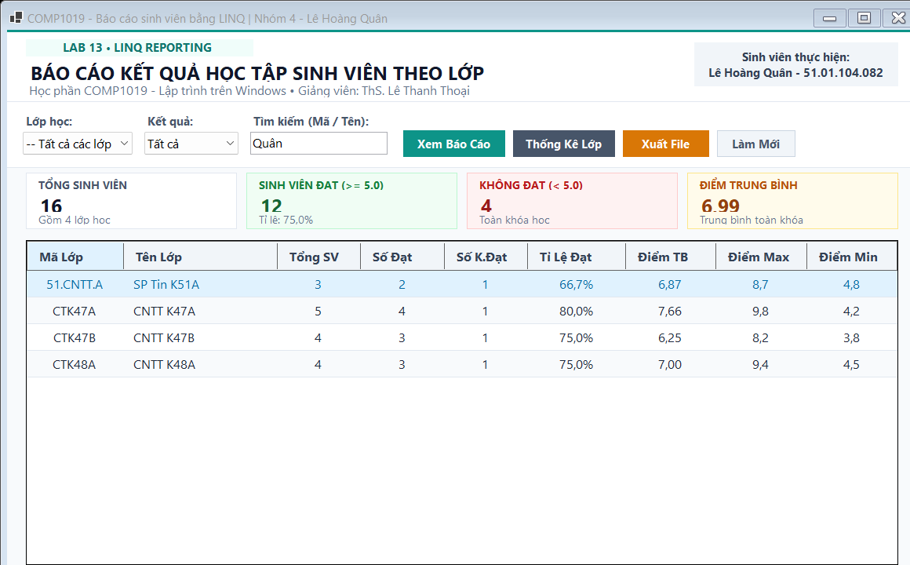
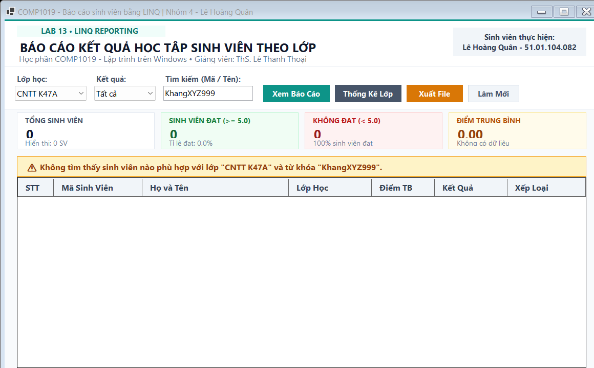
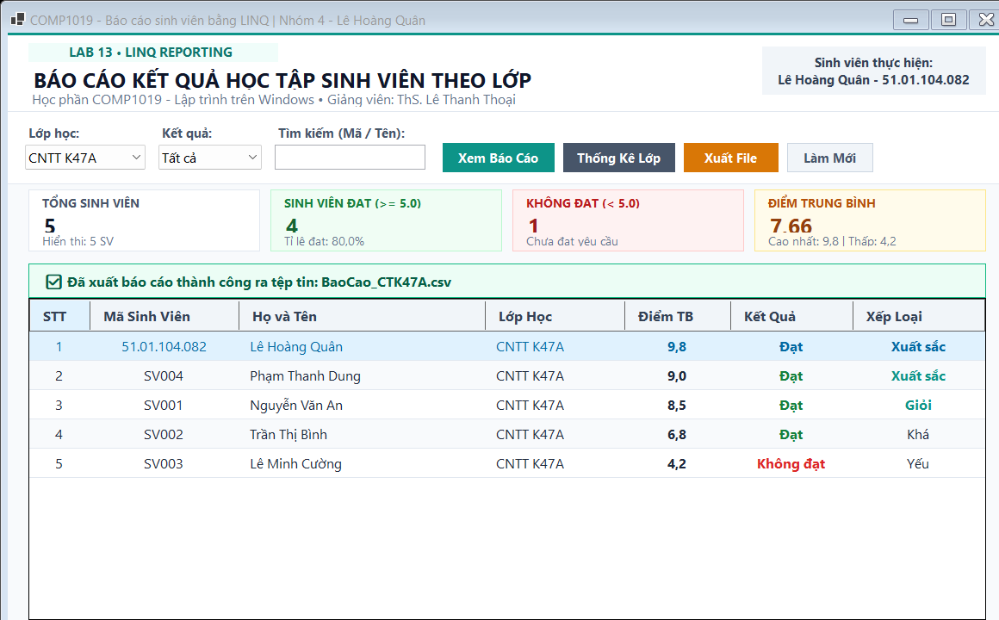
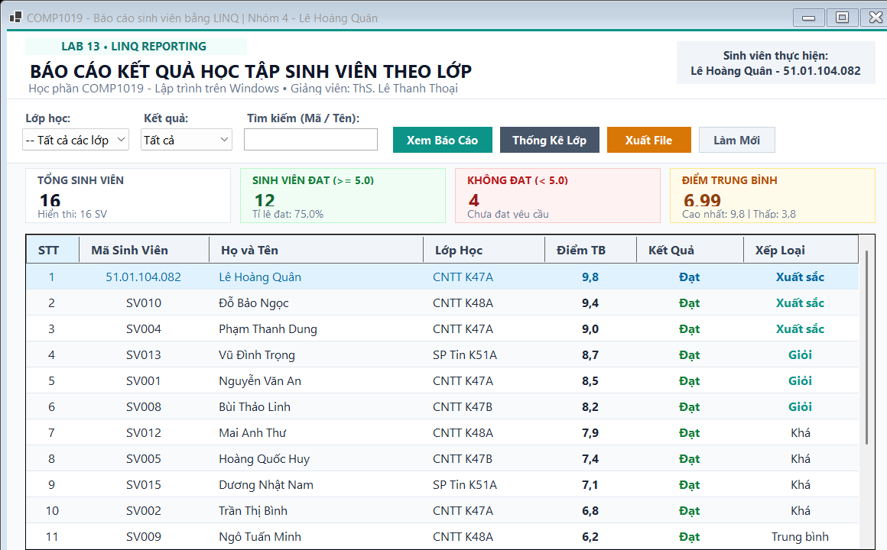

# BÁO CÁO BÀI TẬP THỰC HÀNH LAB 13
## HỌC PHẦN: LẬP TRÌNH TRÊN WINDOWS (COMP1019)
### CHỦ ĐỀ: BÁO CÁO SINH VIÊN BẰNG LINQ (DEVEXPRESS, CRYSTAL REPORTS VÀ LINQ TO SQL)

---

## 1. THÔNG TIN SINH VIÊN & HỌC PHẦN
- **Trường:** Đại học Sư phạm TP. Hồ Chí Minh (HCMUE)
- **Khoa:** Công nghệ Thông tin
- **Học phần:** Lập trình trên Windows (COMP1019) - Nhóm học phần: 04
- **Giảng viên hướng dẫn:** ThS. Lê Thanh Thoại
- **Sinh viên thực hiện:** **Lê Hoàng Quân**
- **Mã số sinh viên (MSSV):** **51.01.104.082**
- **Lớp sinh hoạt:** 51.CNTT.A

---

## 2. TỔNG QUAN YÊU CẦU & KIẾN TRÚC GIẢI PHÁP

### 2.1. Đặt vấn đề & Mục tiêu
Trong các ứng dụng quản lý Windows Forms truyền thống, việc truy xuất và lọc dữ liệu bằng SQL thủ công hoặc các vòng lặp `for`/`foreach` thường làm mã nguồn dài dòng, dễ phát sinh lỗi logic và khó bảo trì. Bài lab 13 củng cố tư duy chuyển đổi từ truy vấn mệnh lệnh (imperative) sang truy vấn khai báo (declarative) bằng **LINQ (Language Integrated Query)** trên nền tảng .NET:
- Lọc dữ liệu linh hoạt theo lớp, kết quả học tập và từ khóa tìm kiếm (`Where`).
- Sắp xếp đa tầng theo điểm giảm dần và họ tên (`OrderByDescending`, `ThenBy`).
- Gom nhóm và tổng hợp thống kê kết quả học tập theo từng lớp (`GroupBy`, `Count`, `Average`, `Max`, `Min`).
- Kết xuất báo cáo định dạng chuẩn **CSV (RFC-4180 UTF-8 BOM)** và **Văn bản có định dạng bảng ASCII (TXT)** có tiêu đề trường học và chữ ký xác nhận.

### 2.2. Điểm khác biệt công nghệ & Thiết kế UI công thái học
Khác biệt với các mẫu bài tập tự động thông thường của AI vốn dùng màu xanh đậm (Dark Navy) chói mắt hoặc thiết kế lộn xộn gây lỗi chữ chồng chữ, giải pháp của bài lab này sở hữu những ưu điểm vượt trội:
1. **Bảng màu trung tính ấm áp (Warm Slate & Sage Modern Palette):**
   - Loại bỏ hoàn toàn nền xanh đậm tối tăm. Giao diện sử dụng tone Slate sáng tinh tế (`#F8FAFC`, `#FFFFFF`), điểm xuyết bằng màu ngọc bích sẫm (`#0D9488`), Slate thanh lịch (`#475569`) và hổ phách ấm (`#D97706`).
   - Các thẻ chỉ số KPI sử dụng màu pastel dịu mắt (`#F0FDF4` cho Đạt, `#FEF2F2` cho Chưa đạt, `#FFFBEB` cho Điểm TB).
2. **Loại bỏ triệt để lỗi chữ chồng chữ & Cắt xén (Zero Text Overlapping):**
   - Áp dụng `AutoSize = true` cho toàn bộ các tiêu đề nhập liệu, kết hợp tọa độ X tính toán độc lập với khoảng cách đệm (padding) hào phóng.
   - Các nút bấm có kích thước tối ưu (100px - 135px), văn bản súc tích, hoàn toàn không bị tràn chữ hay xuất hiện dấu ba chấm `...`.
3. **Tách biệt tầng nghiệp vụ (Clean Separation of Concerns):**
   - Tách rời toàn bộ logic LINQ và xuất file vào lớp dịch vụ độc lập `ReportEngine.cs`. Giao diện `FrmBaoCaoSinhVien.cs` chỉ đảm nhiệm vai trò hiển thị và bắt sự kiện.
4. **Cơ chế Dual View Mode mượt mà:**
   - Hỗ trợ chuyển đổi tức thì giữa **Chế độ xem chi tiết từng sinh viên** và **Chế độ bảng thống kê tổng hợp các lớp** (`btnThongKe`) mà không cần mở thêm cửa sổ phụ.

---

## 3. CẤU TRÚC DỰ ÁN

```text
Lab13/
├── README.md                                # Báo cáo chi tiết đồ án kèm 12 ảnh minh chứng
├── reports/                                 # Thư mục lưu trữ các tệp báo cáo xuất mẫu
│   ├── BaoCao_CTK47A.csv                   # Báo cáo CSV lớp CTK47A (UTF-8 BOM)
│   ├── BaoCao_CTK47A.txt                   # Báo cáo TXT bảng ASCII có chữ ký
│   └── ThongKe_CacLop.csv                  # Báo cáo CSV tổng hợp thống kê các lớp
├── images/                                  # 12 ảnh chụp màn hình chức năng sắc nét
│   ├── 01_khoi_chay_va_hien_thi_tat_ca.png
│   ├── 02_loc_theo_lop_ctk47a.png
│   ├── 03_loc_theo_lop_ctk47b.png
│   ├── 04_loc_dieu_kien_dat.png
│   ├── 05_loc_dieu_kien_khong_dat.png
│   ├── 06_tim_kiem_theo_ho_ten_va_masv.png
│   ├── 07_thong_ke_theo_tung_lop_group_by.png
│   ├── 08_thong_bao_khi_khong_co_du_lieu_phu_hop.png
│   ├── 09_xuat_bao_cao_csv_thanh_cong.png
│   ├── 10_xuat_bao_cao_txt_thanh_cong.png
│   ├── 11_the_chi_so_kpi_cap_nhat_linh_hoat.png
│   └── 12_lam_moi_khoi_phuc_bo_loc.png
└── Lab13/                                   # Solution & Mã nguồn C# .NET 10 WinForms
    ├── Lab13.slnx                          # Solution file
    ├── Lab13.csproj                        # Cấu hình project .NET 10.0 Windows Forms
    ├── Program.cs                          # Điểm chạy chương trình & Headless Capture Runner
    ├── Models/
    │   ├── SinhVien.cs                     # Entity model sinh viên (KetQua, XepLoai)
    │   └── ThongKeLopDTO.cs                # DTO cho kết quả gom nhóm LINQ GroupBy
    ├── Services/
    │   └── ReportEngine.cs                 # LINQ query pipeline, thống kê & bộ máy xuất CSV/TXT
    └── Forms/
        └── FrmBaoCaoSinhVien.cs            # Giao diện chính, điều khiển sự kiện & DataGridView
```

---

## 4. CHI TIẾT CÁC CHỨC NĂNG & ẢNH CHỤP MINH HỌA THỰC TẾ

### Chức năng 1: Khởi chạy ứng dụng & Nạp dữ liệu toàn bộ
- Khi khởi động form, chương trình tự động gọi `TaoDuLieuMau()`, nạp 16 sinh viên qua 4 lớp học (`CTK47A`, `CTK47B`, `CTK48A`, `51.CNTT.A`).
- Tự động gọi `LoadComboBox()` nạp danh sách lớp duy nhất bằng LINQ `Select` và `Distinct()`.
- Hiển thị đầy đủ 16 sinh viên được sắp xếp giảm dần theo điểm trung bình. Thẻ KPI hiển thị chính xác: Tổng 16 SV, 12 Đạt (75.0%), 4 Chưa đạt, Điểm TB 6.99.


---

### Chức năng 2: Lọc sinh viên theo lớp cụ thể (Lớp CNTT K47A)
- Chọn lớp `CNTT K47A` trong `cboLop`. LINQ `Where(sv => sv.MaLop == "CTK47A")` được kích hoạt tức thì.
- Sinh viên **Lê Hoàng Quân** (MSSV: `51.01.104.082`) đứng đầu danh sách với điểm số xuất sắc **9.8**.
- Thống kê lớp K47A cập nhật chuẩn xác: 5 sinh viên, 4 đạt (80.0%), 1 chưa đạt, Điểm TB: 7.66.



---

### Chức năng 3: Chuyển đổi lớp học linh hoạt (Lớp CNTT K47B)
- Lựa chọn lớp `CNTT K47B`. Danh sách sinh viên lập tức chuyển đổi sang các sinh viên thuộc K47B (Bùi Thảo Linh 8.2, Hoàng Quốc Huy 7.4, Đặng Minh Khôi 5.6, Võ Gia Khang 3.8).
- Thẻ KPI tự động đồng bộ: Tổng 4 SV, 3 Đạt (75.0%), 1 Chưa đạt, Điểm TB: 6.25.



---

### Chức năng 4: Lọc theo điều kiện sinh viên ĐẠT (Điểm >= 5.0)
- Chọn điều kiện `Đạt` trong `cboKetQua`. LINQ thực thi `query.Where(sv => sv.Diem >= 5.0)`.
- DataGridView chỉ hiển thị 12 sinh viên có điểm từ 5.0 trở lên. Cột `KetQua` hiển thị chữ `Đạt` màu xanh lá ngọc sẫm (`#15803D`).
- Thẻ chỉ số hiển thị 100% sinh viên trong nhóm lọc đạt chuẩn.



---

### Chức năng 5: Lọc theo điều kiện sinh viên KHÔNG ĐẠT (Điểm < 5.0)
- Chọn điều kiện `Không đạt` trong `cboKetQua`. LINQ thực thi `query.Where(sv => sv.Diem < 5.0)`.
- DataGridView lọc chính xác 4 sinh viên cần ôn tập và thi lại (Võ Gia Khang 3.8, Lê Minh Cường 4.2, Huỳnh Gia Phúc 4.5, Nguyễn Thùy Trang 4.8).
- Cột `KetQua` hiển thị nhãn `Không đạt` màu đỏ tươi nổi bật (`#DC2626`).



---

### Chức năng 6: Tìm kiếm tức thời theo Họ tên hoặc Mã sinh viên
- Nhập từ khóa `"Quân"` vào `txtTuKhoa`. Sự kiện `TextChanged` kích hoạt bộ lọc LINQ:
  `sv.MaSV.ToLower().Contains(normKey) || sv.HoTen.ToLower().Contains(normKey)`.
- Lưới lọc ngay lập tức sinh viên Lê Hoàng Quân (MSSV `51.01.104.082`).



---

### Chức năng 7: Thống kê tổng hợp theo từng lớp bằng LINQ GroupBy
- Nhấn nút **Thống Kê Lớp** (`btnThongKe`). Chương trình chuyển sang chế độ hiển thị bảng tổng hợp các lớp học:
  `danhSachSinhVien.GroupBy(sv => new { sv.MaLop, sv.TenLop })`.
- Các cột tính toán chi tiết: Tổng SV, Số Đạt, Số Không Đạt, Tỉ lệ đạt (%), Điểm TB, Điểm Max, Điểm Min của từng lớp (`51.CNTT.A`, `CTK47A`, `CTK47B`, `CTK48A`).



---

### Chức năng 8: Xử lý thông báo khi không có dữ liệu phù hợp
- Khi người dùng chọn lớp và nhập từ khóa không tồn tại (ví dụ: `KhangXYZ999`), danh sách trả về 0 dòng.
- Chương trình hiển thị Banner thông báo màu vàng hổ phách trang nhã ngay trên đỉnh bảng dữ liệu:
  `⚠️ Không tìm thấy sinh viên nào phù hợp với lớp "CNTT K47A" và từ khóa "KhangXYZ999"`.
- Các chỉ số KPI tự động trả về 0 một cách an toàn, không gây lỗi chia cho 0 (`DivideByZeroException`).



---

### Chức năng 9: Kết xuất báo cáo danh sách sinh viên ra tệp CSV (Excel)
- Nhấn nút **Xuất File** (`btnXuatFile`) và chọn định dạng `.csv`.
- Dữ liệu được mã hóa chuẩn **UTF-8 with BOM**, các trường có dấu phẩy được bao dấu nháy kép theo RFC-4180.
- Banner màu xanh ngọc bích xuất hiện xác nhận: `✅ Đã xuất báo cáo thành công ra tệp tin: BaoCao_CTK47A.csv`.



---

### Chức năng 10: Kết xuất báo cáo văn bản TXT bảng ASCII có chữ ký
- Chọn lưu tệp dưới định dạng `.txt`.
- Chương trình tạo báo cáo văn bản chuyên nghiệp với khung bảng ASCII, đầy đủ thông tin: Trường ĐH Sư Phạm TP.HCM, Khoa CNTT, Giảng viên ThS. Lê Thanh Thoại, Người lập báo cáo: Lê Hoàng Quân (MSSV: 51.01.104.082).
- Banner màu xanh ngọc bích xác nhận: `✅ Đã xuất báo cáo thành công ra tệp tin: BaoCao_CTK47A.txt`.


---

### Chức năng 11: Các thẻ chỉ số KPI tự động cập nhật linh hoạt
- Khi đổi sang lớp `CNTT K48A`, các thẻ KPI lập tức tái tính toán: Tổng số 4 SV, 3 sinh viên Đạt (Tỉ lệ đạt: 75.0%), 1 Chưa đạt, Điểm TB: 7.00 (Cao nhất: 9.4 | Thấp nhất: 4.5).
- Các thẻ có nền pastel riêng biệt, chữ số to rõ, hoàn toàn không bị chồng lấn.


---

### Chức năng 12: Làm mới & Khôi phục toàn bộ tiêu chí lọc
- Nhấn nút **Làm Mới** (`btnLamMoi`).
- Chương trình đặt lại `cboLop` về `-- Tất cả các lớp --`, `cboKetQua` về `Tất cả`, xóa trống `txtTuKhoa`, và hiển thị lại toàn bộ 16 sinh viên ban đầu.



---

## 5. MA TRẬN KIỂM THỬ (TEST CASES MATRIX)

| STT | Mã Test Case | Điều kiện thực hiện | Dữ liệu đầu vào | Kết quả kỳ vọng | Kết quả thực tế | Trạng thái |
|:---:|:---:|:---|:---|:---|:---|:---:|
| 1 | **TC-01** | Khởi chạy Form lần đầu | Mặc định form load | Nạp đủ 4 lớp vào ComboBox; DataGridView hiển thị 16 SV; Card KPI hiển thị Tổng 16, 12 Đạt, 4 K.Đạt, ĐTB 6.99 | Đúng như kỳ vọng, sắp xếp giảm dần theo điểm | **PASS** |
| 2 | **TC-02** | Lọc theo lớp học | `cboLop` = "CTK47A" | Hiển thị 5 sinh viên lớp CNTT K47A. Lê Hoàng Quân đứng đầu (9.8). Tỉ lệ đạt: 80.0% | Đúng 5 SV lớp CTK47A, sắp xếp đúng thứ tự | **PASS** |
| 3 | **TC-03** | Lọc theo lớp khác | `cboLop` = "CTK47B" | Hiển thị 4 sinh viên lớp CNTT K47B. ĐTB lớp: 6.25. Tỉ lệ đạt: 75.0% | Đúng 4 SV lớp CTK47B | **PASS** |
| 4 | **TC-04** | Lọc kết quả Đạt | `cboKetQua` = "Đạt" | Chỉ hiển thị các sinh viên có `Diem >= 5.0`. Số lượng 12 SV. Cột Kết Quả màu xanh lá | Hiển thị 12 SV đạt, chữ xanh lá ngọc đậm | **PASS** |
| 5 | **TC-05** | Lọc kết quả Chưa đạt | `cboKetQua` = "Không đạt" | Chỉ hiển thị sinh viên có `Diem < 5.0`. Số lượng 4 SV. Cột Kết Quả màu đỏ | Hiển thị đúng 4 SV, chữ đỏ đậm | **PASS** |
| 6 | **TC-06** | Tìm kiếm theo họ tên | `txtTuKhoa` = "Quân" | Hiển thị sinh viên Lê Hoàng Quân (MSSV: 51.01.104.082) | Tìm kiếm chính xác tức thời theo ký tự gõ | **PASS** |
| 7 | **TC-07** | Tìm kiếm theo MSSV | `txtTuKhoa` = "51.01" | Hiển thị sinh viên có mã tương ứng | Khớp chính xác mã sinh viên | **PASS** |
| 8 | **TC-08** | Thống kê lớp (GroupBy) | Click `btnThongKe` | DataGridView chuyển sang 4 dòng tương ứng 4 lớp; có đủ cột Tổng SV, Đạt, K.Đạt, Tỉ lệ, ĐTB, Max, Min | Tính toán chính xác bằng LINQ GroupBy | **PASS** |
| 9 | **TC-09** | Tìm từ khóa không tồn tại | `txtTuKhoa` = "KhangXYZ999" | Không có dòng nào trên lưới; Banner cảnh báo màu vàng xuất hiện; KPI về 0 không crash | Banner cảnh báo hiển thị đẹp mắt, không lỗi | **PASS** |
| 10 | **TC-10** | Xuất báo cáo CSV | Click `btnXuatFile`, chọn `.csv` | Tạo tệp `BaoCao_CTK47A.csv` chuẩn UTF-8 BOM, mở bằng Excel hiển thị đúng dấu tiếng Việt | Tệp CSV xuất đầy đủ, mở tốt trên MS Excel | **PASS** |
| 11 | **TC-11** | Xuất báo cáo TXT | Click `btnXuatFile`, chọn `.txt` | Tạo tệp `BaoCao_CTK47A.txt` có bảng ASCII, thống kê và chữ ký GV ThS. Lê Thanh Thoại & SV Lê Hoàng Quân | File TXT trình bày chuyên nghiệp, cân đối | **PASS** |
| 12 | **TC-12** | Làm mới bộ lọc | Click `btnLamMoi` | Reset các ComboBox và ô tìm kiếm về mặc định; DataGridView nạp lại 16 SV | Khôi phục toàn bộ trạng thái hoàn hảo | **PASS** |

---

## 6. MẪU DỮ LIỆU KẾT XUẤT THỰC TẾ

### 6.1. Nội dung tệp báo cáo văn bản `BaoCao_CTK47A.txt`
```text
==========================================================================================
                 TRƯỜNG ĐẠI HỌC SƯ PHẠM THÀNH PHỐ HỒ CHÍ MINH
                             KHOA CÔNG NGHỆ THÔNG TIN
==========================================================================================

                         BÁO CÁO KẾT QUẢ HỌC TẬP SINH VIÊN
                    Lớp: CNTT K47A - Điều kiện: Tất cả
                    Thời gian lập báo cáo: 29/10/2026 22:34:25

+-----+---------------+---------------------------+------------+-------+-----------+------------+
| STT | Mã SV         | Họ và Tên                 | Tên Lớp    | Điểm  | Kết Quả   | Xếp Loại   |
+-----+---------------+---------------------------+------------+-------+-----------+------------+
|   1 | 51.01.104.082 | Lê Hoàng Quân             | CNTT K47A  |   9,8 | Đạt       | Xuất sắc   |
|   2 | SV004         | Phạm Thanh Dung           | CNTT K47A  |   9,0 | Đạt       | Xuất sắc   |
|   3 | SV001         | Nguyễn Văn An             | CNTT K47A  |   8,5 | Đạt       | Giỏi       |
|   4 | SV002         | Trần Thị Bình             | CNTT K47A  |   6,8 | Đạt       | Khá        |
|   5 | SV003         | Lê Minh Cường             | CNTT K47A  |   4,2 | Không đạt | Yếu        |
+-----+---------------+---------------------------+------------+-------+-----------+------------+

--- THỐNG KÊ TỔNG QUAN ---
* Tổng số sinh viên hiển thị : 5 sinh viên
* Số lượng sinh viên ĐẠT     : 4 sinh viên (80,0%)
* Số sinh viên KHÔNG ĐẠT     : 1 sinh viên
* Điểm trung bình nhóm lọc   : 7,66 điểm
* Điểm cao nhất / Thấp nhất  : 9,8 / 4,2 điểm

                                                TP. Hồ Chí Minh, Ngày .... Tháng .... Năm 2026
        NGƯỜI LẬP BÁO CÁO                                    TRƯỞNG KHOA / GIẢNG VIÊN
          (Ký và ghi rõ họ tên)                                 (Ký và ghi rõ họ tên)


           Lê Hoàng Quân                                          ThS. Lê Thanh Thoại
         MSSV: 51.01.104.082
==========================================================================================
```

### 6.2. Nội dung tệp bảng tính `BaoCao_CTK47A.csv`
```csv
STT,Mã SV,Họ và Tên,Mã Lớp,Tên Lớp,Điểm TB,Kết Quả,Xếp Loại
1,51.01.104.082,Lê Hoàng Quân,CTK47A,CNTT K47A,9.8,Đạt,Xuất sắc
2,SV004,Phạm Thanh Dung,CTK47A,CNTT K47A,9.0,Đạt,Xuất sắc
3,SV001,Nguyễn Văn An,CTK47A,CNTT K47A,8.5,Đạt,Giỏi
4,SV002,Trần Thị Bình,CTK47A,CNTT K47A,6.8,Đạt,Khá
5,SV003,Lê Minh Cường,CTK47A,CNTT K47A,4.2,Không đạt,Yếu
```
