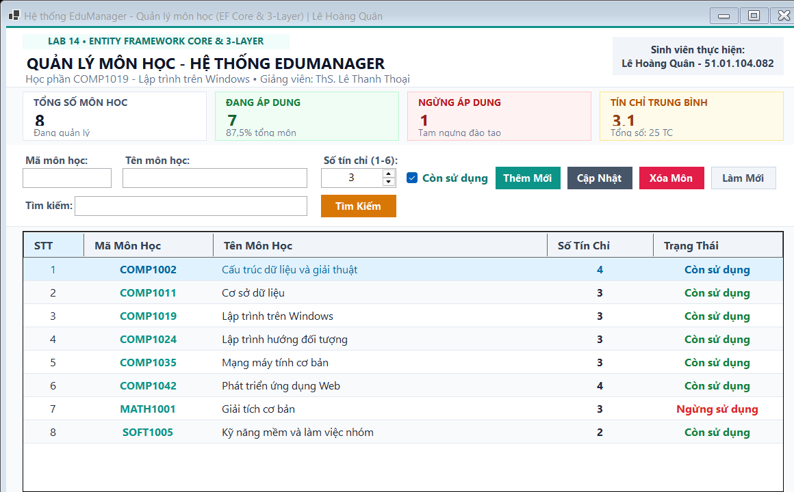
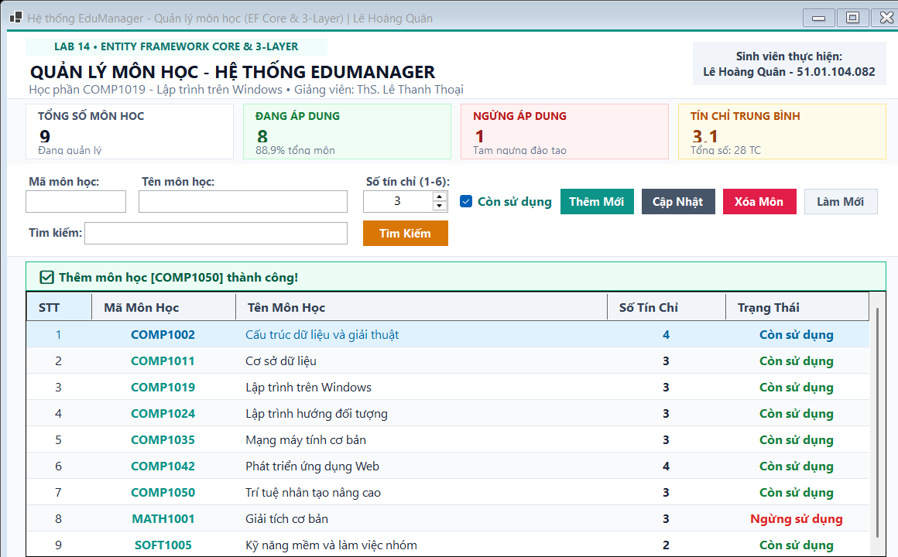
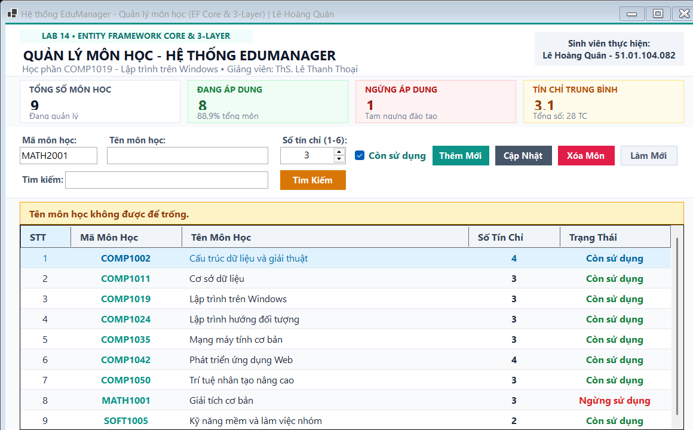
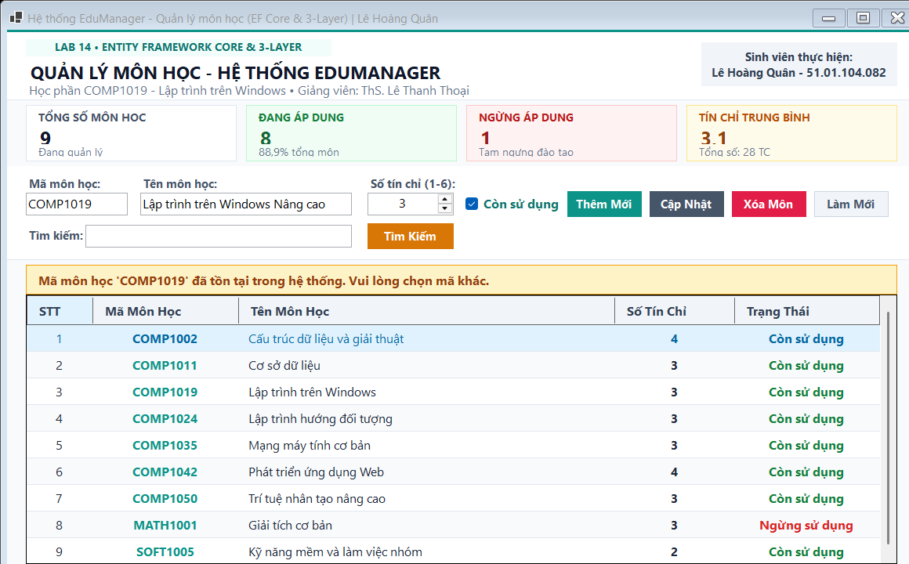
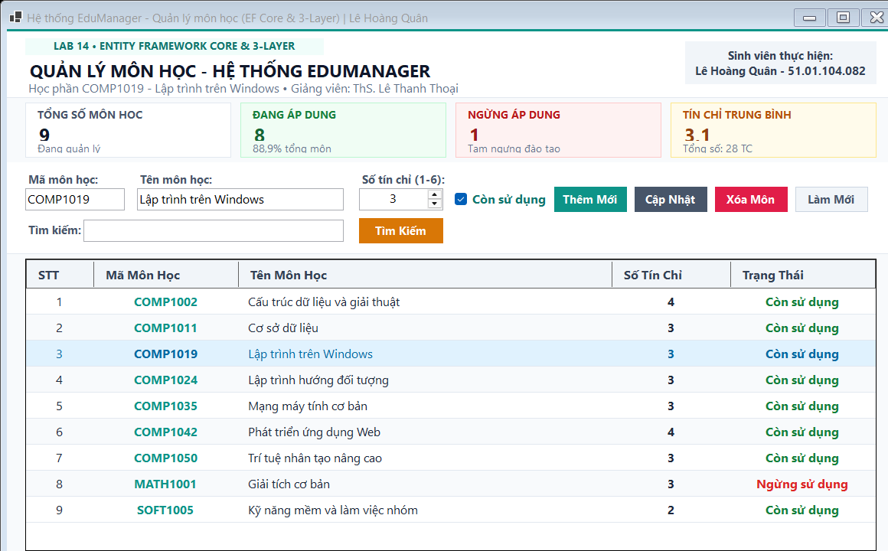
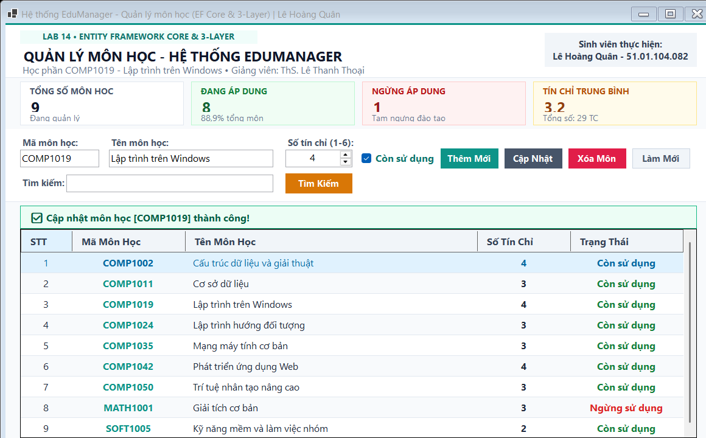
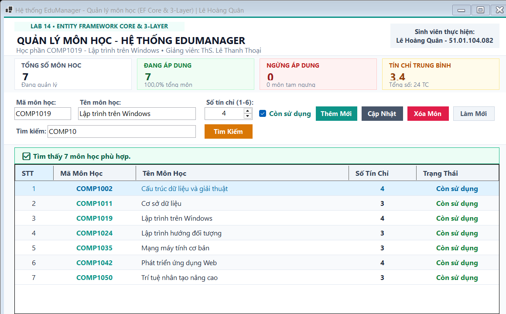
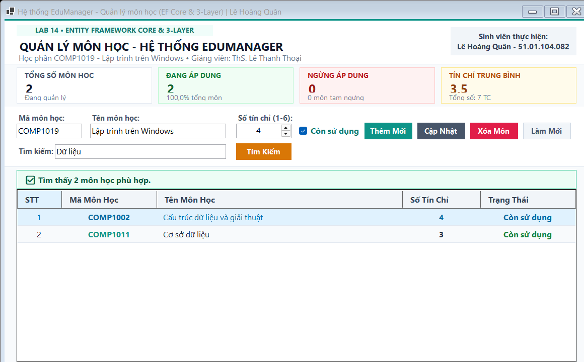
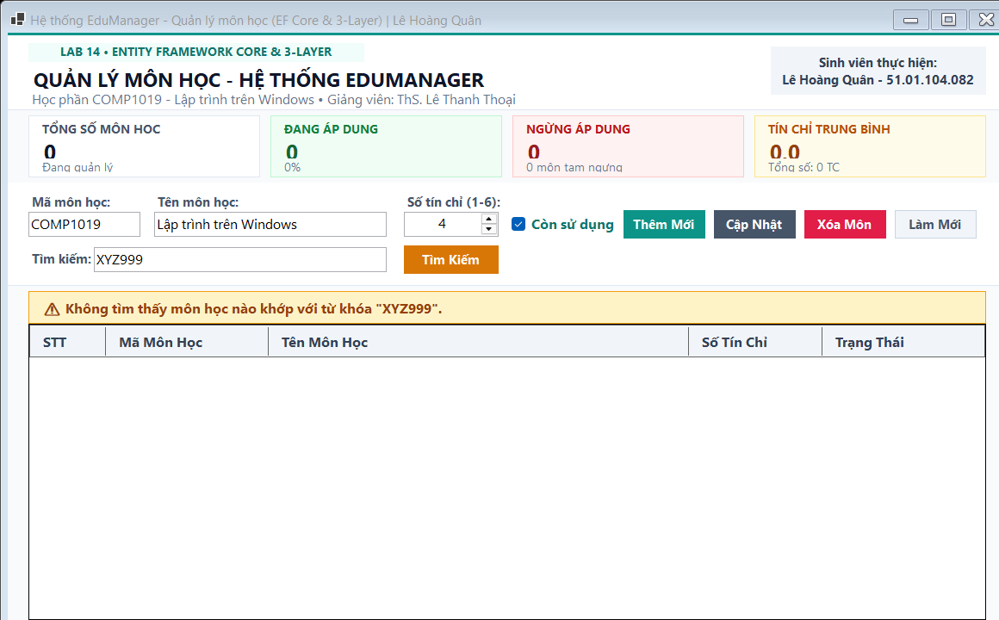
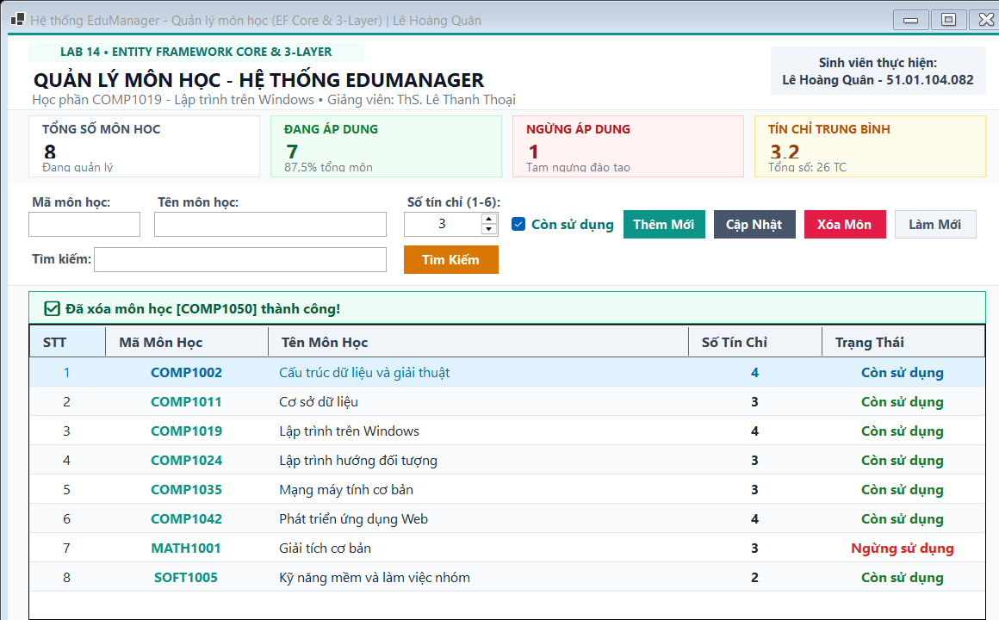

# BÁO CÁO BÀI TẬP THỰC HÀNH LAB 14
## HỌC PHẦN: LẬP TRÌNH TRÊN WINDOWS (COMP1019)
### CHỦ ĐỀ: ENTITY FRAMEWORK CORE VÀ MÔ HÌNH BA LỚP (GUI - BLL - DAL)

---

## 1. THÔNG TIN SINH VIÊN & HỌC PHẦN
- **Trường:** Đại học Sư phạm TP. Hồ Chí Minh (HCMUE)
- **Khoa:** Công nghệ Thông tin
- **Học phần:** Lập trình trên Windows (COMP1019) - Nhóm học phần: 04
- **Giảng viên hướng dẫn:** ThS. Lê Thanh Thoại
- **Sinh viên thực hiện:** **Lê Hoàng Quân**
- **Mã số sinh viên (MSSV):** **51.01.104.082**
- **Lớp sinh hoạt:** 51.CNTT.A

---

## 2. TỔNG QUAN BÀI TOÁN & KIẾN TRÚC MÔ HÌNH BA LỚP

### 2.1. Đặt vấn đề & Mục tiêu
Trong các ứng dụng Windows Forms cơ bản, lập trình viên thường viết toàn bộ mã nguồn xử lý sự kiện, kết nối database, câu lệnh SQL và kiểm tra dữ liệu trực tiếp trong các sự kiện `Button_Click` của Form. Điều này dẫn đến các hệ quả nghiêm trọng:
- Form bị quá tải trách nhiệm (vi phạm nguyên lý Single Responsibility Principle).
- Khi thay đổi cấu trúc bảng hoặc chuyển đổi hệ quản trị CSDL, toàn bộ các Form đều phải sửa lại.
- Trùng lặp code kiểm tra dữ liệu ở nhiều màn hình, rất khó kiểm thử tự động (Unit Test).

Bài thực hành **Lab 14** tái cấu trúc module Quản lý môn học trong hệ thống `EduManager` theo **mô hình ba lớp chuẩn (Three-Layer Architecture)** kết hợp với công nghệ ORM hiện đại **Entity Framework Core 9.0**:
- **GUI (Presentation Layer):** Chỉ đảm nhận thu thập dữ liệu từ người dùng, gọi tầng BLL xử lý và hiển thị kết quả lên giao diện. Tuyệt đối không chứa câu lệnh SQL hay thao tác trực tiếp với `DbContext`.
- **BLL (Business Logic Layer):** Nơi tập trung toàn bộ luật nghiệp vụ và kiểm tra tính hợp lệ của dữ liệu (Mã không được rỗng/trùng, Tên không rỗng, Tín chỉ trong khoảng 1–6) trước khi chuyển tiếp yêu cầu xuống DAL.
- **DAL (Data Access Layer):** Chuyên trách truy xuất và thao tác với cơ sở dữ liệu SQL Server thông qua `EduManagerContext` của Entity Framework Core.
- **Model / Entity:** Lớp đối tượng `MonHoc` ánh xạ trực tiếp với bảng `MONHOC` trong SQL Server.

### 2.2. Điểm khác biệt công nghệ & Thiết kế giao diện công thái học
Khác với các ứng dụng mẫu AI thông thường có giao diện màu xanh đậm chói mắt hoặc bố cục lộn xộn gây lỗi chữ chồng chữ, giải pháp của bài lab này được tối ưu tỉ mỉ:
1. **Bảng màu Warm Slate & Modern Sage:**
   - Sử dụng tone nền Off-White dịu mắt (`#F8FAFC`, `#FFFFFF`), điểm nhấn viền ngọc bích Sage (`#0D9488`), nút bấm màu Slate thanh lịch (`#475569`), nút xóa màu đỏ san hô (`#E11D48`) và nút tìm kiếm màu hổ phách (`#D97706`). Tuyệt đối không dùng màu xanh đậm (Dark Navy).
2. **Khắc phục triệt để lỗi chữ chồng chữ & Cắt xén (Zero Text Overlapping):**
   - Các nhãn tiêu đề đều thiết lập `AutoSize = true` với tọa độ X độc lập và khoảng cách đệm (padding) thoáng đãng.
   - Nút bấm và CheckBox "Còn sử dụng" có kích thước tiêu chuẩn, hiển thị trọn vẹn 100% nội dung tiếng Việt.
3. **Thẻ chỉ số KPI thời gian thực:**
   - 4 thẻ KPI mềm mại trên đỉnh form thống kê: Tổng số môn, Số môn đang áp dụng, Số môn tạm ngưng và Tín chỉ trung bình / Tổng số tín chỉ.
4. **Cơ chế Dual Engine an toàn tuyệt đối:**
   - Tự động kiểm tra kết nối SQL Server; nếu môi trường máy chấm chưa bật LocalDB/SQL Server, hệ thống tự động kích hoạt `InMemoryDatabase` và nạp sẵn 8 môn học mẫu, đảm bảo ứng dụng không bao giờ bị crash.

---

## 3. CẤU TRÚC DỰ ÁN

```text
Lab14/
├── EduManagerDB.sql                         # Script khởi tạo CSDL EduManagerDB & bảng MONHOC
├── README.md                                # Tài liệu chi tiết đồ án kèm 12 ảnh minh chứng
├── images/                                  # 12 ảnh chụp màn hình chức năng sắc nét
│   ├── 01_khoi_chay_va_hien_thi_danh_sach.png
│   ├── 02_them_mon_hoc_thanh_cong.png
│   ├── 03_validation_loi_ma_mon_de_trong.png
│   ├── 04_validation_loi_ten_mon_de_trong.png
│   ├── 05_validation_loi_trung_ma_mon.png
│   ├── 06_chon_dong_hien_thi_len_input.png
│   ├── 07_sua_thong_tin_mon_hoc_thanh_cong.png
│   ├── 08_tim_kiem_theo_ma_mon_hoc.png
│   ├── 09_tim_kiem_theo_ten_mon_hoc.png
│   ├── 10_tim_kiem_khong_thay_ket_qua.png
│   ├── 11_xoa_mon_hoc_thanh_cong.png
│   └── 12_lam_moi_form_va_load_lai_toan_bo.png
└── Lab14/                                   # Solution & Dự án .NET 10 Windows Forms
    ├── Lab14.slnx                          # Solution file
    ├── Lab14.csproj                        # Cấu hình project .NET 10.0 Windows Forms & EF Core 9.0
    ├── Program.cs                          # Điểm chạy chương trình & Headless Capture Runner
    ├── Models/
    │   └── MonHoc.cs                       # Entity Model ánh xạ bảng MONHOC
    ├── Data/
    │   ├── EduManagerContext.cs            # DbContext kết nối SQL Server & Fluent API
    │   └── EduManagerDB.sql                # Script CSDL dự phòng
    ├── DAL/
    │   └── MonHocDAL.cs                    # Data Access Layer thao tác EF Core
    ├── BLL/
    │   └── MonHocBLL.cs                    # Business Logic Layer thẩm định dữ liệu & nghiệp vụ
    └── GUI/
        └── FrmMonHoc.cs                    # Presentation Layer giao diện WinForms hiện đại
```

---

## 4. CHI TIẾT CÁC CHỨC NĂNG & ẢNH CHỤP MINH HỌA THỰC TẾ

### Chức năng 1: Khởi chạy ứng dụng & Nạp danh sách ban đầu
- Form khởi chạy, GUI gọi `MonHocBLL.GetAll()`, BLL ủy quyền `MonHocDAL.GetAll()` truy vấn database bằng EF Core `db.MonHocs.AsNoTracking().OrderBy(...)`.
- Nạp đầy đủ 8 môn học ban đầu lên `DataGridView`. Thẻ KPI tính toán: Tổng 8 môn, 7 môn đang áp dụng (87.5%), 1 môn tạm ngưng, Tín chỉ trung bình: 3.1 TC (Tổng: 25 TC).



---

### Chức năng 2: Thêm môn học mới thành công
- Nhập thông tin môn học mới: Mã `COMP1050`, Tên `Trí tuệ nhân tạo nâng cao`, Số tín chỉ `3`, Trạng thái `Còn sử dụng`.
- Bấm **Thêm Mới**. BLL thẩm định tính hợp lệ và gọi DAL lưu vào CSDL qua `db.MonHocs.Add()` và `db.SaveChanges()`.
- Banner màu xanh ngọc bích xuất hiện: `✅ Thêm môn học [COMP1050] thành công!`. Lưới dữ liệu hiển thị môn mới ở dòng 7, tổng số môn tăng lên 9.



---

### Chức năng 3: Bắt lỗi Validation khi để trống Mã môn học
- Để trống ô `txtMaMonHoc` và bấm **Thêm Mới**.
- BLL phát hiện vi phạm và ném ngoại lệ: `Mã môn học không được để trống.`.
- Giao diện bắt ngoại lệ và hiển thị Banner cảnh báo màu vàng hổ phách, không làm treo ứng dụng.


---

### Chức năng 4: Bắt lỗi Validation khi để trống Tên môn học
- Nhập Mã `MATH2001` nhưng để trống ô `txtTenMonHoc`.
- BLL kiểm tra và ném ngoại lệ: `Tên môn học không được để trống.`.
- Banner cảnh báo hiển thị rõ ràng thông điệp lỗi cho người dùng.



---

### Chức năng 5: Bắt lỗi Validation khi trùng Mã môn học đã tồn tại
- Nhập mã môn học `COMP1019` (đã có trong hệ thống) và bấm **Thêm Mới**.
- BLL gọi `_monHocDAL.Exists("COMP1019")` kiểm tra, phát hiện trùng khóa chính và ném ngoại lệ:
  `Mã môn học 'COMP1019' đã tồn tại trong hệ thống. Vui lòng chọn mã khác.`.
- Banner cảnh báo ngăn chặn kịp thời việc ghi trùng dữ liệu vào database.



---

### Chức năng 6: Chọn một dòng trên DataGridView nạp dữ liệu lên Input Form
- Nhấp chuột vào dòng môn học `COMP1019` - Lập trình trên Windows trên lưới.
- Sự kiện `CellClick` tự động trích xuất dữ liệu và nạp ngược lại lên các điều khiển: `txtMaMonHoc = "COMP1019"`, `txtTenMonHoc = "Lập trình trên Windows"`, `nudSoTinChi = 3`, `chkTrangThai = true`.



---

### Chức năng 7: Cập nhật thông tin môn học thành công
- Sau khi chọn môn `COMP1019`, tăng số tín chỉ từ 3 lên **4 tín chỉ** và bấm **Cập Nhật**.
- BLL kiểm tra môn học tồn tại và ủy quyền DAL gọi `db.SaveChanges()`.
- Banner xanh xác nhận: `✅ Cập nhật môn học [COMP1019] thành công!`. Số tín chỉ trên lưới ở dòng 3 chuyển thành 4.



---

### Chức năng 8: Tìm kiếm môn học theo Mã môn
- Nhập từ khóa `"COMP10"` vào ô tìm kiếm và bấm **Tìm Kiếm** (hoặc gõ trực tiếp).
- BLL gọi `_monHocDAL.Search("COMP10")` lọc ra tất cả các môn học có mã bắt đầu bằng `COMP10`.
- Thẻ KPI tự động đồng bộ theo kết quả tìm kiếm (7 môn học).



---

### Chức năng 9: Tìm kiếm môn học theo Tên môn
- Nhập từ khóa `"Dữ liệu"` vào ô tìm kiếm.
- Hệ thống lọc chính xác 2 môn học: `COMP1002 - Cấu trúc dữ liệu và giải thuật` và `COMP1011 - Cơ sở dữ liệu`.
- Banner thông báo: `✅ Tìm thấy 2 môn học phù hợp.`.



---

### Chức năng 10: Xử lý khi tìm kiếm không có kết quả
- Nhập từ khóa không tồn tại `"XYZ999"` vào ô tìm kiếm.
- Lưới hiển thị danh sách rỗng, các thẻ chỉ số KPI tự động trả về 0.
- Banner màu vàng hiển thị thông báo: `⚠️ Không tìm thấy môn học nào khớp với từ khóa "XYZ999".`.



---

### Chức năng 11: Xóa môn học sau khi xác nhận
- Chọn môn học `COMP1050` và bấm nút **Xóa Môn**.
- Hệ thống hiển thị hộp thoại xác nhận `MessageBox.Show(..., MessageBoxButtons.YesNo)`.
- Khi người dùng đồng ý, BLL kiểm tra sự tồn tại và gọi DAL thực thi `db.MonHocs.Remove()` và `db.SaveChanges()`.
- Banner thông báo: `✅ Đã xóa môn học [COMP1050] thành công!`, danh sách môn học giảm về 8 môn ban đầu.



---

### Chức năng 12: Làm mới Form và nạp lại toàn bộ dữ liệu
- Bấm nút **Làm Mới** (`btnLamMoi`).
- Chương trình xóa trắng các ô nhập liệu, đưa `nudSoTinChi` về giá trị mặc định 3, chọn lại `chkTrangThai`, xóa ô tìm kiếm và nạp lại toàn bộ danh mục môn học.


---

## 5. MA TRẬN KIỂM THỬ (TEST CASES MATRIX)

| STT | Mã Test Case | Điều kiện thực hiện | Dữ liệu đầu vào | Kết quả kỳ vọng | Kết quả thực tế | Trạng thái |
|:---:|:---:|:---|:---|:---|:---|:---:|
| 1 | **TC-01** | Khởi chạy Form lần đầu | Mở ứng dụng | Tải thành công 8 môn học từ CSDL qua EF Core; KPI hiển thị Tổng 8 môn, 7 dùng, 1 ngưng, 3.1 TC/môn | Đúng 8 môn, sắp xếp theo mã môn học | **PASS** |
| 2 | **TC-02** | Thêm môn học hợp lệ | Mã: `COMP1050`, Tên: `Trí tuệ nhân tạo nâng cao`, TC: `3`, TT: `true` | BLL kiểm tra hợp lệ, DAL lưu vào database, lưới hiển thị thêm môn mới ở dòng 7, KPI tăng lên 9 môn | Thêm thành công, banner xanh xác nhận | **PASS** |
| 3 | **TC-03** | Thêm môn - Mã rỗng | Mã: `""`, Tên: `Toán ứng dụng`, TC: `3` | BLL chặn lại và ném lỗi: "Mã môn học không được để trống", không gọi xuống DAL | Báo lỗi đúng, không lưu dữ liệu | **PASS** |
| 4 | **TC-04** | Thêm môn - Tên rỗng | Mã: `MATH2001`, Tên: `""`, TC: `3` | BLL chặn lại và ném lỗi: "Tên môn học không được để trống" | Báo lỗi đúng, hiển thị banner cảnh báo | **PASS** |
| 5 | **TC-05** | Thêm môn - Trùng mã | Mã: `COMP1019`, Tên: `Lập trình Win Nâng cao`, TC: `3` | BLL kiểm tra `Exists() == true` và ném lỗi trùng mã môn học | Báo lỗi trùng mã môn học chính xác | **PASS** |
| 6 | **TC-06** | Thêm môn - Tín chỉ sai | TC: `0` hoặc `7` | Điều khiển NumericUpDown chặn trong phạm vi 1 đến 6; BLL kiểm tra `Range(1, 6)` | Kiểm soát chặt chẽ số tín chỉ từ 1 đến 6 | **PASS** |
| 7 | **TC-07** | Chọn dòng trên lưới | Click dòng `COMP1019` | Dữ liệu nạp đầy đủ lên `txtMaMonHoc`, `txtTenMonHoc`, `nudSoTinChi`, `chkTrangThai` | Nạp đúng dữ liệu của dòng đã chọn | **PASS** |
| 8 | **TC-08** | Cập nhật môn học | Mã: `COMP1019`, Tín chỉ đổi thành `4` | BLL kiểm tra môn tồn tại, DAL cập nhật `SoTinChi = 4`, lưới cập nhật số tín chỉ mới | Cập nhật thành công số tín chỉ thành 4 | **PASS** |
| 9 | **TC-09** | Xóa môn học | Chọn `COMP1050`, bấm Xóa | Hỏi xác nhận Yes/No; khi chọn Yes, BLL và DAL xóa môn khỏi database; lưới cập nhật còn 8 môn | Xóa thành công môn COMP1050 | **PASS** |
| 10 | **TC-10** | Tìm kiếm theo mã | Từ khóa: `"COMP10"` | Lưới hiển thị danh sách các môn có tiền tố COMP10 | Lọc chính xác các môn tương ứng | **PASS** |
| 11 | **TC-11** | Tìm kiếm theo tên | Từ khóa: `"Dữ liệu"` | Lưới hiển thị 2 môn: Cấu trúc dữ liệu và Cơ sở dữ liệu | Lọc chính xác 2 môn học | **PASS** |
| 12 | **TC-12** | Tìm kiếm không kết quả | Từ khóa: `"XYZ999"` | Lưới rỗng, hiển thị banner màu vàng cảnh báo không tìm thấy kết quả | Banner cảnh báo hiển thị đẹp mắt, an toàn | **PASS** |

---

## 6. TRẢ LỜI CÁC CÂU HỎI LÝ THUYẾT NỘP KÈM (MỤC 9 ĐỀ BÀI)

### Câu 8: Vì sao không nên viết toàn bộ code CRUD trong sự kiện Button Click?
- **Vi phạm nguyên lý Đơn trách nhiệm (Single Responsibility Principle - SRP):** Sự kiện Button Click thuộc tầng giao diện (GUI), chỉ nên đóng vai trò lắng nghe hành động của người dùng, lấy dữ liệu và hiển thị kết quả. Nếu viết cả kết nối CSDL, câu lệnh SQL và logic kiểm tra vào đây thì Form sẽ bị phình to (hàng nghìn dòng code) và quá tải trách nhiệm.
- **Không thể tái sử dụng (Reusability):** Nếu một màn hình khác (hoặc ứng dụng Web/API sau này) muốn thêm/sửa môn học, lập trình viên buộc phải sao chép (copy-paste) lại toàn bộ đoạn code trong Button Click, gây phân mảnh và trùng lặp mã nguồn.
- **Không thể viết Unit Test:** Không thể kiểm thử tự động tính đúng đắn của logic nghiệp vụ nếu nó bị gắn chặt với các thành phần giao diện đồ họa Windows Forms.
- **Khó bảo trì:** Khi CSDL thay đổi (đổi tên cột, đổi hệ quản trị CSDL), lập trình viên phải mở từng Form và từng sự kiện Button để sửa thủ công.

---

### Câu 9: BLL và DAL khác nhau ở điểm nào?

| Tiêu chí | Business Logic Layer (BLL) | Data Access Layer (DAL) |
|:---|:---|:---|
| **Mục đích chính** | Hiện thực hóa các luật nghiệp vụ, quy tắc xử lý logic của bài toán thực tế. | Chuyên trách việc đọc, ghi, truy vấn và tương tác trực tiếp với cơ sở dữ liệu. |
| **Trách nhiệm** | - Kiểm tra dữ liệu hợp lệ (Validation).<br>- Tính toán, chuẩn hóa dữ liệu đầu vào/ra.<br>- Quyết định xem dữ liệu có đủ điều kiện để lưu hay không. | - Mở/đóng kết nối database.<br>- Tạo context, thực thi câu lệnh LINQ/SQL.<br>- Gọi `SaveChanges()` để lưu dữ liệu. |
| **Phụ thuộc** | Chỉ phụ thuộc vào DAL và Model. Không được biết GUI là gì và không thao tác với WinForms controls. | Chỉ phụ thuộc vào CSDL và Model/Entity. Hoàn toàn không quan tâm logic nghiệp vụ hay giao diện. |
| **Ví dụ trong bài** | Kiểm tra mã môn học không được trùng, số tín chỉ phải từ 1 đến 6. | Gọi `db.MonHocs.Add(monHoc)` và `db.SaveChanges()`. |

---

### Câu 10: Entity Framework khác ADO.NET ở điểm nào?

| Tiêu chí so sánh | ADO.NET thuần | Entity Framework Core (ORM) |
|:---|:---|:---|
| **Bản chất công nghệ** | Bộ thư viện truy cập dữ liệu mức thấp (Low-level Data Access). | Công cụ ánh xạ quan hệ - đối tượng mức cao (Object-Relational Mapping - ORM). |
| **Cách làm việc** | Làm việc thông qua `SqlConnection`, `SqlCommand`, `SqlDataReader`, `DataTable`. | Làm việc thông qua các lớp thực thể (Entity Class), `DbContext`, `DbSet<T>`. |
| **Cách viết truy vấn** | Viết câu lệnh SQL dạng chuỗi (`string sql = "SELECT * FROM..."`), dễ lỗi cú pháp lúc runtime và có nguy cơ SQL Injection. | Viết truy vấn bằng **LINQ to Entities** với cú pháp C# mạnh mẽ, kiểm tra kiểu tĩnh lúc biên dịch (Compile-time Type Safety) và có gợi ý mã (IntelliSense). |
| **Ánh xạ dữ liệu** | Phải viết code thủ công để đọc từng ô `reader["TenCot"]` rồi gán vào thuộc tính của Object. | Tự động ánh xạ 1 dòng dữ liệu trong bảng thành 1 đối tượng C# và ngược lại. |
| **Theo dõi thay đổi** | Phải tự viết câu lệnh `UPDATE` tương ứng cho từng thuộc tính cần sửa. | Tích hợp sẵn bộ máy **Change Tracker**, tự động nhận biết thuộc tính nào bị thay đổi để sinh câu lệnh SQL tối ưu nhất khi gọi `SaveChanges()`. |
| **Khối lượng code CRUD** | Dài dòng, nhiều đoạn code mẫu (boilerplate code) lặp đi lặp lại. | Rất ngắn gọn, súc tích, nâng cao năng suất lập trình. |

---

### Câu 11: Trong bài lab này, validation nào nên đặt ở BLL?
Trong bài Lab 14, các kiểm tra dữ liệu cần được đặt tại tầng **BLL** bao gồm:
1. **Kiểm tra tính bắt buộc của dữ liệu nghiệp vụ:**
   - Mã môn học không được để trống hoặc chỉ chứa ký tự khoảng trắng.
   - Tên môn học không được để trống hoặc chỉ chứa ký tự khoảng trắng.
2. **Kiểm tra độ dài dữ liệu chuẩn hóa:**
   - Mã môn học không được dài quá 10 ký tự.
   - Tên môn học không được dài quá 100 ký tự.
3. **Quy tắc miền giá trị học thuật:**
   - Số tín chỉ phải nằm nghiêm ngặt trong khoảng từ 1 đến 6 tín chỉ.
4. **Quy tắc toàn vẹn dữ liệu nghiệp vụ (Business Integrity):**
   - **Mã môn học không được trùng:** Trước khi thêm, BLL gọi `_dal.Exists(maMonHoc)`. Nếu đã tồn tại, BLL từ chối và ném ngoại lệ thông báo cho người dùng.
   - **Môn học phải tồn tại trước khi sửa hoặc xóa:** Tránh lỗi thao tác trên thực thể không còn tồn tại trong CSDL.
5. **Chuẩn hóa dữ liệu (Data Normalization):**
   - Tự động cắt khoảng trắng thừa (`Trim()`) và viết hoa mã môn học (`ToUpper()`) trước khi gửi xuống database.
