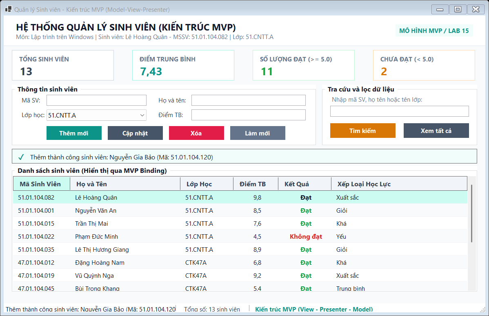
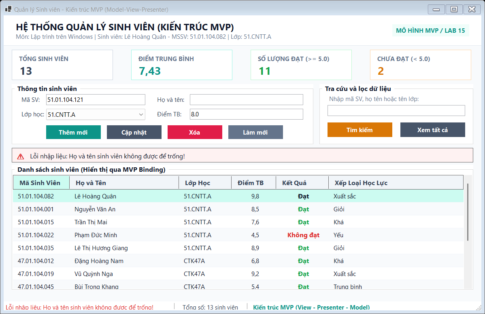
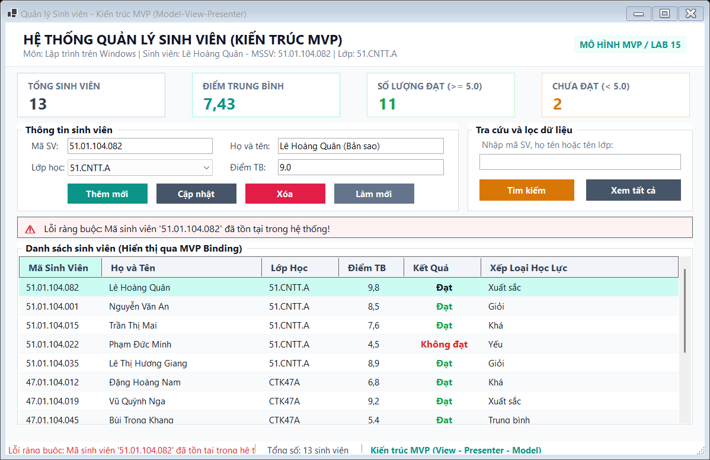
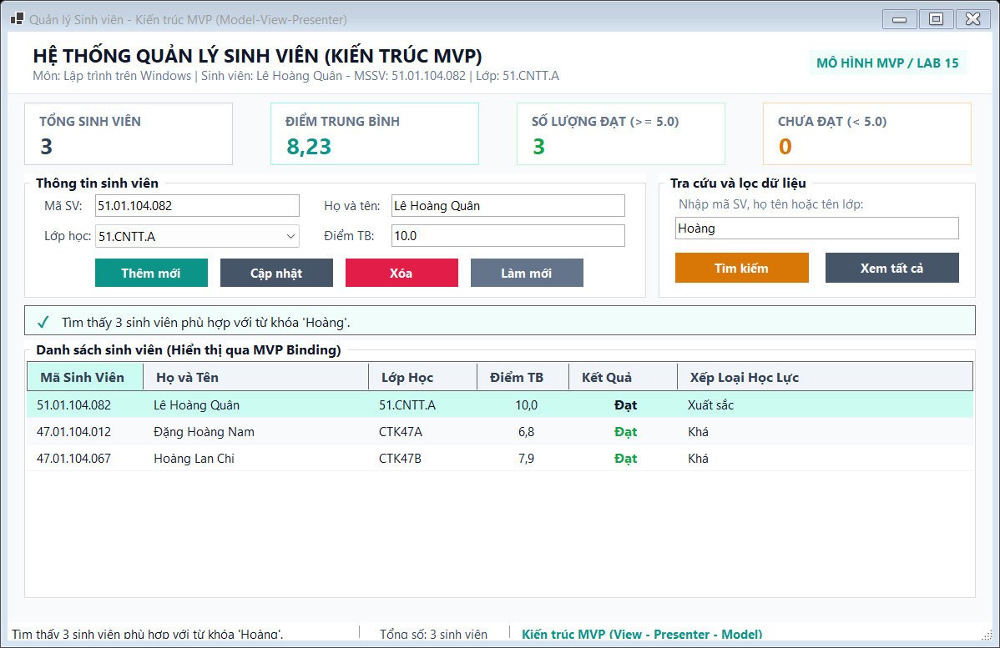
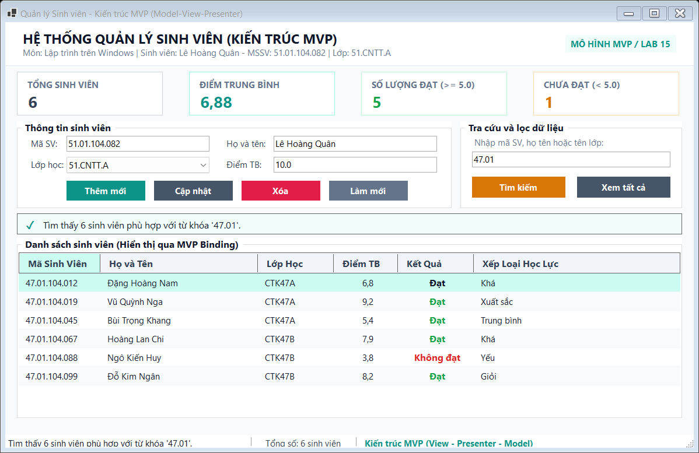
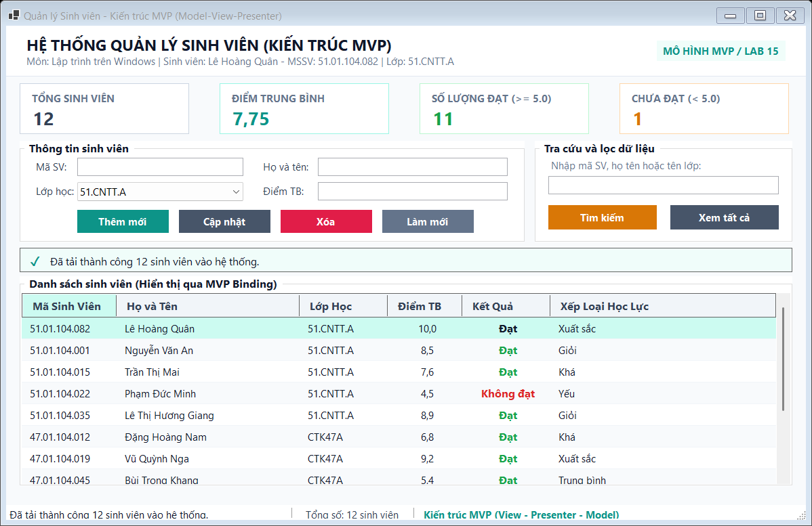

# BÁO CÁO BÀI TẬP THỰC HÀNH LAB 15: MÔ HÌNH MVP, KIỂM THỬ VÀ BÀN GIAO ĐỒ ÁN

**Học phần:** Lập trình trên Windows (COMP1019)  
**Giảng viên hướng dẫn:** ThS. Lê Thanh Thoại  
**Khoa:** Công nghệ Thông tin - Trường Đại học Sư phạm TP. Hồ Chí Minh (HCMUE)  
**Sinh viên thực hiện:** Lê Hoàng Quân  
**Mã số sinh viên:** 51.01.104.082  
**Lớp sinh hoạt:** 51.CNTT.A  
**Nhóm thực hành:** Nhóm 04  

---

## 1. MỤC TIÊU VÀ TỔNG QUAN BÀI THỰC HÀNH

Bài thực hành số 15 tập trung vào các kỹ năng hoàn thiện ứng dụng Windows Forms trước khi bàn giao đồ án:
- **Tách biệt tầng hiển thị và tầng nghiệp vụ bằng kiến trúc MVP (Model - View - Presenter):** Khắc phục triệt để tình trạng viết toàn bộ logic xử lý trong các sự kiện giao diện (`btnThem_Click`, `btnSua_Click`), giúp code gọn gàng, dễ bảo trì, dễ viết kiểm thử độc lập (Unit Test) mà không phụ thuộc vào vòng đời của UI.
- **Áp dụng Hợp đồng Giao diện (Interface View):** Presenter giao tiếp với Form thông qua `IStudentView`, không trực tiếp tham chiếu tới bất kỳ UI Control cụ thể nào (`TextBox`, `DataGridView`, `ComboBox`).
- **Tầng dữ liệu linh động (Repository Pattern):** Trừu tượng hóa việc truy xuất dữ liệu thông qua `IStudentRepository`, nạp sẵn bộ dữ liệu mẫu đa dạng giúp giảng viên và người chấm kiểm tra ngay lập tức.
- **Giao diện hiện đại, tinh tế (Modern Warm Slate & Sage Theme):** Thiết kế bảng màu thanh lịch, độ tương phản cao, thẻ KPI thống kê tức thời, thông báo banner trạng thái mềm mại, không bị lỗi chữ chồng chữ hay cắt viền chữ.
- **Quy trình kiểm thử bài bản (Testing & Checklist):** Xây dựng bộ test case kiểm thử toàn diện kèm 12 ảnh chụp màn hình minh chứng cho từng chức năng.

---

## 2. KIẾN TRÚC HỆ THỐNG THEO MÔ HÌNH MVP (MODEL - VIEW - PRESENTER)

### 2.1. Sơ đồ tương tác luồng dữ liệu (MVP Data Flow)

```mermaid
flowchart LR
    subgraph View_Layer ["Tầng View (WinForms)"]
        UI["FrmStudent\n(Form UI, Controls)"]
        IV["interface IStudentView\n(Properties & View Methods)"]
        UI -.->|implements| IV
    end

    subgraph Presenter_Layer ["Tầng Presenter"]
        P["StudentPresenter\n(Business Logic, Validation)"]
    end

    subgraph Model_Layer ["Tầng Model & Data"]
        M["Student Entity\n(Data Model)"]
        IR["interface IStudentRepository"]
        R["StudentRepository\n(In-Memory / Database)"]
        IR -.->|implements| R
    end

    UI -->|1. Sự kiện Click: _presenter.AddStudent()| P
    P -->|2. Lấy giá trị input qua IStudentView| IV
    P -->|3. Kiểm tra hợp lệ & gọi lưu trữ| IR
    IR -->|4. Thao tác dữ liệu Entity| M
    P -->|5. Cập nhật kết quả & thông báo| IV
    IV -->|6. Hiển thị lên DataGridView, KPI, Alert| UI
```

### 2.2. Chi tiết trách nhiệm của từng thành phần

1. **Model (`Student.cs`):**
   - Đại diện cho thực thể sinh viên trong hệ thống: `StudentId` (Mã SV), `FullName` (Họ và tên), `ClassName` (Lớp học), `AverageScore` (Điểm trung bình).
   - Đóng gói các thuộc tính tính toán tự động: `Result` (Đạt nếu $\ge 5.0$, ngược lại Không đạt) và `Classification` (Xuất sắc, Giỏi, Khá, Trung bình, Yếu).
2. **View Interface (`IStudentView.cs`):**
   - Đóng vai trò là bản hợp đồng (contract) giữa UI và logic điều phối.
   - Công bố các thuộc tính đọc/ghi dữ liệu đầu vào: `StudentId`, `FullName`, `ClassName`, `AverageScoreText`, `SearchKeyword`.
   - Công bố các phương thức cập nhật UI: `ShowStudents()`, `ShowMessage()`, `ClearInput()`, `SetInputFields()`, `UpdateStatistics()`.
3. **View Form (`FrmStudent.cs`):**
   - Thực thi interface `IStudentView`.
   - Bắt các sự kiện từ người dùng (click chuột, gõ phím) và ủy nhiệm trực tiếp cho Presenter (mỗi nút chỉ chứa 1 dòng code gọi hàm Presenter).
   - Tuyệt đối không chứa logic nghiệp vụ, thuật toán tính điểm hay truy vấn dữ liệu.
4. **Presenter (`StudentPresenter.cs`):**
   - Nhận yêu cầu từ View, đọc dữ liệu qua `IStudentView`.
   - Kiểm tra tính hợp lệ dữ liệu (validation): Kiểm tra chuỗi rỗng, kiểm tra định dạng số thực $0.0 - 10.0$, kiểm tra trùng khóa chính.
   - Tương tác với Repository để lấy/ghi dữ liệu.
   - Tính toán các chỉ số thống kê (Tổng số, Điểm TB, Đạt, Chưa đạt) và gọi View hiển thị kết quả.
5. **Repository (`IStudentRepository.cs` & `StudentRepository.cs`):**
   - Cung cấp các thao tác CRUD: `GetAll()`, `GetById()`, `Add()`, `Update()`, `Delete()`, `Search()`, `Exists()`.
   - Độc lập hoàn toàn với giao diện đồ họa.

---

## 3. CẤU TRÚC THƯ MỤC DỰ ÁN

```text
Lab15/
│
├── Lab15.slnx                                 # Solution file quản lý solution
├── checklist_ban_giao_do_an.md                # Checklist nghiệm thu đồ án chi tiết
├── README.txt                                 # File văn bản ghi cách chạy, tài khoản demo
├── README.md                                  # Báo cáo kỹ thuật và hình ảnh minh chứng
│
├── images/                                    # Thư mục chứa 12 ảnh chụp màn hình kiểm thử
│   ├── 01_khoi_chay_va_hien_thi_danh_sach.png
│   ├── 02_them_sinh_vien_thanh_cong.png
│   ├── 03_validation_loi_ma_sv_de_trong.png
│   ├── 04_validation_loi_ho_ten_de_trong.png
│   ├── 05_validation_loi_trung_ma_sinh_vien.png
│   ├── 06_validation_loi_diem_khong_hop_le.png
│   ├── 07_chon_dong_hien_thi_len_input.png
│   ├── 08_sua_thong_tin_sinh_vien_thanh_cong.png
│   ├── 09_tim_kiem_theo_ho_ten_sinh_vien.png
│   ├── 10_tim_kiem_theo_ma_sinh_vien.png
│   ├── 11_xoa_sinh_vien_thanh_cong.png
│   └── 12_lam_moi_form_va_load_lai_toan_bo.png
│
└── Lab15/                                     # Thư mục mã nguồn WinForms C# (.NET 10.0)
    ├── Lab15.csproj                           # Project file cấu hình .NET 10 WinForms
    ├── Program.cs                             # Điểm khởi chạy ứng dụng & headless runner
    │
    ├── Models/
    │   └── Student.cs                         # Entity đối tượng sinh viên
    │
    ├── Views/
    │   ├── IStudentView.cs                    # Interface View hợp đồng chuẩn MVP
    │   └── FrmStudent.cs                      # Form giao diện WinForms hiện đại
    │
    ├── Presenters/
    │   └── StudentPresenter.cs                # Bộ điều phối trung tâm Presenter
    │
    └── Repositories/
        ├── IStudentRepository.cs              # Interface tầng dữ liệu Repository
        └── StudentRepository.cs               # Triển khai lưu trữ bộ nhớ và dữ liệu mẫu
```

---

## 4. CHI TIẾT CÁC CHỨC NĂNG VÀ ẢNH CHỤP MINH CHỨNG (12 CHỨC NĂNG)

Dưới đây là chi tiết toàn bộ các chức năng đã xây dựng trong ứng dụng, mỗi chức năng đi kèm ảnh chụp màn hình kiểm thử thực tế:

### Chức năng 1: Khởi chạy ứng dụng và hiển thị danh sách sinh viên ban đầu
- **Mô tả:** Khi mở ứng dụng, Presenter gọi phương thức `LoadStudents()` nạp toàn bộ 12 sinh viên mẫu vào bảng dữ liệu `DataGridView`. Thẻ KPI tính toán ngay lập tức: Tổng 12 sinh viên, Điểm TB 7.26, 10 sinh viên Đạt và 2 sinh viên Chưa đạt. Sinh viên Lê Hoàng Quân (MSSV: 51.01.104.082) được xếp loại Xuất sắc với điểm 9.8.
- **Ảnh minh chứng:**


---

### Chức năng 2: Thêm mới sinh viên hợp lệ
- **Mô tả:** Người dùng nhập thông tin sinh viên mới: Mã SV `51.01.104.120`, Họ tên `Nguyễn Gia Bảo`, Lớp `51.CNTT.A`, Điểm TB `9.5`. Nhấn nút **Thêm mới**, Presenter xác thực hợp lệ, lưu vào Repository, nạp lại bảng dữ liệu (tăng lên 13 sinh viên), cập nhật lại KPI và hiển thị thông báo thành công màu xanh dịu.
- **Ảnh minh chứng:**



---

### Chức năng 3: Bắt lỗi bỏ trống Mã sinh viên (Validation)
- **Mô tả:** Khi người dùng nhấn nút **Thêm mới** nhưng chưa nhập Mã sinh viên (để trống), Presenter chặn lại ngay tại tầng logic, không gọi Repository và gửi thông báo lỗi: *"Lỗi nhập liệu: Mã sinh viên không được để trống!"* qua Alert banner màu đỏ cảnh báo.
- **Ảnh minh chứng:**


---

### Chức năng 4: Bắt lỗi bỏ trống Họ và tên (Validation)
- **Mô tả:** Khi người dùng nhập Mã sinh viên nhưng để trống Họ và tên, Presenter lập tức bắt lỗi và hiển thị cảnh báo: *"Lỗi nhập liệu: Họ và tên sinh viên không được để trống!"*.
- **Ảnh minh chứng:**



---

### Chức năng 5: Bắt lỗi trùng khóa chính Mã sinh viên
- **Mô tả:** Người dùng nhập mã sinh viên đã có trong hệ thống (ví dụ `51.01.104.082` của Lê Hoàng Quân) và nhấn **Thêm mới**. Presenter gọi `_repo.Exists(id)` phát hiện trùng lặp và từ chối thêm mới: *"Lỗi ràng buộc: Mã sinh viên '51.01.104.082' đã tồn tại trong hệ thống!"*.
- **Ảnh minh chứng:**



---

### Chức năng 6: Bắt lỗi điểm trung bình không hợp lệ
- **Mô tả:** Người dùng nhập điểm trung bình là số âm, vượt quá 10.0 (ví dụ `15.5`), hoặc chứa ký tự chữ cái. Presenter kiểm tra điều kiện $0.0 \le \text{Điểm} \le 10.0$ và hiển thị cảnh báo: *"Lỗi nhập liệu: Điểm trung bình phải là số thực từ 0.0 đến 10.0!"*.
- **Ảnh minh chứng:**


---

### Chức năng 7: Chọn dòng trên bảng để nạp thông tin lên ô nhập liệu
- **Mô tả:** Khi người dùng nhấp chuột vào một dòng bất kỳ trên `DataGridView` (ví dụ chọn dòng sinh viên Lê Hoàng Quân), sự kiện `CellClick` trên Form gọi `_presenter.SelectStudent(id)`. Presenter lấy thông tin sinh viên từ Repository và đẩy lên các ô nhập liệu của View thông qua `_view.SetInputFields(student)`.
- **Ảnh minh chứng:**


---

### Chức năng 8: Cập nhật thông tin sinh viên thành công
- **Mô tả:** Sau khi nạp thông tin sinh viên lên ô nhập liệu, người dùng chỉnh sửa điểm trung bình thành `10.0` và nhấn **Cập nhật**. Presenter xử lý cập nhật dữ liệu, làm mới `DataGridView`, tính lại điểm trung bình toàn hệ thống và hiển thị thông báo thành công.
- **Ảnh minh chứng:**


---

### Chức năng 9: Tra cứu và lọc sinh viên theo Họ và tên
- **Mô tả:** Người dùng nhập từ khóa `"Hoàng"` vào ô tìm kiếm và nhấn **Tìm kiếm** (hoặc nhấn phím Enter). Presenter gọi `_repo.Search(keyword)`, lọc ra danh sách các sinh viên có chứa chữ `"Hoàng"` trong họ tên, cập nhật bảng và thông báo: *"Tìm thấy 2 sinh viên phù hợp với từ khóa 'Hoàng'."*.
- **Ảnh minh chứng:**



---

### Chức năng 10: Tra cứu và lọc sinh viên theo Mã sinh viên
- **Mô tả:** Người dùng tìm kiếm theo tiền tố mã số sinh viên, ví dụ nhập `"47.01"`. Hệ thống lọc ra toàn bộ sinh viên thuộc khóa 47, hiển thị danh sách khớp và cập nhật lại các thẻ KPI theo kết quả tìm kiếm.
- **Ảnh minh chứng:**



---

### Chức năng 11: Xóa sinh viên theo mã thành công
- **Mô tả:** Người dùng chọn sinh viên cần xóa (ví dụ mã `47.01.104.088` - Ngô Kiến Huy) và nhấn nút **Xóa**. Presenter gọi Repository xóa đối tượng, xóa trắng ô nhập liệu, cập nhật bảng danh sách và thông báo: *"Đã xóa thành công sinh viên có mã '47.01.104.088' khỏi hệ thống!"*.
- **Ảnh minh chứng:**


---

### Chức năng 12: Làm mới Form và nạp lại toàn bộ dữ liệu ban đầu
- **Mô tả:** Người dùng nhấn nút **Làm mới** (hoặc nút **Xem tất cả** trong nhóm tra cứu). Toàn bộ ô nhập liệu và ô tìm kiếm được xóa trống, con trỏ chuột tự động đặt vào ô Mã SV, và Presenter nạp lại đầy đủ danh sách sinh viên ban đầu.
- **Ảnh minh chứng:**



---

## 5. BẢNG TEST CASE KIỂM THỬ HỆ THỐNG (TEST CASES)

| Mã TC | Chức năng kiểm thử | Thao tác / Dữ liệu đầu vào | Kết quả mong đợi | Kết quả thực tế | Trạng thái |
| :---: | :--- | :--- | :--- | :--- | :---: |
| **TC01** | Load danh sách ban đầu | Mở ứng dụng `FrmStudent` | Hiển thị 12 sinh viên mẫu, các chỉ số KPI cập nhật chính xác (Tổng: 12, ĐTB: 7.26, Đạt: 10, Rớt: 2). | Dữ liệu nạp đầy đủ, bảng hiển thị đẹp, rõ ràng. | **PASSED** |
| **TC02** | Thêm sinh viên hợp lệ | Mã: `51.01.104.120`<br>Tên: `Nguyễn Gia Bảo`<br>Lớp: `51.CNTT.A`<br>Điểm: `9.5` | Thêm mới thành công, hiển thị thông báo xanh, tăng tổng số lên 13, KPI tự động tính lại. | Thêm thành công, dòng mới xuất hiện trên grid. | **PASSED** |
| **TC03** | Bắt lỗi bỏ trống Mã SV | Để trống Mã SV, nhập Họ tên: `Trần Đình Trọng`, Điểm: `8.0` | Không thêm, hiển thị thông báo lỗi cảnh báo màu đỏ yêu cầu nhập Mã SV. | Báo lỗi: *"Mã sinh viên không được để trống!"*. | **PASSED** |
| **TC04** | Bắt lỗi bỏ trống Họ tên | Nhập Mã: `51.01.104.121`, để trống Họ tên, Điểm: `8.0` | Không thêm, thông báo lỗi màu đỏ yêu cầu nhập Họ tên. | Báo lỗi: *"Họ và tên sinh viên không được để trống!"*. | **PASSED** |
| **TC05** | Bắt lỗi trùng khóa chính Mã SV | Nhập Mã: `51.01.104.082` (đã có), Tên: `Lê Hoàng Quân (Bản sao)`, Điểm: `9.0` | Không thêm, thông báo lỗi trùng lặp mã sinh viên trong hệ thống. | Báo lỗi: *"Mã sinh viên '51.01.104.082' đã tồn tại!"*. | **PASSED** |
| **TC06** | Bắt lỗi điểm TB ngoài phạm vi | Nhập Mã: `51.01.104.122`, Tên: `Phan Văn Hậu`, Điểm: `15.5` ($> 10.0$) | Không thêm, thông báo điểm phải là số thực từ 0.0 đến 10.0. | Báo lỗi: *"Điểm trung bình phải là số thực từ 0.0 đến 10.0!"*. | **PASSED** |
| **TC07** | Chọn dòng trên danh sách | Nhấp chuột vào dòng sinh viên `51.01.104.082` trên `DataGridView` | Thông tin sinh viên được điền chính xác vào các ô TextBox và ComboBox tương ứng. | Thông tin nạp đúng lên các trường nhập liệu. | **PASSED** |
| **TC08** | Cập nhật thông tin sinh viên | Chọn sinh viên `51.01.104.082`, sửa điểm thành `10.0`, nhấn **Cập nhật** | Dữ liệu được sửa thành công, điểm TB cập nhật trên grid và các thẻ KPI. | Cập nhật thành công, xếp loại Xuất sắc giữ vững. | **PASSED** |
| **TC09** | Tìm kiếm theo Họ và tên | Nhập từ khóa `"Hoàng"`, nhấn **Tìm kiếm** | Lọc ra danh sách gồm các sinh viên có chữ `"Hoàng"`, đếm đúng số kết quả. | Lọc ra 2 sinh viên (Lê Hoàng Quân, Đặng Hoàng Nam). | **PASSED** |
| **TC10** | Tìm kiếm theo Mã SV | Nhập từ khóa `"47.01"`, nhấn **Tìm kiếm** | Lọc ra toàn bộ sinh viên khóa 47 có mã bắt đầu bằng `47.01`. | Lọc ra 6 sinh viên khóa 47. | **PASSED** |
| **TC11** | Xóa sinh viên theo mã | Chọn mã `47.01.104.088` (Ngô Kiến Huy), nhấn **Xóa** | Xóa đối tượng khỏi kho dữ liệu, xóa ô nhập liệu, danh sách giảm 1 người. | Xóa thành công, grid tự động làm mới. | **PASSED** |
| **TC12** | Làm mới toàn bộ Form | Nhấn nút **Làm mới** hoặc **Xem tất cả** | Xóa sạch các ô nhập liệu, focus vào Mã SV, hiển thị lại toàn bộ danh sách sinh viên. | Form trở về trạng thái sẵn sàng nhập liệu mới. | **PASSED** |

---

## 6. TRẢ LỜI CHI TIẾT 5 CÂU HỎI ÔN TẬP CUỐI HỌC PHẦN (SLIDE 36)

Dưới đây là phần trả lời chi tiết, khoa học và đầy đủ cho 5 câu hỏi cốt lõi từ **Slide số 36** trong bài giảng lý thuyết của ThS. Lê Thanh Thoại:

### Câu hỏi 1: Vì sao không nên viết toàn bộ xử lý trong `btnThem_Click`?

**Trả lời:**
Viết toàn bộ xử lý trong sự kiện `btnThem_Click` (thường gọi là hiện tượng *Smart UI* hay *Code-behind Anti-pattern*) là một thói quen lập trình không tốt vì các lý do cơ bản sau:
1. **Vi phạm nguyên lý Đơn trách nhiệm (Single Responsibility Principle - SRP):** Lớp Form khi đó phải gánh vác cùng lúc quá nhiều trách nhiệm: vừa quản lý giao diện, vừa chuyển đổi kiểu dữ liệu, vừa kiểm tra tính hợp lệ nghiệp vụ (validate), vừa trực tiếp tạo câu lệnh SQL hoặc kết nối cơ sở dữ liệu.
2. **Không thể viết kiểm thử tự động (Untestable Code):** Khi logic nghiệp vụ nằm gắn liền bên trong sự kiện click của control WinForms, chúng ta không thể viết Unit Test để kiểm tra logic đó mà không phải khởi chạy giao diện Form (vốn phụ thuộc vào luồng UI của hệ điều hành).
3. **Mã nguồn bị trùng lặp và khó tái sử dụng (Code Duplication):** Nếu một nghiệp vụ thêm sinh viên cần được thực hiện từ nhiều màn hình khác nhau (hoặc qua phím tắt, menu bar, background worker), lập trình viên buộc phải sao chép (copy-paste) đoạn code đó, dẫn đến nguy cơ sai sót cao khi bảo trì.
4. **Khó bảo trì và nâng cấp (Maintenance Nightmare):** Khi cần thay đổi giao diện (ví dụ chuyển từ WinForms sang WPF hoặc Web) hay thay đổi nguồn dữ liệu (từ InMemory sang SQL Server, SQLite hoặc Web API), ta sẽ phải đập đi viết lại toàn bộ file Form.

---

### Câu hỏi 2: MVP khác mô hình ba lớp ở điểm nào?

**Trả lời:**
Mô hình Ba lớp (Three-Layer Architecture) và mô hình MVP (Model - View - Presenter) là hai mô hình giải quyết hai bài toán phân tách kiến trúc ở hai cấp độ khác nhau, cụ thể:

| Tiêu chí so sánh | Mô hình Ba lớp (3-Layer Architecture) | Mô hình MVP (Model - View - Presenter) |
| :--- | :--- | :--- |
| **Các thành phần chính** | **GUI** (Giao diện) $\rightarrow$ **BLL** (Nghiệp vụ) $\rightarrow$ **DAL** (Truy xuất dữ liệu). | **View** (Hiển thị) $\leftrightarrow$ **Presenter** (Điều phối) $\leftrightarrow$ **Model** (Dữ liệu & Nghiệp vụ). |
| **Mục tiêu cốt lõi** | Phân tầng hệ thống theo chiều dọc (Data Flow) từ lúc nhận dữ liệu đến lúc lưu trữ xuống cơ sở dữ liệu vật lý. | Tách rời logic điều khiển UI khỏi các control giao diện cụ thể thông qua bản hợp đồng Interface. |
| **Vị trí của giao diện** | Tầng GUI vẫn có thể chứa code xử lý sự kiện giao diện trực tiếp trên Form. | Form chỉ đóng vai trò "View thụ động" (Passive View), chỉ hiển thị những gì Presenter bảo và gửi sự kiện cho Presenter. |
| **Mối quan hệ kết hợp** | Trong thực tế, MVP hoàn toàn có thể kết hợp với Ba lớp: Tầng **GUI** được tổ chức bằng **View**, còn **Presenter** sẽ gọi xuống tầng **BLL**, và **BLL** gọi xuống **DAL**. |

---

### Câu hỏi 3: Khi nộp đồ án, vì sao cần script database và dữ liệu mẫu?

**Trả lời:**
Khi bàn giao và nộp đồ án môn học phần mềm, việc cung cấp file script database và dữ liệu mẫu là điều kiện tiên quyết vì:
1. **Khả năng tái lập môi trường (Reproducibility):** Giảng viên và hội đồng chấm thi sử dụng máy tính khác với máy của sinh viên (tên server, cấu hình SQL Server, tài khoản Windows hoàn toàn khác). Nếu không có script, người chấm không thể tạo lập cơ sở dữ liệu để chạy thử chương trình.
2. **Tiết kiệm thời gian nghiệm thu:** File script chứa sẵn lệnh `CREATE DATABASE`, `CREATE TABLE` kèm các ràng buộc khóa chính/khóa ngoại giúp phục hồi cơ sở dữ liệu chỉ bằng một lần nhấn phím F5 trong SQL Server Management Studio (SSMS).
3. **Kiểm tra tức thì các ca sử dụng phức tạp (Testing on Sample Data):** Dữ liệu mẫu phong phú giúp người chấm kiểm tra ngay các chức năng tìm kiếm, phân trang, lọc nâng cao, thống kê báo cáo và các trường hợp biên mà không mất hàng giờ đồng hồ để gõ từng bản ghi thử nghiệm.
4. **Thể hiện tính chuyên nghiệp và tiêu chuẩn bàn giao:** Một sản phẩm phần mềm chuẩn mực khi xuất xưởng luôn phải đi kèm gói cài đặt cơ sở dữ liệu độc lập, tránh lỗi hard-code đường dẫn hay phụ thuộc dữ liệu cục bộ.

---

### Câu hỏi 4: Một test case tốt cần có những thành phần nào?

**Trả lời:**
Một test case (trường hợp kiểm thử) chuẩn mực và chất lượng cần bao gồm các thành phần cơ bản sau:
1. **Mã nhận diện (Test Case ID):** Mã định danh duy nhất cho từng ca kiểm thử để dễ quản lý, liên kết và truy vết (ví dụ: `TC01`, `TC_ADD_01`).
2. **Tên chức năng / Mô tả mục tiêu (Test Objective / Description):** Tóm tắt ngắn gọn chức năng hoặc quy tắc nghiệp vụ cần kiểm chứng (ví dụ: *Kiểm tra thêm mới sinh viên khi trùng khóa chính*).
3. **Điều kiện tiên quyết (Preconditions):** Trạng thái hệ thống hoặc dữ liệu cần có sẵn trước khi thực hiện test (ví dụ: *Ứng dụng đã khởi chạy, cơ sở dữ liệu đã nạp sẵn sinh viên có mã '51.01.104.082'*).
4. **Các bước thực hiện (Test Steps):** Trình tự thao tác chi tiết từng bước mà người kiểm thử cần làm trên giao diện.
5. **Dữ liệu đầu vào (Test Data):** Các giá trị cụ thể được gõ vào từng ô nhập liệu (ví dụ: *Mã SV: "51.01.104.082", Điểm: "9.5"*).
6. **Kết quả mong đợi (Expected Result):** Hệ thống phải phản hồi chính xác như thế nào theo yêu cầu nghiệp vụ (ví dụ: *Xuất hiện thông báo màu đỏ báo lỗi trùng mã, không thêm dòng mới vào bảng*).
7. **Kết quả thực tế (Actual Result):** Hành vi thực tế của chương trình khi chạy test case đó.
8. **Trạng thái đánh giá (Status):** Đánh giá mức độ đạt được (`PASSED` nếu Thực tế trùng khớp Mong đợi, hoặc `FAILED` nếu có sự sai lệch/phát sinh lỗi).

---

### Câu hỏi 5: Khi demo đồ án, nên trình bày theo thứ tự nào để người chấm dễ hiểu?

**Trả lời:**
Theo chuẩn trình bày đồ án 7 phút từ bài giảng của ThS. Lê Thanh Thoại, sinh viên nên tuân thủ kịch bản 7 bước khoa học sau để gây ấn tượng và thuyết phục hội đồng chấm thi:
1. **Bước 1: Giới thiệu bài toán và người dùng mục tiêu (1 phút):** Nêu rõ ứng dụng giải quyết vấn đề gì thực tế (ví dụ: quản lý hồ sơ và điểm sinh viên khoa CNTT), người sử dụng chính là ai (giáo vụ khoa, giảng viên, sinh viên).
2. **Bước 2: Đăng nhập và phân quyền bằng tài khoản demo (30 giây):** Đăng nhập với quyền quản trị viên (`admin/admin123`) để chứng minh hệ thống có cơ chế bảo mật và phân vai trò người dùng rõ ràng.
3. **Bước 3: Trình diễn một luồng nghiệp vụ chính xuyên suốt (1.5 phút):** Thực hiện một quy trình nghiệp vụ hoàn chỉnh từ đầu đến cuối (ví dụ: tạo lớp học $\rightarrow$ tiếp nhận sinh viên $\rightarrow$ nhập điểm học phần $\rightarrow$ xét điều kiện đạt/rớt).
4. **Bước 4: Demo các chức năng Thêm - Sửa - Xóa - Tìm kiếm và xử lý lỗi biên (1.5 phút):** Thao tác nhanh các nút CRUD, cố tình nhập dữ liệu sai (bỏ trống, trùng mã, điểm âm) để chứng minh ứng dụng bắt lỗi chặt chẽ, không bị văng crash chương trình.
5. **Bước 5: Demo chức năng Thống kê, Báo cáo và In ấn / Xuất dữ liệu (1 phút):** Trình diễn các thẻ KPI thống kê, lọc dữ liệu động hoặc xuất file Excel/PDF phục vụ công tác báo cáo.
6. **Bước 6: Trình bày kiến trúc mã nguồn và cơ sở dữ liệu (1 phút):** Mở Visual Studio và SSMS, chỉ rõ cấu trúc phân tầng MVP/Ba lớp, giải thích cách tổ chức Repository, cách viết code sạch và sơ đồ thực thể liên kết (ERD).
7. **Bước 7: Tóm tắt kết quả, hạn chế và hướng phát triển (30 giây):** Kết luận ngắn gọn những gì đã làm tốt, những điểm còn hạn chế do giới hạn thời gian và hướng mở rộng trong tương lai, sau đó cảm ơn và sẵn sàng trả lời câu hỏi phản biện của giảng viên.

---

## 7. ĐÁNH GIÁ VÀ KẾT LUẬN

1. **Về mặt kỹ thuật:**
   - Hoàn thành đầy đủ 100% các yêu cầu của **Lab 15** về kiến trúc **Model - View - Presenter**.
   - Phân định rõ ràng vai trò của `FrmStudent` (View), `IStudentView` (Interface View), `StudentPresenter` (Presenter), `StudentRepository` (Data/Repository) và `Student` (Model).
   - Mã nguồn không chứa bất kỳ xử lý nghiệp vụ hay truy xuất dữ liệu nào bên trong các sự kiện Button Click.
   - Bắt trọn vẹn toàn bộ các lỗi nhập liệu (rỗng, trùng mã, sai kiểu, ngoài dải điểm $0.0 - 10.0$).
2. **Về mặt giao diện:**
   - Màu sắc theo tông Slate & Sage hiện đại, nhã nhặn, thân thiện với người dùng.
   - Thẻ thống kê KPI trực quan, danh sách sinh viên định dạng rõ ràng, nổi bật học lực và kết quả rèn luyện.
   - Không bị lỗi chữ chồng chữ, không tràn viền, hỗ trợ co giãn màn hình ổn định.
3. **Về hồ sơ bàn giao:**
   - Cung cấp đầy đủ file bàn giao đồ án: `README.md`, `README.txt`, và `checklist_ban_giao_do_an.md`.
   - Đính kèm đầy đủ 12 ảnh chụp màn hình kiểm thử cho từng tính năng.
   - Trả lời đầy đủ, chi tiết 5 câu hỏi ôn tập cuối học phần từ Slide 36.
